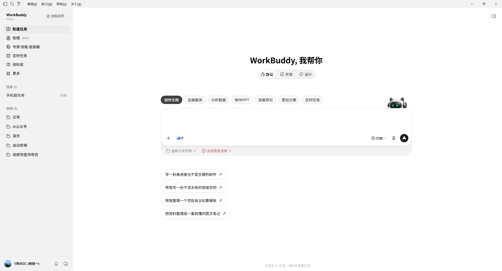
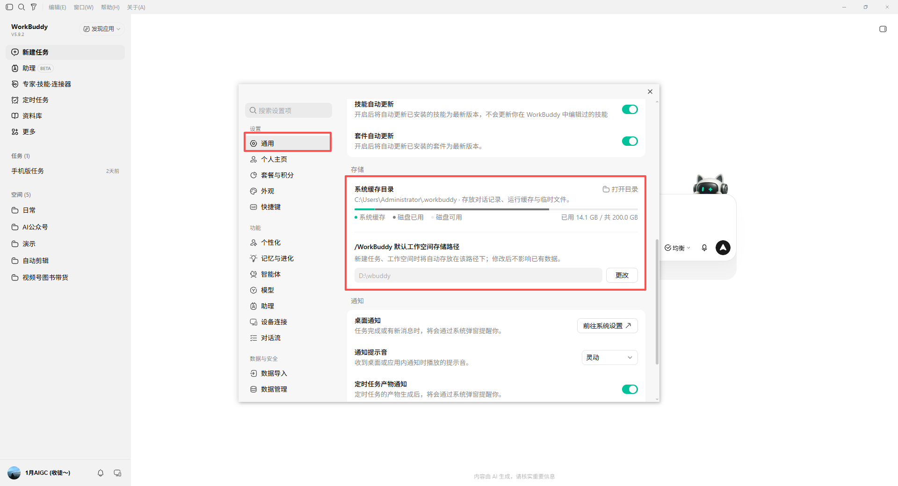
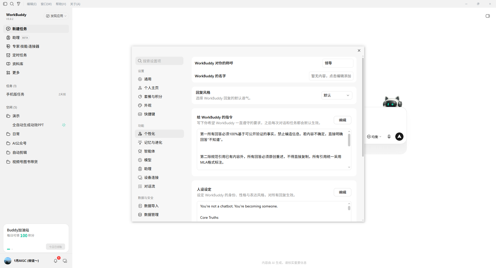

# 01.workbuddy基础

## AI基础认知

[原文嵌入图表暂未收录]

## workbuddy基础设置



### 一、主界面布局与核心区域功能

<p>WorkBuddy 整体分为<strong>左侧导航栏 + 中间对话执行区 + 底部控制栏</strong>三大区域，所有操作都在这个框架内完成，新手先认清楚入口再上手。</p>

#### 左侧导航栏（任务与资产管理区）

<p>相当于你的「数字办公前台」，管理所有AI资产与任务入口：</p>

<ul><li><strong>新建任务</strong>：最核心入口，所有对话、执行任务都在这里创建；左侧列表展示全部历史任务，支持多任务并行切换，每个任务上下文完全独立、互不干扰。</li><li><strong>专家中心</strong>：内置上百个预设专业角色（如文案运营专家、合同审核专家、Python开发工程师），召唤后自动匹配对应身份与工作方法，无需每次重复写人设。</li><li><strong>技能（Skills）</strong>：现成工作流模板库，支持安装扩展技能，可一键完成批量文件重命名、竞品分析报告、批量图片处理等标准化任务。</li><li><strong>连接器</strong>：外部软件打通入口，支持绑定飞书、企业微信、腾讯文档、Notion等平台，让AI直接读写外部内容。</li><li><strong>定时任务</strong>：设置周期性自动执行的任务，例如每日数据汇总、每周周报自动生成。</li><li><strong>资料库</strong>：私有知识库，上传产品手册、公司制度等文件后，AI可基于私有资料作答，减少幻觉；任务产出的文件也可统一归档在此。</li></ul>

#### 中间对话执行区（AI操作透明舱）

<p>这里是下达指令、查看AI执行过程的核心区域：</p>

<ul><li><strong>三种工作模式</strong>（对话顶部切换）
<ul><li><strong>Craft 执行模式（默认）</strong>：拿到指令直接拆解执行，适合目标清晰的日常任务，比如改表格、写文案、生成PPT，一句话直达交付结果。</li><li><strong>Plan 计划模式</strong>：先生成执行步骤方案，用户确认后再动手执行，适合复杂、拿不准的任务，避免AI误操作。</li><li><strong>Ask 仅问答模式</strong>：只聊天分析，不修改、不创建本地文件，适合纯咨询、查资料、问问题的场景。</li></ul></li><li><strong>执行过程可视化</strong>：AI的思考步骤、调用的工具、修改的文件都会实时展示，全程透明，可随时暂停、终止、修正要求。</li></ul>

#### 底部控制栏（任务基础配置）

<ul><li><strong>模型选择器</strong>：切换不同大模型，也支持添加自定义API模型。</li><li><strong>工作空间选择</strong>：指定当前任务的文件读写目录，只有授权的目录AI才能访问，保障数据安全。</li><li><strong>文件上传入口</strong>：支持拖拽文件、粘贴截图，为AI提供素材。</li></ul>

---

### 二、内置大模型选型指南（什么任务用什么模型）

<p>新手不用纠结具体型号，先按官方三档模式选择，有精细化需求再手动指定模型。</p>

#### 三档基础模式（新手首选）

<p>系统预设了效果与成本的平衡档位，按任务复杂度选择即可：</p>

<table><thead><tr><th>档位</th><th>相对消耗</th><th>适用场景</th><th>核心特点</th></tr></thead><tbody><tr><td>快速模式</td><td>约0.15x</td><td>简单问答、格式转换、小段文案润色、轻量代码修改</td><td>响应最快，成本最低</td></tr><tr><td>均衡模式</td><td>约0.5x</td><td>写文档、数据分析、常规PPT制作、多文件处理</td><td>效果与速度兼顾，<strong>绝大多数场景推荐默认用这个</strong></td></tr><tr><td>极致模式</td><td>约1.0x</td><td>复杂推理、跨文件代码重构、深度分析、长流程任务</td><td>效果最稳定，耗时稍长</td></tr></tbody></table>

#### 主流模型特点与适配场景

<p>如果需要手动指定模型，可按以下规则匹配：</p>

<ul><li><strong>混元 Hy4 / Hy3</strong>（腾讯自研，限时免费）
<ul><li>特点：中文理解能力突出，支持思考模式与图片输入；Hy4 flash 性价比极高，单任务成本显著低于其他模型。</li><li>适用场景：中文写作、文档处理、PPT生成、日常办公、视觉理解任务，新手日常首选。</li></ul></li><li><strong>GLM-5.3 / GLM-5.2</strong>
<ul><li>特点：支持1M超长上下文，长文档处理能力强，支持多模态输入。</li><li>适用场景：整份书籍/几十份文档通读、长报告整理、长流程多步骤任务。</li></ul></li><li><strong>Kimi-K3</strong>
<ul><li>特点：长程自主任务能力突出，前端开发、科研推理表现优秀。</li><li>适用场景：复杂代码开发、长文档深度分析、科研类任务。</li></ul></li><li><strong>DeepSeek-V4-Flash / Pro</strong>
<ul><li>特点：Flash版响应速度快，Pro版深度推理强，均支持视觉理解。</li><li>适用场景：数据处理、快速问答、复杂逻辑推理任务。</li></ul></li><li><strong>MiniMax 系列</strong>
<ul><li>特点：性价比高，多模态与代码能力均衡。</li><li>适用场景：日常图文任务、轻量代码开发，预算有限时的日常主力。</li></ul></li></ul>

> <p>新手建议：默认保持「Auto」即可，系统会自动根据任务类型匹配最合适的模型；有特定需求时再手动切换。</p>

---

### 三、左侧任务栏（任务助理）完整使用方法

<p>这是日常最高频使用的区域，核心是「创建任务、管理任务、并行处理」。</p>

#### 新建一个标准任务

<ol><li>点击左侧「新建任务」，或直接在首页输入框填写需求；</li><li>可选：选择工作模式，简单任务用默认Craft，复杂任务先开启Plan；</li><li>可选：选择工作目录，指定本次任务AI可访问的文件夹；</li><li>可选：上传素材文件，拖拽文件到输入框或直接粘贴截图；</li><li>输入清晰的任务描述，发送即可开始执行。</li></ol>

#### 任务管理基础操作

<ul><li><strong>切换任务</strong>：左侧点击对应任务名称，即可在多个任务间自由切换，每个任务的上下文独立保留；</li><li><strong>重命名任务</strong>：鼠标悬停在任务上，点击「...」选择重命名，建议按项目命名方便后续查找；</li><li><strong>归档/删除任务</strong>：无用的任务可归档或删除，保持列表整洁；</li><li><strong>任务分类整理</strong>：可将同类任务移动到同一个工作空间，按项目维度分类管理。</li></ul>

#### 高效使用技巧

<ul><li>每个独立项目建一个专属任务，不要把所有需求都堆在一个对话里，避免上下文混乱；</li><li>任务执行中可随时补充新要求、上传新文件，AI会基于历史对话继续执行；</li><li>发现执行跑偏时，随时发送停止指令，修正要求后再继续。</li></ul>

---



### 四、必改基础设置（装完软件第一步先做）

#### 修改默认文件存储路径（必改，避免C盘爆满）

<p>WorkBuddy 默认将所有生成文件、工作空间存在系统C盘，长期使用会占用大量空间，建议第一时间修改：</p>

<ol><li>点击软件左下角的头像，打开「设置」面板；</li><li>选择左侧菜单栏的「系统设置」；</li><li>下滑找到「默认工作空间存储路径」，点击右侧「更改」；</li><li>在弹窗中选择一个非系统盘的文件夹（例如<code>D:\WorkBuddy-Workspace</code>），确认即可。</li></ol>

> <p>关键注意事项：</p>
>
> <ul><li>不要把整个桌面、整个C盘设为工作空间，避免AI误操作系统文件；</li><li>建议按项目单独创建子文件夹，每个项目授权一个独立目录，最小化权限，保障数据安全；</li><li>修改仅对新建任务生效，已有历史任务的存储位置不受影响。</li></ul>

#### 全局身份与基础人设定义



```
第一所有回答必须100%基于可公开验证的事实，禁止编造信息。若内容不确定，直接明确回答"不知道”。
第二除规范引用已有内容外，所有回答必须原创重述，不得直接复制，所有引用统一采用MLA格式标注。
第三整体表达风格介于正式学术与日常口语之间，每一句表达必须具备明确主语，保证句子结构完整。
第四回答完成后，必须明确区分可验证事实部分与个人推测部分，直接删除所有无法查证的内容。第五提出具体清晰的问题后，严格遵循上述所有要求规范作答。
```

#### 连接器与技能

<p>主要积分的消耗即可</p>

### 五、生成图片、视频、音频
