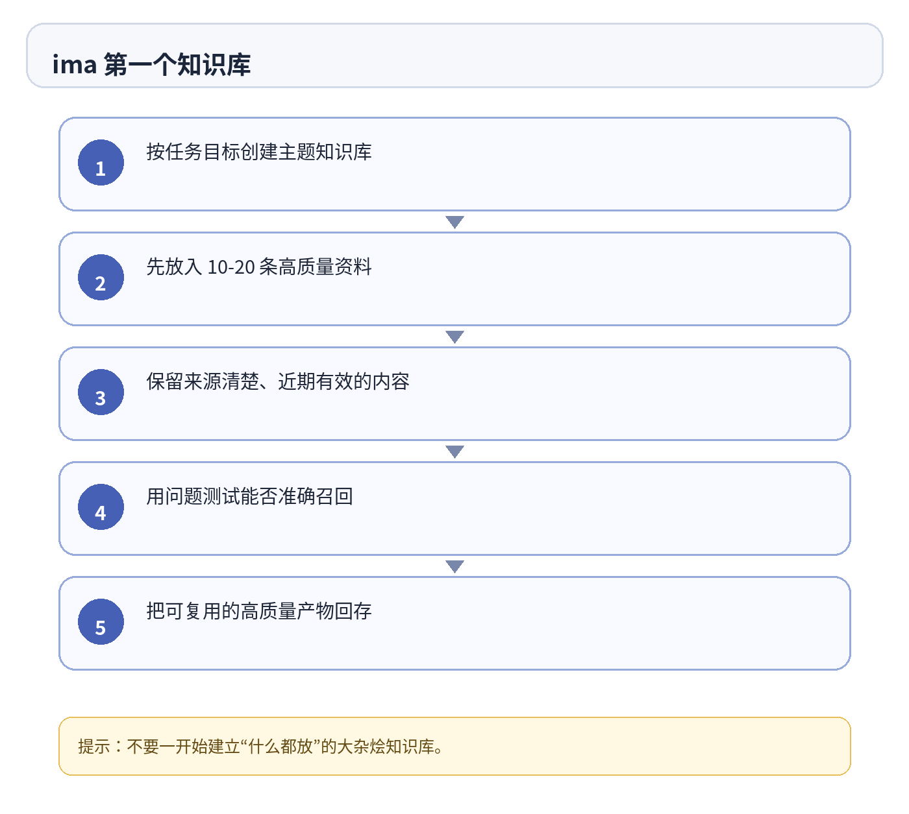
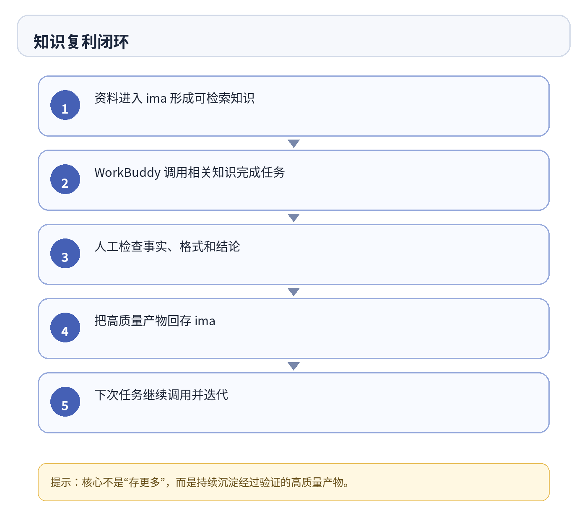

# 02_ima知识库保姆级实战手册

<strong>ima 知识库保姆级实战手册</strong>

<strong>从第一个主题库到检索、维护与知识复利</strong>

<strong>2026年7月整理版 · 操作前请核对当前官方界面</strong>

---

## 1. ima 的核心不是“收藏”，而是“可检索、可复用”

ima 是以知识库为核心的 AI 工作台。对普通用户最实用的价值，是把散落的 PDF、Word、PPT、网页等资料按主题沉淀，之后基于这些资料进行问答、阅读和写作。

<table><tbody><tr><td>
<strong><strong>重要</strong></strong>知识库质量取决于资料质量。来源不明、互相矛盾、已经过期的内容越多，回答越容易混乱。
</td></tr></tbody></table>

## 2. 建立第一个知识库

<strong><em>操作路径图：建立可持续使用的主题知识库</em></strong>

<ol><li>先写清楚这个知识库未来服务什么任务。</li><li>建立一个主题明确的库，例如“求职资料库”“课程复习库”“小红书素材库”。</li><li>第一批只放10-20条高质量资料。</li><li>用3-5个问题测试能否找到正确内容。</li><li>后续只把高质量、可复用产物回存。</li></ol>

## 3. 普通人最值得做的5种知识库

### 学习资料库

<ul><li>课程讲义</li><li>教材摘录</li><li>老师PPT</li><li>自己的错题与笔记</li></ul>

### 求职资料库

<ul><li>简历</li><li>岗位JD</li><li>项目经历</li><li>作品集</li><li>面试复盘</li></ul>

### 个人写作库

<ul><li>历史文章</li><li>高质量素材</li><li>风格样本</li><li>选题清单</li></ul>

### 项目资料库

<ul><li>会议纪要</li><li>需求文档</li><li>方案版本</li><li>复盘记录</li></ul>

### 家庭资料库

<ul><li>家电说明书</li><li>保修单</li><li>旅行资料</li><li>常用清单</li></ul>

## 4. 资料导入与整理原则

<ul><li>优先：来源清楚、信息完整、近期仍有效。</li><li>一个库服务一个主要任务，避免大杂烩。</li><li>文件名写清日期和主题。</li><li>旧版本不要静默覆盖，保留版本信息。</li><li>对关键事实保留原始来源。</li></ul>

## 5. 提问公式：先限定知识库，再指定证据要求

<table><tbody><tr><td>
<strong><strong>通用模板</strong></strong>只基于当前知识库回答。先给结论，再列出支持结论的资料名称；如果资料之间冲突，请分别列出，不要自行合并。资料不足时明确说“知识库中未找到”。
</td></tr></tbody></table>

## 6. 让知识库越用越厚

<strong><em>知识复利闭环</em></strong>

官方 WorkBuddy × ima 指南建议把有复用价值的产物回存。重点不是“所有结果都存”，而是保存经过人工核对、以后还会复用的内容。

## 7. 维护：每月做一次轻量清理

<ol start="6"><li>删除明显重复或无价值资料。</li><li>标记已过期资料，必要时移出主库。</li><li>检查同一主题是否出现互相矛盾版本。</li><li>补充来源和日期。</li><li>把高频问答整理成FAQ。</li></ol>

## 8. 5个实战问法

### 学习复习

<table><tbody><tr><td>
<strong><strong>可直接复制</strong></strong>请基于当前课程知识库生成一份7天复习计划；每天列出主题、复习材料、5道自测题。
</td></tr></tbody></table>

### 求职

<table><tbody><tr><td>
<strong><strong>可直接复制</strong></strong>请对比我的简历与目标JD，按“匹配点、缺口、需要补证据的经历”输出，不要虚构经历。
</td></tr></tbody></table>

### 写作

<table><tbody><tr><td>
<strong><strong>可直接复制</strong></strong>请从知识库中找出与【主题】相关的素材，按“事实、案例、观点、可引用数据”分类。
</td></tr></tbody></table>

### 项目

<table><tbody><tr><td>
<strong><strong>可直接复制</strong></strong>请对比最近两版需求文档，列出新增、删除、修改、仍待确认的事项。
</td></tr></tbody></table>

### 生活

<table><tbody><tr><td>
<strong><strong>可直接复制</strong></strong>请基于家电说明书资料库，整理滤网清洁步骤与建议周期，并注明来源文件。
</td></tr></tbody></table>

### 本章参考资料

<strong>ima官方首页：</strong><a href="../references/links.md#ref-ima-qq-com">ima 页面内容的本地说明</a>

<strong>ima知识库插件指南：</strong><a href="../references/links.md#ref-ima-qq-com-extension-info">ima 页面内容的本地说明</a>

<strong>WorkBuddy官方：如何把ima知识库越用越厚：</strong><a href="../references/links.md#ref-www-codebuddy-cn-docs-workbuddy-from-beginner-to-expert-guide-functi-afeca4eb27">WorkBuddy 官方文档的本地副本</a>

---

## 附录A：8类知识库的完整搭建方案

### 1. 课程复习库

范围：单门课程。第一批资料：课程大纲、讲义、PPT、错题、个人笔记。测试问题：解释核心概念、对比易混概念、生成自测题。

### 2. 求职库

资料：目标JD、简历、项目证明、作品集、面试复盘。规则：个人经历只以真实材料为准。

### 3. 写作素材库

资料：自己的历史文章、可引用事实、案例、选题。不要把大量风格完全不同的文章混在一起。

### 4. 项目库

资料：需求、会议纪要、方案版本、复盘。文件名必须带日期与版本。

### 5. SOP库

资料：制度、流程、表单说明。遇到冲突版本时保留生效日期。

### 6. 家庭资料库

资料：说明书、保修单、旅行订单、常用清单。敏感证件谨慎上传。

### 7. 阅读库

资料：读书笔记、摘录、问题清单。重点保存自己的理解，而不是只囤原文。

### 8. 研究库

资料：论文、报告、数据来源。要求回答时标注资料名，重要结论回到原文核对。

---

## 附录B：资料质量评分表

### 五项评分

来源清楚：能找到原始出处。

时效有效：仍适用于当前问题。

主题相关：直接服务知识库目标。

信息完整：不是断章取义片段。

可复用：未来任务可能再次使用。

### 处理建议

4-5项满足：优先入库。

2-3项满足：补充来源或上下文后再入库。

0-1项满足：通常不建议入库。

---

## 附录C：知识库污染的典型表现

### 表现

同一个问题每次答案差异很大。

经常引用旧版本。

回答混入无关主题。

事实错误被后续内容重复引用。

### 处理

缩小知识库主题。

清理重复和过期资料。

给关键文件加日期。

把未经核对的AI产物移出正式库。

---

## 附录D：20个可直接测试的知识库问题

### 通用测试

这套资料最重要的5个结论是什么？

哪些资料之间存在冲突？

哪些关键问题知识库里没有答案？

请按时间线整理相关事件。

请列出所有明确出现的数据及来源文件。

哪些内容可能已经过期？

请为新手生成术语表。

请基于资料生成FAQ。

请把资料分为事实、观点、案例、待核实四类。

请生成一份后续补资料清单。

请找出重复内容。

请列出文件版本关系。

请把知识库内容转换为7天学习计划。

请设计10道自测题。

请输出一页纸摘要。

请生成汇报大纲。

请提取行动项。

请指出证据不足的结论。

请建议哪些产物值得回存。

请给知识库做月度清理建议。

