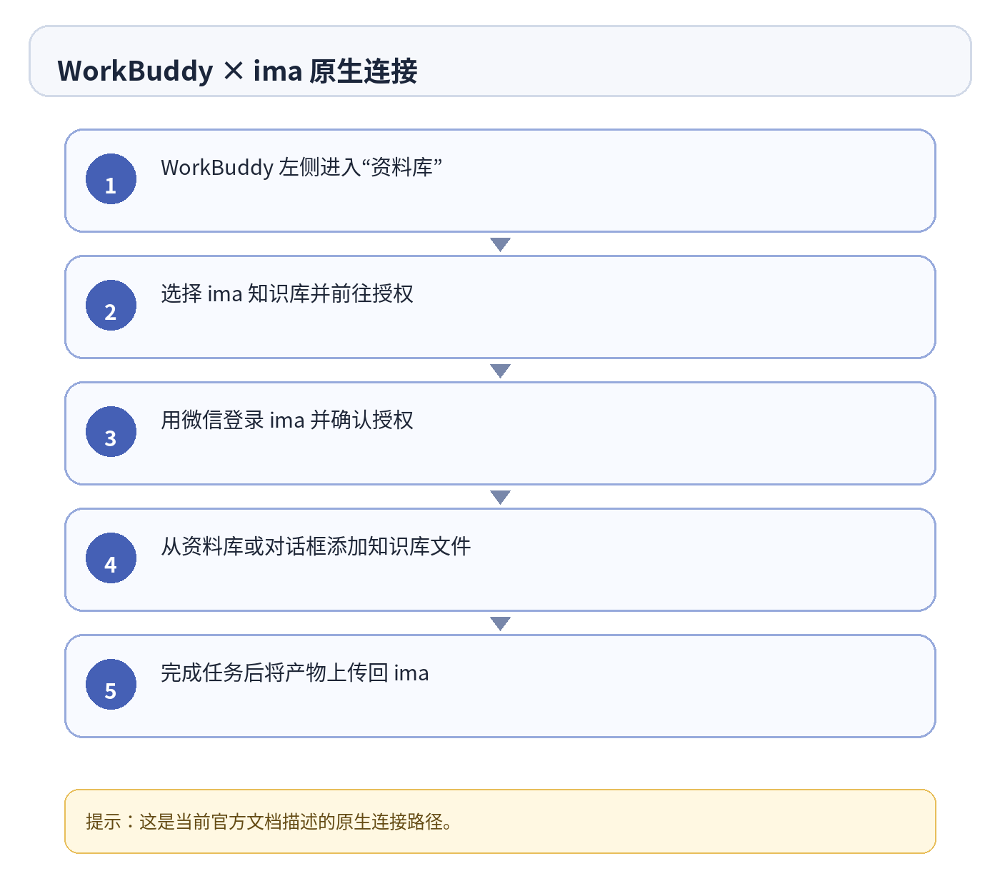
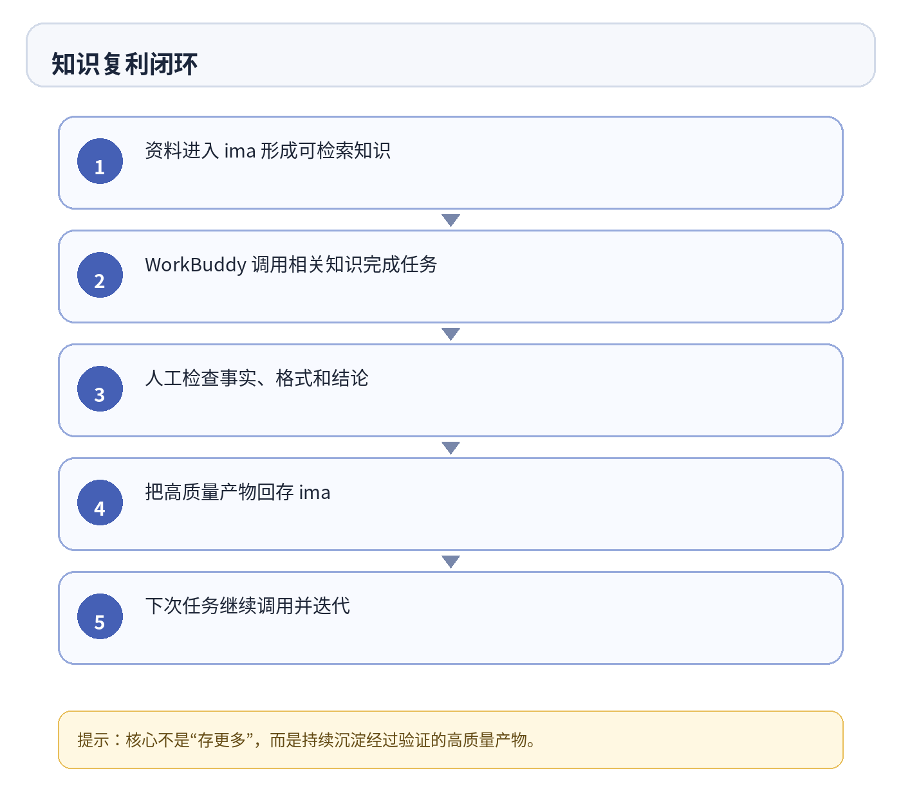

# 03_WorkBuddy×ima联动实战手册

<strong>WorkBuddy × ima 联动实战手册</strong>

<strong>从授权连接到“知识沉淀 - 调用 - 执行 - 回存”闭环</strong>

<strong>2026年7月整理版 · 操作前请核对当前官方界面</strong>

---

## 1. 两者为什么要连在一起

ima 更适合沉淀和检索知识，WorkBuddy 更适合围绕目标执行任务并生成交付文件。当前官方文档描述的原生连接支持检索/引用个人、共享和订阅知识库，并把任务产物保存回 ima。

## 2. 原生连接步骤

<strong><em>官方当前文档描述的连接路径示意</em></strong>

<ol><li>在 WorkBuddy 左侧边栏进入“资料库”。</li><li>选择 ima 知识库。</li><li>点击前往授权，用微信登录 ima 并确认授权。</li><li>授权后可查看知识库列表并选择资料。</li><li>在任务中引用资料；完成后可将产物保存回 ima。</li></ol>

<table><tbody><tr><td>
<strong><strong>权限提醒</strong></strong>授权前先看清权限范围；更换账号或不再使用时，按官方指引解除绑定。
</td></tr></tbody></table>

## 3. 两种添加知识的方法

<ul><li>从“资料库 - ima知识库”选择文件并添加到任务。</li><li>在新建任务输入框上方的上传入口中打开 ima 知识库，选择整个知识库或具体文件。</li></ul>

## 4. 最实用的8个联动场景

### 课程复习

ima存课程资料 → WorkBuddy调用讲解难点 → 生成复习笔记 → 回存ima

### 求职

ima存简历/项目/JD → WorkBuddy生成个人网站Brief或面试准备

### 自媒体

ima存历史文章/素材 → WorkBuddy提炼热点并按个人风格创作

### 项目变更

ima存历史方案/会议纪要 → WorkBuddy对比新旧需求并生成修改清单

### 周报

ima沉淀周内记录 → WorkBuddy生成周报 → 审核后回存

### 研究

ima存论文/报告 → WorkBuddy按问题检索证据并生成结构化报告

### 公司SOP

ima存制度/SOP → WorkBuddy回答问题并生成执行清单

### 旅行规划

ima存订单/攻略/地图资料 → WorkBuddy生成行程与准备清单

## 5. 完整案例：学习资料库

<ol start="6"><li>在 ima 建立“消费者行为学”主题库并导入课程资料。</li><li>在 WorkBuddy 选择该 ima 知识库相关资料。</li><li>提出具体难点，不要只说“帮我讲解”。</li><li>要求根据知识特点选择对比表、案例或图示。</li><li>把人工核对后的复习笔记回存 ima。</li></ol>

<table><tbody><tr><td>
<strong><strong>可直接复制</strong></strong>请结合ima中“消费者行为学”知识库，解释【经典条件反射】和【操作性条件反射】。我知道定义，但案例中容易混淆。请用对比表+两个生活案例说明；只基于知识库资料，缺失处明确标注。
</td></tr></tbody></table>

## 6. 完整案例：专属编辑助理

<ol start="11"><li>ima 保存历史文章、选题、素材和风格样本。</li><li>WorkBuddy 调用相关资料，先做选题和角度分析。</li><li>生成大纲前要求引用相关素材。</li><li>成稿后人工检查事实、语气和重复表达。</li><li>高质量成稿与复盘回存 ima。</li></ol>

## 7. 完整案例：项目资料闭环

<ol start="16"><li>把历史报价、旧方案、会议纪要放入项目知识库。</li><li>新需求到来后先整理变化，不直接修改方案。</li><li>调用历史资料对比新旧要求。</li><li>生成“范围内修改 / 新增需求 / 待确认”清单。</li><li>完成交付后做复盘并回存。</li></ol>

## 8. 常见失败原因

<ul><li>知识库太杂，检索到无关材料。</li><li>指令没有限定资料范围，模型混入外部常识。</li><li>资料版本冲突但没有日期。</li><li>生成后不检查，错误又被回存形成污染。</li><li>授权失效或账号切换导致找不到资料。</li></ul>

## 9. 推荐的知识复利闭环

<strong><em>WorkBuddy × ima 联动闭环</em></strong>

### 本章参考资料

<strong>WorkBuddy官方：WorkBuddy × ima 功能指引：</strong><a href="../references/links.md#ref-www-codebuddy-cn-docs-workbuddy-from-beginner-to-expert-guide-functi-93acd0b210">WorkBuddy 官方文档的本地副本</a>

<strong>官方：OPC的一天：</strong><a href="../references/links.md#ref-www-codebuddy-cn-docs-workbuddy-from-beginner-to-expert-guide-functi-c1c0a064e3">WorkBuddy 官方文档的本地副本</a>

<strong>官方：创作者攻略：</strong><a href="../references/links.md#ref-www-codebuddy-cn-docs-workbuddy-from-beginner-to-expert-guide-functi-81ed6080c3">WorkBuddy 官方文档的本地副本</a>

<strong>官方：学业助手：</strong><a href="../references/links.md#ref-www-codebuddy-cn-docs-workbuddy-from-beginner-to-expert-guide-functi-093b8ccbe9">WorkBuddy 官方文档的本地副本</a>

<strong>官方：求职展示：</strong><a href="../references/links.md#ref-www-codebuddy-cn-docs-workbuddy-from-beginner-to-expert-guide-functi-063fce0df3">WorkBuddy 官方文档的本地副本</a>

---

## 附录A：10条联动工作流模板

### 模板1：学习

ima存课程资料 → WorkBuddy检索相关章节 → 解释难点 → 生成复习笔记 → 人工核对 → 回存。

### 模板2：写作

ima存历史文章和素材 → WorkBuddy筛选相关资料 → 生成选题 → 大纲 → 成稿 → 复盘回存。

### 模板3：项目变更

ima存旧方案和会议纪要 → WorkBuddy读取新需求 → 新旧对比 → 生成变更清单 → 回存最新确认版。

### 模板4：求职

ima存简历、JD、作品 → WorkBuddy生成匹配分析和面试准备 → 人工核对真实经历。

### 模板5：SOP问答

ima存制度和流程 → WorkBuddy按问题检索 → 输出步骤和来源 → 无答案时标记。

### 模板6：周报

ima沉淀周内记录 → WorkBuddy汇总 → 人工补充结果数据 → 回存正式周报。

### 模板7：研究

ima存论文报告 → WorkBuddy按研究问题检索证据 → 生成结构化报告 → 引用来源。

### 模板8：旅行

ima存订单攻略 → WorkBuddy生成行程、清单和风险提醒。

### 模板9：内容热点

定期收集热点 → WorkBuddy匹配ima历史素材 → 生成选题建议 → 保存优质选题。

### 模板10：个人复盘

ima存日记/周记的非敏感摘要 → WorkBuddy按主题整理进展 → 生成下周计划。

---

## 附录B：授权连接后的检查清单

### 连接成功后

是否能看到正确ima账号的知识库列表？

是否能添加单个文件到任务？

是否能引用整个知识库？

生成产物后是否能看到保存回ima的入口？

### 异常时

检查是否授权了错误账号。

确认知识库本身可访问。

用单个小文件做最小测试。

查看官方当前功能指引。

---

## 附录C：回存规则 - 什么该存，什么不该存

### 建议回存

人工核对后的正式报告。

高质量FAQ。

稳定可复用模板。

项目最终确认版。

经过事实核验的复盘。

### 不建议直接回存

未经检查的AI初稿。

包含明显错误的中间结果。

重复文件。

无来源的网络片段。

敏感信息或临时垃圾内容。

---

## 附录D：联动提示词公式

### 检索型

请只基于ima中【知识库名称】检索与【问题】相关资料。先列出命中的文件，再总结；资料不足时明确说明。

### 对比型

请基于ima中的【旧版资料】与我刚添加的【新版资料】，输出新增、删除、修改、待确认。不要补充外部信息。

### 创作型

请先从ima知识库检索与【主题】相关的事实、案例和我的历史表达，再生成大纲。先不要写全文。

### 回存型

请评估当前产物是否值得回存ima，输出建议标题、目标知识库、可复用场景、仍需人工核对项。

