# 5000字WorkBuddy 保姆级学习手册：腾讯版「AI小龙虾」从入门到精通

## 资料在下面

---

<p>说实话，我接触过很多 AI 工具。 大部分都是这个模式：你打字，它回答，你再打字，它再回答。很聪明，但不干活。</p>

<p>直到我遇到 WorkBuddy，才第一次感觉——这个东西，是真的在<strong>帮我干活</strong>。</p>

<p>今天这篇文章，是我用了一段时间之后，从零开始写的一份完整使用教程。</p>

<p>不管你是完全没听说过 WorkBuddy 的小白，还是下载了却不知道怎么用的新手，看完这篇，你都能上手。</p>

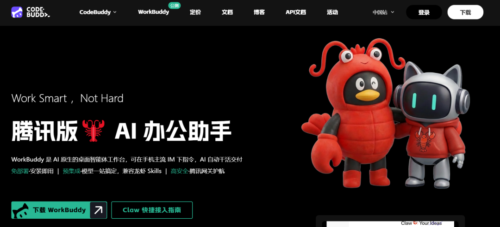

### 一、先说清楚：WorkBuddy 到底是个什么东西？

<p><strong>一句话定位：</strong></p>

> <p>WorkBuddy = 会「动手干活」的 AI 工作台，不只是聊天，还能操控你的电脑。</p>

<p>官方的说法是：<strong>全场景职场 AI 智能体桌面工作台</strong>。</p>

<p>这话听起来有点绕。用人话翻译就是：</p>

<p>你把任务交给它，它会自己规划步骤、操作电脑、处理文件，最后把结果交给你。</p>

<p><strong>它是腾讯的产品吗？</strong></p>

<p>是的。WorkBuddy 是腾讯云 CodeBuddy 团队在 2026 年推出的产品，基于开源框架 OpenClaw 构建，并做了大量面向普通用户的优化——不用懂代码，下载即用。</p>

<p><strong>它用的是什么 AI 模型？</strong></p>

<p>WorkBuddy 支持多个国内主流模型，包括：</p>

<ul><li><strong>DeepSeek：</strong>推理能力强，适合分析类任务</li><li><strong>腾讯混元：</strong>中文理解好，适合中文写作</li><li><strong>Kimi：</strong>擅长处理超长文本</li><li><strong>MiniMax：</strong>多模态能力较强</li></ul>

<p>而且这些模型都<strong>免费</strong>使用。腾讯还送 5000 积分的初始额度，够你玩很久了。</p>

<p><strong>它和 ChatG-T / Claude 有什么区别？</strong></p>

<table><thead><tr><th>对比项</th><th>WorkBuddy</th><th>ChatG-T/Claude</th></tr></thead><tbody><tr><td>能操作电脑文件</td><td>✅</td><td>❌</td></tr><tr><td>能自动化执行任务</td><td>✅</td><td>❌</td></tr><tr><td>能远程控制电脑</td><td>✅</td><td>❌</td></tr><tr><td>技能/插件生态</td><td>✅ 丰富</td><td>❌ 无</td></tr><tr><td>定时自动执行</td><td>✅</td><td>❌</td></tr><tr><td>是否免费</td><td>✅ 送积分</td><td>❌ 需付费</td></tr></tbody></table>

<p>简单说：ChatG-T 是只动嘴的顾问，WorkBuddy 是真正的员工——它会动手。</p>

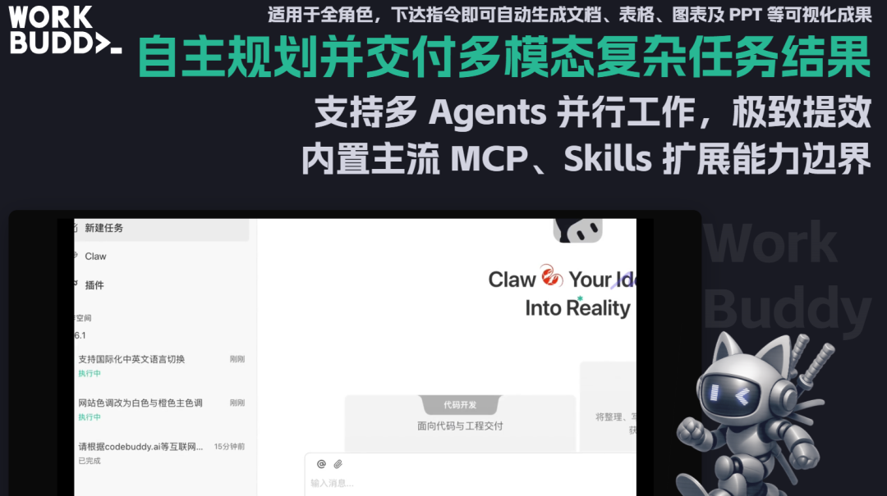

---

### 二、下载安装：5分钟搞定

#### 2.1 下载

<p>打开浏览器，访问 WorkBuddy 官方下载页：</p>

```
https://www.workbuddy.cn/events/invite?inviteCode=rx6k5dad4vvv38
```

<p>根据你的电脑选择版本：</p>

<ul><li><strong>Windows 电脑</strong>→ 下载<code>.exe</code>安装包</li><li><strong>Mac 电脑</strong>→ 下载<code>.dmg</code>安装包</li></ul>

#### 2.2 安装

<p>下载完成后，双击安装包，按照页面提示一步步点「下一步」，安装完成后桌面会出现 WorkBuddy 图标。</p>

> <p>⚠️<strong>小提示</strong>：安装前建议先安装<strong>Node.js（LTS版）</strong>和<strong>Git</strong>，这两个是运行部分插件技能的必要环境。如果只是体验基础功能，可以先不装，后续需要时再补上。</p>

#### 2.3 登录

<p>双击打开 WorkBuddy，首次使用需要登录，支持两种方式：</p>

<ol><li><strong>微信扫码登录：</strong>（推荐，最方便）</li><li><strong>账号密码登录：</strong>（需先在官网注册）</li></ol>

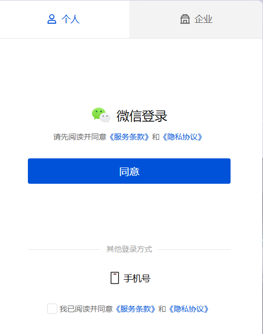

<p>登录后，你就进入了 WorkBuddy 的主界面。</p>

<p>主界面长这样：左边是功能导航栏，右边是主操作区域。整体设计很干净，不会让你觉得乱。</p>

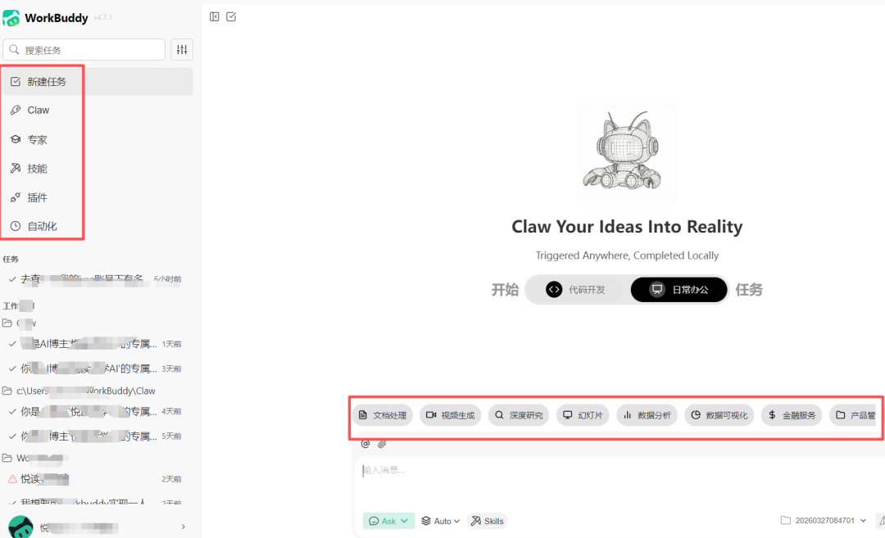

### 三、核心模块详解：WorkBuddy 的 7 大功能

<p>接下来是这篇文章最重要的部分。</p>

<p>WorkBuddy 有 7 个核心功能模块，我一个个给你讲清楚。</p>

---

#### 🗨️ 模块一：AI 对话（基础功能）

<p>这是最基本的功能，也是每个人都会用的。</p>

<p>打开 WorkBuddy，在主界面的输入框里输入你的问题，回车发送，AI 就会回答你。</p>

<p><strong>但是</strong>，WorkBuddy 的对话不只是问答——它自带三种工作模式，你可以在输入框上方切换：</p>

<table><thead><tr><th>模式</th><th>说明</th><th>适合场景</th></tr></thead><tbody><tr><td>Craft（执行模式）</td><td>收到指令直接动手做</td><td>任务明确，想要快速出结果</td></tr><tr><td>Plan（计划模式）</td><td>先出方案，确认后再执行</td><td>复杂任务，怕AI理解跑偏</td></tr><tr><td>Ask（问答模式）</td><td>只回答问题，不动手操作</td><td>只是想咨询，不需要AI直接执行</td></tr></tbody></table>

<p><strong>我的建议：</strong></p>

<p>刚开始用，先试试 Craft 模式感受一下 AI 的执行能力；</p>

<p>碰到重要任务，切换到 Plan 模式，先看方案再放行——这样出错率低很多。</p>

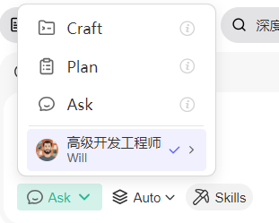

#### ✅ 模块二：任务执行（核心能力）

<p>这才是 WorkBuddy 真正让人上瘾的功能。</p>

<p>你描述一个完整的任务，它会自动拆解步骤、逐步执行、最后交付结果。</p>

<p><strong>操作步骤：</strong></p>

<ol><li>在输入框里，尽可能详细地描述你的需求</li><li>选择工作模式（Craft / Plan）</li><li>发送，等待执行</li></ol>

<p><strong>什么叫&quot;尽可能详细&quot;？</strong></p>

<p>❌ 模糊描述：「帮我整理一下文件」</p>

<p>✅ 清晰描述：「把 Downloads 文件夹里所有 .pdf 文件，移动到 D:/资料/PDFs 文件夹，按文件名里的日期重新命名为 YYYY-MM-DD-原始文件名格式」</p>

<p>说得越清楚，它做得越准。</p>

<p><strong>真实使用场景举例：</strong></p>

<ul><li>「帮我把这份 Excel 销售数据整理成图表，保存到桌面报告文件夹」</li><li>「把这篇公众号文章改成小红书风格，加上话题标签和 emoji」</li><li>「用 Python 写一个脚本，自动备份指定文件夹里的所有文件到外部硬盘」</li><li>「帮我总结这 5 份 PDF 文件的核心观点，整理成一份对比表格」</li></ul>

<p>这些任务，它都可以真正动手完成，不只是给你建议。</p>

---

#### 🔌 模块三：插件（Plugins / MCP）

<p>这里要区分清楚一个概念——<strong>插件</strong>和<strong>技能</strong>是两回事。</p>

<p>先说插件（Plugins<em>()</em>）：</p>

<p><strong>插件 = 扩展 AI 的操作能力</strong></p>

<p>插件基于 MCP<em>()</em>协议运行，安装后会在后台静默待命。当你发出需求，AI 会自动判断是否需要调用插件。</p>

<p>举个例子：</p>

<ul><li>安装了「微信公众号搜索插件」→ AI 就能帮你搜索公众号文章</li><li>安装了「腾讯地图插件」→ AI 就能帮你查路线</li><li>安装了「文件系统插件」→ AI 就能操作本地文件夹</li></ul>

<p><strong>如何安装插件：</strong></p>

<ol><li>点击左侧边栏「插件」图标</li><li>进入插件市场，浏览分类</li><li>找到需要的插件，点击「安装」</li><li>安装完成后，插件自动在后台生效，无需手动启用</li></ol>

<p>使用时你直接提需求，不用特意说&quot;用某某插件&quot;，AI 会自己判断和调用。</p>

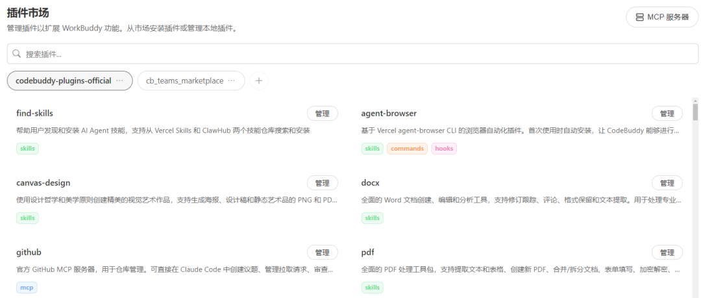

#### 📚 模块四：技能（Skills）

<p>技能（Skills）和插件很像，但本质不同：</p>

<p><strong>技能 = 给 AI 注入专业知识</strong></p>

<p>如果说插件扩展的是 AI 的<strong>能力边界</strong>，那技能扩展的是 AI 的<strong>知识深度</strong>。</p>

<table><thead><tr><th>维度</th><th>技能（Skills）</th><th>插件（Plugins）</th></tr></thead><tbody><tr><td>本质</td><td>领域专业知识说明书</td><td>外部工具调用接口</td></tr><tr><td>作用</td><td>让 AI 更懂行、更专业</td><td>让 AI 能真正干具体的事</td></tr><tr><td>类比</td><td>像 import 引入专业书籍</td><td>像安装专用外接设备</td></tr><tr><td>触发</td><td>AI 自动识别，或你指定</td><td>AI 自动判断调用</td></tr></tbody></table>

<p><strong>WorkBuddy 自带上百个预设技能，开箱即用：</strong></p>

<table><thead><tr><th>技能名</th><th>功能</th></tr></thead><tbody><tr><td>summarize</td><td>快速总结网页、PDF、视频内容</td></tr><tr><td>humanizer</td><td>去除 AI 写作痕迹，让文章更像人写的</td></tr><tr><td>github</td><td>管理 GitHub 的 PR 和 Issue</td></tr><tr><td>obsidian</td><td>操作 Obsidian 笔记库</td></tr><tr><td>feishu-doc</td><td>读取飞书文档</td></tr><tr><td>xiaohongshu</td><td>小红书内容工具</td></tr><tr><td>skill-vetter</td><td>⭐ 安全审查其他技能（必装！）</td></tr></tbody></table>

<p><strong>如何安装社区技能：</strong></p>

<ol><li>访问官方技能市场：<code>skillhub.tencent.com</code>，或社区市场：<code>clawhub.ai</code></li><li>找到你想要的技能，复制安装指令</li><li>打开 WorkBuddy，进入「技能」面板，选择「安装技能」</li><li>粘贴指令，等待安装完成</li></ol>

<p><strong>⚠️ 安全提醒（重要！）</strong></p>

<p>安装任何社区技能前，<strong>务必先用</strong><strong><code>skill-vetter</code></strong><strong>技能做安全审查</strong>。</p>

<p>这是因为技能本质上是代码，来路不明的技能可能存在安全风险。skill-vetter 会自动扫描这些红旗信号：</p>

<ul><li>有没有异常的网络访问行为</li><li>有没有索要 API 密钥或密码</li><li>有没有访问敏感目录（如<code>~/.ssh</code>）</li></ul>

<p>遇到高风险提示，坚决不装。</p>

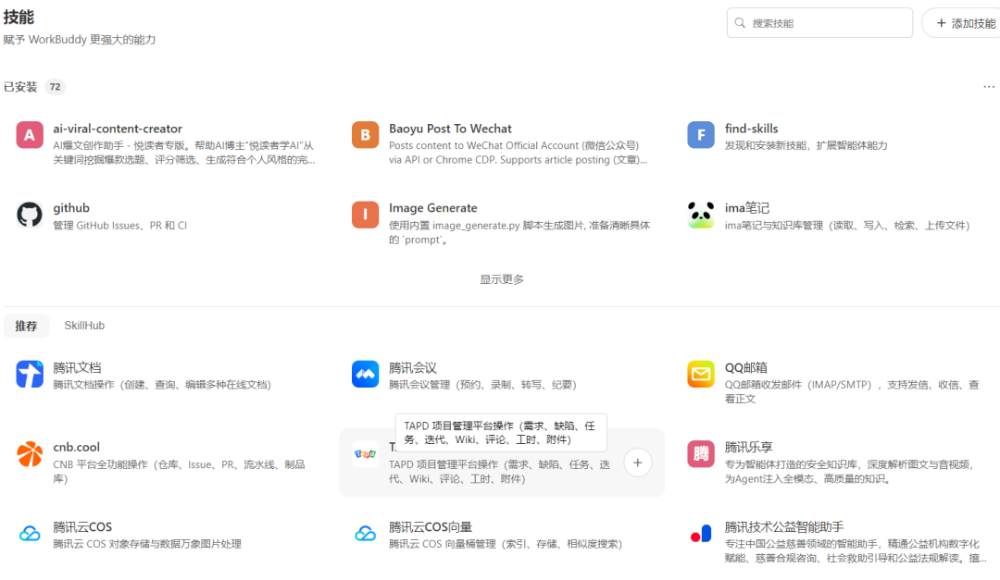

#### 👨‍💼 模块五：专家（Experts<em>()</em>）

<p>这是 WorkBuddy 在 2026 年 3 月 17 日新上线的功能，也是我个人最喜欢的模块。</p>

<p><strong>专家 = 拥有名字和人设的垂直领域 AI 专业顾问</strong></p>

<p>如果说技能和插件都是「工具」，专家则更像「人」——每一位专家都有自己的名字、专业领域和工作风格。</p>

<p>WorkBuddy 目前上线了<strong>12 大领域、141 位专家</strong>，全部按企业真实职能分工设计：</p>

<table><thead><tr><th>领域</th><th>专家数</th><th>代表能力</th></tr></thead><tbody><tr><td>市场营销</td><td>26位</td><td>社交媒体、SEO、内容创作、增长黑客</td></tr><tr><td>工程技术</td><td>21位</td><td>前后端开发、AI/ML、DevOps、架构</td></tr><tr><td>付费媒体</td><td>7位</td><td>广告投放、创意策略、追踪归因</td></tr><tr><td>设计</td><td>8位</td><td>品牌策略、UI/UX、视觉传达</td></tr><tr><td>销售</td><td>8位</td><td>大客户经营、销售教练、交易策略</td></tr><tr><td>产品</td><td>4位</td><td>行为设计、反馈分析、趋势研究</td></tr></tbody></table>

<p>而且专家都有自己的名字：</p>

<ul><li><strong>小红书运营专家 Fay</strong></li><li><strong>知乎策略师 Gia</strong></li><li><strong>内容创作专家 Kai</strong></li><li><strong>社交媒体策略师 Ari</strong></li></ul>

<p><strong>如何使用专家：</strong></p>

<ol><li>在任务页面顶部，找到「专家」入口，点击进入专家中心</li><li>按领域浏览，找到你需要的专家，点击「立即召唤」</li><li>在对话框里告诉他你的需求，越具体越好</li></ol>

<p><strong>推荐指令格式：</strong></p>

> <p>「我的身份 + 我的目标 + 具体问题 + 希望的输出格式」</p>

<p>比如这样：</p>

> <p>「我是一个做 AI 工具科普的公众号博主，本周想写一篇对比文章。帮我分析目前 5 款主流 AI 写作工具的差异，生成一份对比表格，文字简洁，适合公众号排版。」</p>

<p>专家模式的核心优势是：<strong>它不是通用 AI 在泛泛而谈，而是懂行的人在认真回答你的专业问题。</strong></p>

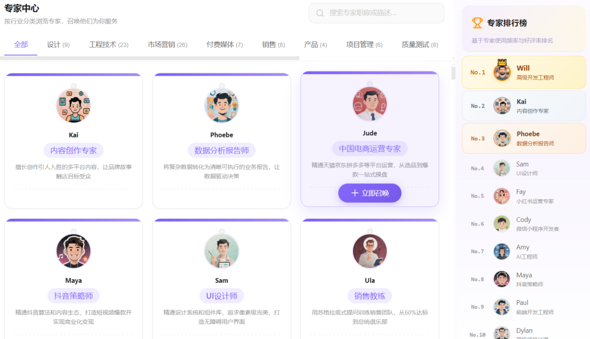

<p>关于如何调用专家，可参考<a href="../references/links.md#ref-wechat-ai-team">一人公司≠一个人死磕！我用141个AI员工，搭了一支24小时不打烊的顶配团队</a></p>

---

#### ⏰ 模块六：自动化（Automations）

<p>这是让 WorkBuddy 从「效率工具」升级为「自动化系统」的关键功能。</p>

<p><strong>自动化 = 给任务设一个定时器，让它自动执行</strong></p>

<p>你可以设置定期任务，WorkBuddy 会在指定时间自动运行，结果完成后还能推送到企业微信。</p>

<p><strong>操作步骤：</strong></p>

<ol><li>在左侧导航找到「自动化」模块</li><li>点击「新建自动化」</li></ol>

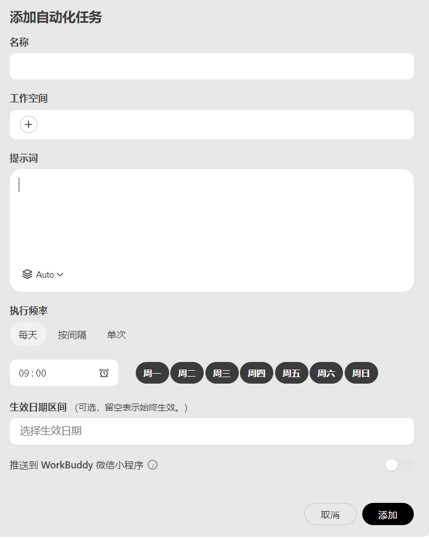

<ol><li>填写任务内容（和正常任务描述一样）</li><li>设置触发条件：
<ul><li><strong>定时触发：选择执行时间（每天/每周/自定义时间）</strong></li><li><strong>单次触发：设置一个具体日期时间，只执行一次</strong></li></ul></li><li>配置通知（可以推送到企业微信）</li><li>保存，自动化就生效了</li></ol>

<p><strong>真实使用场景：</strong></p>

<ul><li>每天早上 9 点自动抓取行业热点，整理成摘要推送到企业微信</li><li>每周五下午 5 点自动生成本周工作总结</li><li>每天晚上 11 点自动备份今天新建的文件</li></ul>

<p>设置好之后，这些事情就从你的待办列表里消失了——机器会帮你记。</p>

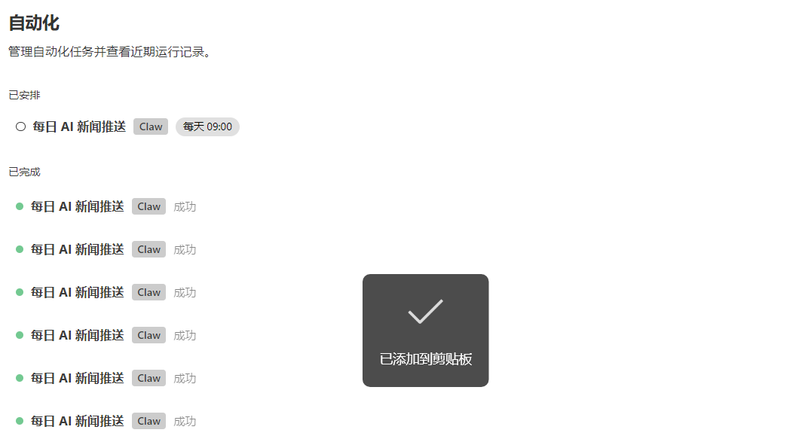

#### 📱 模块七：Claw 远程控制（微信 / 企微接入）

<p>这是 WorkBuddy 最&quot;黑科技&quot;的功能，也是最多人惊呼&quot;这也能做到？&quot;的功能。</p>

<p><strong>Claw 远程控制 = 用手机微信，远程指挥办公室的电脑干活</strong></p>

<p>你人在外面，电脑在办公室。发一条微信，电脑自动执行任务。</p>

<p><strong>配置步骤：</strong></p>

<ol><li>在 WorkBuddy 设置中，找到「连接」或「Claw 接入」模块</li><li>选择接入方式：
<ul><li><strong>微信客服号接入：（支持个人用户）</strong></li><li><strong>企业微信接入：（适合企业/团队用户）</strong></li></ul></li><li>按提示完成扫码授权</li><li>配置好之后，你在微信里给 WorkBuddy 发消息，电脑就会执行</li></ol>

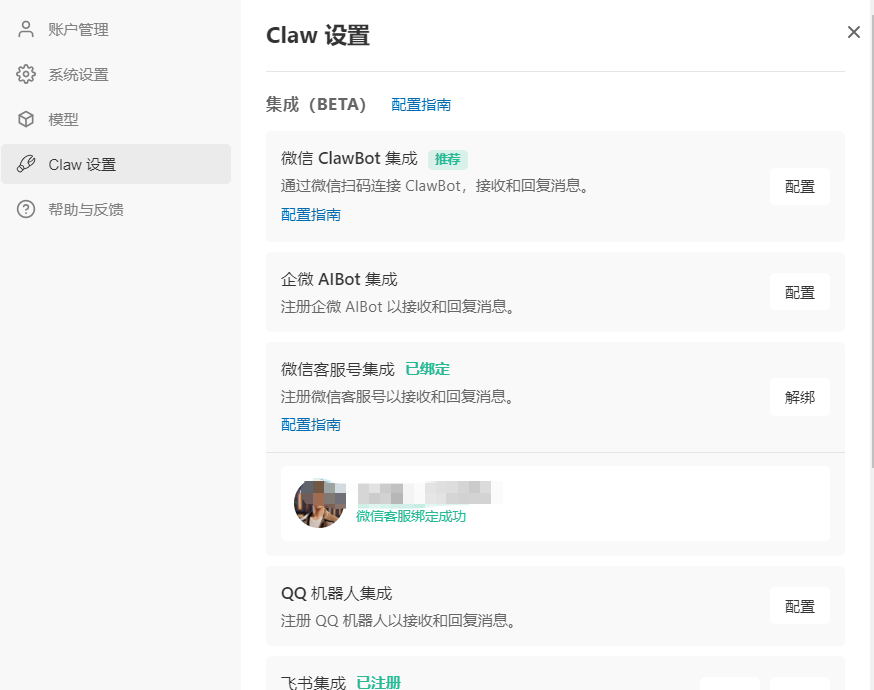

<p><strong>具体可以做什么：</strong></p>

<ul><li>「把桌面上的《周报.docx》发到我的文件传输助手」→ 文件自动发过来</li><li>「帮我查一下今天下午的会议安排」→ 自动读取日历返回</li><li>「把那份数据表格整理成图表，发我微信」→ 图表生成好直接收到</li></ul>

> <p>💡<strong>企业微信专属优化</strong>：最新版本还优化了企业微信的底层稳定性，支持断网后自动重连，IP 配置流程也简化了不少。</p>

---

### 四、三者协同：插件 + 技能 + 专家怎么一起用？

<p>很多人安装了一堆东西，但不知道怎么组合。</p>

<p>我来给你一个简单的理解框架：</p>

> <p><strong>插件是手，技能是脑，专家是人格。</strong></p>

<ul><li><strong>插件：</strong>给 AI 装上工具手，让它能操作外部系统</li><li><strong>技能：</strong>给 AI 注入专业知识，让它懂得怎么做得更好</li><li><strong>专家：</strong>给 AI 一个专业身份，让它以专家视角来回答你</li></ul>

<p>一个最佳组合案例：</p>

> <p>你是一个内容博主，想要每周自动收集行业动态并发布</p>

<p><strong>第一步</strong>（插件打底）：安装微信公众号搜索插件、网页浏览插件，让 AI 能搜集内容。</p>

<p><strong>第二步</strong>（技能提升）：启用<code>summarize</code>技能（快速总结）、<code>humanizer</code>技能（优化文笔）。</p>

<p><strong>第三步</strong>（专家加持）：召唤「内容创作专家 Kai」，让他以专业内容人的视角把信息组织成高质量推文。</p>

<p><strong>第四步</strong>（自动化收口）：把这整套流程设置成每周一自动触发，结果推送到企业微信。</p>

<p>这就是 WorkBuddy 最大的价值：<strong>不是单一功能的强大，而是各模块协同之后的整体效率提升。</strong></p>

---

### 五、进阶技巧：让 WorkBuddy 更好用

<p><strong>技巧一：任务描述要包含 4 个要素</strong></p>

<ul><li><strong>身份：</strong>你是谁，做什么工作</li><li><strong>目标：</strong>最终要达到什么效果</li><li><strong>范围：</strong>涉及哪些文件/数据/范围</li><li><strong>格式：</strong>希望输出什么样的结果</li></ul>

<p>描述越具体，结果越准，返工率越低。</p>

<p><strong>技巧二：用 Plan 模式处理重要任务</strong></p>

<p>涉及文件操作、重要数据的任务，先用 Plan 模式看方案，确认没问题再执行。这个习惯能避免很多麻烦。</p>

<p><strong>技巧三：技能组合使用</strong></p>

<p>不要单独用一个技能，试试组合：</p>

<ol><li><code>feishu-doc： 读取飞书文档</code></li><li><code>summarize 提取关键信息</code></li><li><code>humanizer 优化表达</code></li><li><code>xiaohongshu 生成平台适配版本</code></li></ol>

<p><strong>技巧四：善用追问</strong></p>

<p>做完第一步不满意，直接追问：</p>

<ul><li>「这个太长了，帮我压缩到 500 字」</li><li>「换一种更轻松的表达方式」</li><li>「把第二部分的逻辑重新梳理一下」</li></ul>

<p>WorkBuddy 支持多轮对话，你和它的互动越多，结果越好。</p>

<p><strong>技巧五：定期整理技能库</strong></p>

<p>装了一堆技能但不用，会影响 AI 的判断效率。定期进去看一眼，把用不上的技能禁用或卸载。</p>

---

### 六、常见问题 FAQ

<p><strong>Q：WorkBuddy 完全免费吗？</strong></p>

<p>基础功能免费，腾讯送 5000 积分初始额度（截至 2026 年 3 月 31 日，注册即领）。积分用完后可通过日常活跃获取，或购买额外积分。</p>

<p><strong>Q：数据安全吗？文件会上传到腾讯服务器吗？</strong></p>

<p>WorkBuddy 所有任务在本地运行，数据不出本地机器。腾讯官方承诺不收集用户的文件数据。安装第三方技能时需要谨慎，记得用 skill-vetter 先审查。</p>

<p><strong>Q：WorkBuddy 和 OpenClaw 是什么关系？</strong></p>

<p>WorkBuddy 基于开源框架 OpenClaw 构建，完全兼容 OpenClaw 的技能生态。如果你之前用过 OpenClaw，技能可以无缝迁移过来。两者最大的区别是：OpenClaw 更偏技术用户，需要一定的部署能力；WorkBuddy 面向普通用户，下载即用，无需配置。</p>

<p><strong>Q：电脑配置要求高吗？</strong></p>

<p>普通的 Windows/Mac 电脑都能运行。建议内存 8GB 以上，处理复杂任务时响应更流畅。</p>

<p><strong>Q：远程控制功能安全吗？</strong></p>

<p>安全。任务在本地执行，微信只是触发器，不传输文件内容。但建议不要用主微信号，专门用一个微信小号或企业微信号来接入，隔离风险。</p>

<p><strong>Q：技能安装失败了怎么办？</strong></p>

<p>先检查 Node.js 和 Git 是否已安装并正确配置，然后检查网络连接。如果持续失败，可以重启 WorkBuddy 再试，或查阅官方文档的报错排查章节。</p>

---

### 写在最后

<p>学了这么多 AI 工具，WorkBuddy 给我最大的感触是：</p>

<p><strong>它终于把 AI 的能力，从「回答问题」真正拓展到了「完成任务」。</strong></p>

<p>以前的 AI，是你的智囊。它能给建议，能帮你想，但最后还是你自己动手。</p>

<p>WorkBuddy 不一样。你说，它做，它交付。</p>

<p>这个转变，比任何一个单独的功能都重要。</p>

<p>当然，它现在还不完美，复杂任务偶尔会跑偏，有时候需要你追问纠正。但这个方向是对的。</p>

<p><strong>一个真正会干活的 AI，就应该是这个样子。</strong></p>

<p>去下载来试试吧。</p>

<p>有任何使用中遇到的问题、或者发现好用的技能和玩法，欢迎评论区告诉我——</p>

<p>我在这里，我们一起研究。</p>
