# 用WorkBuddy养出你的龙虾搭子！【附提示词】

## 资料在下面

<p>workbuddy资料在下面</p>

<p>雷猴啊朋友们！这是<strong>普通白领必备的龙虾教程</strong>～</p>

<p>不需要额外的电脑，<strong>1分钟装好龙虾，三招养出你的成长搭子</strong>！</p>

[原文图片暂未收录]

<p>我也帮你准备好了<strong>提示词</strong>，</p>

<p>跟着走完，<strong>你的龙虾就会越来越了解你，跟你一起成长，并且不知不觉的帮你攒下各种经验，和适合你的专属技能Skill</strong>～</p>

<p>来吧，跟你的龙虾一起变强！</p>


## <strong>安装</strong>

<p>那今天我们用到的，是专给普通白领打造的<strong>国产自研龙虾</strong>，<strong>腾讯Work Buddy</strong>。</p>

<p>官网点击下载👉<strong><a href="../references/links.md#ref-www-codebuddy-cn-work">WorkBuddy 官方文档的本地副本</a></strong></p>

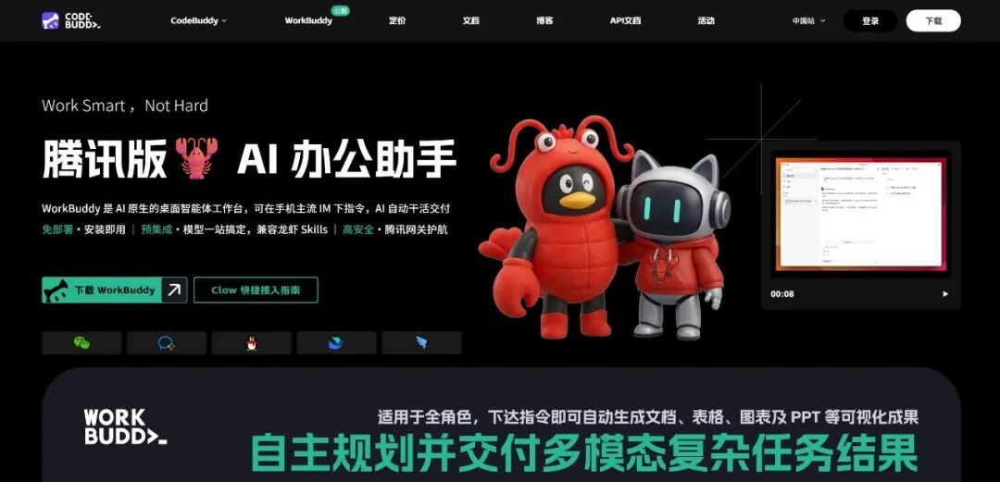

<p>安装完，双击打开软件就能用了 ～</p>

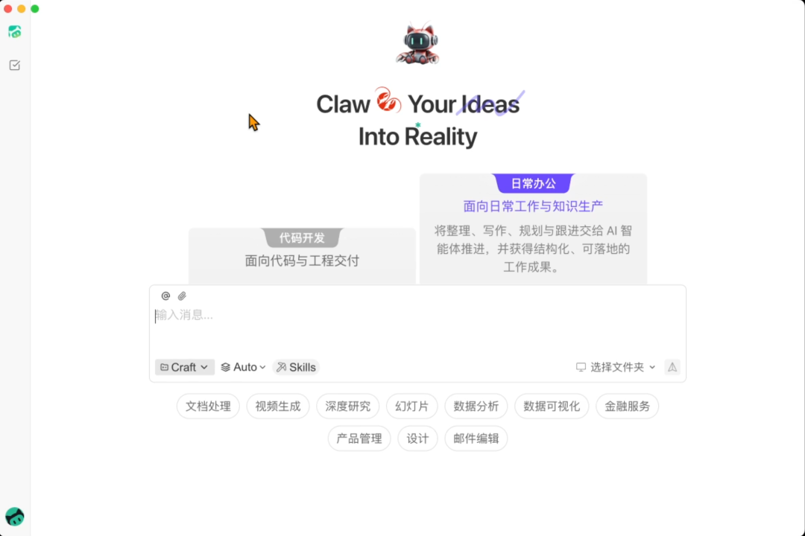

<p>最离谱的是，最新版的WorkBuddy<strong>想连上微信</strong>给龙虾发消息，<strong>只要三步！</strong></p>

<p>先点这里，</p>

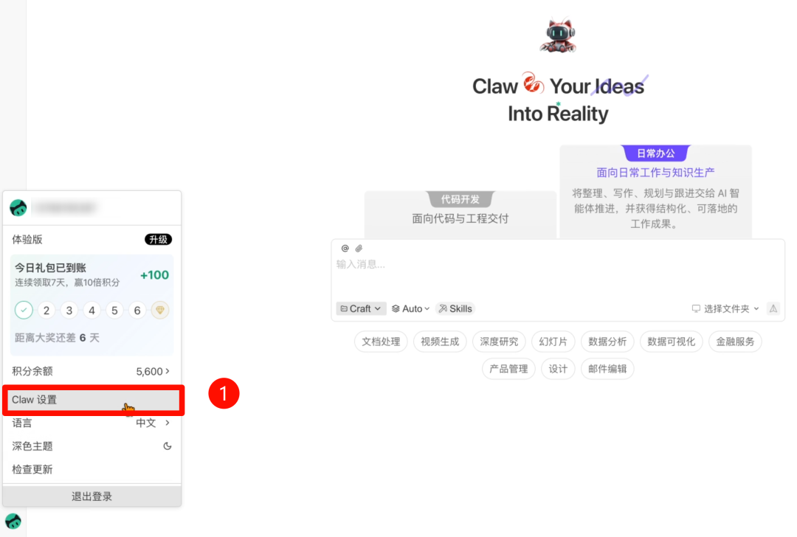

<p>再选微信clawbot，这就是<strong>最新的微信官方龙虾插件</strong>了，然后直接扫码，</p>

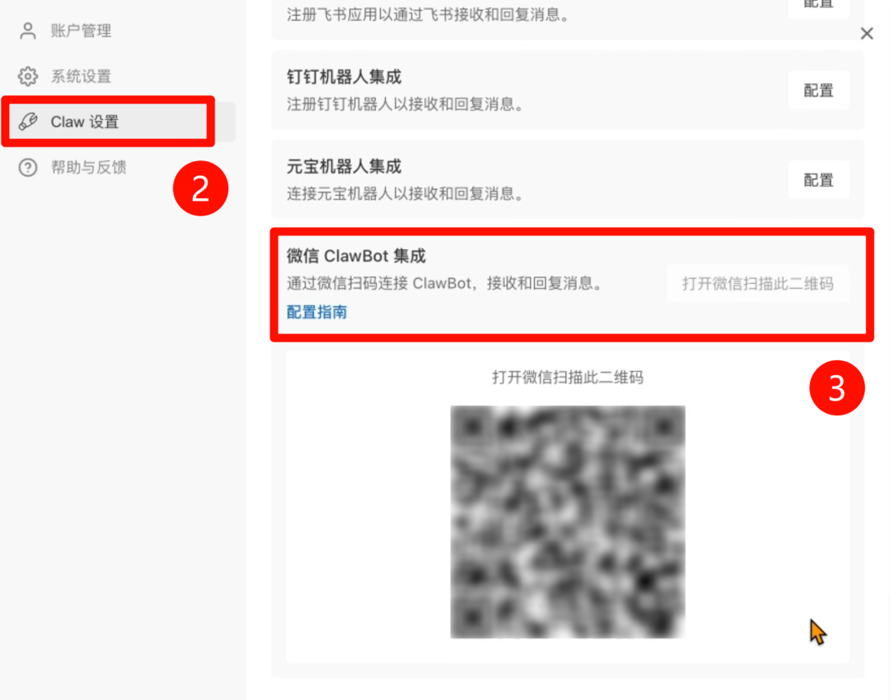

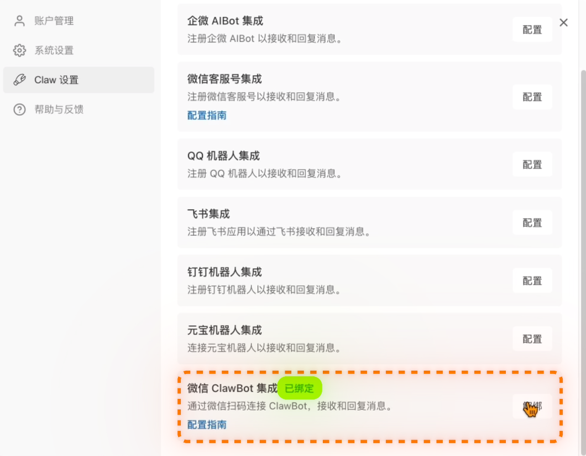

<p>你就可以直接给它发微信、发语音、甚至发图片了 ，</p>

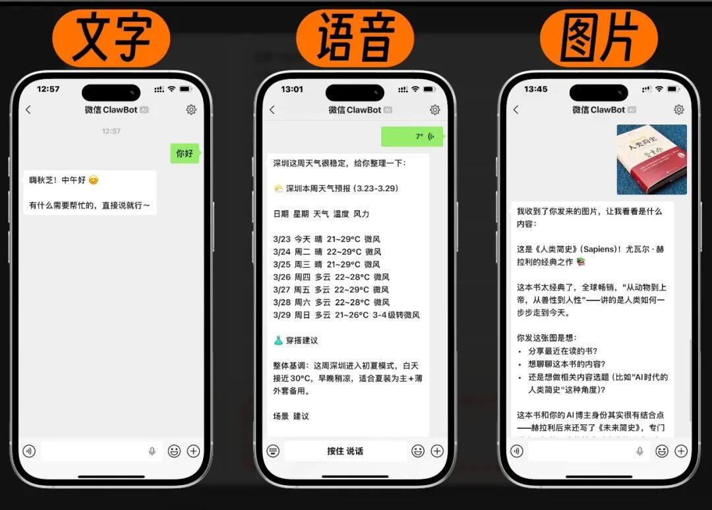

<p>它内置的国产模型也比较丰富，在聊天界面可以直接选。</p>

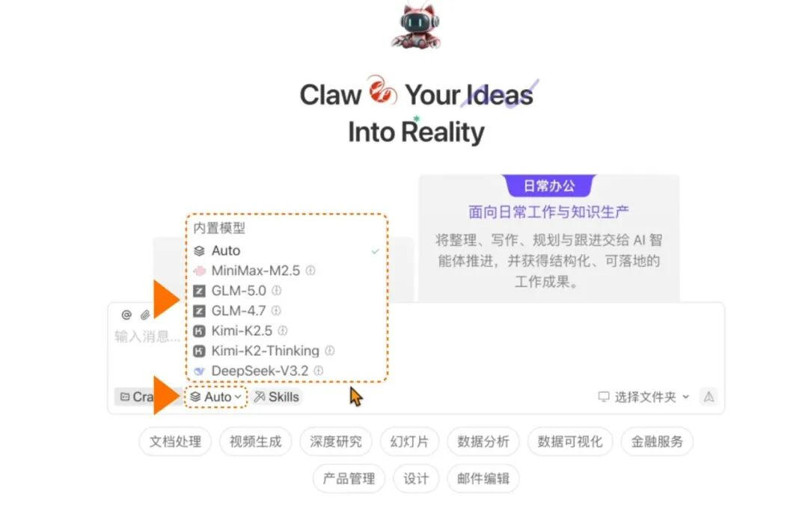

<p>我们先试一下用微信给它发消息，让它在电脑上的干活试试，</p>

```
帮我在桌面建一个我的经验文件夹，里面再帮我分好类建几个子文件夹
```

<p>诶，开始干活了！门槛很低~</p>

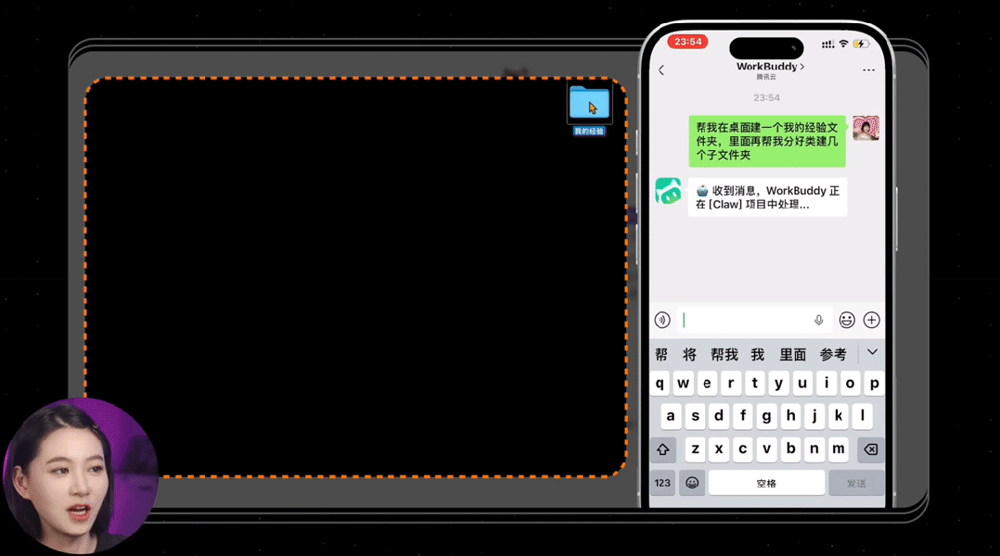

<p>而且<strong>现在注册还送 5000 credits</strong>，我用了好几天都还没用完~</p>


## <strong>用法</strong>

<p>那装好了，怎么把它养成你的成长搭子呢。一共三招，跟着做就行。</p>

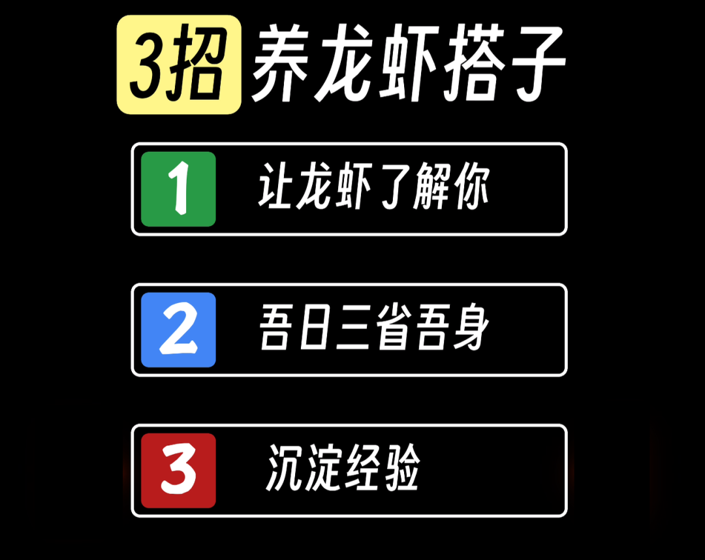

<p><strong>第一招：让龙虾了解你</strong></p>

<p>因为龙虾刚装好的时候，<strong>它对你一无所知</strong>，</p>


<p>所以第一步，<strong>你得让它了解你</strong>。</p>

<p>我准备了一个模板，大家可以参考。</p>

```
我叫小王，在杭州做运营，xxxx，今年个人成长目标是xxx，职业目标是做出xxx。
我希望你记住这个目标，在以后的协作中，都可以帮我想想这件事是不是在让我离目标更近。另外，你也可以主动给我提建议，帮助我尽快的达到目标。 把这些写进你的长期记忆里。
```

<p>它的好处是让你在低头看路，埋头干活的同时，也有一只虾在客观地帮你想着阶段性的北极星。</p>

<p>以终为始 ～</p>

<p><strong>第二招：吾日三省吾身</strong></p>

<p>那当龙虾对你有了基本了解，就可以效仿老祖宗的成长秘诀，吾日三省吾身！</p>

<p><strong>我们可以利用WorkBuddy的定时任务功能，设置早、中、晚三个任务。</strong></p>

<p>你只需要把提示词发给它，它就会自己到点自动执行。</p>

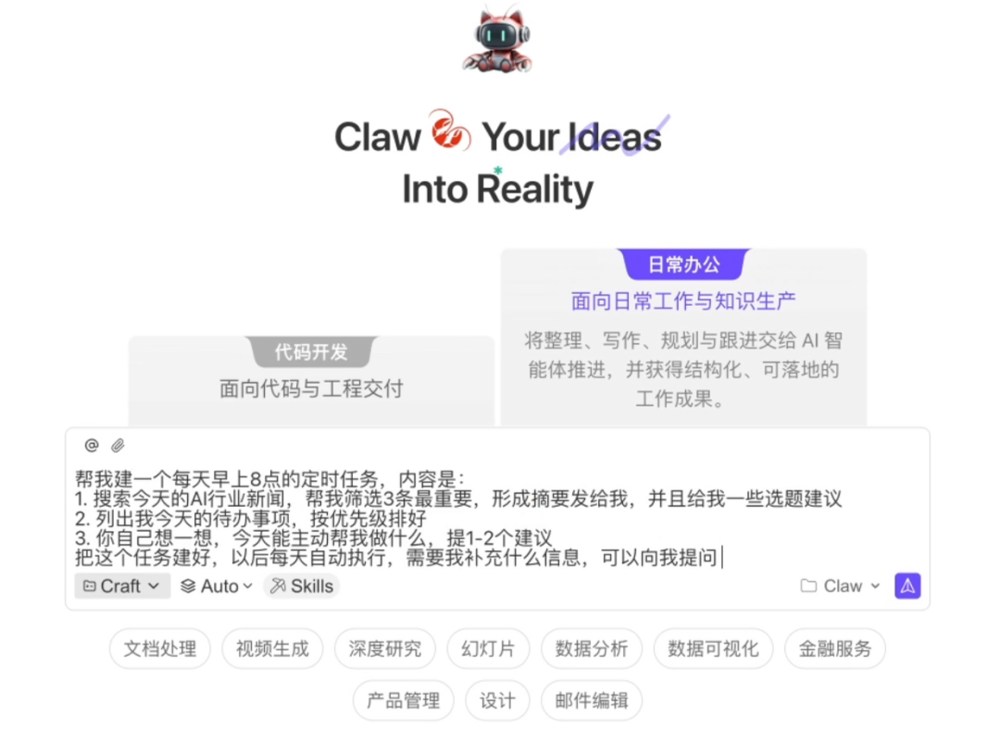

<p><strong>早上：梳理</strong></p>

<p>你可以直接把这段发给它：</p>

```
帮我建一个每天早上8点的定时任务，内容是：1. 搜索今天的AI行业新闻，帮我筛选3条最重要，形成摘要发给我，并且给我一些选题建议2. 列出我今天的待办事项，按优先级排好3. 你自己想一想，今天能主动帮我做什么，提1-2个建议把这个任务建好，以后每天自动执行，需要我补充什么信息，可以向我提问
```

<p>当然，如果你不关心AI新闻，换成股市动态、政治新闻、英语资讯、考公热点，都可以，改改第一条就好~</p>

<p>效果就是，你就像个老板一样，每天早上打开微信，就收到了助理给你整理的<strong>新闻简报、日程安排、以及它主动要为你做的事</strong>。</p>

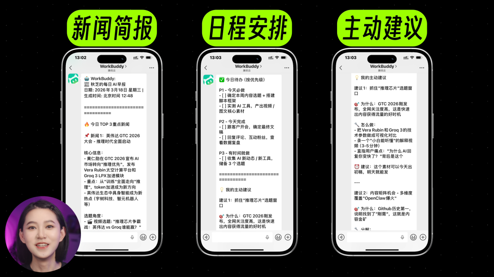

<p><strong>人人都有助理了 ～</strong></p>


<p><strong>中午：对齐</strong></p>

<p>那到了中午，龙虾还可以帮你做一次<strong>进度检查和提醒</strong>。你可以直接把这段发给它：</p>

```
再帮我建一个每天中午12点的定时任务：
回顾一下我今天早上安排的待办事项，看看完成了多少，提醒我下午还有哪些要做的。如果发现我上午效率不高，给我一点建议。
```

<p>相当于小助理又来说“秋总，您上午的工作怎么样了，下午还有个会，如果上午有卡点，要不要交给我来做”！</p>

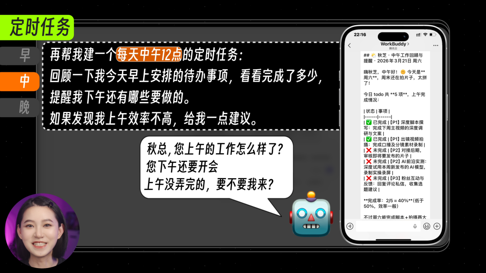

<p>Very nice！</p>

<p><strong>晚上：复盘（最关键）</strong></p>

<p>不过，晚上这一波才是精华，</p>

```
再建一个每天晚上9点半的定时任务，内容是：
1. 对我今天的任务完成情况做一个复盘，哪些完成了，哪些没完成，效率如何
2. 你自己今天在帮我做事的过程中，犯了什么错、学到了什么，给出你的成长日报
3. 根据每天我们的对话，建一个主人档案，每天我的状态、情绪怎么样、行为模式、有什么缺点，帮助我客观的理解自己4. 询问并跟我一起梳理明天要做的事，存到每日todo里，用于早上告诉我
```

<p>这一步的效果，相当于你有了一个<strong>客观的视角，每天帮你观察自己</strong>。过一个月回头看，你会清楚地看到自己的变化~</p>

<p>我自己还额外加了一个任务：每天晚上给我讲一个科幻类的睡前故事。</p>

<p>你也可以每天让它推一个儿童故事，讲给孩子听～</p>

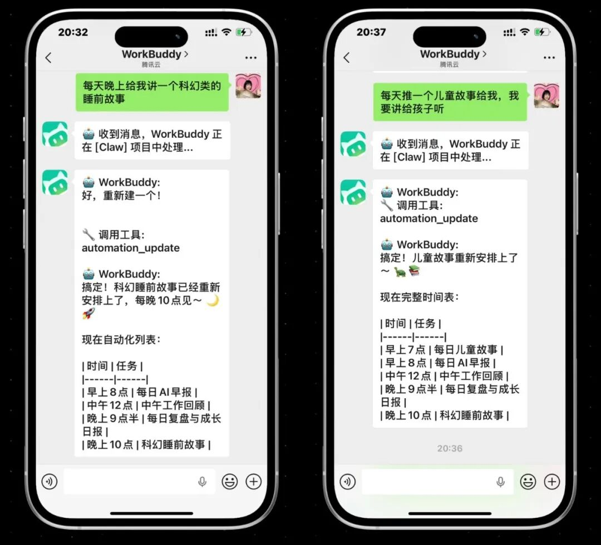

<p>那这样下来，每天早上你一打开微信就进入状态，晚上在复盘中清晰地结束一天。日积月累，你和虾进步都是肉眼可见的。</p>

<p>真的肉眼可见，因为全都存在你电脑文件夹里了~</p>

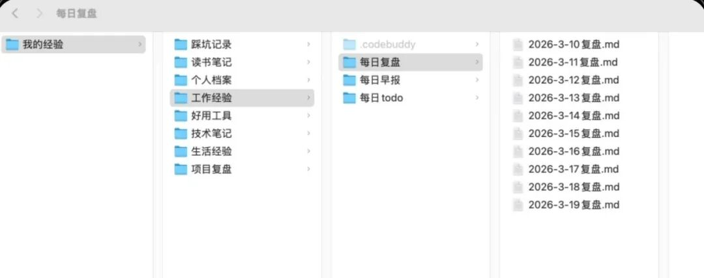

<p><strong>第三招：沉淀经验，变成技能</strong></p>

<p>第三招，也是我觉得最&quot;邪修&quot;的一招，</p>

<p><strong>让龙虾帮你把看到的、做过的，全都变成可复用的经验。</strong></p>

<p>看到好东西直接丢给它！比如你刷到一篇特别好的文章《如何高效沟通<em>()</em>》，</p>


<p>别收藏了，直接发给龙虾，然后说：</p>

```
帮我分析总结这篇文章的核心方法，沉淀成一个文档。然后做成一个skill，以后我问你沟通相关的问题，你就按这套方法给我支招。
```

<p>这样做的效果是：<strong>别人的经验，直接变成了你和龙虾的能力。</strong></p>

<p>下次你要沟通，它给你的建议就不是泛泛而谈，而是基于那篇文章里的具体方法。</p>

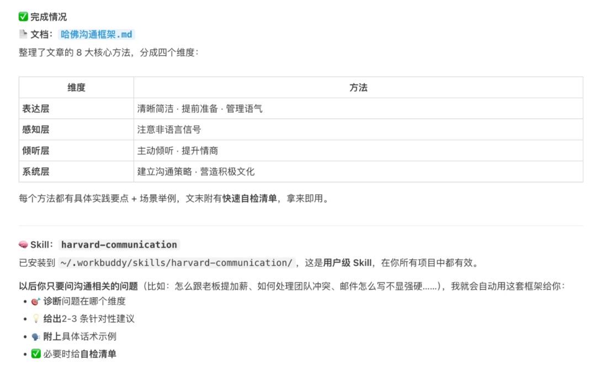

<p>以此类推，好文章、好书、好视频、好教程，看到就丢给它，<strong>你的龙虾会越来越强，你也会越来越强。</strong></p>


<p><strong>专家模式</strong></p>

<p>说到别人的经验，WorkBuddy还有个现成<strong>专家团队</strong>，</p>

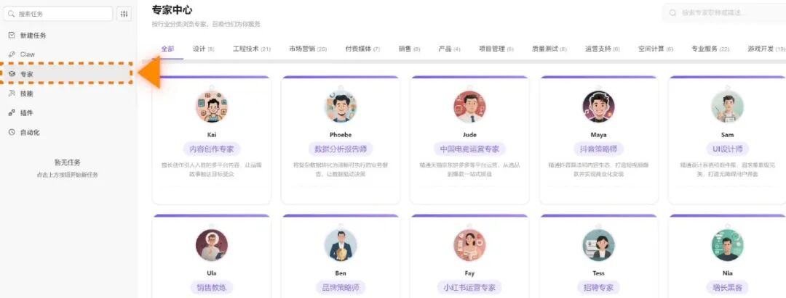

<p>据说是真的<strong>腾讯内部140多个真人大咖的实战经验封装</strong>而成 ～ 约等于让腾讯团队，用他们的SOP，帮你干活！</p>


<p>比如我们选个直播电商的专家，问它</p>

```
我做了一款国产粉扑，决定自己做直播带货，但我没有任何经验，希望你给我全套的直播的方案，包括直播话术
```

<p>你看看，它咔咔就是系统的输出，给我们平台的建议、</p>

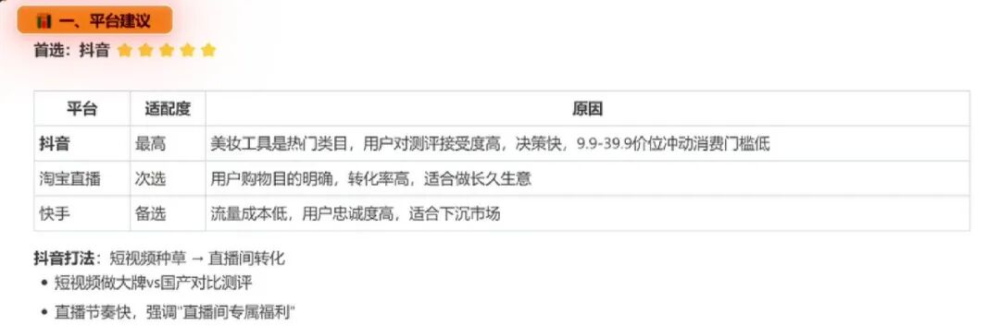

<p>人群建议、</p>

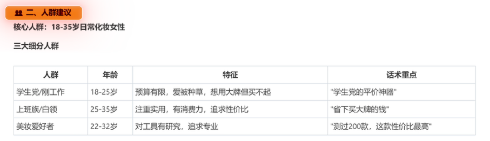

<p>价格带、</p>

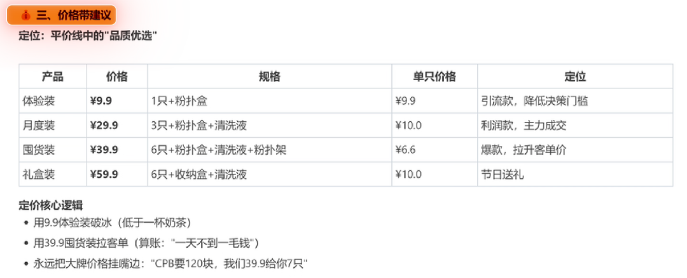

<p>人设方向，</p>

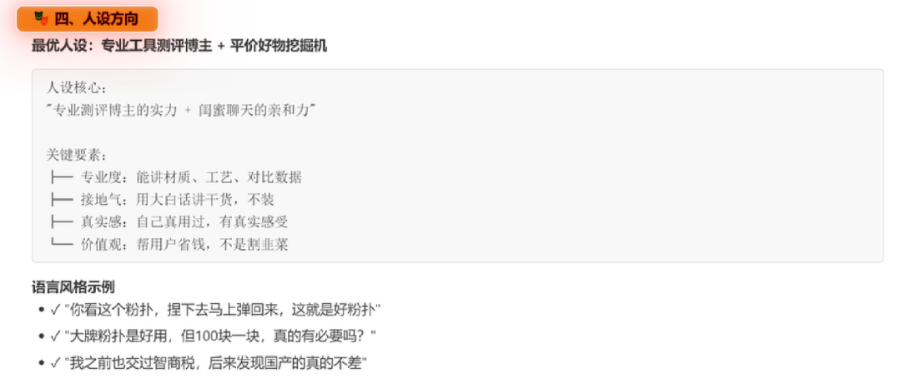

<p>还把我们粉扑的卖点12345梳理的明明白白，还有排品策略、排品节奏等等，</p>

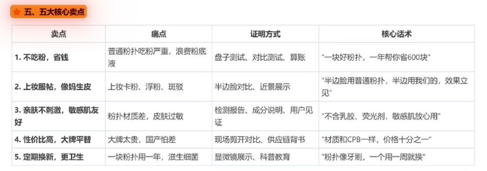

<p>实在是新手震撼！</p>


<p>而且他很冷静，告诉我们不要投流，刚开始直播一定要纯练基本功，</p>

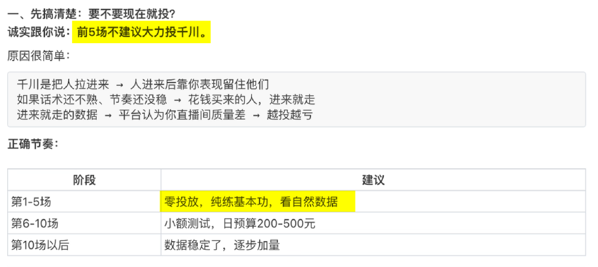

<p>完了还把千川的概念给我们梳理了一遍。</p>

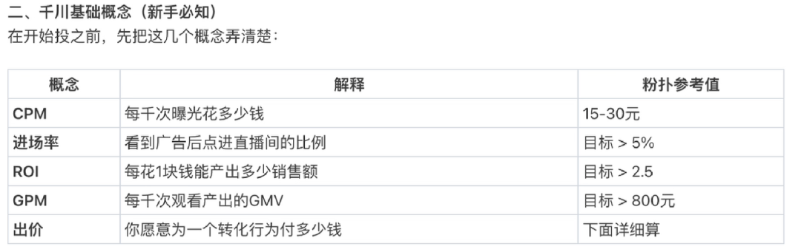

<p><strong>真的，很多商家朋友原来有这个东西，应该能走很多弯路吧~</strong></p>

<p><strong>第三招：沉淀经验</strong></p>

<p>除了吸收别人的经验，<strong>你跟龙虾一起做过的事，也会自动变成方法论。</strong></p>

<p>举个例子：你是做运营的，每次让龙虾帮你写文案，你会说&quot;这个太硬广了&quot;、“这个要这样”，“那个要那样”。</p>

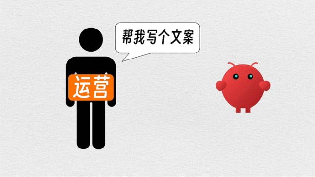

<p>那我们希望每一次的反馈，他都能记住，帮你沉淀成一个文案方法笔记本。</p>

<p>那我们可以让他<strong>永久的记住这个规则</strong></p>

```
这是一个永久的硬性要求：每次让你写运营的文案，我所对你提出的所有要求，
你看到后先不要修改，先理解这些要求，并且沉淀到我们的文案方法笔记里面去，然后每一次帮我写的时候，都要符合笔记当中的所有要求。
```

<p>时间一长，你都不用再反复说要求了，它出来的东西就会越来越接近你想要的</p>

<p><strong>不知不觉中你就攒出了自己专属的标准和SOP！巧妙建立专属skill ～</strong></p>

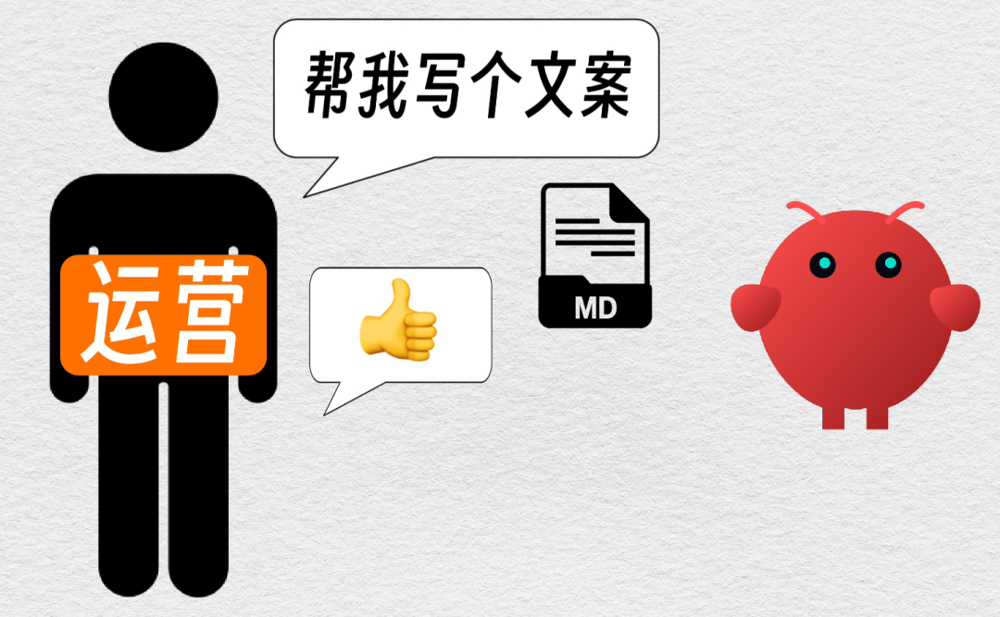


<p>好啦，朋友们，你会看到其实龙虾也不一定是神秘复杂酷炫的极客玩具,</p>

<p>对普通人来说，也会是一个<strong>了解你的目标、陪你成长、帮你复盘、把你的经验一点点攒起来的得力助手，一个WorkBuddy！</strong></p>

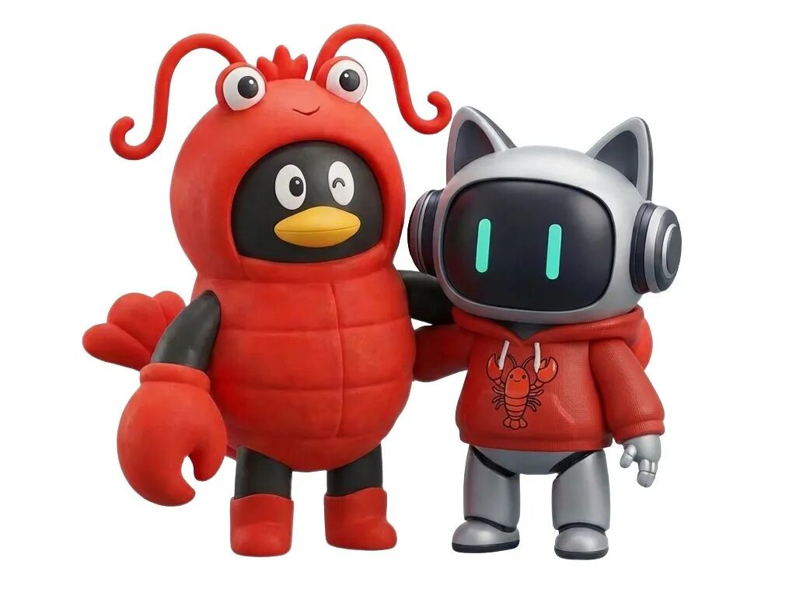

<p>反正AI变不变强我们控制不了，</p>

<p><strong>但至少，我们要在用AI的过程中，把自己变强！</strong></p>
