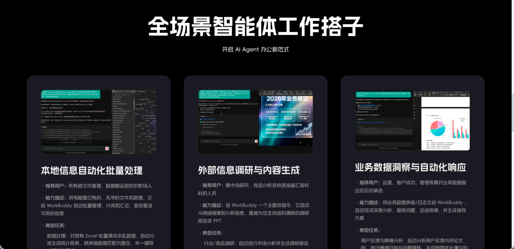
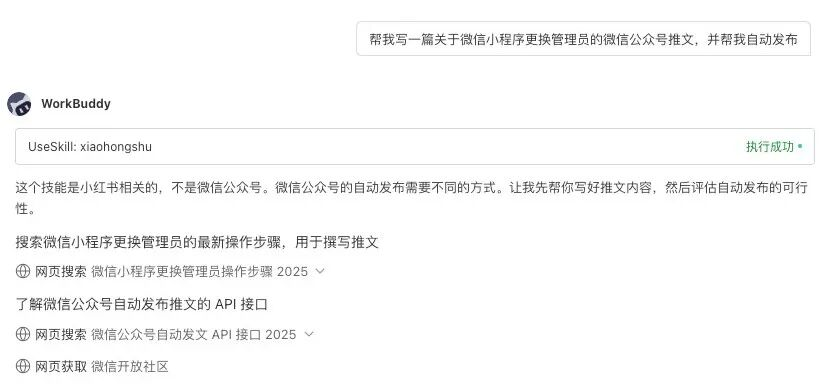
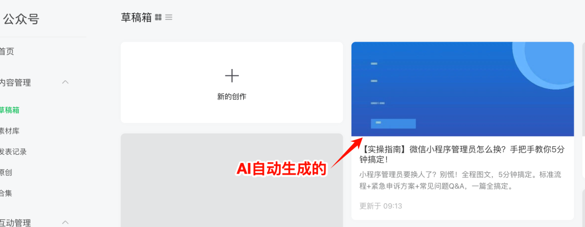

# WorkBuddy：从0到1搭建公众号自动化生成爆文保姆级教程！

## 资料在下面

---

一句话搞定公众号发文？我用 WorkBuddy（AI办公助手）试了试，结果惊到我了

[原文图片暂未收录]

最近在用一款叫 WorkBuddy（腾讯版小龙虾） 的 AI 工具处理日常工作，今天分享一个真实案例——

我只说了一句话，它帮我把公众号推文从零写到草稿入库，全程不到10分钟。

## 🧰 WorkBuddy 是什么？

WorkBuddy 是腾讯云代码助手 CodeBuddy<em>()</em>推出的全场景职场 AI 智能体桌面工作台。

和普通 AI 对话工具不一样的地方在于：你不需要一步一步告诉它怎么做，只需要用自然语言描述你想要的结果，它会自主规划任务、拆解步骤、调用工具、交付成果，像一个真正在帮你干活的同事。

支持的任务类型包括：写文档、做 PPT、分析数据、处理本地文件、调用 API……几乎覆盖了日常办公的大部分场景。

## 🎯 我提了什么需求？

就一句话：

> 
&quot;帮我写一篇关于微信小程序更换管理员的微信公众号推文，并帮我自动发布。&quot;

然后我就坐等结果了。

[原文图片暂未收录]

文章的内容质量，可以通过不断“调教”优化，也会达到甚至超过你的预期

## 🤖 WorkBuddy 是怎么做的？

#### Step 1：自动搜索资料

WorkBuddy 没有直接开始写，而是先去网上检索了微信小程序更换管理员的最新操作步骤，还顺带查了公众号自动发布的 API 接口文档。

📌 这一步保证了文章内容有据可查，不是 AI 瞎编的。

#### Step 2：生成完整推文

资料搜集完成后，WorkBuddy 自动生成了一篇结构完整的推文，包含：

<ul><li>更换前的准备事项</li><li>5步标准操作流程</li><li>紧急申诉方案（原管理员无法联系时怎么办）</li><li>6个高频问题 Q&amp;A</li><li>一张操作速查表格</li></ul>

全文约2000字，内容扎实，开箱即用。

#### Step 3：引导配置 API 权限

写完内容后，WorkBuddy 主动提示我需要提供公众号的 AppID 和 AppSecret<em>()</em>，并详细说明了在哪里找到这两个配置项。

[原文图片暂未收录]

---

由于新旧版本不一样，（AI给的路径不正确）我附上操作路径：

1、打开「微信开发者平台<em>()</em>」左上角选择「公众号」

2、在「开发密钥」区，在AppSecret  在后点击启动，管理员扫码自动生成，生成的 AppSecret 一定要保存，这个是自动发文章的重要凭证。

[原文图片暂未收录]

[原文图片暂未收录]

[原文图片暂未收录]

#### Step 4：自动处理 IP 白名单

第一次调用微信 API 时，遇到了 IP 白名单拦截。WorkBuddy 直接给出解决方案，并告诉我需要添加哪个 IP 地址。按照提示操作，不到1分钟搞定。

[原文图片暂未收录]

---

附上操作步骤（这个是我自己截图，并非AI输出的内容）

[原文图片暂未收录]

[原文图片暂未收录]

[原文图片暂未收录]

Step 5：自动生成封面图

WorkBuddy 用代码生成了一张蓝色渐变风格的封面图，风格简洁专业，并自动上传至公众号永久素材库。

Step 6：一键创建图文草稿

最后调用微信草稿箱接口，封面、标题、摘要、正文全部打包上传，草稿直接出现在我的公众号后台——我只需要点一下&quot;发布&quot;。

---

## ✅ 全程我只做了这两件事

<ol><li>提供 AppID<em>()</em>和 AppSecret</li><li>在后台添加一个 IP 白名单</li></ol>

其余全部由 WorkBuddy 自动完成。

## 💡 用下来的几点感受

效率提升明显： 以前手动写稿、排版、上传，怎么也要30-60分钟。WorkBuddy 全程不超过10分钟。

不只是写字： 它不是简单的文字生成器，而是真的在&quot;做事&quot;——搜索、调 API、生成图片、处理文件，一条龙下来。

上手门槛极低： 不需要懂代码，不需要配置复杂环境，用自然语言说清楚需求就行。

有边界感： 遇到平台限制（比如未认证订阅号无法 API 群发），WorkBuddy 会如实告诉你，不会忽悠你。

## 🔮 写在最后

内容创作的门槛正在快速降低，软件 工具使用门槛低

把重复性的工作交给 AI，把创意和判断留给自己——这才是 AI 工具的正确打开方式。

如果你也是公众号运营者，或者日常有大量重复性内容工作，WorkBuddy 值得试试。

