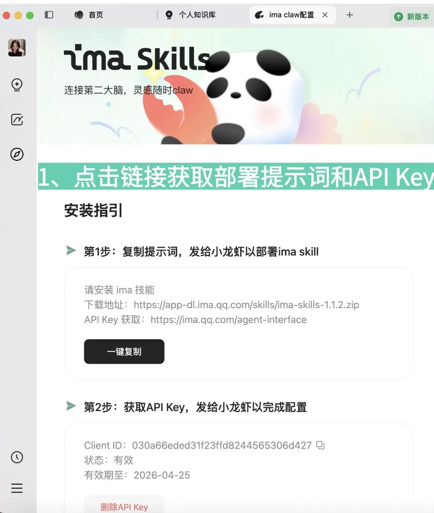
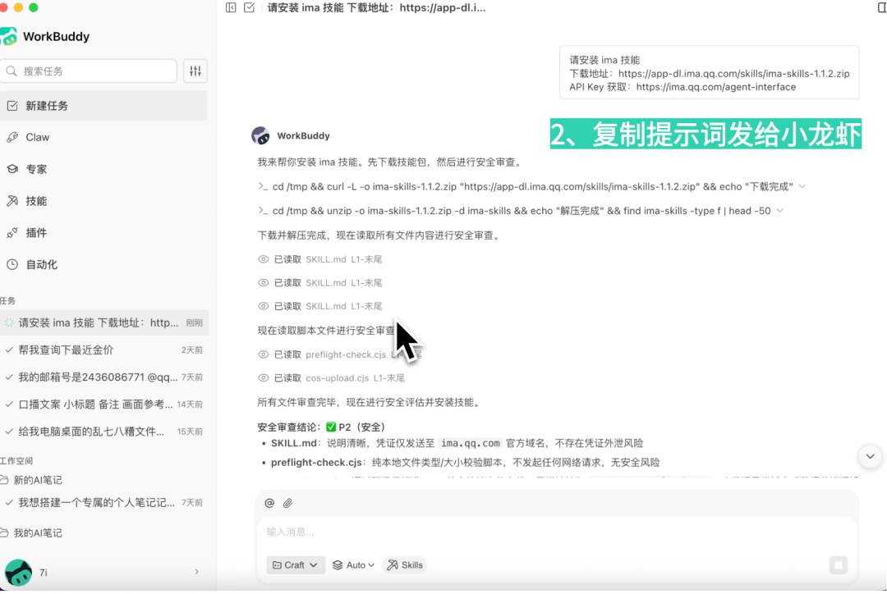
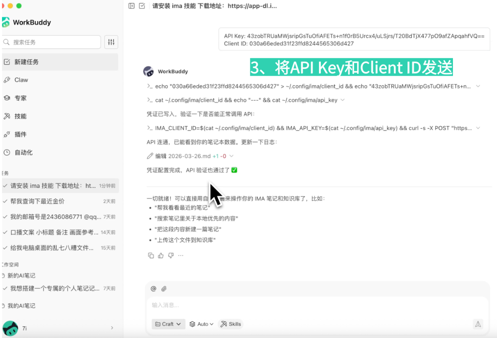
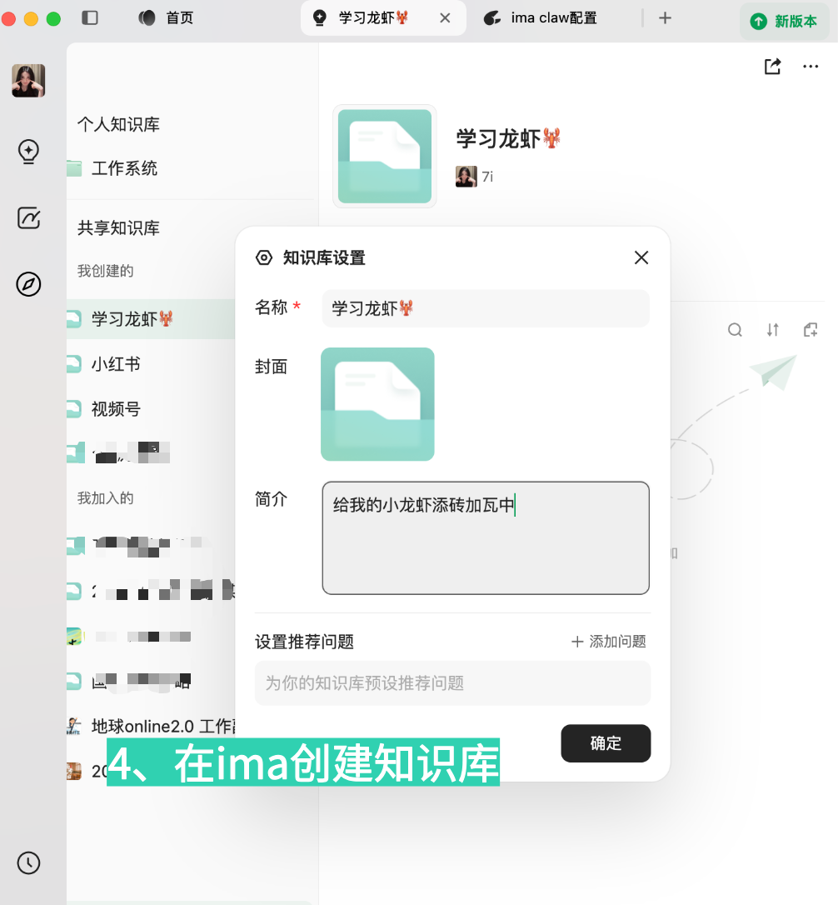
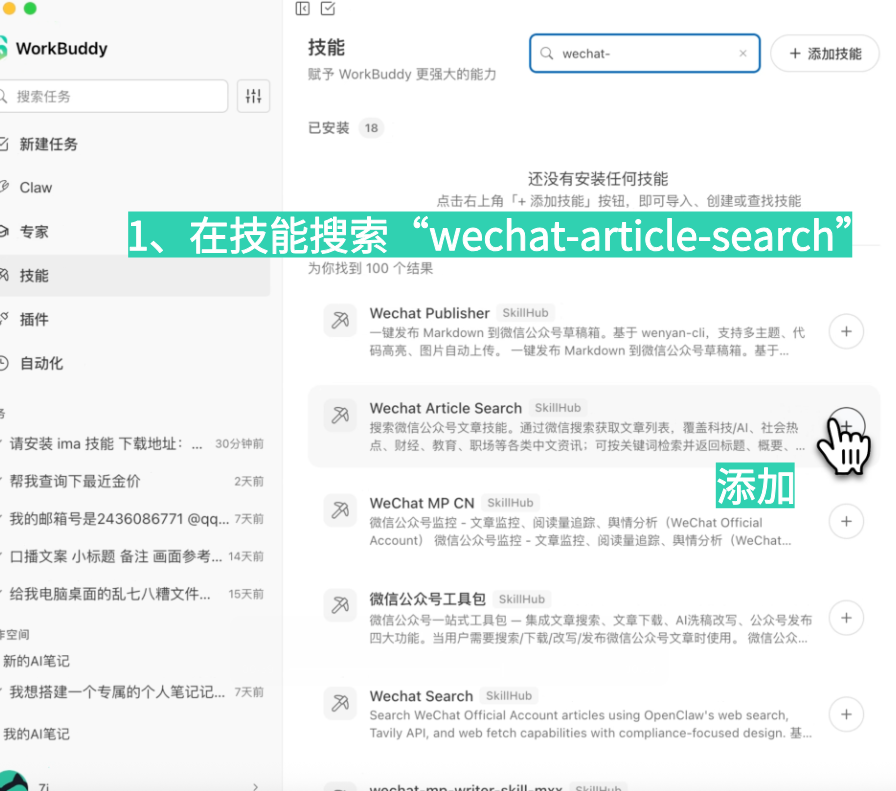
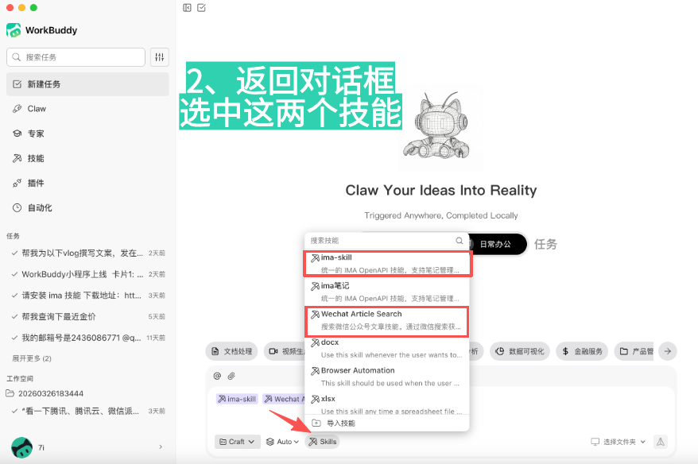
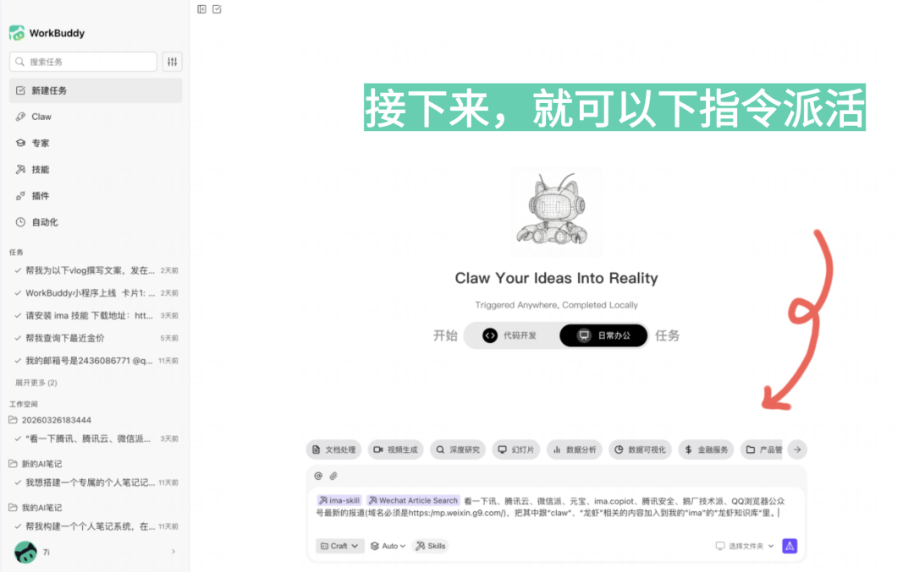
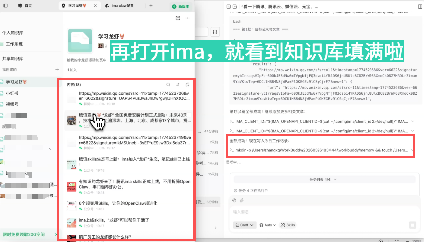
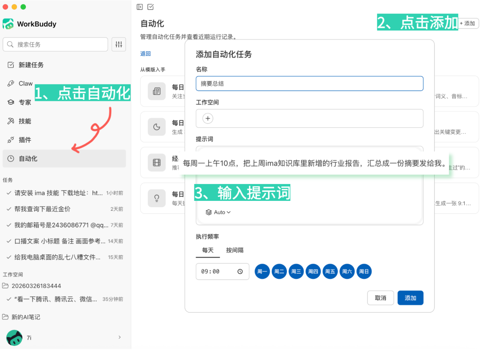

# 还在手动整理ima？用WorkBuddy帮你自动更新、管理ima知识库（完整教程）

> [!NOTE]
> 🎉
> 
你是不是经常——

>
> 
早上到公司，打十几个网页、公众号、行业论坛，一条条翻，生怕错过什么重要信息。

>
> 
中午吃饭还在刷手机，想看有没有新出的报告、竞品动态、行业趋势……

>
> 
晚上回家累得不行，想想今天好像又没看到什么有价值的东西，时间倒是花了不少。

<strong>想掌握最新讯息，但真的没时间到处搜。</strong>

别急。今天教大家一招：<strong>创建自己的ima知识库</strong><strong><em>()</em></strong><strong>，让WorkBuddy帮你管理，你只管“收”，我替你“搜”。</strong>

腾讯ima是一款以知识库为核心的AI工作台产品，专门用来帮你收集、整理、沉淀各种信息。不管是微信文章、网页链接、PDF报告、会议纪要，还是随手记的碎片笔记，都可以一键存进去，自动归档。

如今有<strong>WorkBuddy</strong>在，你只需要做四件事——<strong>连接知识库、安装技能、说句话、设个定时。</strong>每天早上，我就会把你要的信息自动送到面前。

本期，我将以搜索微信公众号内容为例，教大家如何用workbuddy管理ima知识库。

## 手把手教学实操

<strong>第1步：连接ima知识库</strong>

1、进入ima skills<em>()</em>安装指引网页，获取<strong>API Key</strong>和<strong>Client ID</strong>，具体教学请戳：<a href="../references/links.md#ref-wechat-ima-skills">ima上线skills，“龙虾”可以帮你干活了</a>

ima skills安装指引网页：

<u><a href="../references/links.md#ref-ima-qq-com-agent-interface">ima 页面内容的本地说明</a></u>

2、复制提示词给<strong>WorkBuddy部署ima skills</strong>

3、将<strong>API Key和Client ID</strong>发送给WorkBuddy完成授权

4、在ima中创建知识库

<strong>第2步：安装微信公众号查询Skill</strong>

<strong>给WorkBuddy配上“情报员”技能。</strong>

<ol><li>在WorkBuddy的“技能页面”搜索“wechat-article-search”，点击安装，我就可以帮你查询微信公众号内容啦。</li></ol>

<ol><li>安装完成后，在WorkBuddy的对话框选中<strong>“ima-skill”</strong>和<strong>“Wechat Article Search”</strong>两个技能</li></ol>

<strong>第3步：告诉我你想关注什么</strong>

接下来，你就可以像给助理派活一样，告诉我你要关注什么。

<strong>提示词：</strong>

“看一下腾讯、腾讯云、微信派、元宝、ima.copilot、腾讯安全、鹅厂技术派、QQ浏览器公众号最新的报道（域名必须是<a href="../references/links.md#ref-mp-weixin-qq-com">相关参考内容（本地副本）</a>），把其中跟“claw”、“龙虾&quot;相关的内容加入到我的&quot;ima&quot;的&quot;龙虾知识库&quot;里。”

几秒钟后，你的ima知识库就会被符合要求的信息填满啦。

<strong>第4步：设置定时自动化推送</strong>

这是最爽的一步——让WorkBuddy每天自动帮你<strong>搜集、整理、推送</strong>，你再也不用主动去搜了。

<strong>操作步骤：</strong>

<ol><li>在WorkBuddy中，点击“自动化”，点击“添加”</li><li>输入提示词，选择时间</li><li>点击“添加”，搞定！</li></ol>

<strong>你也可以设置更多自动化场景：</strong>

> [!NOTE]
> 🌰
> <ul><li>每周一上午10点，把上周ima知识库里新增的行业报告，汇总成一份摘要发给我。</li></ul>
>
> <ul><li>每天早上8点半，整理ima‘竞品动态’知识库的最新资料，发给我。</li></ul>
>
> <ul><li>每天下班前6点，把今天存进ima的信息整理好，按主题分类发给我。</li></ul>

设置一次，以后每天早上，你什么都不用做，到点就能收到一份整理好的“今日情报”，花3分钟看完，最新动态全掌握。

以前，是你去找信息；现在，信息主动来找你。

你只需要负责思考和决策，搜集信息、整理情报这些“苦力活”，统统交给我。快去试试吧！

