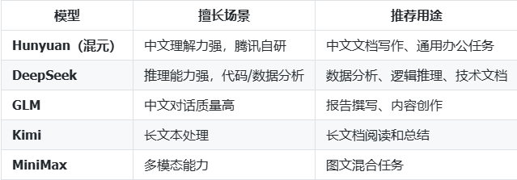
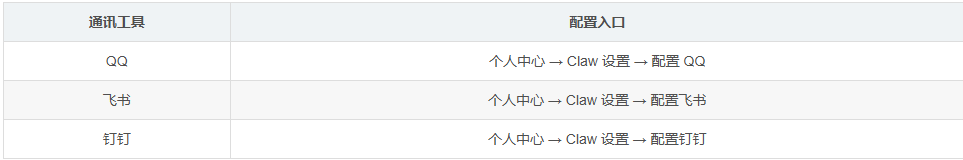

# WorkBuddy 安装使用完全指南：腾讯版“小龙虾“，一句话让 AI 替你干活

## 资料在下面

---

## 一、WorkBuddy 是什么？

### 1.1 一句话定义

<p>WorkBuddy 是腾讯云推出的 AI 原生桌面智能体（Desktop AI Agent）工作台，基于腾讯 CodeBuddy 同源架构构建。它不是一个只会聊天的对话框，而是一个能听懂人话、自主思考、直接操作你电脑上文件的 AI 同事。</p>

<p>你只需用自然语言描述需求，WorkBuddy 就能自动规划、拆解、执行多步骤任务，直接交付可验收的成果——Excel 报表、PPT 演示文稿、调研报告、数据分析 图表，应有尽有。</p>

### 1.2 与传统AI工具的区别

<p>与传统AI工具的区别</p>

<table><tbody><tr><td><p><strong>维度</strong></p></td><td><p><strong>G-T / 豆包等</strong></p></td><td><p><strong>WorkBuddy</strong></p></td></tr><tr><td><p>本质</p></td><td><p>对话式AI，告诉&quot;怎么做&quot;</p></td><td><p>行动式AI Agent，直接&quot;帮你做&quot;</p></td></tr><tr><td><p>文件操作</p></td><td><p>不能操作本地文件</p></td><td><p>直接读取、编辑、整理本地文件</p></td></tr><tr><td><p>任务执行</p></td><td><p>生成文本建议</p></td><td><p>自主规划并执行完整工作流</p></td></tr><tr><td><p>结果交付</p></td><td><p>对话文本</p></td><td><p>可直接使用的文档/表格/PPT</p></td></tr><tr><td><p>远程控制</p></td><td><p>不支持</p></td><td><p>支持企微/QQ/飞书/钉钉远程遥控</p></td></tr></tbody></table>

### 1.3 和 OpenClaw（小龙虾）的关系

<p>完全兼容 OpenClaw（开源小龙虾）的 Skills 技能包,可理解为腾讯官方出品的&quot;养龙虾&quot;平台</p>

<p>相比自己部署 OpenClaw 的优势：</p>

<p>免部署：不需要搭建云服务器，下载安装即可用</p>

<p>企业级安全：统一账号、计费管理、安全审计</p>

<p>更易用：图形化界面，配置远程遥控最快 1 分钟</p>

## 二、安装步骤（Windows/macOS ）

### 2.1 下载安装包

<ol><li>打开浏览器，访问 WorkBuddy 官网：<a href="../references/links.md#ref-www-codebuddy-cn-work">WorkBuddy 官方文档的本地副本</a></li><li>根据你的操作系统，选择 Windows 或 macOS 版本</li><li>点击下载按钮，等待安装包下载完成</li></ol>

### 2.2 安装软件

<p>Windows 用户：</p>

<ol><li>双击下载的 .exe 安装包</li><li>按照安装向导提示点击&quot;下一步&quot;</li><li>安装过程中如弹出&quot;是否允许此应用对设备进行更改&quot;，点击&quot;是&quot;</li><li>安装完成后，桌面会出现 WorkBuddy 图标</li></ol>

<p>macOS 用户：</p>

<ol><li>双击下载的 .dmg 文件</li><li>将 WorkBuddy 图标拖拽到 Applications（应用程序）文件夹</li><li>首次打开时，如提示&quot;无法验证开发者&quot;，前往 系统偏好设置 → 安全性与隐私 点击&quot;仍然打开&quot;</li></ol>

### 2.3 登录账号

<ol><li>双击桌面图标启动 WorkBuddy</li><li>首次启动会弹出登录界面，有两种方式：</li><li>腾讯云账号登录：输入腾讯云账号密码</li><li>微信扫码登录：用微信扫描二维码快速登录</li><li>登录成功后即可进入主界面</li></ol>

## 三、界面与基础操作

### 3.1 主界面布局

<p>启动后你会看到 WorkBuddy 的主界面，主要分为以下区域：</p>

```
┌────────────────────────────────────────────────┐
│  顶部工具栏        [模型选择]  [个人中心]       │
├──────────┬─────────────────────────────────────┤
│          │                                     │
│  侧边栏  │         对话/任务区域                │
│          │                                     │
│  任务列表 │   在这里输入你的需求                 │
│          │   WorkBuddy 会在这里展示             │
│          │   执行过程和中间结果                  │
│          │                                     │
│          ├─────────────────────────────────────┤
│          │         结果展示面板                  │
│          │   生成的文档/表格/PPT 在这里查看      │└──────────┴─────────────────────────────────────┘
```

### 3.2 核心功能区

<ul><li>侧边栏：切换不同任务窗口，支持多任务并行</li><li>对话区域：输入指令、查看执行过程、与 WorkBuddy 交互</li><li>结果面板：查看和下载生成的产物（文档、表格、PPT等）</li><li>顶部工具栏：切换模型、进入个人中心和 Claw 设置</li></ul>

### 3.3 发起第一个任务

<ol><li>在输入框中输入你的需求，例如：</li></ol>

```
帮我把桌面上 Downloads 文件夹里的文件按类型分类整理到不同子文件夹运行项目并下载源码
```

<ol><li>选择一个合适的 AI 模型（后文详细讲解）</li><li>按回车键或点击发送按钮</li><li>WorkBuddy 会自动开始规划和执行任务</li><li>在对话区观察执行进度，在结果面板查看产出</li></ol>

### 3.3 文件夹授权

<p>WorkBuddy 操作本地文件前需要你的授权：</p>

<ol><li>首次使用文件相关功能时，WorkBuddy 会提示你添加授权文件夹</li><li>点击&quot;添加文件夹&quot;按钮</li><li>选择你希望 AI 可以访问的目录（如 D:\工作文档、C:\Users\你的用户名\Desktop 等）</li><li>确认授权</li></ol>

<p>安全提示：WorkBuddy 仅能访问你主动授权的文件夹，不会偷偷读取其他目录。核心数据处理在本地完成，敏感文件不会上传到云端。</p>

## 四、模型选择指南

### 4.1 可用模型对比



<p><strong>切换模型的方法</strong>：在顶部工具栏或对话输入框附近找到模型选择下拉框，点击即可切换。</p>

### 4.2 选型经验法则

<ul><li>不确定用哪个？：先用 DeepSeek，综合能力强</li><li>纯中文写作？：用 Hunyuan 或 GLM</li><li>需要处理长文档？：用 Kimi</li><li>任务复杂、需要强推理？：用 DeepSeek</li></ul>

## 五、核心功能详解

### 5.1 批量文件处理

<p><strong>适用场景</strong>：文件整理、批量重命名、格式转换、信息提取</p>

<p><strong>示例指令</strong>：</p>

```
把 D:\发票 文件夹里所有 PDF 和图片格式的发票，自动提取发票号、金额、日期，汇总生成一个 Excel 报销明细表，保存到桌面
```

```
将 Downloads 文件夹里的文件按照文件类型（文档、图片、压缩包、视频）分别归类到对应子文件夹中
```

```
批量将 D:\合同 文件夹下的所有 Word 文档转换为 PDF 格式
```

### 5.2 数据分析与可视化

<p><strong>适用场景</strong>：Excel 数据清洗、统计分析、生成图表</p>

```
分析这份销售数据 Excel（D:\data\sales_2025.xlsx），找出销售额 TOP10 的产品，生成柱状图和趋势分析报告
```

```
清洗这份客户数据表：去除重复项，统一手机号格式，补全缺失的城市信息，导出为新的 Excel
```

```
对比 Q1 和 Q2 两个季度的运营数据，生成对比分析报告，包含增长率、环比变化和改进建议
```

### 5.3 文档与 PPT 生成

<p><strong>适用场景</strong>：工作报告、周报、方案 PPT、会议纪要</p>

```
根据以下要点生成本周工作周报：
1. 完成了客户管理系统 V2.0 上线
2. 处理了 15 个客户反馈工单3. 下周计划：启动数据迁移项目
```

```
生成一份关于"2026年AI办公趋势"的 PPT，包含市场概况、主要产品对比、应用场景、未来展望四个章节，每章 3-5 页
```

```
把这份会议录音笔记（D:\meeting_notes.txt）整理成正式的会议纪要，提炼关键决策、行动项和责任人
```

### 5.4 深度信息研究

<p><strong>适用场景</strong>：竞品分析、市场调研、行业报告</p>

```
帮我调研国内主流的 AI 编程工具（Cursor、CodeBuddy、Windsurf 等），从功能、价格、用户体验三个维度对比，输出一份竞品分析报告
```

```
分析 2025-2026 年新能源汽车市场趋势，包括销量数据、政策变化、主要厂商动态，生成 SWOT 分析报告
```

### 5.5 多 Agent 并行工作

<ul><li>多窗口并行：在侧边栏创建多个任务窗口，每个窗口独立执行</li><li>动态任务拆解：一个复杂任务自动被拆成多个步骤并行推进</li><li>适用场景：同时处理数据分析 + 生成 PPT + 写邮件等多个任务</li></ul>

## 六、远程遥控配置

### 6.1 企业微信远程遥控（推荐，最快 1 分钟）

<p>配置步骤：</p>

<ol><li>打开 WorkBuddy，点击右上角 个人中心</li><li>找到 &quot;Claw 设置&quot; 选项，点击进入</li><li>点击 &quot;配置企业微信&quot; 按钮</li><li>按照页面指引：</li></ol>

<ul><li>在企业微信管理后台添加群机器人</li><li>获取 Webhook URL</li><li>将 URL 填入 WorkBuddy 配置页面</li></ul>

<ol><li>配置完成后，在企业微信中找到对应的机器人</li><li>向机器人发送文字或语音指令即可远程控制</li></ol>

<p><strong>使用示例</strong>：</p>

```
帮我把桌面上的"Q1总结.docx"整理成周报格式，发送到我的工作邮箱
```

<p>WorkBuddy 会在你的办公电脑上自动完成任务。</p>

### 6.2 其他通讯工具支持



<p>使用建议：远程遥控时确保办公电脑处于开机状态且 WorkBuddy 保持运行</p>

## 七、Skills 技能包扩展

### 7.1 什么是 Skills

<p>Skills（技能包）是 WorkBuddy 的扩展能力系统。每个 Skill 就是一个&quot;专业培训包&quot;，让 AI 在特定领域更专业。WorkBuddy 内置了 20+ 种技能包，涵盖：</p>

<ul><li>海报/封面图生成</li><li>自动化报表</li><li>数据分析</li><li>文档转换</li><li>……</li></ul>

### 7.2 使用内置技能

<p>内置技能开箱即用，当你的需求匹配某个技能时，WorkBuddy 会自动调用。你也可以在设置中查看和管理已有技能。</p>

### 7.3 导入外部技能

<p>WorkBuddy 完全兼容 OpenClaw 的 Skills，可以一键导入社区分享的技能包：</p>

<ol><li>找到需要的 Skill（OpenClaw 社区、GitHub 等）</li><li>在 WorkBuddy 设置中选择&quot;导入技能&quot;</li><li>粘贴 Skill 地址或上传 Skill 文件</li><li>导入完成后即可使用</li></ol>

### 7.4 自定义技能（零代码）

<p>你可以零代码创建自己的技能包：</p>

<ol><li>在 WorkBuddy 中进入技能管理页面</li><li>点击&quot;新建技能&quot;</li><li>填写技能名称和描述</li><li>定义工作流程和使用的工具</li><li>保存即可</li></ol>

<p><strong>自定义技能示例</strong>：创建一个&quot;周报生成器&quot;</p>

```
---
name: weekly-report
description: 根据本周工作记录自动生成格式化周报
---

你是一个周报生成专家。请按以下格式生成周报：

## 工作流程
1. 读取用户提供的工作记录
2. 按项目分类整理
3. 提炼关键成果和数据
4. 生成标准周报格式

## 输出格式
### 本周完成
- [项目名] 具体成果
### 进行中
- [项目名] 当前进度
### 下周计划
- [项目名] 计划事项
### 需要协调- 需要其他部门支持的事项
```

## 八、MCP 协议扩展

### 8.1 MCP 协议

<ul><li>MCP（Model Context Protocol）：让 AI 连接外部工具和数据源的标准协议</li><li>通过 MCP，WorkBuddy 可以调用第三方工具的能力</li></ul>

### 8.2 配置 MCP 服务

<ul><li>在 WorkBuddy 设置中找到 MCP 配置 选项</li><li>添加 MCP Server 地址（SSE URL 或 STDIO 方式）</li><li>配置完成后，WorkBuddy 在执行任务时会自动调用相应的 MCP 工具</li></ul>

<p><strong>常用 MCP 扩展场景：</strong></p>

<ul><li>接入浏览器控制（自动化网页操作）</li><li>接入数据库查询</li><li>接入企业内部系统 API</li><li>接入文件转换服务</li></ul>

## 九、实战场景演示

#### 场景 1：财务发票整理

<p>需求：一堆发票扫描件，需要提取信息并汇总</p>

<p>输入：</p>

```
读取 D:\报销\2026年3月 文件夹下所有发票图片和PDF，
提取每张发票的：发票代码、发票号码、开票日期、金额（含税）、销售方名称，汇总生成 Excel 表格，按日期排序，最后计算总金额
```

#### 场景 2：竞品分析 PPT

<p>需求：快速生成竞品分析演示文稿</p>

<p>输入：</p>

```
帮我做一份"国内AI编程工具竞品分析"PPT，要求：
1. 调研 Cursor、CodeBuddy、Windsurf、Trae 这几款产品
2. 对比维度：功能特性、定价策略、用户口碑、技术架构
3. 每个产品 2-3 页，最后给出总结和建议4. 风格简洁商务
```

#### 场景 3：日常数据分析

<p>需求：分析销售数据并给出建议</p>

<p>输入：</p>

```
分析这份 Excel（D:\data\sales.xlsx），我想知道：
1. 哪些产品销售额在下降？下降幅度是多少？
2. 哪个区域的销售增长最快？
3. 预测下个季度的销售趋势4. 生成可视化图表和一份简短的分析报
```

#### 场景 4：远程遥控场景

<p><strong>需求</strong>：外出时需要电脑上的文件</p>

<p>在手机企业微信上发送：</p>

```
帮我在电脑上找到 D:\项目文档\方案V3.docx，转换成PDF，然后发送到我的邮箱 xxx@company.com
```

## 十、使用技巧与最佳实践

### 10.1 写出好指令的技巧

<p><strong>明确目标</strong>：告诉 WorkBuddy 你要什么结果</p>

```
❌ 帮我处理一下这个文件✅ 把 D:\data.xlsx 中的重复数据删除，按销售额降序排列，导出为新的 Excel 保存到桌面
```

<p><strong>提供上下文</strong>：说明背景和约束条件</p>

```
❌ 写个周报
✅ 根据以下内容写本周工作周报，格式按照公司模板（本周完成/进行中/下周计划），语气正式简洁：1. 完成A项目需求评审 2. 修复3个线上Bug 3. 开始B项目技术方案
```

<p><strong>指定输出格式</strong>：明确你要什么格式的结果</p>

```
❌ 分析一下数据
✅ 分析销售数据并生成 Excel 报告，包含：数据摘要表、柱状图、趋势折线图、文字总结（不超过500字），保存为 D:\reports\sales_analysis.xlsx
```

### 10.2 高效使用习惯

<ul><li>善用多窗口：不同任务放在不同窗口，互不干扰</li><li>迭代优化：第一次结果不满意？直接在对话中补充要求</li><li>活用远程遥控：通勤路上也能让电脑干活</li><li>积累自定义技能：把常用的工作流封装成 Skill，下次一键复用</li><li>选对模型：不同任务选不同模型，效果差异明显</li></ul>

### 10.3 注意事项

<ul><li>保持电脑在线：远程遥控需要办公电脑开机且 WorkBuddy 运行中</li><li>文件授权范围：只授权必要的文件夹，不要授权整个 C 盘</li><li>重要文件备份：让 AI 操作文件前，建议对重要文件做备份</li><li>检查结果：AI 生成的内容务必人工检查后再使用，尤其是财务数据</li><li>Credits 额度：注意 Credits 消耗，复杂任务消耗较多</li></ul>

## 十一、常见问题（FAQ）

#### Q1：WorkBuddy 免费吗？

<p>新用户注册即送 5,000 Credits。后续使用按 Credits 消耗计费，不同模型消耗速率不同。具体定价请关注官网公告。</p>

#### Q2：支持哪些操作系统？

<p>目前支持 Windows 和 macOS。Linux 版本暂未发布。</p>

#### Q3：我的文件安全吗？

<p>WorkBuddy 的核心数据处理在本地完成，仅访问你主动授权的文件夹。通过安全网关代理通信，避免内网穿透带来的安全隐患。基于腾讯 CodeBuddy 架构 ，具备企业级安全审计能力。</p>

#### Q4：可以处理哪些文件格式？

<p>支持的文件格式包括但不限于：</p>

<p>文档：PDF、Word（.docx）、TXT、Markdown</p>

<p>表格：Excel（.xlsx、.csv）</p>

<p>演示文稿：PPT（.pptx）</p>

<p>图片：JPG、PNG（含文字识别能力，如发票、截图）</p>

#### Q5：需要一直联网吗？

<p>基础的本地文件操作在本地完成。但以下功能需要联网：</p>

<p>AI 模型调用（需要连接模型服务）</p>

<p>网络信息检索</p>

<p>远程遥控</p>

#### Q6：和 CodeBuddy 是什么关系？

<p>WorkBuddy 基于 CodeBuddy 同源架构构建：</p>

<p>CodeBuddy 面向开发者，是 AI 编程工具（IDE 插件 / CLI / 独立编辑器）</p>

<p>WorkBuddy 面向所有职场人，是 AI 办公智能体工作台</p>

<p>两者共享统一的账号和计费体系</p>

#### Q7：远程遥控没反应怎么办？

<p>检查以下几点：</p>

<p>办公电脑是否开机且 WorkBuddy 正在运行</p>

<p>网络连接是否正常</p>

<p>企业微信/QQ/飞书/钉钉 的机器人配置是否正确</p>

<p>尝试在 WorkBuddy 的 Claw 设置中重新配置连接</p>
