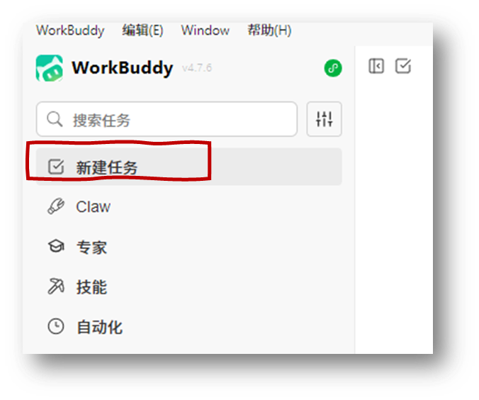
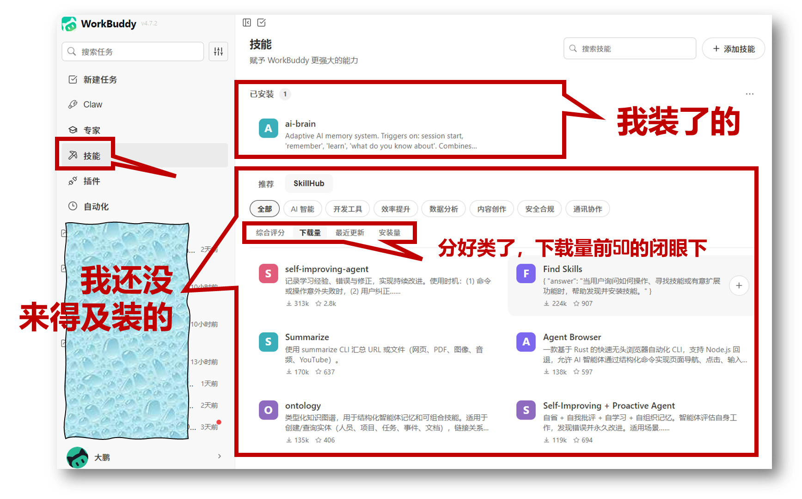
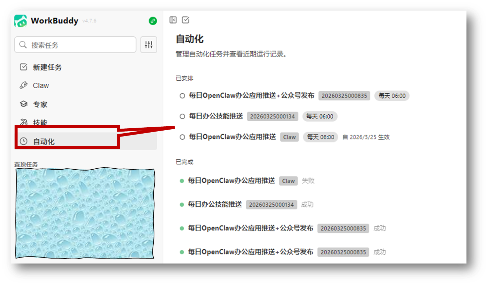

# 还在加班做Excel？用Workbuddy帮你1小时搞定1天的活！

## 资料在下面

---

> [!TIP]
> 💡
> ## 你是不是也这样？——办公繁琐任务，其实都能自动化
>
> <ul><li>月底结账：从多个系统导数据手工汇总，反复核对，加班还被嫌慢。</li><li>周报月报：每周重复同样的事，简单但耗时间，想自动化却不会编程。</li><li>临时需求：老板突然要报表，客户催方案，部门急整理文件。</li></ul>
>
> <p>这些工作不难但繁琐，却占用了80%的工作时间</p>
>
> <ul><li><strong>传统方式：</strong>月底结账要2-3天，周报汇总要半天，批量文件处理要1天。</li><li><strong>用WorkBuddy：</strong>月底结账首次设置1小时之后全自动，周报设置一次每周自动生成，批量文件处理一句话搞定。核心理念：让AI做繁琐的事，你专注做重要的事。</li></ul>

## 一、WorkBuddy到底是什么？

<p><code>一句话说清楚：这是个能直接操作你电脑的AI助手。你说话，它干活。</code></p>

<p>它和G-T有什么区别？</p>

<table><tbody><tr><td><p><strong>你需要什么</strong></p></td><td><p><strong>G-T</strong></p></td><td><p><strong>WorkBuddy</strong></p></td></tr><tr><td><p>Excel数据合并</p></td><td><p>告诉你怎么做</p></td><td><p>直接帮你合并好 ✅</p></td></tr><tr><td><p>PPT制作</p></td><td><p>给你大纲</p></td><td><p>直接生成PPT文件 ✅</p></td></tr><tr><td><p>文件整理</p></td><td><p>告诉你方法</p></td><td><p>直接帮你整理好 ✅</p></td></tr></tbody></table>

<p>就像你雇了一个助手，你说&quot;帮我整理一下桌面的文件按月份分类&quot;，它就真的去做了，而不是教你方法。</p>

## 二、零基础上手

### 第一步：下载安装

<p><strong>详细步骤：</strong></p>

<p><strong>第一步：打开官网</strong></p>

> [!TIP]
> <p>💡 www.codebuddy.cn/work，复制粘贴到浏览器就行</p>
>
> <p>下载安装包，点击&quot;下载WorkBuddy&quot;，选择你的系统（Windows选第一个），就像装普通软件一样，一直点&quot;下一步&quot;就行，双击下载好的文件，点&quot;我同意&quot;，选择安装位置（建议D盘，别装C盘），点&quot;安装&quot;，等待完成</p>

> [!TIP]
> <p>💡 <strong>第二步：登录（扫个码就搞定）</strong></p>
>
> <p>打开WorkBuddy，点击&quot;登录&quot;，第一次登录会弹出&quot;授权访问文件夹&quot;的提示，✅ 点击&quot;允许&quot;</p>
>
> <p>💡 建议：只勾选你常用的工作文件夹，不要全选</p>

> [!TIP]
> <p>💡 <strong>第三步：完成你的第一个任务</strong></p>
>
> <p>让我们来做一个真实的案例：整理一个季度的销售数据</p>

<p><strong>准备工作：</strong></p>

<p>新建任务，打开WorkBuddy，左上角有个&quot;+ 新建任务&quot;按钮，选择工作目录，就是你想将来生成内容放到哪里？</p>

<p>这个属于你专门为这个任务建的【工作空间】</p>

<p>选择模式，新手建议选&quot;问一问&quot;模式（安全，不会改你的文件），熟悉后再用&quot;做一做&quot;模式</p>




###### 开始操作

<p>在输入框里复制这段话：</p>

```
请帮我完成以下任务：
1. 读取工作目录中的"Q1销售数据.xlsx"
2. 按月份和产品类别进行汇总
3. 计算环比增长率
4. 生成包含图表的可视化报表5. 输出为新的Excel文件
```

<p>💡 小贴士：把这段话改成你实际的文件名</p>

<ul><li>点击&quot;发送&quot;，然后… 静静地看着它自动干活！</li></ul>

<p><strong>你会看到什么？</strong></p>

<p>WorkBuddy会：</p>

<ol><li>显示&quot;正在分析需求…&quot;</li><li>列出执行步骤：“第1步：读取文件…”</li><li>实时显示进度条</li><li>最后弹出预览窗口</li></ol>

<p>第一次可能会慢一点，大概1-2分钟。别急，AI在思考。</p>

<p><strong>查看结果</strong></p>

<p>右侧会出现预览窗口，你可以：</p>

<ul><li>直接看图表</li><li>检查数据是否正确</li><li>不满意？在对话框说&quot;帮我调整一下图表颜色&quot;</li></ul>

<p><strong>找到输出文件：</strong></p>

<ul><li>在工作目录里会生成新的Excel文件</li><li>文件名会带&quot;_processed&quot;后缀</li></ul>

<p>恭喜你！你已经用AI完成了第一个自动化任务！</p>

## 三、进阶：让它更懂你的需求

### 功能1：专家系统 - 找对&quot;人&quot;办对事


<p><strong>这是什么？：</strong>就像去医院，有内科医生、外科医生、儿科医生。AI也可以切换&quot;专家身份&quot;。</p>

> [!TIP]
> <p>💡 <strong>1.操作步骤：</strong></p>
>
> <ul><li>点击左侧&quot;专家&quot;标签</li><li>搜索框输入&quot;法律&quot;</li><li>看到&quot;法律合规审查专家&quot;，点击&quot;立即召唤&quot;</li><li>上传你的合同文件</li><li>AI会从法律角度分析，告诉你哪些条款有风险</li></ul>

> [!TIP]
> <p>💡 <strong>2.不同专家的处理差异：</strong></p>
>
> <p>同样是处理Excel数据：</p>
>
> <ul><li>财务专家：从财务合规角度，关注数据准确性</li><li>数据分析专家：从洞察角度，发现数据规律</li><li>办公自动化专家：追求最高效的批量处理</li><li>实用建议：不确定用哪个专家？先用默认模式试试，效果不好再换专家。</li></ul>

### 功能2：技能包 - 给AI装上&quot;专业技能&quot;



<p><strong>这是什么？：</strong>如果说专家是&quot;换人&quot;，技能包就是&quot;装技能&quot;。</p>

<p><strong>核心技能包一览</strong>：</p>

<table><thead><tr><th>技能名</th><th>能干什么</th><th>什么时候用</th></tr></thead><tbody><tr><td>pdf</td><td>提取文本、合并PDF、转格式</td><td>处理合同、报告等PDF文件</td></tr><tr><td>xlsx</td><td>数据清洗、公式计算、图表</td><td>Excel数据处理分析</td></tr><tr><td>pptx</td><td>自动排版、生成PPT</td><td>快速制作汇报PPT</td></tr><tr><td>docx</td><td>Word批量处理</td><td>文档格式统一、转换</td></tr><tr><td>前端开发</td><td>生成网页代码</td><td>制作简单网站</td></tr></tbody></table>

#### 1.<strong>怎么用？</strong>

##### <strong>方法1：自动识别</strong>（推荐新手）

<ul><li>直接说&quot;帮我制作一份产品介绍PPT&quot;</li><li>AI会自动调用pptx技能</li></ul>

##### <strong>方法2：手动指定</strong>

<ul><li>在对话框输入：<code>/pptx 帮我制作一份产品介绍PPT</code></li><li>斜杠命令强制指定技能</li></ul>

#### <strong>2.实战案例：一键生成行业报告</strong>

```
请帮我：
1. 搜索新能源汽车行业最新动态
2. 整理Top5企业的市场数据3. 生成PPT演示文稿
```

<p>AI会自动调用：搜索技能 → 数据分析技能 → PPT生成技能，一站式完成。</p>

#### <strong>3.组合使用威力最大</strong>：

```
财务专家（专业性）+ 
Excel技能包（数据处理）+ 
微信插件（推送结果）+ 
定时自动化（自动执行）= 每月自动生成财务报表推送到你微信
```

### 功能3：自动化 - 让它定时自己干



<p><strong>这是什么？：</strong>给AI设个闹钟，到点自动干活。</p>

<p><strong>适合什么任务？</strong></p>

<ul><li>✅ 每天/每周/每月重复做的事</li><li>✅ 有固定格式的报表</li><li>✅ 定期需要收集的信息</li></ul>

<p><strong>怎么设置？</strong></p>

##### 案例：每天自动推送行业热点

<ol><li>先手动测试指令</li></ol>

```
每天早上8点：
1. 搜索"人工智能"领域的热点话题
2. 整理Top10，标注热度和来源
3. 生成HTML报告4. 保存到桌面
```

<ol><li><strong>确认效果OK后，设置自动化</strong>
<ul><li>点击左侧&quot;自动化&quot;标签</li><li>点击&quot;添加任务&quot;，粘贴你的指令</li><li>设置时间：每天8:00，点击&quot;添加&quot;</li></ul></li><li><strong>测试一下</strong>
<ul><li>找到刚创建的任务</li><li>点击&quot;测试运行&quot;，看看效果</li></ul></li></ol>

<p><strong>大功告成！以后每天早上8点，AI自动帮你搜集热点，你起床就能看到。</strong></p>

### 功能4：远程控制  - 手机指挥电脑


<p><strong>这是什么？：</strong>外出时，用手机微信远程控制电脑干活。</p>

<p><strong>配置步骤</strong>（1分钟）：</p>

<ol><li>选择&quot;Claw设置&quot;</li><li>点击&quot;wx客服号集成&quot; → “配置”</li><li>手机wx扫码，显示&quot;已绑定&quot;，完成！</li></ol>

<p><strong>使用场景</strong>：</p>

<p>你在地铁上，老板突然要一个数据：</p>

<p><strong>手机微信发送</strong>：</p>

```
帮我统计一下本月销售数据，生成简报发给我一键获取完整项目代码
```

<p><strong>电脑自动执行</strong>，结果推送到你微信。</p>

## 四、真实案例

#### 案例1：财务主管

<p>原来：每月最后2天要加班，从5个系统导数据，手工汇总Excel，制作分析PPT，耗时2-3天</p>

<p>现在：</p>

```
设置自动化任务（每月最后一天执行）：
1. 自动读取各系统导出的Excel（提供文件夹地址，比如：C:\Users\18910\Desktop\openclaw研究\月报数据）
2. 按科目分类汇总
3. 计算环比、同比
4. 标记异常数据
5. 生成PPT分析报告6. 推送到企业微信
```

<p><strong>效果</strong>：首次设置1小时，之后全自动。每月节省2-3天！</p>

#### 案例2：自媒体人

<p><strong>痛点</strong>：每天要找选题，不知追什么热点，熬夜写稿</p>

<p><strong>解决方案</strong>：</p>

<p><strong>第一步：自动搜集热点</strong>（设置每天8点执行）</p>

```
搜索我所在领域的热点：
1. 从微博、知乎、小红书抓取热门（给他赛道类别）内容
2. 按热度排序Top10
3. 标注热度指数、来源、核心观点4. 生成HTML报告推送到微信
```

<p><strong>第二步：内容创作辅助</strong></p>

```
围绕选定热点创作小红书图文：
1. 标题（框定主体范围）要有情绪、有悬念
2. 正文800字，口语化
3. 结尾引导互动4. 附10个话题标签
```

<p><strong>第三步：配图生成</strong></p>

```
为文章生成配图Prompt：
1. 封面图：吸睛主题
2. 内容配图：相关场景3. 互动引导图
```

<p><strong>效果</strong>：早上8点收到热点清单，选定话题，AI帮写初稿，30分钟完成一篇内容。</p>

#### 案例3：行政工作

<p><strong>原来</strong>：员工信息散落各处，手工录入Excel，经常出错</p>

<p><strong>现在</strong>：</p>

```
帮我整理员工信息：
1. 读取所有员工登记表
2. 提取关键信息：姓名、部门、入职时间
3. 按部门分类
4. 标注合同即将到期的员工5. 生成统计报表
```

<p><strong>效果</strong>：原来半天的工作，现在5分钟搞定。</p>

### 不同岗位怎么用？

<p><strong>财务会计</strong></p>

<p>✅ 月度/季度报表自动生成✅ 发票信息批量提取✅ 财务数据异常监控</p>

<p><strong>运营人员</strong></p>

<p>✅ 每日数据简报自动生成✅ 竞品动态自动监控✅ 活动数据自动汇总</p>

<p><strong>行政人事</strong></p>

<p>✅ 员工信息批量整理✅ 考勤数据自动统计✅ 会议纪要自动生成</p>

<p><strong>产品经理</strong></p>

<p>✅ 用户反馈自动分类✅ 需求文档快速生成✅ 竞品分析报告</p>

<p><strong>程序员</strong></p>

<p>✅ 代码快速生成✅ 技术文档自动编写✅ 代码安全审查</p>

## 五、新手必看：避坑指南

##### 错误1：指令太简单

<p>❌<strong>错误示范</strong>：</p>

```
帮我分析一下数据
```

<p>✅<strong>正确示范</strong>：</p>

```
请分析销售数据.xlsx：
1. 按产品线和地区分组
2. 计算同比增长率
3. 找出增长最快的Top3产品
4. 生成图表和分析报告5. 输出新Excel文件
```

<p><strong>原因</strong>：AI不是你肚子里的蛔虫，要说清楚具体要做什么。</p>

##### 错误2：忘了指定文件路径

<p>❌<strong>错误示范</strong>：</p>

```
帮我处理一下那个表格
```

<p>✅<strong>正确示范</strong>：</p>

```
读取工作目录中的"2026Q1销售数据.xlsx"
```

<p><strong>原因</strong>：AI不知道&quot;那个&quot;是哪个。</p>

##### 错误3：第一次就用&quot;做一做&quot;模式

<p><strong>正确姿势</strong>：</p>

<ol><li>第一次用&quot;问一问&quot;模式测试</li><li>确认AI理解正确</li><li>再用&quot;做一做&quot;模式执行</li></ol>

<p><strong>原因</strong>：避免AI理解错误，把你的文件改乱了。</p>

##### 错误4：不检查结果直接用

<p><strong>正确姿势</strong>：</p>

<ol><li>AI生成结果后，一定要检查</li><li>特别注意数字是否正确</li><li>重要文件先备份</li></ol>

<p><strong>原因</strong>：AI也会出错，最终结果要你负责。</p>

##### 错误5：授权整个硬盘

<p><strong>正确姿势</strong>：</p>

<ul><li>✅ 只授权工作文件夹</li><li>❌ 不要授权整个C盘</li><li>❌ 不要授权包含密码、私钥的文件夹</li></ul>

<p><strong>原因</strong>：数据安全第一。</p>

## 六、进阶技巧

##### 技巧1：建立你的指令库

<p>把常用的指令保存下来，下次直接复制粘贴：</p>

<p><strong>月报模板</strong>：</p>

```
请生成月度工作报告：
1. 读取本月的[数据文件]
2. 按部门/产品线汇总
3. 计算环比和同比
4. 标注异常项5. 生成PPT格式报告
```

<p><strong>会议纪要模板</strong>：</p>

```
整理会议记录：
1. 提取关键决策
2. 列出待办事项和负责人
3. 按部门分类4. 生成纪要文档
```

##### 技巧2：功能组合威力翻倍

<p><strong>公式</strong>：</p>

```
专家 + 技能包 + 插件 + 自动化 = 完美工作流
```

<p><strong>示例</strong>：财务月报自动化</p>

```
财务专家（专业）+ 
Excel技能（处理数据）+ 
PPT技能（生成报告）+ 
微信插件（推送）+定时任务（自动执行）
```

##### 技巧3：渐进式优化

<p><strong>不要追求一步到位</strong>：</p>

<ol><li>先手动执行，测试指令</li><li>确认效果稳定后设置自动化</li><li>使用中不断优化指令</li><li>最终形成标准化工作流</li></ol>

## 附录：可直接复制使用的指令

##### 文件整理类

```
请整理[文件地址+文件夹名]：
1. 按文件类型分类（文档/图片/表格）
2. 重命名为：日期_类型_序号
3. 删除重复文件4. 生成整理清单
```

##### 数据分析类

```
请分析[文件夹地址+文件名]：
1. 按[维度]分组汇总
2. 计算同比/环比
3. 找出异常值和Top10
4. 生成图表和分析报告5. 输出新Excel
```

##### PPT生成类

```
请制作一份[主题]PPT：
1. 封面+目录+内容+总结
2. 配色专业简洁
3. 每页配相关图表4. 10-15页
```

##### 文档处理类

```
请批量处理这些文档：
1. 统一格式（标题、字体、行距）
2. 添加页眉页脚
3. 按日期重命名4. 转换为PDF
```
