# 6个WorkBuddy入门小技巧

## 资料在下面

---

> [!NOTE]
> 🍞
> 
不知道你是不是这样用WorkBuddy：打开 WorkBuddy → 输入问题 → 等答案 → 复制走人 → 关闭。

>
> 
又或者，看了一堆攻略，最后还是只会在输入框里敲问题，并没有实质性提高工作效率。

>
> 
今天直接带你认识 WorkBuddy 的几个<strong>入门能力和小技巧。</strong>

## <strong>1.善用任务和分区，让不同任务一目了然</strong>

你有没有遇到过这种情况——把所有的任务都堆在一个对话里，后面想接着聊找不到了，还要从头说需求。

这是职场人最常见的痛点：任务一多，上下文全断。WorkBuddy 的任务和工作空间就是来解决这个问题的。

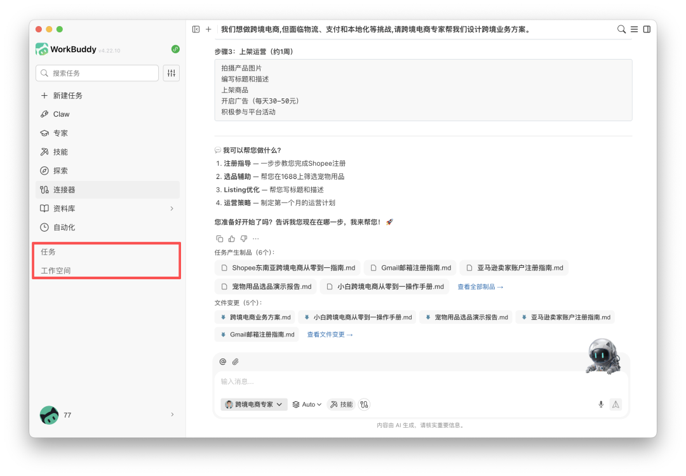

每一个你在 WorkBuddy 里做过的事，都会<strong>自动保存</strong>为一条任务。它不仅保存你的指令，还<strong>锁定当时的上下文</strong>——相当于给这个任务包了一层保鲜膜，下次打开，思路还在原地等你。

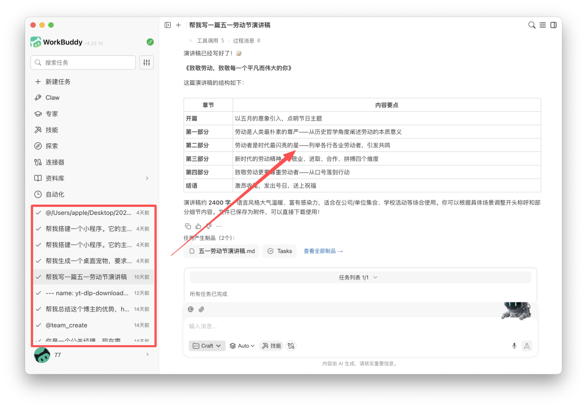

如果遇到复杂任务，比如既要分析竞品数据、又要写推广方案、还要做用户调研，是不是非常担心任务混乱？没关系，<strong>在输入指令前，右下角先把工作空间设好，这样每个项目就会单独存放各自的文档和对话记录里了。</strong>各是各，互不污染。

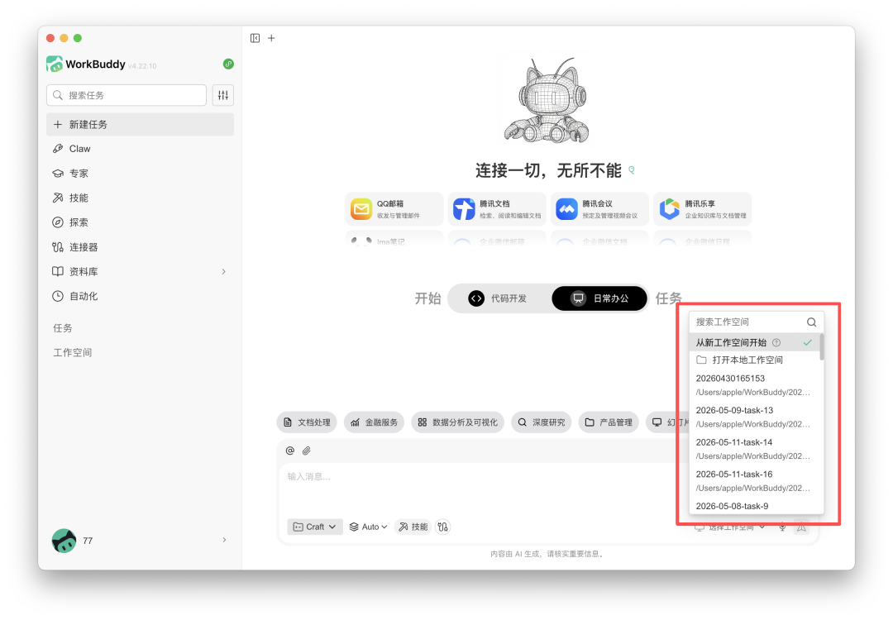

如果长期内不会查看这些任务，可以直接点击任务<strong>右边的归档按钮，</strong>我就会帮你<strong>收藏</strong>起来了。

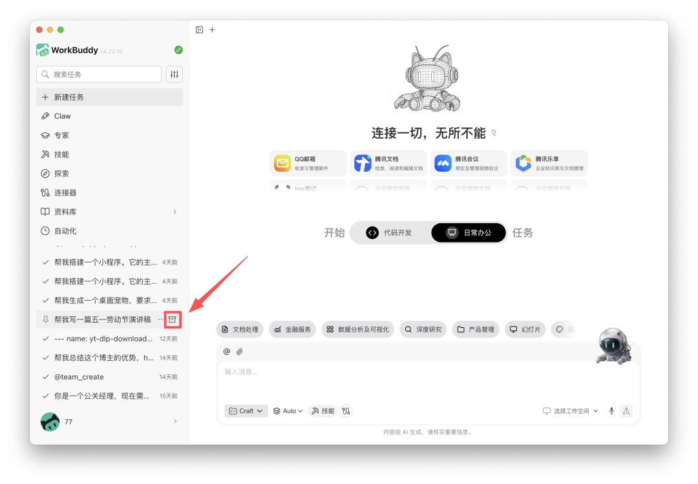

点击<strong>头像</strong>里的设置，再点击<strong>数据管理</strong>就能看到<strong>已经归档</strong>的任务啦

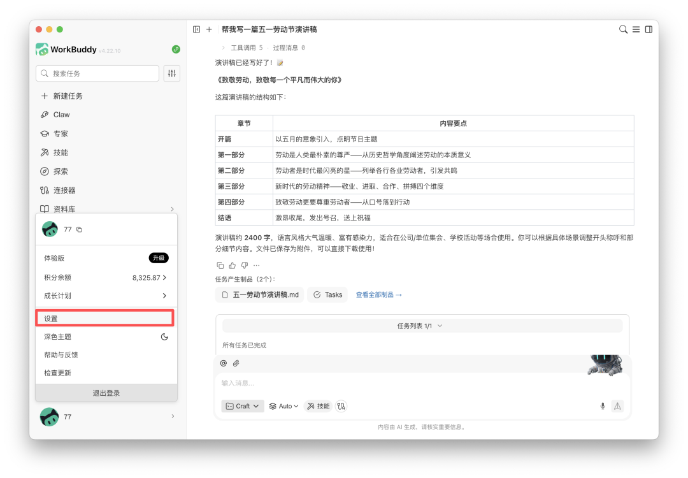

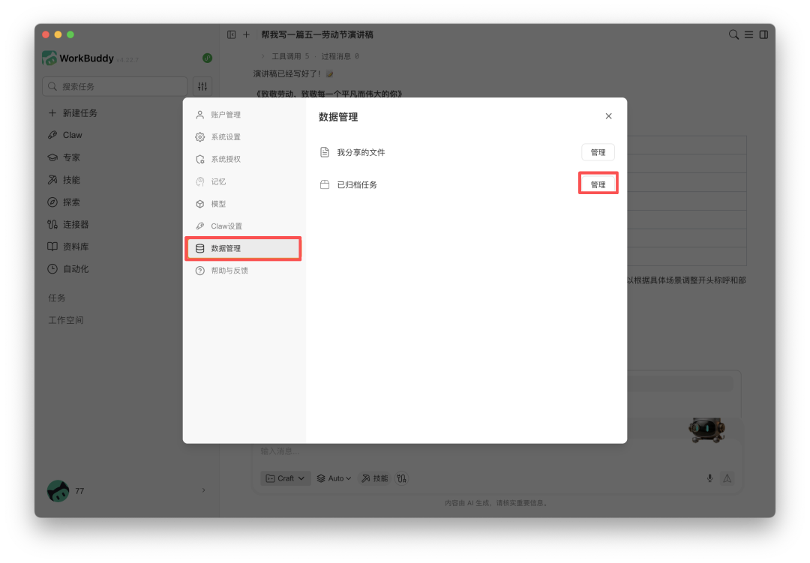

<strong>小技巧：善用任务重命名：</strong>任务默认会用你第一条指令的前几个字命名，时间一长满屏都是&quot;帮我写&quot;一&quot;帮我分析&quot;——根本分不清哪个是哪个。

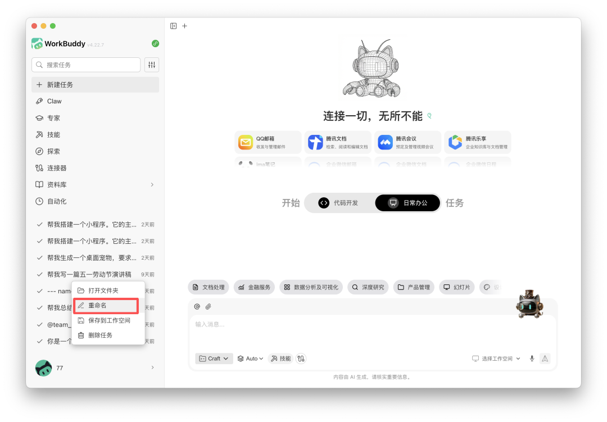

鼠标放在每个任务上，点击<strong>右侧三个点</strong>，戳一下重命名，给它起个清晰的名字，比如“Q2 推广方案”、“竞品分析 4 月”，任务栏瞬间清爽好找。

## <strong>2.召唤不同专家，让任务完成更专业</strong>

WorkBuddy 内置了<strong>100+ 专业领域的 AI 专家。</strong>

你的所有任务都会7×24小时待命解决～处理单个/单领域问题时可以找专家，财务专家帮你分析报表、做预算；法律专家帮你审合同、写协议……

处理从0-1的跨领域复杂任务时就找专家团，团长会分配任务，多名专家团员会协作分工，进行多维度协作交付结果。区别于 Skill ，专家与专家团都是<strong>深度对话模式，</strong>可以直接进去聊背景、聊需求，给出的结果更<strong>贴合专业场景。</strong>

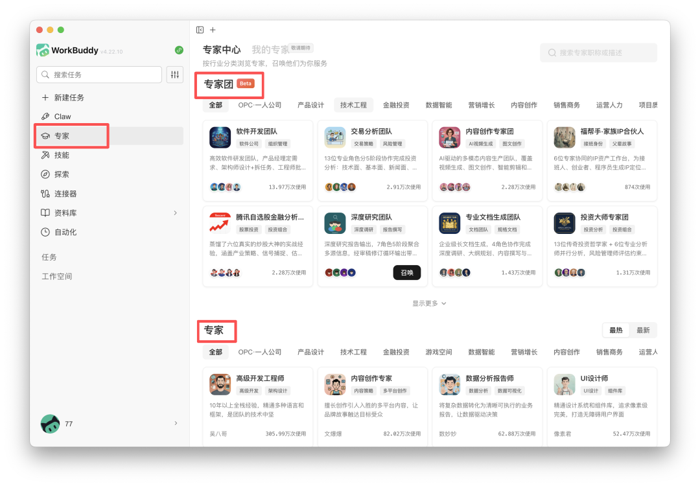

<strong>场景运用：</strong>你是一家创业公司的程序员，要设计一个小程序。直接召唤&quot;微信小程序开发者&quot;，把<strong>面向人群、功能、主要内容</strong>告诉我（ WorkBuddy ），我就会帮你敲代码，几分钟就搞定！

<strong>操作步骤：</strong>

·方式一：点击<strong>左侧「专家」，</strong>在<strong>搜索栏</strong>里找合适的，直接召唤。

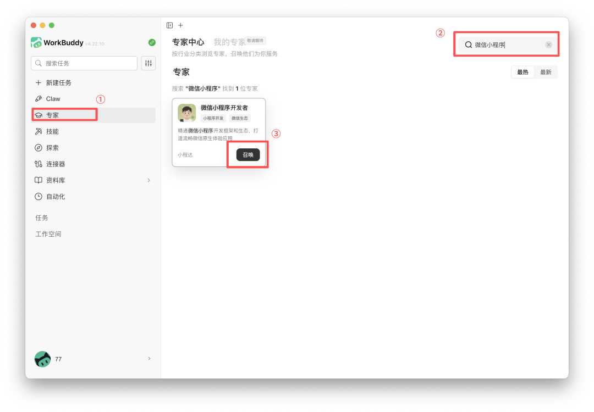

·方式二：在<strong>输入框下方的 Craft</strong>旁边，直接输入专家名字召唤。

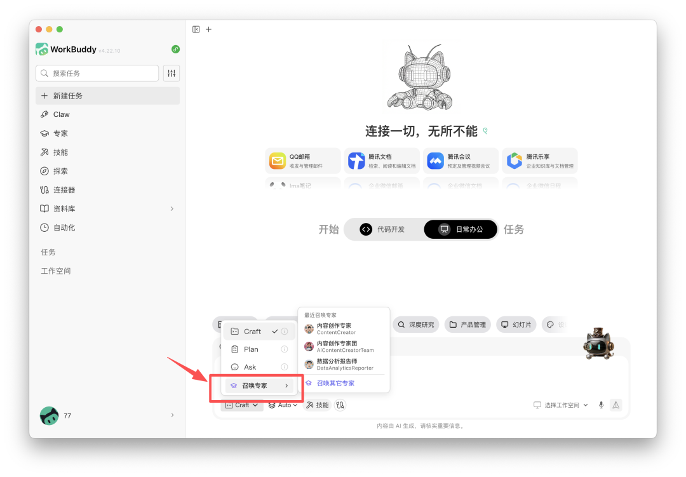

叫对专家，<strong>效率翻倍。</strong>

## <strong>3.自动定期重复任务，让你的手彻底解放</strong>

有些事，重复耗时、却又很枯燥——

·每天早上整理昨天的运营数据

·每天晚上写工作总结

·每周一生成上周周报

你花 10 分钟做 Excel ，我花 10 秒帮你搞定，然后你去干<strong>真正重要的事</strong>。这就是<strong>自动化</strong>的价值：你设计规则，我来执行，定时定点，风雨无阻

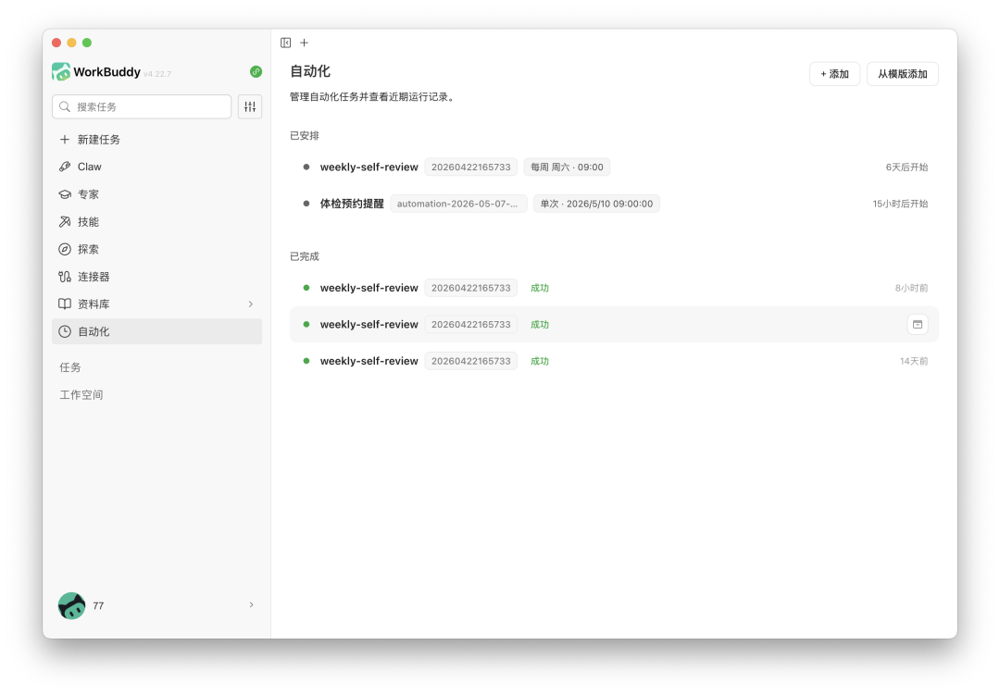

<strong>场景运用：</strong>你是一位每天忙碌的上班族，但是现在面临房子到期。但是，一下班只想躺在床上刷手机，根本不想找房源。交给我吧！

<strong>操作步骤：</strong>

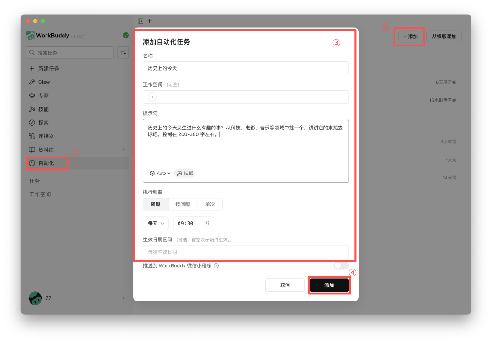

点击左侧<strong>「自动化」</strong>→ 戳右上角<strong>「添加」</strong>→ 按顺序填写<strong>信息</strong>、输入<strong>提示词</strong>→ 设置<strong>触发时间</strong>→ 点击<strong>「添加」</strong>完成。

<strong>重复的事交给我，</strong>创意和决策的事留给你。

## <strong>4.用 Skills 复用高效、稳定的 SOP</strong><strong><em>()</em></strong>

&quot;能不能帮我做个 PPT ？&quot;&quot;能不能生成一张图？&quot;

答案是：能，但为什么别人用 AI 做的 PPT 这么好看？

要看有没有对应的<strong>Skills</strong>加持。用上了PPT skill，做出来的PPT质感完全不一样噢！

Skills 是我（ WorkBuddy ） 的能力扩展包——每个 Skill 背后都有<strong>专业领域的 SOP</strong>、<strong>工具和脚本</strong>，相当于给你配了一个领域里的&quot;老师傅&quot;。

内置<strong>上百个 Skills</strong>，无论你要做什么—— PPT、图片、PDF 、数据分析、爆款文案——找到对应的 Skill 安装上，我就能超常发挥。

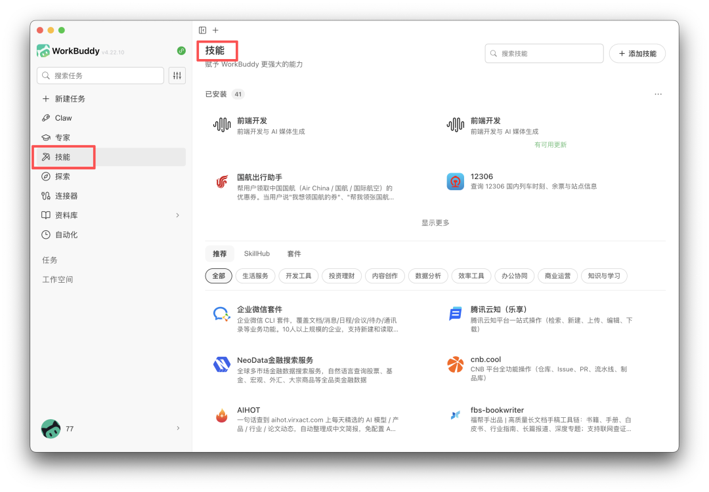

<strong>场景运用：</strong>你是一个网页设计师，现在需要设计一个网页的UI，想半天没有好的创意？你只需选中<strong>品牌设计风格专家 Skill ，然后输入指令，</strong>就可以在短时间内拿到多份创意设计了。

<strong>操作步骤：</strong>

第一步：在<strong>技能市场</strong>搜索你需要的 Skill ，点击<strong>「＋」</strong>安装。

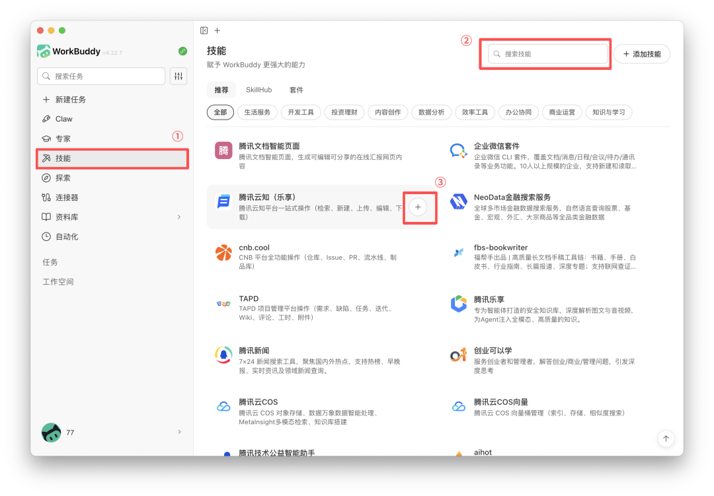

第二步：在主页面<strong>提示词框下面</strong>，点击<strong>Skill</strong>，选择你需要的，开始任务。

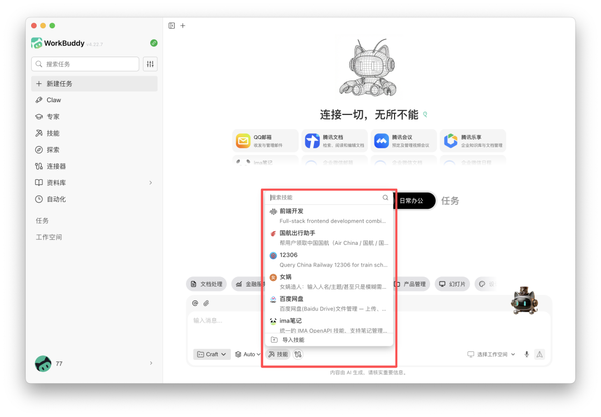

哪里不会装哪里，<strong>像搭积木一样简单。</strong>

## <strong>5.用 Claw 打通微信，随时随地安排工作</strong>

你在地铁上，突然想起一件事想让我来处理。电脑没带。算了，到公司再说。……然后到公司，我要干啥来着？

我（ WorkBuddy ）支持<strong>接入微信、企业微信、QQ、小程序。</strong>在这些平台上直接给我发消息，我就能帮你搞定，两者<strong>完全互通</strong>，所有<strong>任务记录同步保存。</strong>

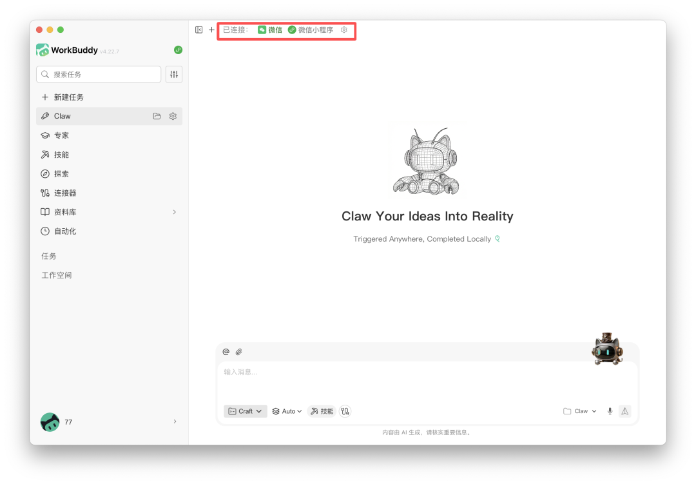

<strong>场景运用：</strong>今天家里没人接小孩，只能你去，但是手里的工作还没干完，孩子老师又一直打电话催。这时候，你只需要在微信或者QQ等平台上给我发指令，<strong>只要电脑是开着的，无论你在哪我都可以帮你工作。</strong>

<strong>操作步骤：</strong>

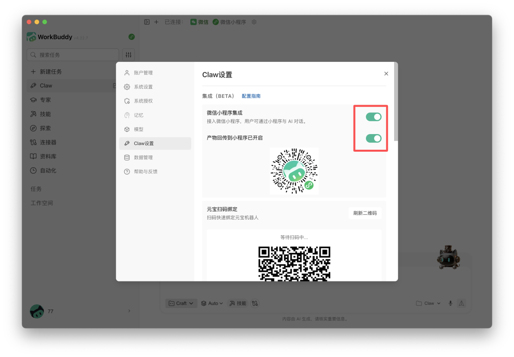

点击左侧<strong>「 Claw 」</strong>→ 点击上方<strong>「配置」</strong>→ 一键连接你想用的平台。让你的工作<strong>随时在线，不被设备限制。</strong>

## <strong>6.探索精选案例，一键复用，生成专属版本</strong>

你是一个AI小白，想要通过AI做出属于自己的东西，但是得自己研究怎么做、看懂了还要会做。

我（ WorkBuddy ）<strong>「探索」</strong>模块直接帮你降低使用门槛，<strong>内置上百种精选案例</strong>，所见即所得！你想要做什么，直接搜索，一键复用。<strong>你不需要自己写 Prompt， Skill 和专家也已经关联好，你只需自己改关键词就可以。</strong>

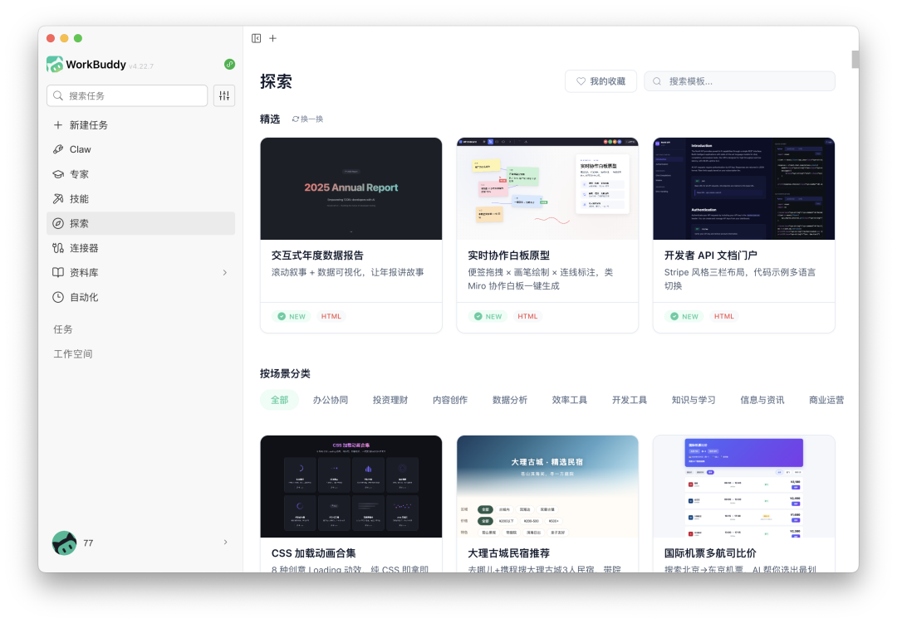

场景运用：马上临近暑假了，你想要带着孩子出去旅游。从其他平台上制作攻略还需要一个一个信息筛选，一遍一遍改方案，每天忙于工作的你哪有时间做这些。这时候，你只需<strong>挪出1分钟的时间</strong>，给我<strong>输出指令</strong>就可以得到一份<strong>完美的假期一站式规划了。</strong>

<strong>操作步骤：</strong>

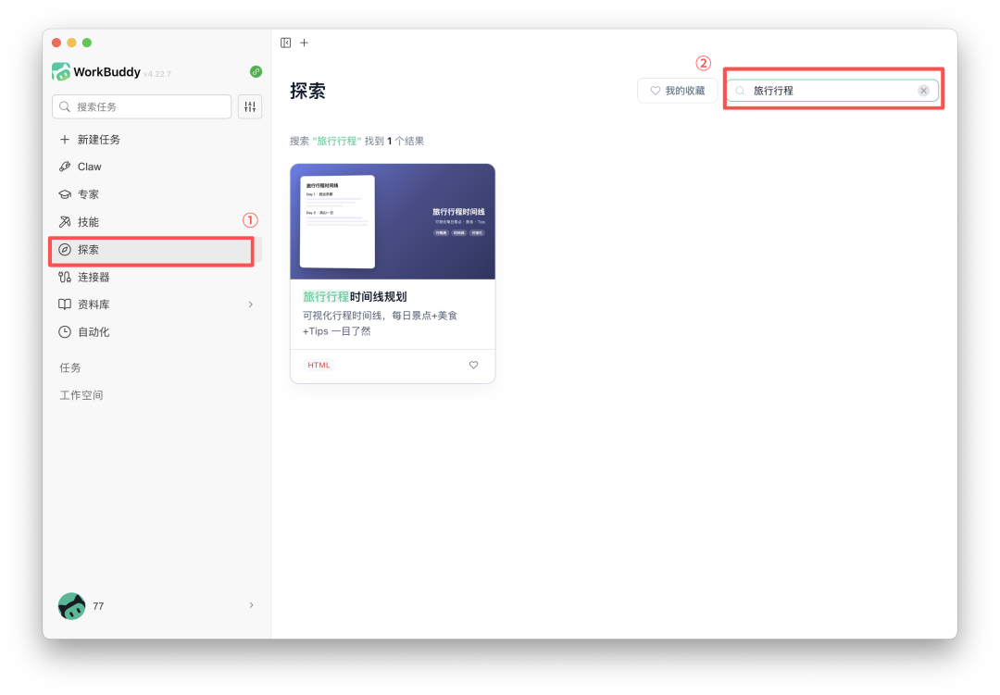

点击<strong>「探索」</strong>，随后在<strong>「搜索栏」</strong>里输入你希望我做的东西。

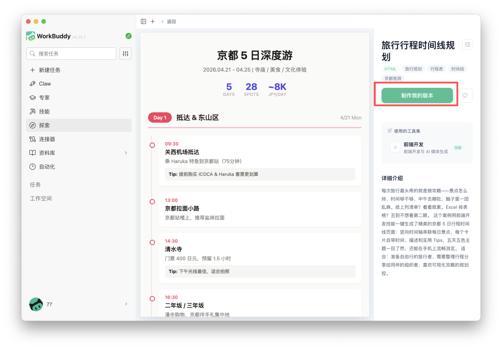

点击<strong>「制作我的版本」</strong>

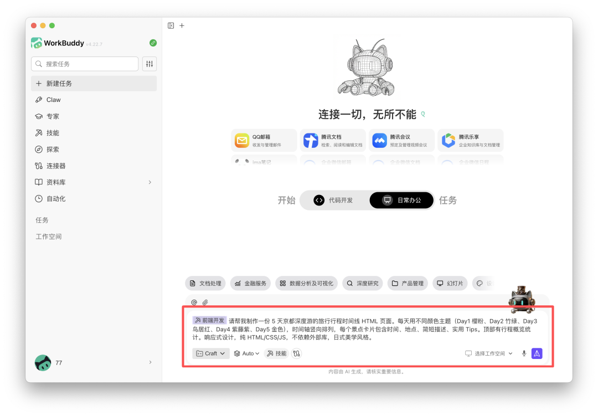

只需在<strong>「提示词框」中改关键词</strong>就可以。

