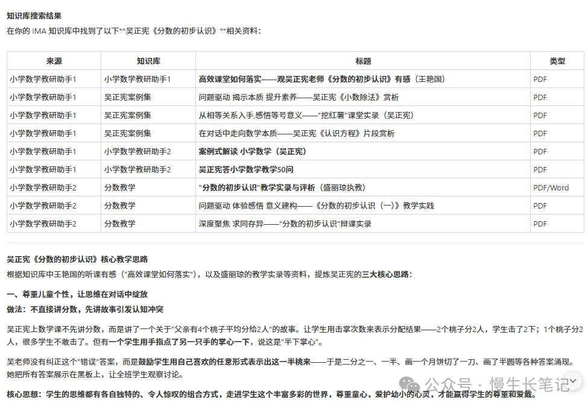
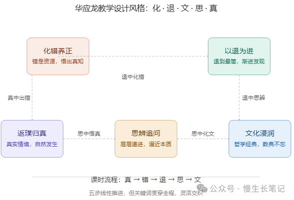
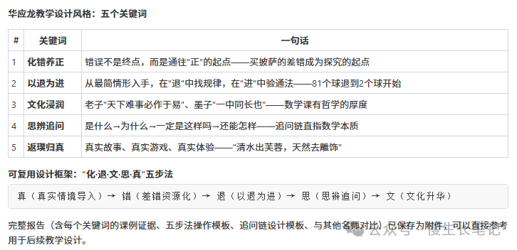
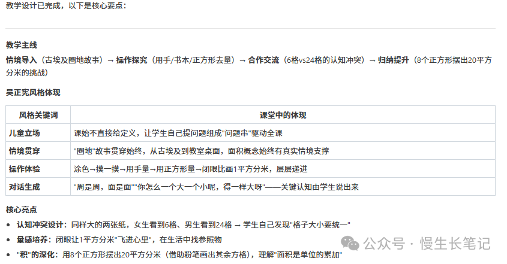

# 【教师专用版】WorkBuddy + ima：自动备课实操教程

## 资料在下面

---

> [!NOTE]
> 
🥇 今天跟大家聊一位&quot;ai新同事&quot;——<strong>WorkBuddy</strong>，跟<strong>ima</strong>。它不是那种只会给你提供情绪价值的小可爱<strong>豆包</strong>、<strong>元宝</strong>，是有事真能上的那种。装在你电脑上，你动动嘴皮子，它就去义无反顾地执行。

>
> 
这篇文章，我想给大家提供一种完整的思路，供大家模仿、实践：<strong>ima 建自己的专属教学资源库→ 刨析名师风格、按要求撰写教学设计 → 一键备份回 ima，形成教案集 → 按进度表设好计划任务，每天到点自动写教学设计</strong>。

全程聊天就可以。不用学代码和编程。

---

### 一、WorkBuddy 是谁

一句话概括：

WorkBuddy 是腾讯的桌面 AI 智能体，称它&quot;全能虾&quot;也不为过。它兄弟准多，办公的腾讯文档、对话式ai元宝、知识库专家ima、系统级的智能体QClaw和marvis……

跟咱们老师有关的几个点：

<ul><li><strong>打通软件壁障。</strong>与腾讯文档、金山文档等办公软件、与微信、企业微信等通讯软件，多端协同工作，高效互联互通。</li><li><strong>能连 ima 知识库</strong>。你在 ima 里存的那些名师课例、课标解读，它能读能写。</li><li><strong>支持计划任务，一件设置，自动完成</strong>。设好时间到点执行，不用人盯着，省心省力。</li><li><strong>安装学习现成的技能包</strong>。丰富的技能包，覆盖备课、出题、统计分析数据、撰写材料等需求，即点既用。</li><li><strong>免费</strong>。这个很重要！</li></ul>

WorkBuddy 官网下载，安装，完成准备工作。

---

### 二、第一步：链接ima 知识库，让文件夹从此不积灰

估计每个老师都会想松鼠一样，不停的攒！攒！攒！名师的课例、各级各类的公开课示范课、专家教授发的讲稿讲座ppt、自己收集的课程标准、以备不时之需的各种格式的教案，混杂在自己日积月累的教学资料中……问题是，它们散在电脑文件夹里、微信收藏里、浏览器收藏夹里。真要用了，永远也找不到。

让WorkBuddy链接ima，这些东西就变成了一个能流动起来的的专属资源库。

怎么做：

<ol><li>电脑上先装好腾讯 ima；</li><li>在 ima 里建个个人知识库，命名随便，如&quot;小学数学备课资料&quot;；</li><li>把相关的教学资源上传——吴正宪相关教学实录、华应龙的经典课例合集、俞正强的&quot;种子课&quot;专著、贲友林的&quot;学为中心&quot;相关论述、2022 版新课标、新教材、教师用书、学校下发的备课模板，连同自己以前写的那些优质教案，统统扔进去。别嫌多，越多越准（可以利用ima的copilot，一键完成整理）。</li><li>打开 WorkBuddy → 技能市场 → 搜<code>ima-skill</code>→ 安装。</li><li>按照指引获取 ima 的 API Key 和 Client ID，填进去，授权一次就通了。</li></ol>

完成后，你就可以这样跟 WorkBuddy 对话：

> 
在我 ima 知识库里搜一下&quot;分数的初步认识&quot;，把吴正宪老师相关的教学设计找出来，提炼她的核心思路。

它直接在你的ima知识库里海量的文件中搜索、整理、归纳后发给你。比你手动翻文件夹快得多，既全面又深入。

接着再做一件事——让它把名师的风格&quot;挖&quot;出来：

> 
分析我知识库中华应龙老师的所有课例，把他的教学设计风格归纳成五个关键词，再给一套可复用的设计框架。

它会读完你存的资料，输出类似这样的东西：

> 
>
> 

每位名师的&quot;设计精髓&quot;都被你&quot;采&quot;到了。以后写教案，想切换那种风格就切换哪种。

---

### 三、第二步：根据模板撰写教学设计，AI 当备课助手

知识库接好了，名师风格也选定了，接下来动手写教案。

给你一个我正在用的指令，直接复制改改就行：

> 
参考我 ima 知识库中吴正宪老师的教学设计风格（关键词：儿童立场、情境贯穿、操作体验、对话生成），为北师大版三年级下册《面积》第一课时写一份同步教学设计。  要求： 1. 对标 2022 版新课标核心素养目标 2. 包含：教学目标、教学重难点、教学准备、教学过程（导入-新授-巩固-总结）、板书设计、作业设计 3. 教学主线按&quot;情境导入→操作探究→合作交流→归纳提升&quot;走 4. 每个环节标注设计意图5. 语言别太书面，适合课堂实际用

几十秒，一份结构完整、带有名师气质的设计就出来了。

当然，还没完，你拿到之后还可以玩点花样：

<strong>换风格：</strong>

> 
把刚才面积那节课，换成华应龙老师的风格重写一遍。强调&quot;化错&quot;和大问题驱动。

两份同课异构，对比着看，各取所长。这搁以前，太不容易了。

<strong>换教材：</strong>

> 
把这份设计的北师版内容替换成人教版版对应章节，例题和习题也换成对应的。

即完成了竖向的教材分析，也完成了横向的教学对比。减负增效，不言自喻。

<strong>补细节：</strong>

> 
在这份教案基础上加两个板块：分层教学建议与学生评价建议。

分层教学、教学评一体化，这些专业理念，统统都可以融入到你的教学中来。

---

### 四、第三步：写完的教案，一键存回 ima，即时整理

以往好多老师大多都是这样的：ai生成 → 复制 → 打开 Word → 粘贴 → 调格式 →保存 → 打印。重复执行n次。

WorkBuddy 链接 ima 之后，一条指令：

> 
把刚才那份《面积》第一课时的教学设计，存进 ima 知识库的&quot;三年级下册教案&quot;文件夹。

它自己完成新建、写入、存入。全程后台完成。

当然，如果你们学校集体备课，你们备课组完全可以使用共享知识库，大家都可以把自己的教案存进去：

> 
把这份教案发到 ima 的&quot;三年级数学组共享知识库&quot;，标注&quot;第5周·面积单元·第1课时·吴正宪风格&quot;。

分工协作，集体共享。一个人的备课成果，一群人的起点，省时省力，何乐而不为呢。

---

### 五、第四步：开启计划任务——真正实现躺平式备课

哈哈，这个才是各位牛马真正要学习的技能！！

#### 能不能不突击补教案？

当然可以。每学期开学初，你手上都有一份教学进度表。长这样：

<table><thead><tr><th>周次</th><th>日期</th><th>教学内容</th><th>课时</th></tr></thead><tbody><tr><td>第1周</td><td>9.2-9.8</td><td>混合运算《小熊购物》</td><td>3</td></tr><tr><td>第2周</td><td>9.9-9.15</td><td>《买文具》《过河》</td><td>4</td></tr></tbody></table>

你就说，你填完教学进度表后，后面还会再翻吗？大概补教案的时候，才会回忆一下，几月几号上了什么，一篇一篇往回补。补到后面手酸眼花，内容自己都不敢细看。

有了计划任务以后，事情就简单多了。

#### 怎么设置

WorkBuddy 里对话创建计划任务：

> 
帮我创建计划任务：<strong>任务名</strong>：每日教学教学计划自动撰写<strong>执行时间</strong>：每个工作日下午五点<strong>指令</strong>：

>
> 
你是小学数学教学设计专家。请按以下要求生成教学设计详案并保存到 IMA 知识库。

>
> 
生成教学设计详案，约3000字，吴正宪风格。

>
> 
1.包含8大板块：教学内容分析、教学目标、教学重难点、教学准备、教学过程（含5个教学板块）、板书设计、作业设计、教学反思预设。

>
> 
2.本地备份并且，上传到 IMA 知识库

>
> 
3.完成后，通知我文件位置，保存是否成功。

一次设置，整学期有效。你放学前收到微信通知，打开扫一眼，只需要把跟自己实际课堂出入的地方改一改，几分钟的事情。

#### 把进度表整个喂进去

当然，你还可以一步到位：

把整学期的教学进度表扔给 WorkBuddy（Excel 拖进去、或者直接粘贴文本都行），告诉它：

> 
严格按这份进度表，每个工作日按当天的教学内容写教学笔记。遇到节假日和学校活动日自动跳过。单元复习课那几天，教学设计侧重复习效果和学生易错点。考试那天改成试卷分析。

你只需要，上班打开电脑，下班关闭电脑。

过个两三周，检查一下ima知识库的成果，有没有按计划来。调课、请假、临时变动教学计划，直接告诉WorkBuddy。

---

### 六、有没有懵逼，我帮你捋捋

还没调试成功的，按这个顺序检查一遍：

<table><thead><tr><th>步骤</th><th>干什么</th><th>花多久</th></tr></thead><tbody><tr><td>①</td><td>下载装好 WorkBuddy</td><td>5分钟</td></tr><tr><td>②</td><td>技能市场装 ima-skill，授权连接</td><td>10分钟</td></tr><tr><td>③</td><td>往 ima 知识库里扔资料，让 AI 提炼一到两位名师风格</td><td>15分钟</td></tr><tr><td>④</td><td>用上面那个 prompt 生成第一份同步教学设计</td><td>2分钟</td></tr><tr><td>⑤</td><td>确认、微调、一键存回 ima 知识库</td><td>3分钟</td></tr><tr><td>⑥</td><td>装 teaching-note-scheduler 技能，设好每日教学笔记计划任务</td><td>5分钟</td></tr></tbody></table>

---

上面这四步——连 ima、写设计、存知识库、排计划任务——看着多，但每一步都是固定的。我把这套流程打包成了一个技能包(skill)，叫 teaching-note-scheduler，中文名“小学数学教师教学设计自动生成器”。

你打开 WorkBuddy，复制提示词，发送给任意 AI 助手即可安装 Skill，包括但不限于WorkBuddy、QClaw、Kimi等。

> 
请先检查是否已安装 SkillHub 商店，若未安装，请根据 <a href="../references/links.md#ref-skillhub-cn-install-skillhub-md">SkillHub 安装说明的本地副本</a> 安装SkillHub商店，但是只安装CLI，然后安装teaching-note-scheduler技能。若已安装，则直接安装teaching-note-scheduler技能。

装完后重启软件，你的电脑就学会这个技能了。以后对着 WorkBuddy 说一句&quot;帮我写今天的教学设计&quot;，它按你指定的流程运作起来。

一次安装，管一个学期

