# Workbuddy+HR工作的一整套流程完整版搭建教程

## 资料在下面

---

手动写JD、筛简历筛到眼花、面试总是不知道问什么、面完还得写报告……

这些事你是不是每周都在做，而且一做就是一整天？

现在，有了WorkBuddy，<strong>直接能拥有一个HR团队</strong>，就能帮你处理掉这些重复劳动！

从<strong>招聘的JD撰写</strong>、<strong>简历搜集&amp;筛选&amp;打分</strong>、<strong>针对性的面试准备</strong>、<strong>面评撰写到人才Mapping</strong>等，这些WorkBuddy都能帮到你。

快来看看，有了Buddy的工作到底有多顺👇

## 手把手教学

<strong>1.招聘：写JD，一句话的事</strong>

你只需要把任务需求、待处理的文件上传到WorkBuddy，Buddy就会开始处理工作。

比如，你需要<strong>写一份招聘岗位JD，你可以说：</strong>

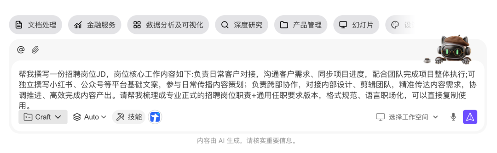

帮我撰写一份招聘岗位JD，岗位核心工作内容如下:负责日常客户对接，沟通客户需求、同步项目进度，配合团队完成项目整体执行;可独立撰写小红书、公众号等平台基础文案，参与日常传播内容策划；负责跨部协作，对接内部设计、剪辑团队，精准传达内容需求，协调推进、高效完成内容产出。请帮我梳理成专业正式的招聘岗位职责+通用任职要求版本，格式规范、语言职场化，可以直接复制使用。

我会按HR运营团队的标准流程来根据岗位定位来整理一份专业 JD。

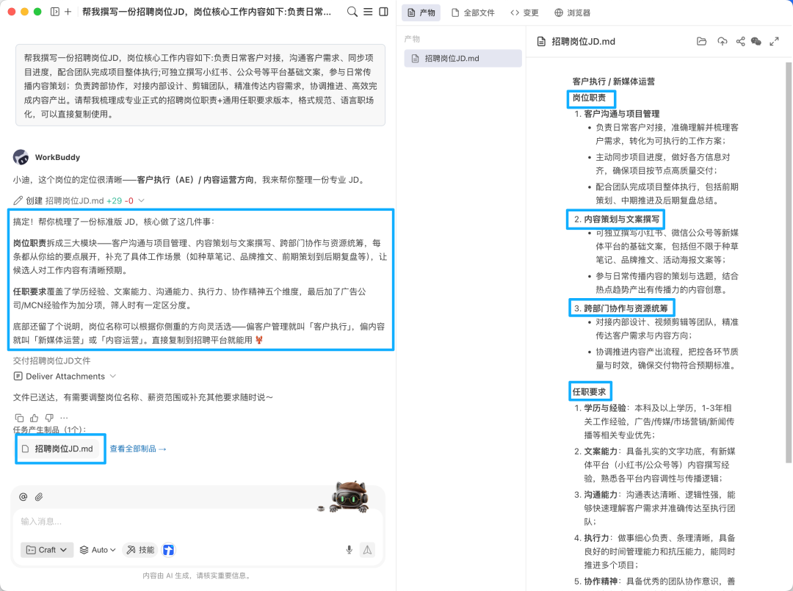

<strong>2.简历搜集&amp;筛选&amp;打分</strong>

不仅如此，我还能根据上下文，<strong>结合JD，帮你从QQ邮箱简历中</strong>精准筛选出匹配度高的人选简历，免去一次次导出-翻看-筛选的繁琐工作。

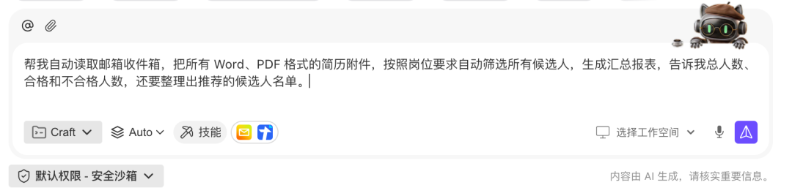

帮我自动读取邮箱收件箱，把所有 Word、PDF 格式的简历附件，按照岗位要求自动筛选所有候选人，生成汇总报表，告诉我总人数、合格和不合格人数，还要整理出推荐的候选人名单。

<strong>tips：通过连接器一键绑定QQ邮箱，可以直接调用邮箱内容，更支持把邮箱中的文件下载到本地。</strong>

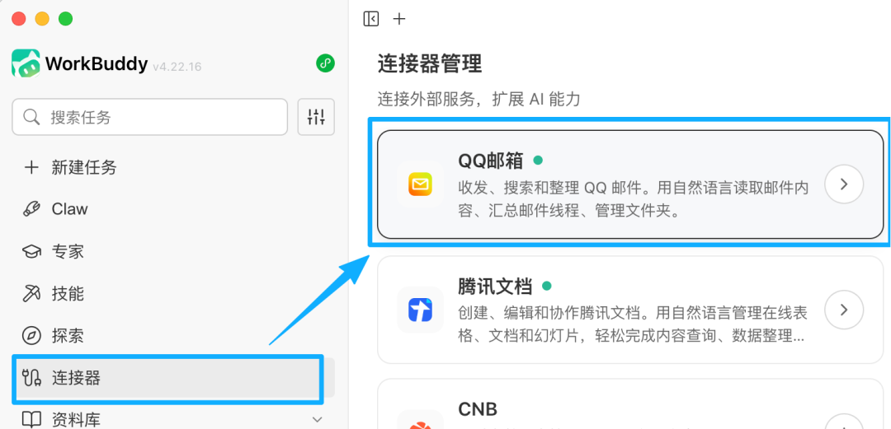

WorkBuddy会连接你的邮箱，逐个分析简历 → 解析简历内容 → 按JD筛选 → 生成汇总报表。

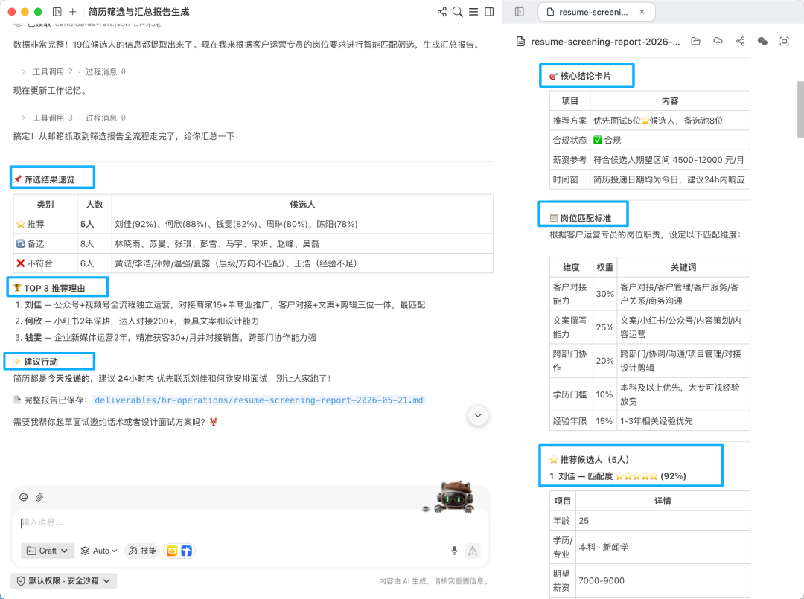

最后，根据岗位JD，给出候选人详细评估报告。

当然也可以<strong>本地读取文件名</strong>，交给Buddy分析筛选候选人哦～

<strong>试着对我说：</strong>

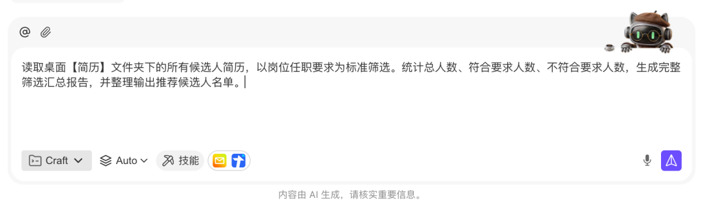

读取桌面【简历】文件夹下的所有候选人简历，以岗位任职要求为标准筛选。统计总人数、符合要求人数、不符合要求人数，生成完整筛选汇总报告，并整理输出推荐候选人名单。

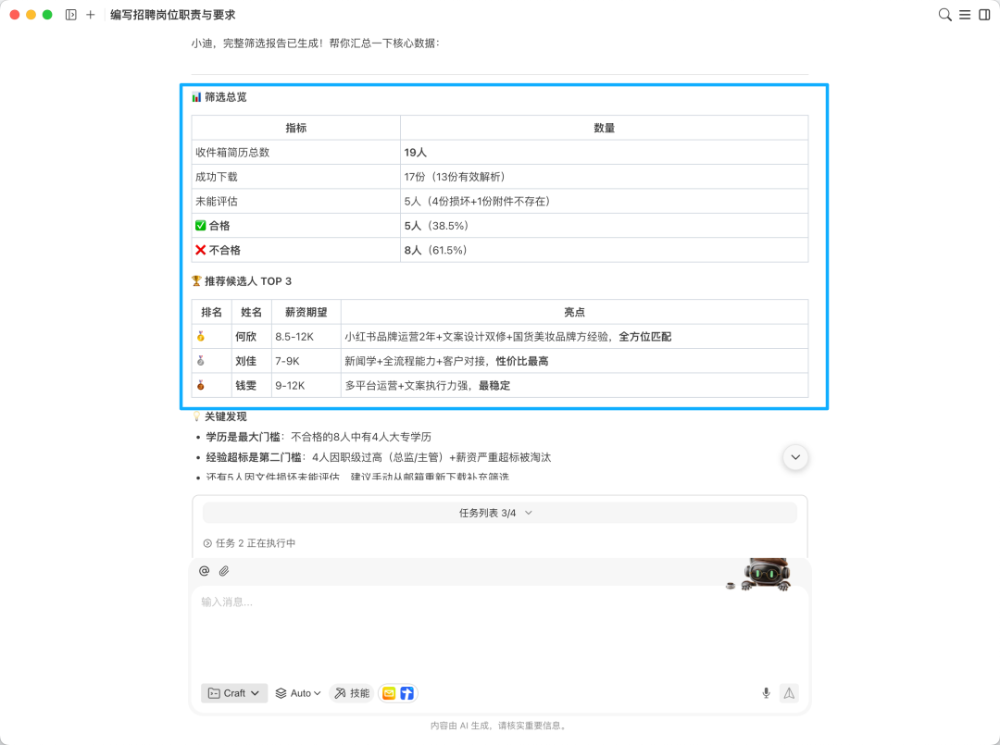

<strong>3.面试准备：根据岗位自动生成面试问题</strong>

有了岗位需求、岗位候选人，接下来就进入到面试环节。不少人面试时常常无从发问，也不知道如何在有限时间内完成对候选人的全面考察。

<strong>你只需要对我说：</strong>

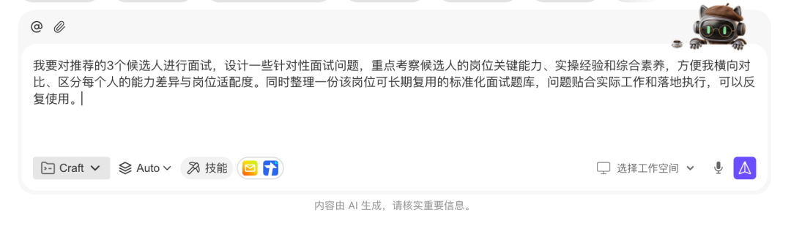

我要对推荐的3个候选人进行面试，设计一些针对性面试问题，重点考察候选人的岗位关键能力、实操经验和综合素养，方便我横向对比、区分每个人的能力差异与岗位适配度。同时整理一份该岗位可长期复用的标准化面试题库，问题贴合实际工作和落地执行，可以反复使用。

我会先读取简历筛选报告和候选人数据，来输出面试方案和题库。

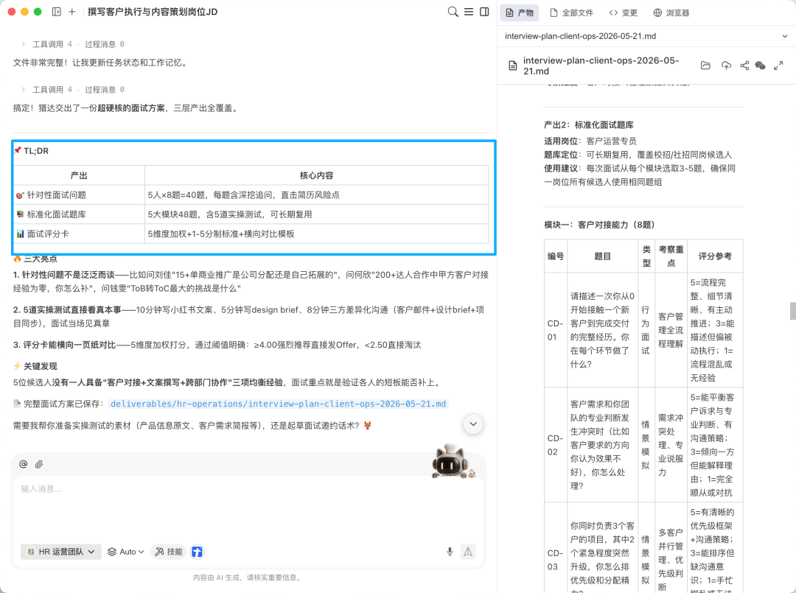

<strong>4.面评撰写：面试写总结，自动一键生成</strong>

每次面完候选人都得写面试报告汇报，之前总对着空文档憋不出内容，现在可以这样👇

<strong>把面试记录给我，然后说：</strong>

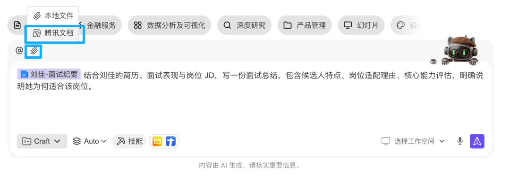

结合刘佳的简历、面试表现与岗位 JD，写一份面试总结，包含候选人特点、岗位适配理由、核心能力评估，明确说明她为何适合该岗位。

当我读取数据后，就会开始结合岗位职责要求写面试评估报告，为你提供建议。

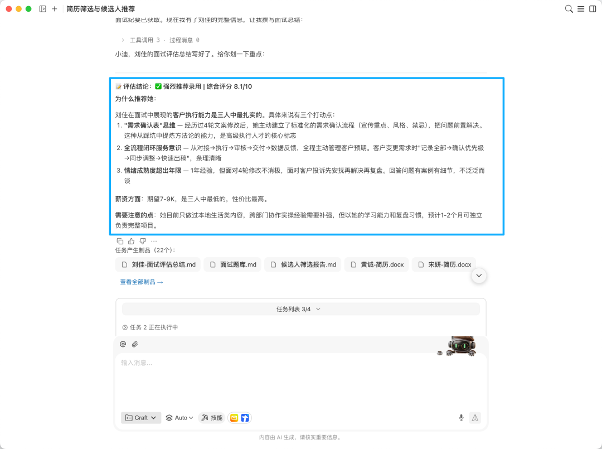

<strong>5.Mapping：人才对标超省心，告别手动扒数据</strong>

领导让你做友商公司的某某岗位的人才分析画像，以前你得翻遍招聘网站、脉脉、年报……手搓n天。

<strong>现在跟我说：</strong>

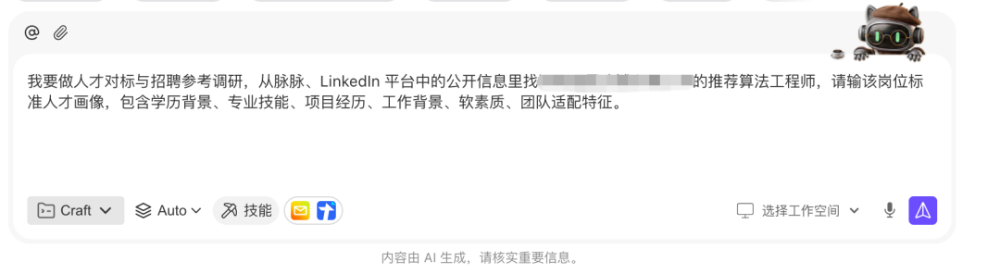

我要做人才对标与招聘参考调研，从脉脉、LinkedIn 平台中的公开信息里找xx公司的推荐算法工程师，请输该岗位标准人才画像，包含学历背景、专业技能、项目经历、工作背景、软素质、团队适配特征。

我就会自动搜集全网的公开信息，进行搜集整理，最后按HR运营团队的标准工作流来帮你做这份人才画像。

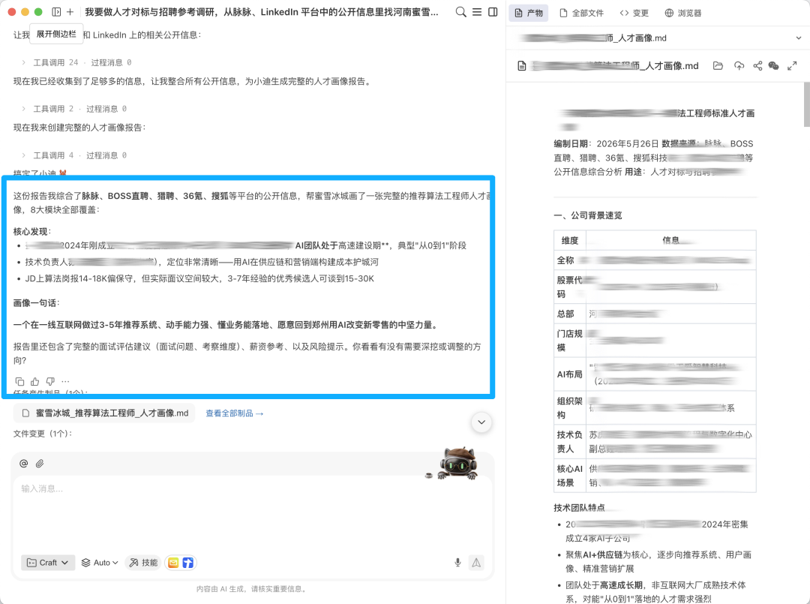

## 不想从零开始？

## 去“探索”广场抄作业

如果你嫌写指令麻烦，或者想看看别人怎么玩的——

<strong>WorkBuddy的「探索」广场已经为你备好了精选案例。</strong>

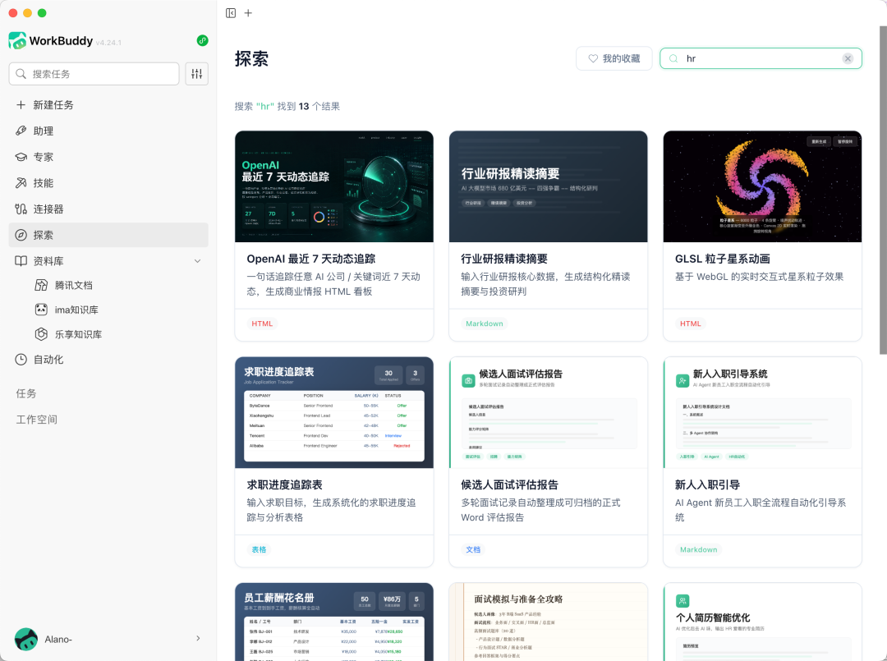

从<strong>「候选人面试评估报告」到「新人入职引导」</strong>……直接选用案例，一键套用，替换信息就能完成。

## 写在最后

那些让HR头大的重复劳动——

面试评估写三遍、绩效反馈词穷、FAQ回答得像复读机……

统统丢给你的AI团队。

<strong>你只管去做那些真正有价值的事：</strong>

跟候选人好好聊聊、帮员工规划成长路线、想想团队怎么能激发更大的活力

别犹豫了，打开WorkBuddy，说出你的要求，

<strong>你会发现，真的不一样！</strong>

