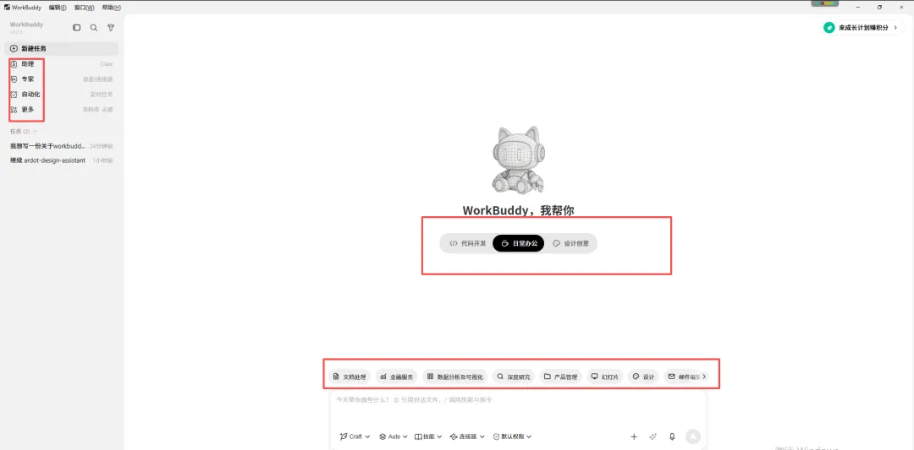
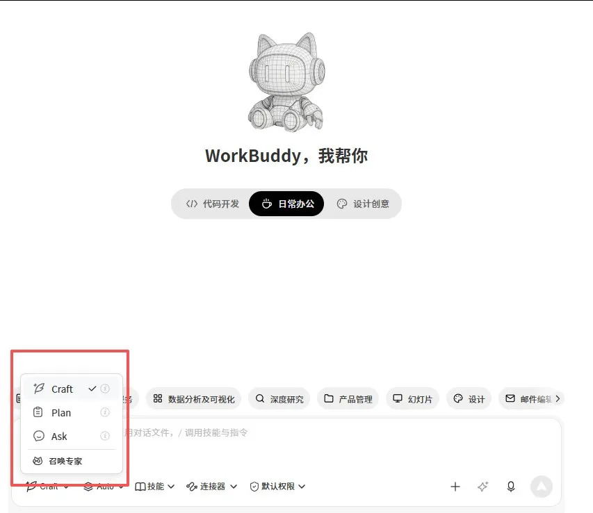
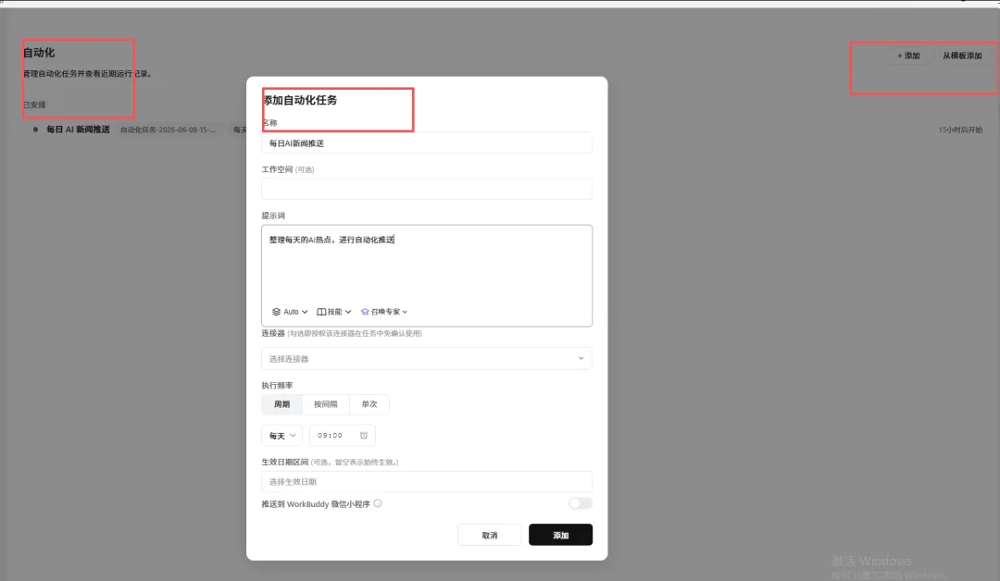
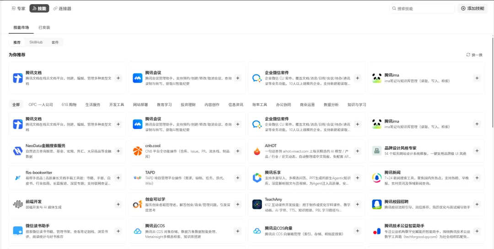
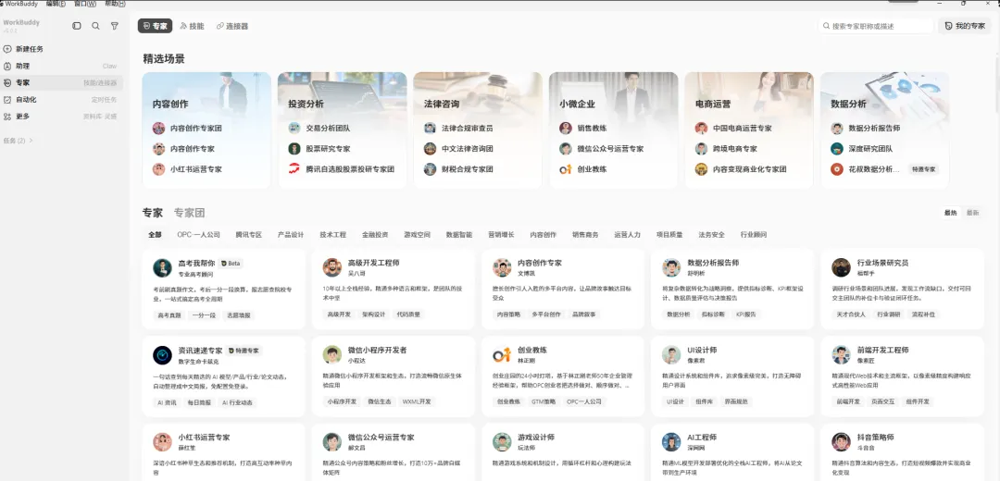
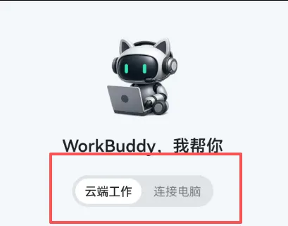

# WorkBuddy 保姆级攻略：从零到精通，让 AI 真正帮你干活！

## 资料在下面

---

## 1.WorkBuddy 是什么？

<p>WorkBuddy（内部代号&quot;小龙虾&quot;🦞）是<strong>腾讯云 CodeBuddy 团队</strong>推出的<strong>全场景 AI 桌面智能体工作台</strong>，2026 年 3 月正式公测。</p>

<p>用最通俗的话说：<strong>以前 AI 只能跟你聊天，WorkBuddy 能直接帮你干活。</strong></p>

<p>你只需要用一句话描述需求，WorkBuddy 就会自主拆解任务、规划步骤、调用工具、执行操作，最终交付<strong>可以直接验收的工作成果</strong>——不是文字建议，而是实打实的文档、表格、PPT、整理后的文件。</p>



#### 六大核心能力速览

<table><tbody><tr><td><p>能力</p></td><td><p>说明</p></td></tr><tr><td><p>🧠 自然语言操控</p></td><td><p>一句话描述任务，AI 自动拆解并执行多步骤操作</p></td></tr><tr><td><p>📁 多格式文件处理</p></td><td><p>支持 Office（Word/Excel/PPT）、PDF、图片等文件的读写、合并、转换</p></td></tr><tr><td><p>🔄 多模型自由切换</p></td><td><p>内置混元、DeepSeek、GLM、Kimi 等 5+ 款主流大模型</p></td></tr><tr><td><p>📱 多端远程操控</p></td><td><p>通过微信/企业微信/QQ/飞书/钉钉手机端远程调度电脑任务</p></td></tr><tr><td><p>🔌 技能无限扩展</p></td><td><p>预置 20+ 专业技能包，支持零代码自定义 Skills</p></td></tr><tr><td><p>🔗 连接器生态</p></td><td><p>内置 QQ 邮箱、腾讯文档、腾讯乐享连接器，支持自定义 MCP 连接器</p></td></tr></tbody></table>

## 2.它和普通 AI 聊天有啥区别？

<p><strong>一句话说清</strong>：G-T 告诉你怎么做，WorkBuddy 直接帮你做。</p>

## 3.安装教程（3 分钟搞定）

#### 🖥️ Windows 用户

<p><strong>系统要求</strong>：Windows 10 1903+（推荐 Win11），内存 ≥ 4GB（推荐 8GB+），硬盘 ≥ 200MB</p>

<p><strong>安装步骤</strong>：</p>

<ol><li>打开官网 👉<u>codebuddy.cn/work</u></li><li>点击「<strong>Windows 版本下载</strong>」，下载安装包（约 150-180MB）</li><li>双击<code>WorkBuddySetup.exe</code>，<strong>右键以管理员身份运行</strong>（⚠️ 这步很重要，否则可能权限报错）</li><li>选择安装路径（<strong>建议默认路径，避免中文路径</strong>，中文路径可能导致后续插件安装失败）</li><li>勾选「创建桌面快捷方式」→ 点击「立即安装」</li><li>安装完成，勾选「立即启动 WorkBuddy」</li></ol>

> <p>⚠️<strong>安装前必看</strong>：关闭第三方杀毒软件（360、tx电脑管家等），避免误判自动化模块！</p>

#### 🍎 macOS 用户

<p><strong>系统要求</strong>：macOS 11.0+（推荐 macOS 14+）</p>

<p><strong>安装步骤</strong>：</p>

<ol><li>打开官网 👉<u>codebuddy.cn/work</u></li><li>下载<code>.dmg</code>安装包</li><li>双击<code>.dmg</code>文件，将 WorkBuddy 图标<strong>拖拽至「应用程序」文件夹</strong></li><li>首次启动若提示&quot;无法验证开发者&quot;：
<ul><li>• 打开<code>系统设置 → 隐私与安全性 → 安全性</code>→ 点击「仍要打开」</li></ul></li></ol>

#### 📋 建议提前安装的运行环境

<table><tbody><tr><td><p>环境</p></td><td><p>用途</p></td><td><p>说明</p></td></tr><tr><td><p>Node.js（LTS 版）</p></td><td><p>90%+ 插件的运行基础</p></td><td><p>安装时勾选&quot;添加到系统环境变量&quot;</p></td></tr><tr><td><p>Git</p></td><td><p>插件安装/更新</p></td><td><p>无 Git 可能导致插件安装失败</p></td></tr><tr><td><p>.NET Desktop Runtime</p></td><td><p>Windows 专属运行库</p></td><td><p>下载最新桌面运行时版</p></td></tr></tbody></table>

> <p>💡<strong>安装完以上环境后务必重启电脑！</strong></p>

## 4.首次启动配置（关键 4 步）

#### Step 1 — 登录账号 🔐

<p>支持wx<strong>、</strong>企业wx、扣扣扫码登录（推荐微信，最便捷）</p>

<p>首次登录赠送<strong>2000 Credits</strong>（免费算力积分）</p>

#### Step 2 — 文件夹授权 📂

<p>首次登录后会提示授权文件夹访问权限，这是 WorkBuddy 能操作你文件的前提：</p>

<ul><li>• ✅<strong>推荐授权</strong>：工作目录（桌面、文档、下载）</li><li>• ⚠️<strong>不要授权</strong>：系统盘、隐私文件夹</li><li>• 💡<strong>最佳实践</strong>：单独建一个工作区目录（如<code>D:\WorkBuddy</code>），专用于 AI 操作，安全隔离</li></ul>

#### Step 3 — 选择模型 🤖

<p>进入<code>左下角头像 → 设置 → 模型选项</code>：</p>

<table><tbody><tr><td><p>使用场景</p></td><td><p>推荐模型</p></td><td><p>理由</p></td></tr><tr><td><p>日常办公</p></td><td><p>混元</p></td><td><p>响应快，中文优化好</p></td></tr><tr><td><p>复杂推理</p></td><td><p>DeepSeek</p></td><td><p>推理能力强</p></td></tr><tr><td><p>代码任务</p></td><td><p>GLM / Kimi</p></td><td><p>代码理解能力突出</p></td></tr><tr><td><p>创意写作</p></td><td><p>Kimi</p></td><td><p>文本生成质量高</p></td></tr><tr><td><p>不确定选啥</p></td><td><p>自动模式</p></td><td><p>系统根据任务复杂度自动匹配模型</p></td></tr></tbody></table>

> <p>💡 新手直接选&quot;自动模式&quot;即可，让系统帮你选！</p>

#### Step 4 — 快捷键设置 ⌨️

<p>默认快捷键：<strong>Ctrl + Alt + W</strong>（打开/隐藏 WorkBuddy）</p>

<p>可在设置中自定义，建议设置一个顺手的快捷键，随时呼出。</p>

## 5.三大核心模式详解

<p>WorkBuddy 提供三种工作模式，<strong>根据场景选择最合适的</strong>：</p>



#### 🟢 Craft 模式（直接干）

<p><strong>什么时候用</strong>：任务明确，不需要犹豫</p>

<p><strong>它会怎么做</strong>：读指令 → 拆任务 → 执行 → 交付</p>

<p><strong>示例</strong>：</p>

> ```
> "帮我生成一份周报模板，保存到桌面""把这份 Excel 按部门汇总，生成柱状图"
> ```

#### 🟡 Plan 模式（先规划）

<p><strong>什么时候用</strong>：多步骤复杂任务，不确定 AI 会怎么做</p>

<p><strong>它会怎么做</strong>：先生成执行计划给你确认 → 你确认后再动手</p>

<p><strong>示例</strong>：</p>

> ```
> "把桌面的 Q1 销售数据 Excel 合并，生成柱状图 + 分析报告""帮我做一个竞品分析 PPT，涵盖市场概况、产品对比、SWOT 分析"
> ```
>
> <p>💡 Plan 模式最安全，适合新手先用，看看 AI 打算怎么做，不满意可以调整后再执行</p>

#### 🔵 Ask 模式（纯聊天）

<p><strong>什么时候用</strong>：纯咨询、方案讨论、只需要建议</p>

<p><strong>它会怎么做</strong>：只回答问题，不动任何文件</p>

<p><strong>示例</strong>：</p>

> ```
> "帮我写一封邮件，主题是项目延期说明"
> "解释一下什么是 RAG 技术""对比一下 React 和 Vue 的优劣"
> ```

#### 模式选择口诀 🎯

> <p><strong>简单任务用 Craft，复杂任务用 Plan，不确定就先 Ask 聊清楚！</strong></p>

## 6.核心能力全解析

#### 能力一：智能任务自动化 🤖

<p>这是 WorkBuddy 最核心的能力——你说一句话，它自动完成多步骤任务。</p>

<p><strong>工作流程</strong>：理解需求 → 拆解任务 → 规划步骤 → 调用工具 → 执行操作 → 交付成果</p>

<p><strong>典型场景</strong>：</p>

<ul><li>• &quot;汇总本周销售数据，生成周报&quot; → 自动找文件、读数据、算指标、出报告</li><li>• &quot;把下载文件夹里的图片按日期分类&quot; → 自动扫描、重命名、移动文件</li></ul>



#### 能力二：本地文件全流程操作 📁

<p>这是 WorkBuddy 区别于所有聊天 AI 的<strong>最狠能力</strong>——授权范围内可直接<strong>读取、编辑、分类、转换、归档</strong>电脑上的任何文件。</p>

<p><strong>支持的文件格式</strong>：</p>

<table><tbody><tr><td><p>类型</p></td><td><p>支持格式</p></td></tr><tr><td><p>文档</p></td><td><p>Word（.docx）、PDF、Markdown</p></td></tr><tr><td><p>表格</p></td><td><p>Excel（.xlsx/.csv）</p></td></tr><tr><td><p>演示</p></td><td><p>PPT（.pptx）</p></td></tr><tr><td><p>图片</p></td><td><p>PNG、JPG、GIF 等</p></td></tr><tr><td><p>数据</p></td><td><p>JSON、CSV、XML 等</p></td></tr></tbody></table>

<p><strong>你能做的事</strong>：</p>

<ul><li>一句话整理 Downloads 文件夹</li><li>Excel 数据清洗、做透视表、画图表、打包报表</li><li>Word 转 PDF、PDF 提取文字</li><li>批量重命名、批量格式转换</li></ul>

#### 能力三：多模态内容创作 ✍️

<p>写文案、做 PPT、画海报、绘图表——内容产出工作全包。</p>

<p><strong>不是给你模板让你自己填</strong>，而是根据你的需求，从内容到排版全自动生成。</p>

<p><strong>示例</strong>：</p>

> <p>&quot;帮我做一个 Q2 季度汇报 PPT，重点突出营收增长和客户拓展&quot;→ 直接输出一个完整的、能直接用的 PPT 文件</p>

#### 能力四：专业数据处理 📊

<p>数据分析、清洗、可视化、自动化报表——WorkBuddy 的数据处理能力不输初级数据分析师。</p>

<p><strong>示例</strong>：</p>

> <p>&quot;读取桌面的销售数据.xlsx，按部门汇总销售额，生成柱状图和趋势分析&quot;</p>

#### 能力五：深度研究与调研 🔍

<p>对复杂问题进行深度调研，搜索全网信息，结构化输出报告。</p>

<p><strong>示例</strong>：</p>

> <p>&quot;帮我调研一下 2026 年国内 AI 编程工具的发展现状，输出一份 3000 字的报告&quot;</p>

## 7.技能系统（Skills）

#### 什么是 Skill？

<p>Skill 是 WorkBuddy 的&quot;<strong>专业能力包</strong>&quot;，包含操作指南（SKILL.md）、执行脚本、参考文档和模板资源。<strong>装什么 Skill，AI 就具备什么专业能力。</strong></p>



<p>类比理解：Skill 就像给 AI 装&quot;专业软件&quot;——装了 PPT Skill，AI 就会做 PPT；装了翻译 Skill，AI 就会专业翻译。</p>

> <p>💡<strong>大多数情况下不需要手动装技能</strong>，遇到需要时 WorkBuddy 会自动搜索安装！</p>

## 8.专家中心

#### 什么是专家？

<p>如果说 Skill 是&quot;<strong>工具</strong>&quot;，那专家就是&quot;<strong>员工</strong>&quot;。</p>

<ul><li>• Skill：通用工具，标准化操作（如翻译、排版），无行业思维</li><li>• 专家：垂直领域&quot;员工&quot;，<strong>带行业知识，会场景化思考</strong>，输出专业结果</li></ul>

#### 专家怎么用？

<p><strong>单专家使用</strong>（轻量任务）：</p>

<ol><li>左侧菜单栏点击「专家」，进入专家广场</li><li>按领域筛选：内容创作、产品研发、财税法务、运营管理等<strong>29 个方向，160+ AI 专家</strong></li><li>选择一个专家（如&quot;文案策划师&quot;）</li><li>输入需求，专家独立输出结果</li></ol>



<p><strong>示例</strong>：</p>

> <p>对&quot;文案策划师&quot;说：&quot;写一份口红新品营销方案，轻奢风格&quot;</p>

<p><strong>专家团协作</strong>（复杂任务 🔥）：</p>

<ol><li>选择<strong>专家团</strong>（如&quot;内容创作团队&quot;）</li><li>输入复杂需求</li><li>系统自动拆解任务：
<ul><li>•<strong>团长统筹</strong>→ 产品经理定大纲 → 设计师做 PPT → 测试质检 → 汇总交付</li></ul></li><li>等待 15-30 分钟，直接接收完整成果</li></ol>

<p><strong>示例</strong>：</p>

> <p>&quot;做一份深圳房地产政策 PPT，含大纲、内容、动效&quot;→ 团长分配任务 → 各专家分工完成 → 质检审核 → 交付完整 PPT</p>

#### 专家团 vs 单专家 怎么选？

<table><tbody><tr><td><p>场景</p></td><td><p>推荐</p></td><td><p>理由</p></td></tr><tr><td><p>写一篇文案</p></td><td><p>单专家</p></td><td><p>简单直接，一个专家就能搞定</p></td></tr><tr><td><p>做一份完整方案</p></td><td><p>专家团</p></td><td><p>需要多角色协作（调研+写作+设计+审核）</p></td></tr><tr><td><p>竞品分析报告</p></td><td><p>专家团</p></td><td><p>需要信息搜集+数据分析+报告撰写+质检</p></td></tr></tbody></table>

## 9.Claw 远程控制：手机遥控电脑

<p><strong>这是 WorkBuddy 的王炸功能</strong>🔥</p>

<p>想象一下：你在通勤地铁上，老板催你要一份文件。你掏出手机 → 打开微信 → 给 WorkBuddy 发条消息 → 你的办公电脑自动执行 → 结果回传到微信。</p>

#### 微信绑定步骤

<ol><li>打开 WorkBuddy，左侧点击<strong>助理「Claw」</strong>→ 齿轮图标设置</li><li>绑定相应的微信</li><li>手机端连接电脑或者云端工作</li><li>发送指令（文字/语音），例如：
<ul><li>• &quot;帮我总结桌面最新会议记录&quot;</li><li>• &quot;把文档文件夹的客户纪要发到微信&quot;</li><li>• &quot;生成一份月度工作汇报 PPT&quot;</li></ul></li><li>电脑自动执行，结果直接返回微信（文件/文字/链接）</li></ol>



## 10.连接器（MCP）：打通所有平台

#### MCP 是什么？

<p>MCP（Model Context Protocol，模型上下文协议）是 AI 界的&quot;<strong>USB 接口</strong>&quot;——定义了通用标准，让 AI 能安全对接外部工具和平台。</p>

<p>以前要让 AI 操作某个软件，得专门写代码对接。MCP 出现后，只要软件有对应的 MCP 服务端，填个配置就能用。</p>

#### 两种接入方式

<p><strong>方式一：官方连接器</strong>（推荐新手 ✅）</p>

<p>左侧栏有连接器入口（插头图标），点进去选服务，扫码授权就行。</p>

<p>目前已有的官方连接器包括：</p>

<ul><li>• 📧 QQ 邮箱 / 网易邮箱</li><li>• 📄 腾讯文档 / 金山文档</li><li>• 📚 腾讯乐享知识库 / ima 知识库 / Notion</li><li>• 💬 企业微信 / 飞书 / 钉钉</li><li>• 🔍 天眼查 / 企查查 / 北大法宝</li><li>• 📊 通达信 / 销售易 CRM</li><li>• ☁️ 腾讯云 CloudBase / 微云 / 百度网盘</li><li>• 📋 腾讯问卷 / TAPD</li><li>• 🐙 GitHub</li><li>• ...更多连接器持续增加中</li></ul>

<p><strong>方式二：自定义 MCP 服务器</strong>（进阶用户）</p>

<p>适合有开发能力或需要接入自建服务的场景。配置文件放在<code>~/.workbuddy/mcp.json</code>，手动填写<code>command</code>、<code>args</code>、<code>env</code>即可。</p>

<p><strong>配置示例</strong>（接入企业微信 Bot）：</p>

```
{
  "mcpServers": {
    "wecom": {
      "command": "uvx",
      "args": ["wecom-bot-mcp-server"],
      "env": {
        "WECOM_WEBHOOK_URL": "你的webhook-url"
      }
    }
  }}
```

> <p>⚠️ 自定义 MCP 服务器配置完成后，需要在连接器管理页面点击&quot;<strong>信任</strong>&quot;才能启用！</p>

#### 连接器能做什么？

<table><tbody><tr><td><p>连接器</p></td><td><p>典型用法</p></td></tr><tr><td><p>腾讯文档</p></td><td><p>直接读写在线文档和表格，自动保存报告</p></td></tr><tr><td><p>QQ 邮箱</p></td><td><p>自动收发邮件、提取附件、整理邮件</p></td></tr><tr><td><p>飞书</p></td><td><p>读写飞书文档、发送消息、管理日程</p></td></tr><tr><td><p>企业微信</p></td><td><p>发消息、建日程、管文档、智能表格</p></td></tr><tr><td><p>天眼查/企查查</p></td><td><p>查询企业工商信息、股权结构</p></td></tr><tr><td><p>GitHub</p></td><td><p>管理 Issue、PR、代码仓库</p></td></tr><tr><td><p>通达信</p></td><td><p>获取股票行情、技术分析</p></td></tr></tbody></table>

## 11.自动化：定时任务让 AI 自己跑

#### 什么是自动化？

<p>类比理解：就像给 AI 设置了一个&quot;<strong>闹钟</strong>&quot;，到点就自动干活。</p>

<p>你可以把每天重复做的工作设定为自动化任务，让 WorkBuddy 定时自动执行，<strong>全程不需要人插手</strong>。</p>

#### 支持的调度方式

<table><tbody><tr><td><p>类型</p></td><td><p>说明</p></td><td><p>示例</p></td></tr><tr><td><p>一次性任务</p></td><td><p>指定时间执行一次</p></td><td><p>&quot;明天下午 3 点提醒我开会&quot;</p></td></tr><tr><td><p>每日任务</p></td><td><p>每天定时执行</p></td><td><p>&quot;每天早上 9 点生成昨日工作简报&quot;</p></td></tr><tr><td><p>每周任务</p></td><td><p>每周固定时间执行</p></td><td><p>&quot;每周五下午生成周报&quot;</p></td></tr><tr><td><p>自定义周期</p></td><td><p>支持 CRON 表达式</p></td><td><p>&quot;每月 1 号生成月度报告&quot;</p></td></tr></tbody></table>

#### 创建自动化任务

<ol><li>左侧菜单点击**「自动化」**（⏰ 图标）</li><li>点击**「新建自动化」**</li><li>填写配置：
<ul><li>•<strong>名称</strong>：给你的自动化起个名字（如&quot;每日资讯简报&quot;）</li><li>•<strong>调度规则</strong>：设置执行频率（如每天 8:00）</li><li>•<strong>工作目录</strong>：选择任务执行的工作区</li><li>•<strong>核心指令</strong>：描述 AI 要做什么（如&quot;搜索今日 AI 行业最新动态，撰写 1200 字深度分析文章&quot;）</li></ul></li><li>点击保存，自动化任务即可生效</li></ol>

#### 实战：搭建自动化矩阵

<p><strong>场景</strong>：每天自动生成行业日报并发布</p>

<table><tbody><tr><td><p>步骤</p></td><td><p>操作</p></td><td><p>说明</p></td></tr><tr><td><p>Step 1</p></td><td><p>确定内容品类</p></td><td><p>如：AI 行业日报</p></td></tr><tr><td><p>Step 2</p></td><td><p>创建自动化任务</p></td><td><p>每天早上 8:00 执行</p></td></tr><tr><td><p>Step 3</p></td><td><p>配置 Skill</p></td><td><p>安装 web-search（搜索）、document-skills（文档生成）</p></td></tr><tr><td><p>Step 4</p></td><td><p>打通连接器</p></td><td><p>接入企业微信（自动发送给团队）</p></td></tr><tr><td><p>Step 5</p></td><td><p>测试运行</p></td><td><p>手动触发一次，确认效果</p></td></tr></tbody></table>

<p><strong>配置后的工作流</strong>：</p>

> <p>每天 8:00 → AI 自动搜索行业新闻 → 撰写分析文章 → 生成文档 → 自动发送到企业微信群 → 你早上起来直接看结果</p>

#### 自动化 + Skill + 连接器组合公式 🧩

> <p><strong>1 个自动化 + 几个 Skill + 连接器 = 1 条自动化流水线</strong></p>

<p>这是 WorkBuddy 最强大的用法——把手动操作变成自动化流程，<strong>1 人干翻 10 人团队</strong>。</p>

## 12.实战指令速查表（直接复制可用）

#### 📄 文档处理

<table><tbody><tr><td><p>指令</p></td><td><p>效果</p></td></tr><tr><td><p>帮我写一份本周工作总结，包含完成项目、遇到问题和下周计划</p></td><td><p>自动生成周报</p></td></tr><tr><td><p>把这个 Word 文档转成 PDF 格式</p></td><td><p>格式转换</p></td></tr><tr><td><p>帮我把这个 PDF 提取文字，整理成 Markdown</p></td><td><p>PDF 提取</p></td></tr><tr><td><p>帮我写一份项目延期说明邮件</p></td><td><p>自动写邮件</p></td></tr></tbody></table>

#### 📊 数据分析

<table><tbody><tr><td><p>指令</p></td><td><p>效果</p></td></tr><tr><td><p>读取桌面/销售数据.xlsx，计算各部门销售额，生成柱状图</p></td><td><p>数据分析+可视化</p></td></tr><tr><td><p>帮我清洗这份 Excel，去除重复行和空值</p></td><td><p>数据清洗</p></td></tr><tr><td><p>把这两份表格按 ID 合并，输出汇总表</p></td><td><p>表格合并</p></td></tr><tr><td><p>根据这份数据，做一个数据看板 HTML 页面</p></td><td><p>数据看板</p></td></tr></tbody></table>

#### 🖥️ 文件管理

<table><tbody><tr><td><p>指令</p></td><td><p>效果</p></td></tr><tr><td><p>把下载文件夹中的所有截图按日期重命名，移动到桌面/截图归档</p></td><td><p>批量整理</p></td></tr><tr><td><p>帮我把桌面所有 PDF 文件整理到一个文件夹</p></td><td><p>文件归类</p></td></tr><tr><td><p>批量把文件夹里的 Word 文件转成 PDF</p></td><td><p>批量转换</p></td></tr><tr><td><p>根据这份数据，做一个数据看板 HTML 页面</p></td><td><p>数据看板</p></td></tr></tbody></table>

#### 📑 PPT 生成

<table><tbody><tr><td><p>指令</p></td><td><p>效果</p></td></tr><tr><td><p>根据这份报告内容，帮我生成一份 10 页的汇报 PPT</p></td><td><p>一键生成 PPT</p></td></tr><tr><td><p>帮我做一个产品发布会的 PPT，风格简洁科技</p></td><td><p>自定义风格 PPT</p></td></tr><tr><td><p>把这个 Word 大纲转成 PPT</p></td><td><p>大纲转 PPT</p></td></tr></tbody></table>

#### 🔍 深度研究

<table><tbody><tr><td><p>指令</p></td><td><p>效果</p></td></tr><tr><td><p>帮我调研一下 2026 年国内 AI 编程工具的发展现状</p></td><td><p>竞品/行业调研</p></td></tr><tr><td><p>搜索今天关于新能源汽车的重要新闻，整理成简报</p></td><td><p>每日资讯简报</p></td></tr><tr><td><p>对比分析 Notion 和飞书文档的优劣</p></td><td><p>产品对比</p></td></tr></tbody></table>

#### 🎨 内容创作

<table><tbody><tr><td><p>指令</p></td><td><p>效果</p></td></tr><tr><td><p>帮我写一篇小红书种草笔记，产品是 XX 面膜</p></td><td><p>小红书文案</p></td></tr><tr><td><p>写一篇 2000 字的公众号文章，主题是 XX</p></td><td><p>公众号推文</p></td></tr><tr><td><p>帮我生成一个科技风格的封面图</p></td><td><p>AI 生图</p></td></tr></tbody></table>
