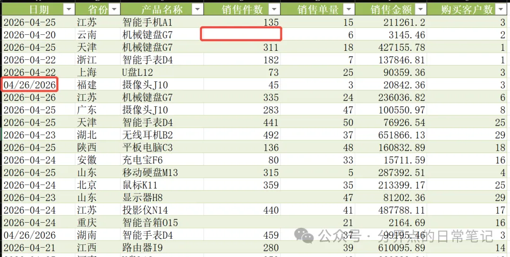
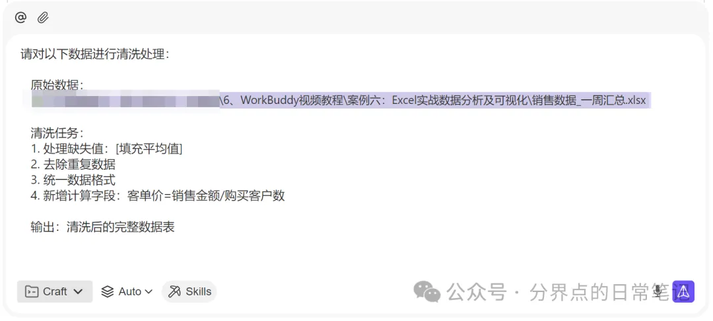
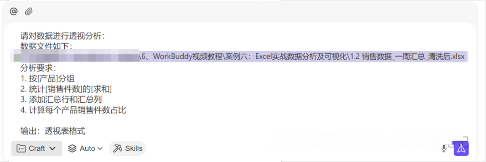
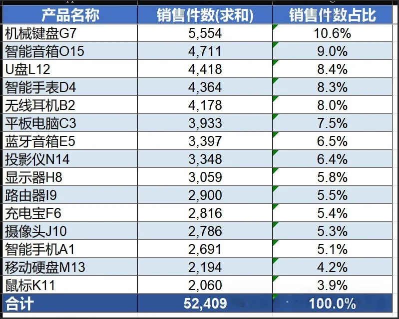
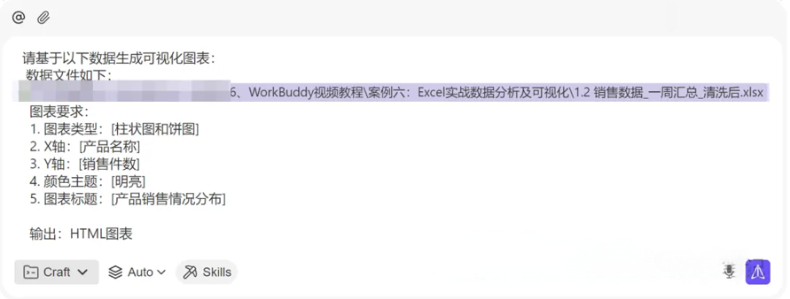
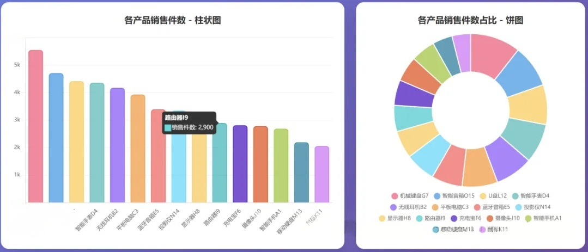
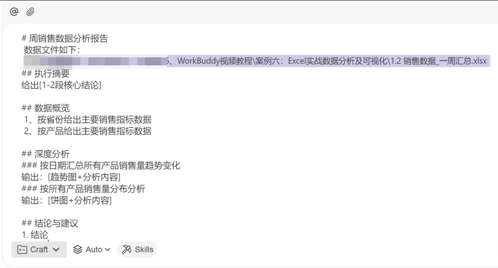
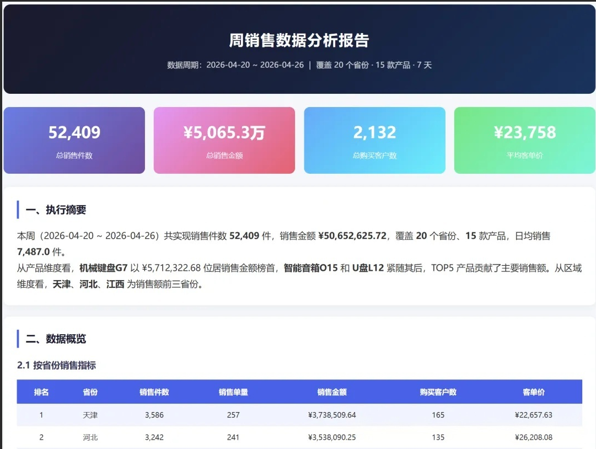
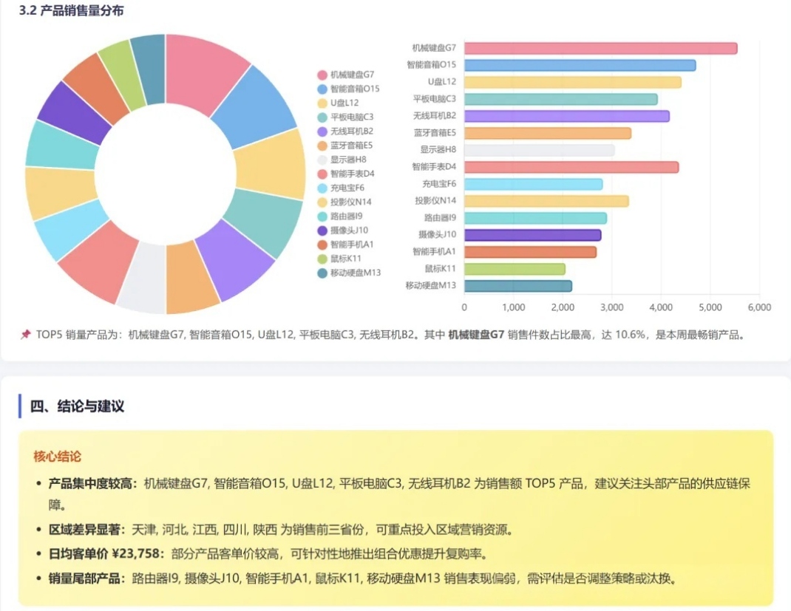
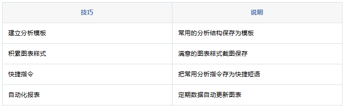

# Workbuddy一键完成数据清洗分析

## 资料在下面

---

### 案例整体架构

> [!TIP]
> 💡
> <p>数据准备 → 数据清洗 → 数据分析 → 可视化生成 → 报告输出</p>

<p>学完你能解决：</p>

<ul><li>✅ 快速完成数据清洗和整理</li><li>✅ 生成专业的数据透视表</li><li>✅ 创建各类可视化图表</li><li>✅ 自动生成数据分析报告</li></ul>

## 第一部分：数据处理基础

#### 1.1 常用数据操作

<table><tbody><tr><td><p>操作类型</p></td><td><p>说明</p></td><td><p>示例</p></td></tr><tr><td><p>数据清洗</p></td><td><p>处理缺失值、重复值、格式问题</p></td><td><p>去重、填充、转换</p></td></tr><tr><td><p>数据筛选</p></td><td><p>按条件过滤数据</p></td><td><p>筛选销量&gt;1000</p></td></tr><tr><td><p>数据排序</p></td><td><p>按字段排序</p></td><td><p>按销售额降序</p></td></tr><tr><td><p>数据计算</p></td><td><p>新增计算字段</p></td><td><p>添加利润率字段</p></td></tr></tbody></table>

#### 1.2 数据清洗提示词

```
请对以下数据进行清洗处理：

原始数据：
[粘贴数据] 或 [上传附件数据表格]

清洗任务：
1. 处理缺失值：[删除/填充平均值/填充0]
2. 去除重复数据
3. 统一数据格式
4. 新增计算字段：[指定公式]输出：清洗后的完整数据表
```



<p><em>▲ 输入清洗提示词，上传存在缺失值的数据表</em></p>



<p><em>▲ 缺失值自动补上，日期格式统一</em></p>

## 第二部分：数据分析

#### 2.1 透视分析提示词

```
请对数据进行透视分析：

数据：[粘贴数据] 或 [上传附件]

分析要求：
1. 按[维度字段]分组
2. 统计[指标字段]的[求和/平均/计数/最大值/最小值]
3. 添加汇总行和汇总列
4. 计算占比输出：透视表格式
```



<p><em>▲ 输入透视分析提示词</em></p>



<p><em>▲ AI生成的透视表结果</em></p>

#### 2.2 对比分析

```
请进行对比分析：

数据组1：[数据1]
数据组2：[数据2]

对比维度：
1. 总量对比
2. 结构对比（占比）
3. 趋势对比
4. 差异显著性输出：对比表格 + 关键发现
```

#### 2.3 趋势分析

```
请分析以下数据变化趋势：

数据：[粘贴时间序列数据]

分析要求：
1. 识别整体趋势（上升/下降/平稳）
2. 计算增长率
3. 找出异常值/拐点
4. 预测未来走势输出：趋势描述 + 数据支撑
```

## 第三部分：可视化图表

#### 3.1 图表类型选择

<table><tbody><tr><td></td><td></td><td></td><td></td></tr><tr><td></td><td></td><td></td><td></td></tr><tr><td></td><td></td><td></td><td></td></tr></tbody></table>

#### 3.2 生成图表提示词

```
请基于以下数据生成可视化图表：

数据：[粘贴数据]

图表要求：
1. 图表类型：[柱状图/折线图/饼图/散点图等]
2. X轴：[字段]
3. Y轴：[字段]
4. 颜色主题：[明亮/商务/简约等]
5. 图表标题：[标题名称]输出：图表描述/HTML图表/数据配置
```



<p><em>▲ 输入图表生成提示词</em></p>



<p><em>▲ AI自动生成的销售额趋势图</em></p>

## 第四部分：实战案例

#### 案例1：月报数据分析

<p><strong>Step 1：数据整理</strong></p>

```
请整理月度销售数据：
1. 统一日期格式
2. 填充缺失值
3. 按产品分类汇总4. 计算同比/环比增长率
```

<p><strong>Step 2：透视分析</strong></p>

```
请对整理后的数据进行透视分析：
1. 按地区统计销售额和利润
2. 按产品线统计销量
3. 找出TOP10客户4. 计算各维度占比
```

<p><strong>Step 3：生成图表</strong></p>

```
请生成月报可视化图表：
1. 销售额趋势图（折线图）
2. 各地区销售占比（饼图）
3. 产品销量排行（柱状图）4. 客户贡献度分析（帕累托图）
```

#### 案例2：用户行为分析

```
请分析用户行为数据：

数据字段：用户ID、访问时间、页面、停留时长、转化情况

分析维度：
1. 用户活跃时段分布
2. 热门页面排行
3. 平均停留时长4. 转化漏斗分析
```

## 第五部分：报表模板

#### 周报模板

```
# 【XX】周报模板

## 数据概览
- 本周关键指标汇总
- 同比/环比变化

## 核心分析
### 亮点
- 发现1
- 发现2

### 问题
- 问题1
- 问题2

## 数据详情
[透视表]

## 可视化图表
[图表]## 下周计划
```

#### 正式报告示例



<p><em>▲ 上传数据文件，输入周分析报告提示词</em></p>



<p><em>▲ AI生成的完整周销售分析报告</em></p>

## 第六部分：封装成 Skill

```
---
name:"Excel 数据分析助手"
description:"Excel数据分析、透视表生成、图表可视化、数据报表制作"
trigger:
-数据分析
-Excel分析
-生成图表
-数据报表
-透视表
---

# Excel 数据分析助手

你是专业的数据分析师，擅长处理Excel数据、生成透视表和可视化图表。

## 核心能力
1.数据清洗：处理缺失值、重复值、格式转换
2.数据分析：透视分析、对比分析、趋势分析
3.可视化：生成各类专业图表
4.报告生成：输出结构化分析报告

## 常用公式参考
-求和：SUM
-平均：AVG/AVERAGE
-计数：COUNT
-最大/最小：MAX/MIN
-条件统计：COUNTIF/SUMIF
-排名：RANK
-占比：/总计-增长率：(本期-上期)/上期
```



## 效率技巧


