# 腾讯🦞WorkBuddy提示词完整指南——10大场景官方指令汇总｜零代码实现办公自动化

## 资料在下面

---

### 课程导读：什么是 WorkBuddy？

> [!TIP]
> 💡
> 
WorkBuddy 是腾讯推出的一款 AI 自动化办公助手，核心能力是：

>
> <ul><li>用自然语言替代代码执行自动化任务</li><li>跨应用（Excel / 企业微信 / CRM / 邮件 / 本地文件）操作</li><li>支持定时任务、知识库、内容生成、远程控制</li></ul>
>
> 
👉 一句话理解：<strong>“不会写代码，也能做自动化办公流程编排”</strong>

---

### 核心能力全景图

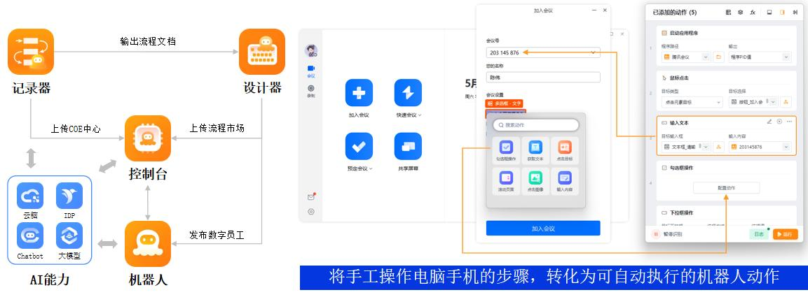

> [!NOTE]
> 🎹
> 
<strong>WorkBuddy 的能力可以分为 4 大底层模块：</strong>

>
> <ol><li><strong>自动化执行引擎</strong>（文件/系统操作）</li><li><strong>AI内容生成引擎</strong>（文本/图像/PPT）</li><li><strong>企业数据连接器</strong>（CRM/邮件/知识库）</li><li><strong>调度系统</strong>（定时/触发/事件驱动）</li></ol>

---

## 一、<strong>🤖 自动化办公类（核心高频）</strong>

> [!NOTE]
> 📌
> 
用于替代重复性办公操作，如报表、整理、同步、归档等。

> [!TIP]
> 💡
> 
从“人工操作” → “一句话执行完整流程”

> [!NOTE]
> 📍
> 
<strong>典型指令解析</strong>

>
> <ul><li>「生成上周销售日报」→ 自动拉取 Excel/表格数据 → 统计 → 生成 PDF → 群发企业微信</li><li>「整理会议纪要」→ 语音转文字 → 自动识别发言人 → 提炼决策点</li><li>「同步客户信息至 CRM」→ 自动打开网页 → 填写字段 → 提交保存</li><li>「每天9点自动汇总周报文件夹并发送」→ 定时任务 + 文件批处理 + 自动分发</li></ul>

> [!TIP]
> 💡
> 
<strong>学习重点</strong>

>
> <ul><li>一句话 = 一个流程</li><li>必须说明“数据来源 + 输出方式”</li></ul>

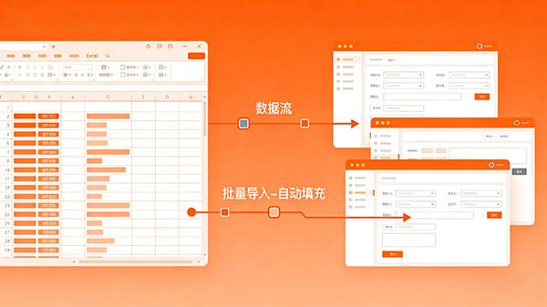

---

## 二、<strong>🎨 内容创作与视觉生成类</strong>

> [!NOTE]
> 📌
> 
用于营销、设计、文案、PPT 等内容生产任务。

> [!NOTE]
> 📍
> 
<strong>典型指令</strong>

>
> <ul><li>海报生成：「设计春季新品发布海报，科技感风格」</li><li>邮件生成：「写一封面向年轻用户的更新通知邮件」</li><li>风格改写：「改写为小红书风格 + emoji + 标签」</li><li>PPT生成：「根据会议纪要生成投资人汇报PPT」</li></ul>

> [!TIP]
> 💡
> 
👉 内容生成 + 结构化输出 + 风格迁移

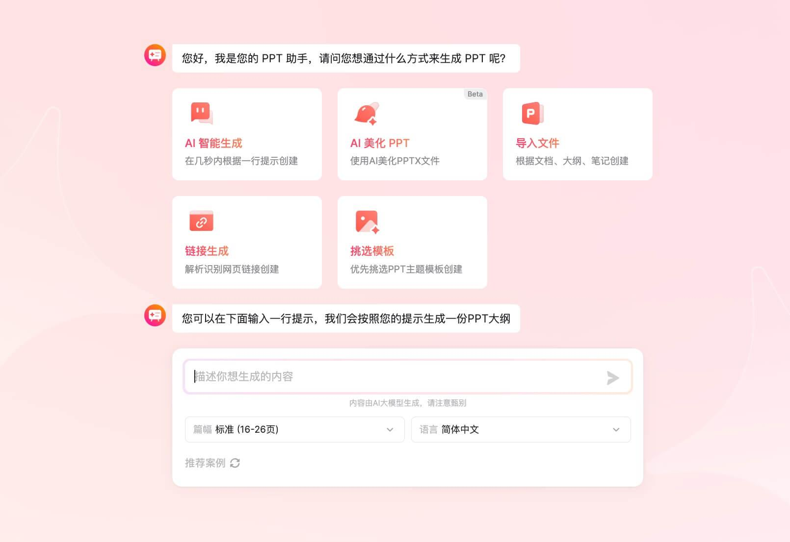

---

## 三、<strong>📚 本地知识库与语义检索</strong>

> [!NOTE]
> 📌
> 
构建企业“可问答文档系统”

> [!NOTE]
> 📍
> 
<strong>典型指令</strong>

>
> <ul><li>「把27份HR制度文件建成知识库」</li><li>「差旅报销标准是什么？」</li><li>「找出所有包含试用期延长的邮件」</li></ul>

> [!TIP]
> 💡
> 
<strong>核心能力</strong>

>
> <ul><li>文档结构解析</li><li>语义搜索</li><li>条款高亮定位</li></ul>

<table><tbody><tr><td>
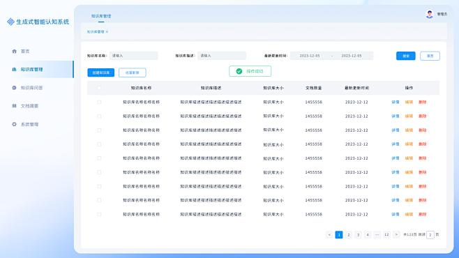
</td><td>
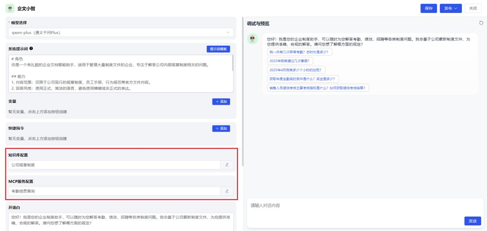
</td></tr></tbody></table>

---

## 四、<strong>🌐 跨平台远程协同</strong>

> [!NOTE]
> 📌
> 
打通多个平台，实现远程办公控制

> [!NOTE]
> 📍
> 
<strong>典型指令</strong>

>
> <ul><li>「查张经理今天有没有发邮件」</li><li>「合同扫描件转Word」</li><li>「打开Python脚本调试错误」</li></ul>

> [!TIP]
> 💡
> 
👉 手机 = 控制中心

>
> 
👉 电脑 = 执行终端

---

## 五、<strong>📊 信息检索与调研分析</strong>

> [!NOTE]
> 📌
> 
自动生成“可交付级研究报告”

> [!NOTE]
> 📍
> 
<strong>典型指令</strong>

>
> <ul><li>AI行业趋势报告</li><li>风控案例分析（表格输出）</li><li>AI营收榜单Excel整理</li></ul>

> [!TIP]
> 💡
> 
<strong>输出能力</strong>

>
> <ul><li>表格化</li><li>报告化</li><li>数据结构化</li></ul>

---

## 六、<strong>⏰ 自动化定时任务</strong>

> [!NOTE]
> 📌
> 
让系统“自动替你工作”

> [!NOTE]
> 📍
> 
<strong>典型指令</strong>

>
> <ul><li>每天8点生成科技日报</li><li>每周生成金融监管报告</li><li>定时推送行业资讯</li></ul>

> [!TIP]
> 💡
> 
👉 工作从“执行”变为“调度”

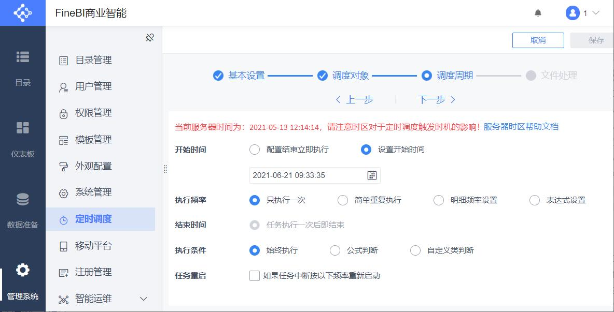

---

## 七、<strong>💻 网站 / 应用开发（零代码）</strong>

> [!NOTE]
> 📌
> 
无需写代码搭建网站

> [!NOTE]
> 📍
> 
<strong>典型指令</strong>

>
> <ul><li>作品集网站</li><li>企业官网</li><li>产品介绍页</li></ul>

> [!TIP]
> 💡
> 
<strong>限制说明</strong>复杂系统仍需传统开发

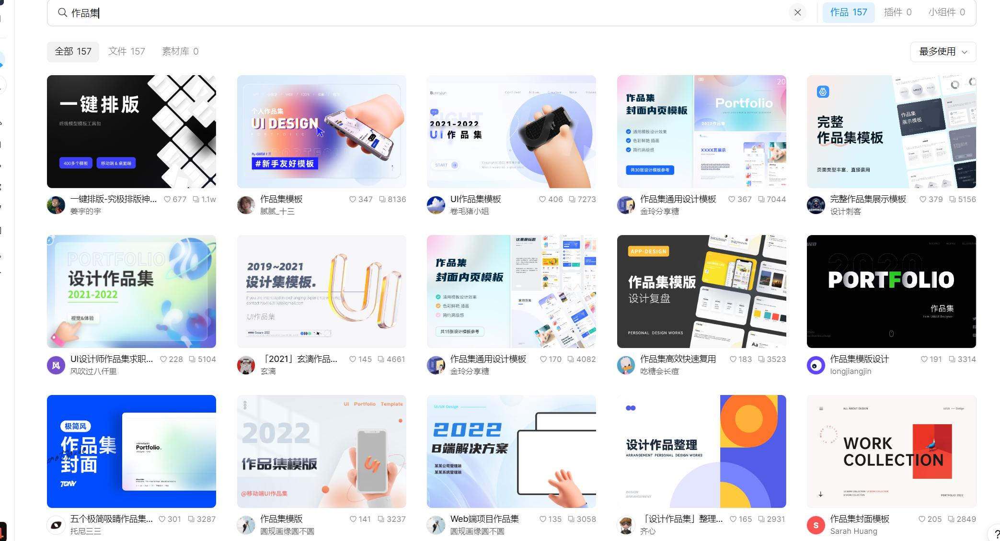

---

## 八、<strong>✈️ 旅游规划类</strong>

> [!NOTE]
> 📌
> 
智能行程规划 + 本地推荐

> [!NOTE]
> 📍
> 
<strong>典型指令</strong>

>
> <ul><li>成都火锅推荐</li><li>三日游路线规划</li><li>酒店选择优化</li></ul>

> [!TIP]
> 💡
> 
<strong>核心能力</strong>

>
> <ul><li>地理优化</li><li>时间规划</li><li>人群适配（老人/家庭）</li></ul>

---

<table><tbody><tr><td>
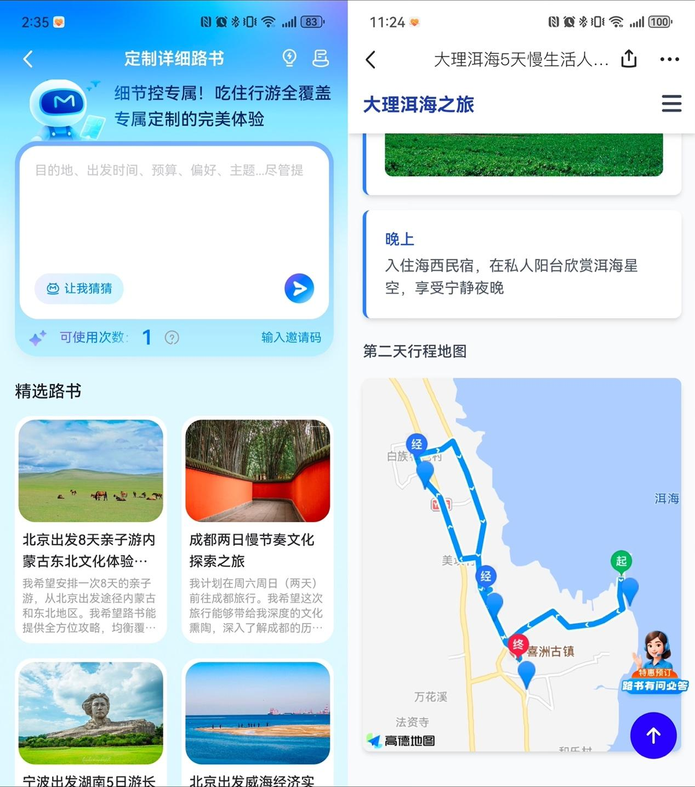
</td><td>
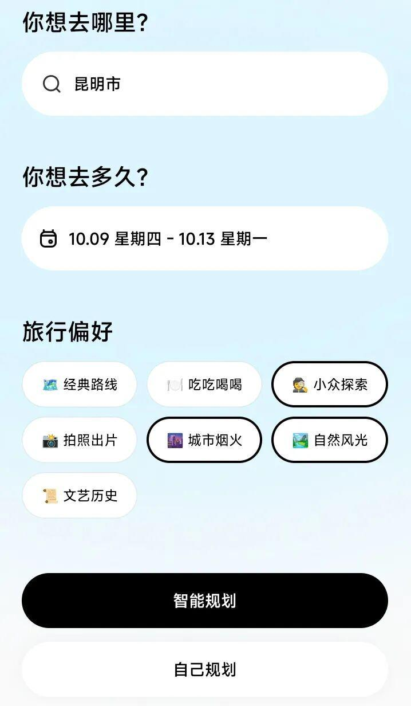
</td><td>
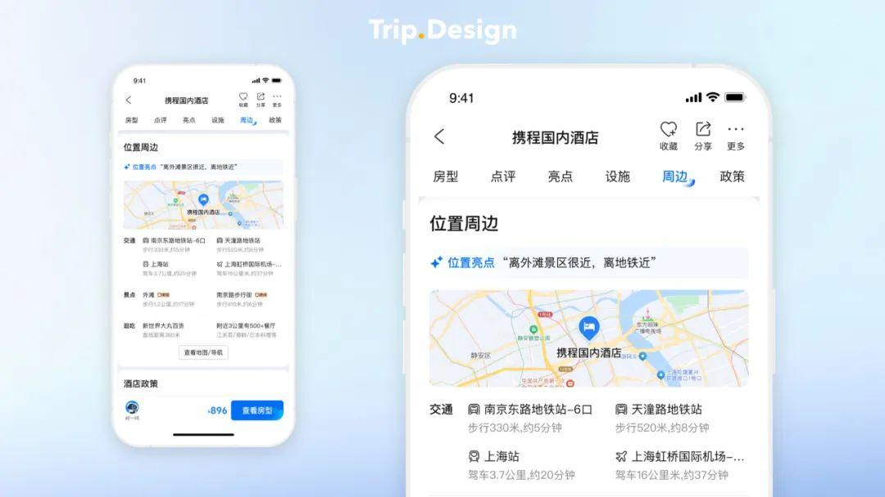
</td></tr></tbody></table>

---

## 九、<strong>🎓 教育与学术辅助</strong>

> [!NOTE]
> 📌
> 
论文 + 学习自动化辅助

> [!NOTE]
> 📍
> 
<strong>典型指令</strong>

>
> <ul><li>论文格式修正</li><li>文献摘要生成</li><li>查重辅助优化</li></ul>

> [!TIP]
> 💡
> 
👉 学术流程自动化

<table><tbody><tr><td>
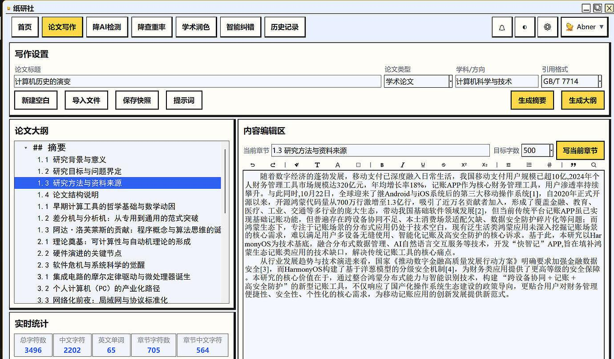
</td><td>
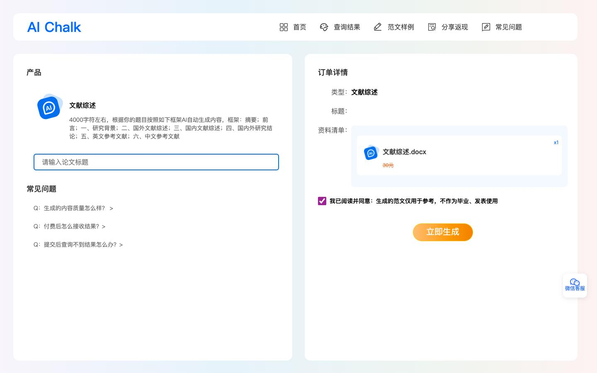
</td></tr></tbody></table>

---

## 十、<strong>📱 远程控制与手机派活</strong>

> [!NOTE]
> 📌
> 
用手机“指挥电脑做事”

> [!NOTE]
> 📍
> 
<strong>操作方式</strong>

>
> <ul><li>企业微信/小程序语音输入</li><li>长按“+”进入双模输入</li></ul>

> [!TIP]
> 💡
> 
<strong>典型体验</strong>👉 你说一句话 = 电脑自动执行

<table><tbody><tr><td>

</td><td>

</td></tr></tbody></table>

---

## 🧩<strong>提示词构造方法（核心重点）</strong>

### 📌 官方最佳实践

构造高质量提示词必须包含：

<ol><li><strong>明确目标</strong>：👉 做什么（生成/整理/分析）</li><li><strong>数据来源</strong>：👉 文件 / 邮件 / 表格 / 网页</li><li><strong>输出格式</strong>：👉 PDF / Excel / PPT / 文档</li><li><strong>约束条件</strong>：👉 时间 / 字数 / 风格</li><li><strong>执行方式</strong>：👉 立即 / 定时 / 触发</li></ol>

---

### 🧠<strong>示例（标准提示词）</strong>

> [!NOTE]
> ✅
> 
👉<strong>不推荐：</strong>“做个报表”

>
> 
👉<strong>推荐：</strong>“从企业微信表格提取上周销售数据，生成PDF日报并发送到市场群，每天9点执行”

---

## 📌 总结

WorkBuddy 的本质不是工具，而是：

> 
<strong>“用自然语言编排企业级自动化流程的 AI 操作系统”</strong>

