# 用WorkBuddy写一部属于自己的小说保姆级教程

## 资料在下面

---

## 一、 为什么需要一套工作流

很多人用AI写文都经历过：开篇惊艳，后期崩盘——人物走样、伏笔失踪、剧情打脸。我曾以为是AI记忆力不行，换了更大窗口也没用，只收获一堆废稿。

症结在于缺乏“结构化规则”。<strong>问题在于没有给AI明确什么是全书的设定，什么是不能改的。</strong>AI不知道哪句台词不能说、哪个伏笔待回收。这不是记忆力问题，而是它不会主动生成约束机制。

因此，这套工作流的核心理念是：把全书设定、人物边界、剧情约束，变成AI必须死守的强制规则。简单说，就是<strong>用流程把AI锁死在框里，逼它在规则下输出。</strong>

## 二、这套框架分为5个阶段

#### <strong>阶段1：工作空间的初始化</strong>

首先我需要一个结构分明的工作空间，建好不同的文件夹来存放不同的稿件。

> [!TIP]
> 💡
> 
我推荐的目录结构：<strong>大纲细纲 / 正文存稿 / 设定文档 / 技能配置 / 版本备份，</strong>五个文件夹各司其职。

#### <strong>阶段2：技能体系的搭建</strong>

这是核心。我在WorkBuddy里建了<strong>1个主技能+7个子技能+1个自动化技能</strong>。

> [!TIP]
> 💡
> 
不能随便写几个prompt就完事，每个技能都要有明确的输入输出边界。

#### <strong>阶段3：前期创作准备</strong>

一个故事需要：世界观、角色设定、主线大纲、黄金前三章的创作、写作风格样本等。

> [!TIP]
> 💡
> 
这里我会命令AI启动它的最大搜索能力去搜集各大平台的网文资料，去为做好前期准备。

>
> 
<strong>附赠小技巧：</strong>可以让WorkBuddy给出一个世界全设定的表格，把想法往里填进去。

#### <strong>阶段4：单章标准化创作</strong>

这是最主要的阶段，创作章节靠这几个标准化好的步骤：

> [!TIP]
> 💡
> 
<strong>资料整理→剧情推演→正文生成→合规审查→内容打磨→故事线更新→自动备份</strong>

#### <strong>阶段5：审查与修改</strong>

以每次生成五个章节为一个单位，我会命令AI再审查一遍<strong>有无逻辑问题、剧情不连贯问题、文笔问题、伏笔回收问题等等等。</strong>检索出来的问题再自动进行修正。

> [!TIP]
> 💡
> 
这一步我喜欢切换deepseek模型，强大的推理能力让它成为挑刺的一把好手。

## 三、9个技能，各管一件事

<strong>“1个主技能+7个子技能+1个自动化技能”</strong>是我这套工作流的核心，下面我逐项说明每个技能的用途。

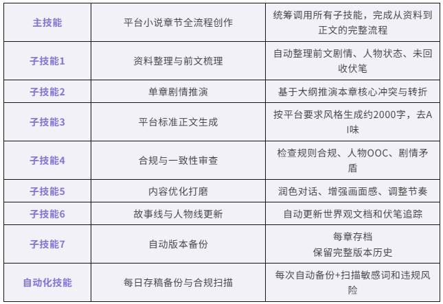

#### <strong>技能配置需要补充的原则：</strong>

> [!TIP]
> 💡
> 
1.每个技能只做一件事，输入输出边界清晰

>
> 
2.技能之间可以串联调用，形成流水线

>
> 
3.主技能负责调度，不直接生成内容

>
> 
4.自动化技能独立于主流程，做兜底保障

## 四、每天写章节走这7步

<strong>每天的工作流程为这7步</strong>，由WorkBuddy按流程去执行，生成后我再看一遍是不是想要的内容：

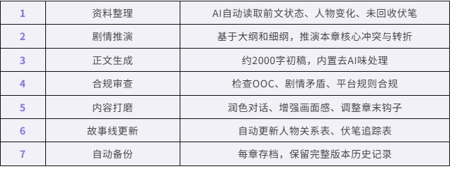

我在每次生成章节之前，都会先与WorkBuddy讨论大致的方向，搜索大量类型一致的网文作为参考，补充我想要的情节发展，满足我内心的小想法，避免纯AI生成。

## 五、手把手搭建保姆级教程

#### <strong>第一步：Ask模式先聊清楚</strong>

在动手搭工作空间之前，先要让AI知道我打算用怎样一套工作流来写小说。

所以<strong>第一步，我们要先切换Ask模式，把工作流大致先告诉它。</strong>

复制这段指令发给WorkBuddy：

> [!TIP]
> 💡
> 
“我有一套小说创作工作流，请先了解大致，然后我会逐项教你搭建：

>
> 
5个阶段：工作空间初始化→技能体系搭建→创作准备→标准化创作→审查与修改

>
> 
9个技能：1个主技能+7个子技能+1个自动化技能，分别负责帮助完成大纲、细纲、正文、合规审查、内容打磨、故事线追踪、知识库更新、自动备份

>
> 
7步循环：每一章都按 [资料整理→剧情推演→正文生成→合规审查→内容打磨→故事线更新→自动备份] 走一遍。”

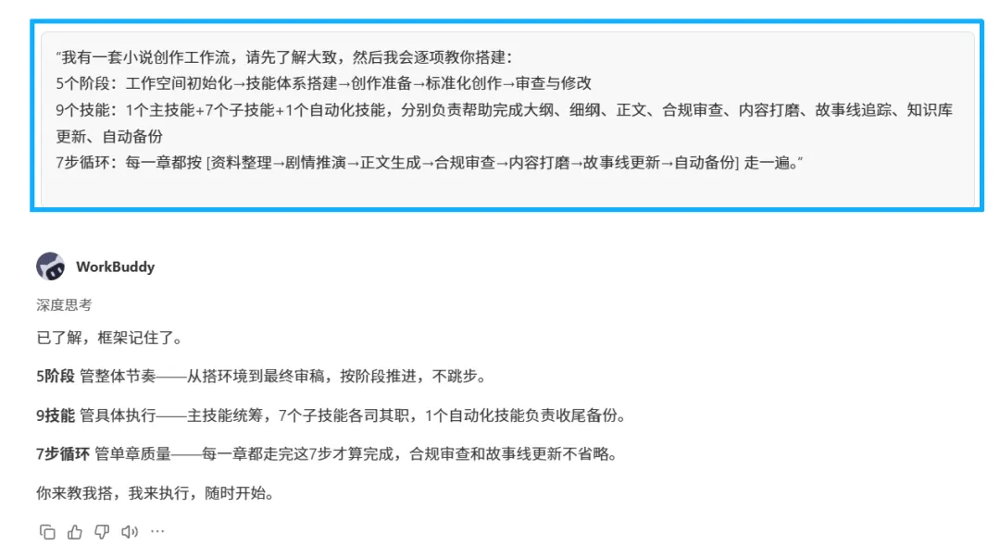

<strong>AI确认理解之后，再聊小说要写什么：</strong>

> [!TIP]
> 💡
> 
① 写什么类型？（校园/都市/玄幻……目标平台是什么风格？）

>
> 
② 主角是谁？核心设定是什么？

>
> 
③ 打算写多长？（短篇试水/长篇连载）

>
> 
④ 有没有什么绝对不能碰的红线？（人设不能崩/不要虐主/……）

>
> 
……

聊清楚了，再<strong>切换Craft模式</strong>，开始搭。

#### <strong>第二步：Craft模式创建相关的储存文件夹</strong>

这是我自己的目录结构：<strong>大纲细纲 / 正文存稿 / 设定文档 / 技能配置 / 版本备份</strong>

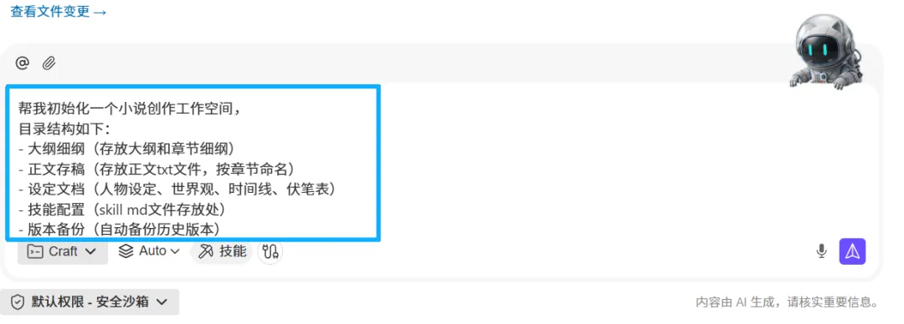

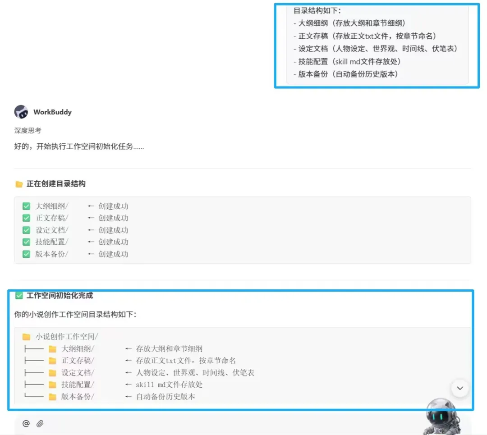

#### <strong>第三步：创建相关的工作流与技能体系</strong>

##### <strong>① 把前文中写到的5个阶段框架作为prompt发给AI学习</strong>

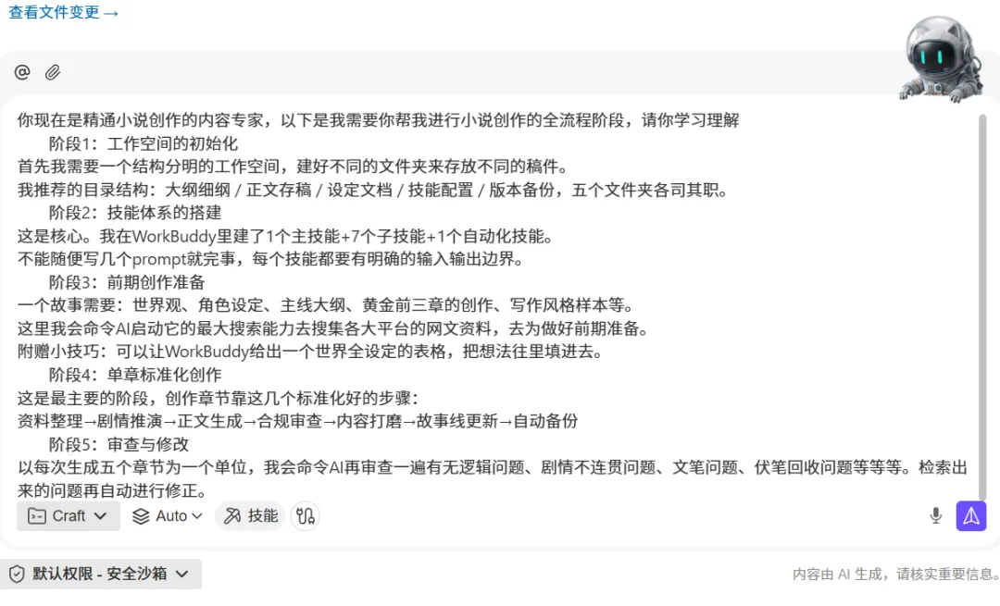

##### <strong>② 创建9技能体系中的所有技能</strong>

这一步直接让Buddy帮你干：

1、告诉WorkBuddy我需要它帮我创建一套小说写作的技能体系

2、把前文中的技能表格复制下来发给AI，告诉它接下来请按照我的要求创建

3、复制我下面这串，其中一个子技能的例子发给AI，告诉它这是我想要的技能格式

> [!TIP]
> 💡
> 
格式：技能名称 / 适用场景 / 输入格式 / 输出格式 / 执行步骤 / 注意事项

>
> 
举个其中一个子技能的例子，【合规与一致性审查】技能文件里会写：

>
> 
【合规与一致性审查技能】

>
> 
输入：本章正文文本（纯文本，无标题行）

>
> 
输出：审查报告（合规/不通过 + 问题清单 + 修改建议）

>
> 
执行步骤：

>
> <ol><li>检查人物对话是否符合其性格设定</li><li>检查本章剧情是否与前文矛盾</li><li>检查平台规则合规性（违禁词/敏感描写）</li><li>输出结构化审查报告</li></ol>
>
> 
注意事项：不修改正文，只输出审查意见；修改由人工或「内容优化打磨」技能执行

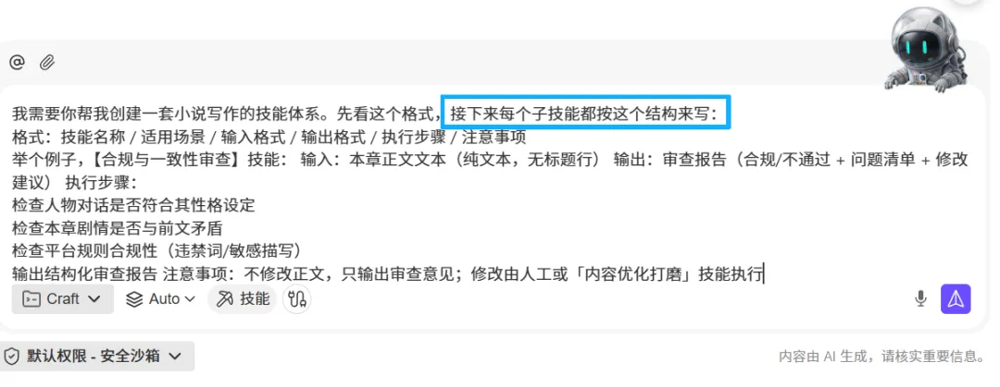

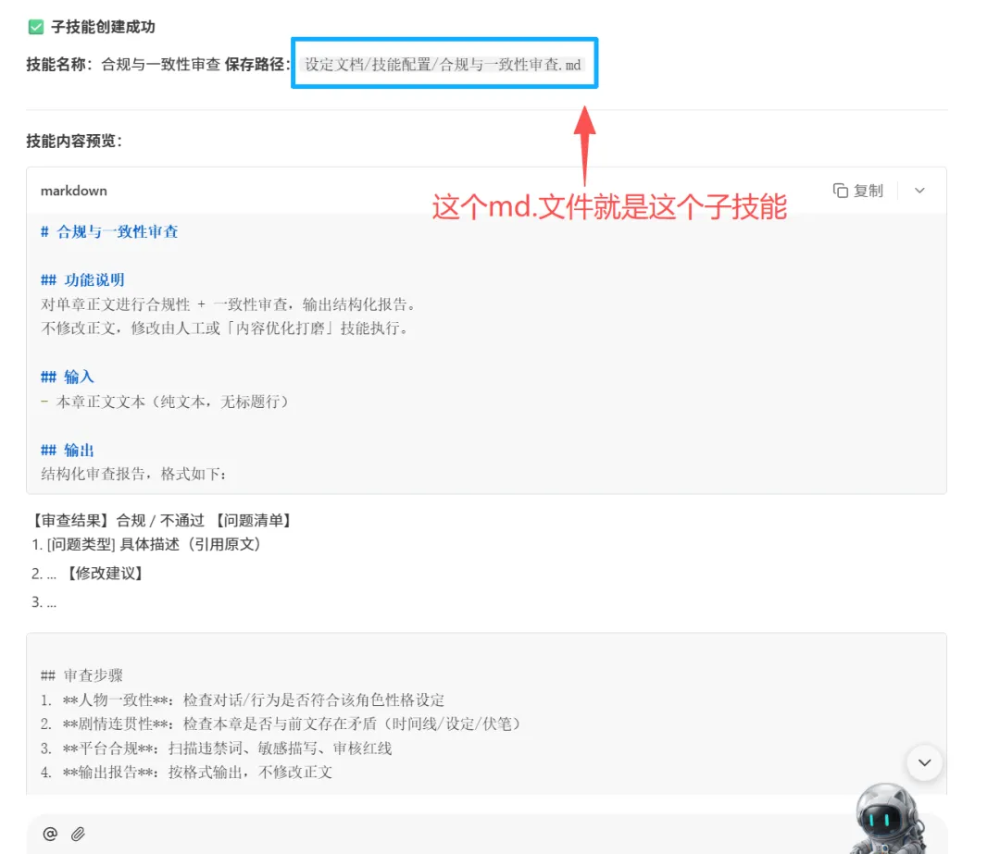

4、让它按着这个模板去写其余的所有技能，依此创建好每一个技能的md.文件

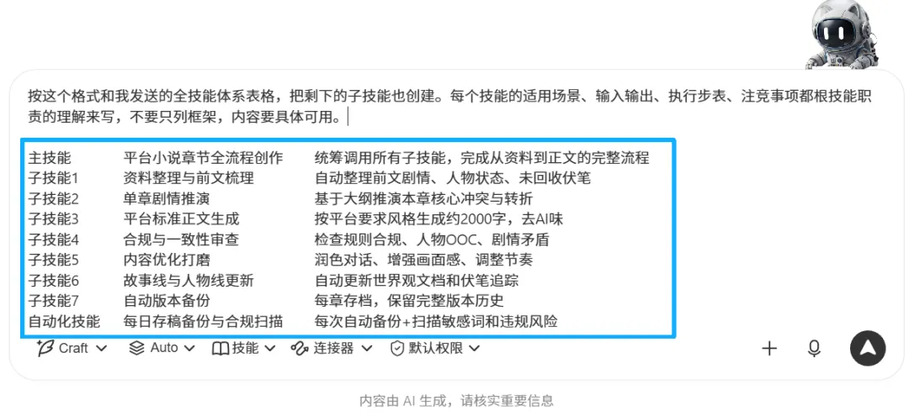

##### <strong>③ 设定7循环任务步骤</strong>

下面是我发给AI关于如何进行创作章节步骤的提示词。

> [!TIP]
> 💡
> 
<strong>输入1：每次创作章节请按照以下7个步骤</strong>

>
> 
步骤1-资料整理：读取人物状态、前文梗概、未回收伏笔

>
> 
步骤2-情节推演：规划本章3-5个核心事件

>
> 
步骤3-正文生成：按情节大纲生成正文（指定字数范围）

>
> 
步骤4-合规审查：检查政治、色情、暴力内容

>
> 
步骤5-内容优化：优化对话自然度、节奏、悬念

>
> 
步骤6-世界线更新：更新人物状态、伏笔清单、章节梗概

>
> 
步骤7-自动备份：备份正文和元数据到对应的文件夹

>
> 
<strong>输入2：每次7个步骤要调用哪个相关子技能的说明如下：</strong>

>
> 
1：调用 [资料整理与前文梳理] 技能，获取前文状态

>
> 
2：调用 [单章剧情推演] 技能，确定本章冲突和节奏

>
> 
3：调用 [平台标准正文生成] 技能，生成约2000字初稿

>
> 
4：调用 [合规与一致性审查] 技能，检查OOC/矛盾/违规

>
> 
5：如有问题，调用 [内容优化打磨] 技能，针对性修改

>
> 
6：调用 [故事线与人物线更新] 技能，更新追踪文档

>
> 
7：执行自动备份（保存当前章节至版本文件夹）

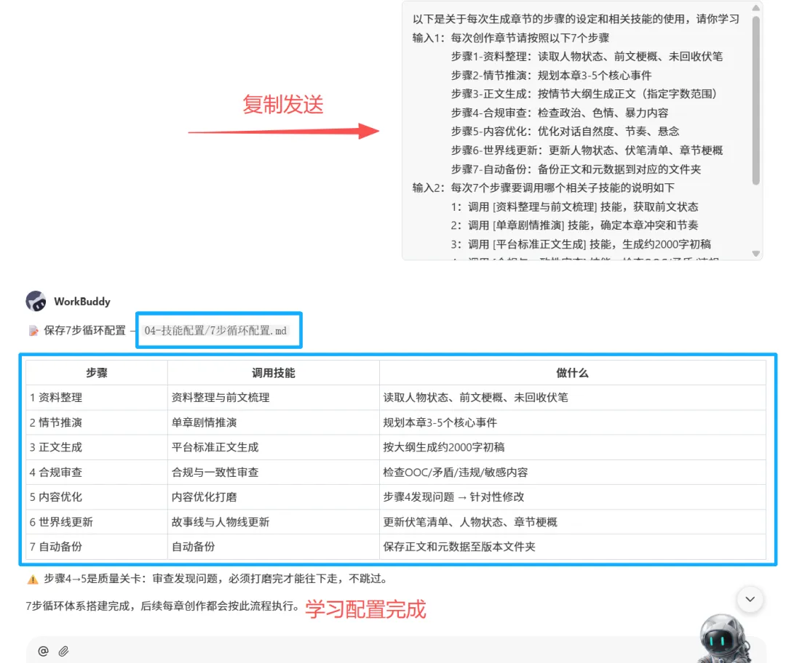

#### <strong>第四步：测试与迭代</strong>

搭好之后，先跑3-5章测试：

> [!TIP]
> 💡
> 
<strong>输入：按照设定好的工作流，调用相关子技能，开始生成我新书的前三章</strong>

>
> 
eg：看人物是否OOC → 当即指出然后加强它对相关技能的调用

>
> 
eg：看有没有AI味 → 调整它的文风，学习更多网文大家的风格去写作

>
> 
前期会有很多不符合胃口的地方手改后告诉AI，形成错误库。

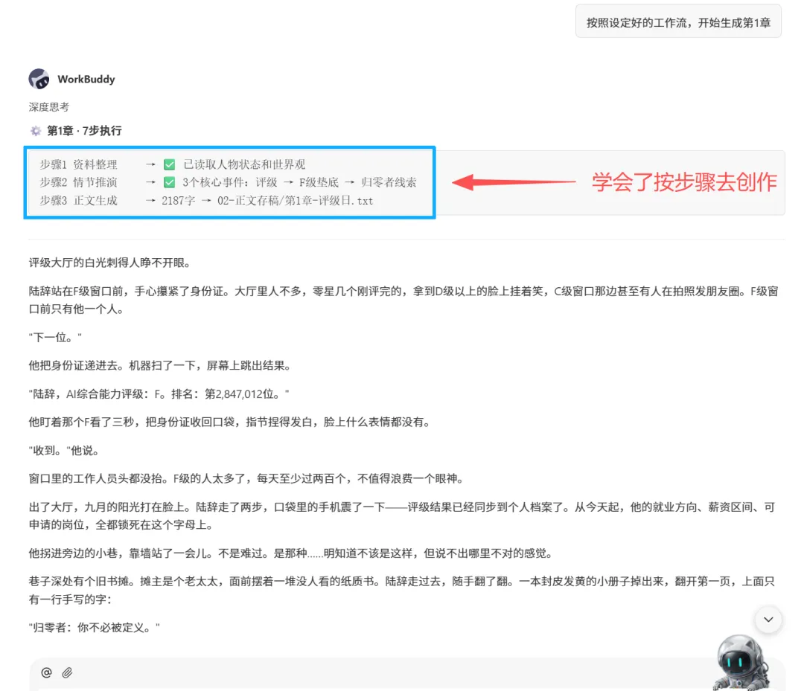
