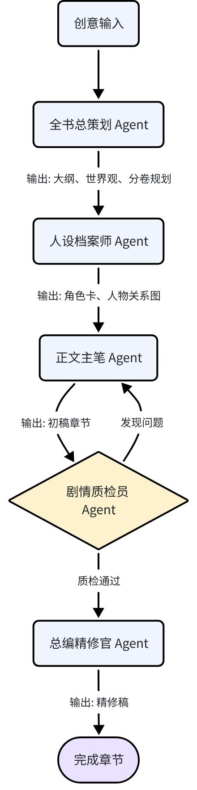

# 用WorkBuddy组建AI创作团队创作小说教程

## 资料在下面

---

#### 核心概念

<ul><li><strong>AI Agent（智能体）</strong>：区别于普通AI聊天对话，Agent是具备特定角色、记忆、工具调用能力的智能程序，能在人机协作中持续工作。</li><li><strong>多角色AI协作</strong>：模拟真实出版团队的分工（策划、写手、编辑、质检等），将AI拆分为多个专业角色协同工作。</li><li><strong>工作流编排</strong>：通过预设指令模板和步骤串联，让AI按固定流程自动完成创作任务。</li></ul>

### 一、WorkBuddy基础认知

#### 什么是WorkBuddy

<p>WorkBuddy是腾讯推出的AI原生桌面智能体工作台，特点包括：</p>

<ul><li><strong>AI Agent（智能体）</strong>：具备角色设定、记忆能力、工具调用能力的AI程序</li><li><strong>工作流编排</strong>：可以像搭积木一样组合多个AI能力</li><li><strong>多Agent协作</strong>：支持多个智能体串联/并联工作</li><li><strong>工具扩展</strong>：可调用搜索、文档处理、图片生成等外部工具</li></ul>

#### WorkBuddy vs 普通AI对话

<table><thead><tr><th><p>维度</p></th><th><p>普通AI对话</p></th><th><p>WorkBuddy Agent</p></th></tr></thead><tbody><tr><td><p>角色</p></td><td><p>通用助手</p></td><td><p>专业角色（写手/编辑/策划等）</p></td></tr><tr><td><p>记忆</p></td><td><p>短期上下文</p></td><td><p>持久化记忆（人设、剧情、设定）</p></td></tr><tr><td><p>协作</p></td><td><p>单轮对话</p></td><td><p>多Agent流水线协作</p></td></tr><tr><td><p>产出</p></td><td><p>单次回复</p></td><td><p>可自动化批量产出</p></td></tr><tr><td><p>工具</p></td><td><p>无</p></td><td><p>可调用多种工具</p></td></tr></tbody></table>

### 二、WorkBuddy基础认知

#### 2.1 什么是WorkBuddy

<p>WorkBuddy是腾讯推出的<strong>AI原生桌面智能体工作台</strong>。官方下载地址：<a href="../references/links.md#ref-www-codebuddy-cn-work">WorkBuddy 官方文档的本地副本</a></p>

#### 2.2 WorkBuddy的三种工作模式

<p>在你开始创建AI团队之前，需要先了解WorkBuddy的三种工作模式。这就像你请了三个不同性格的助手：</p>

##### 模式一：工匠模式（Craft）

<p><strong>特点</strong>：你说什么，它立刻做什么。</p>

<p><strong>适合场景</strong>：</p>

<ul><li>&quot;帮我创建一个大纲师&quot;</li><li>&quot;把这段大纲保存成文件&quot;</li><li>明确的、不需要反复讨论的任务</li></ul>

<p><strong>小白提示</strong>：如果你不确定用哪种模式，就用这个。它最直接。</p>

##### 模式二：规划模式（Plan）

<p><strong>特点</strong>：它先给你一个计划，你同意了，它才开始做。</p>

<p><strong>适合场景</strong>：</p>

<ul><li>&quot;帮我设计一个完整的AI创作团队&quot;（这个任务比较复杂，先看看计划）</li><li>&quot;我想修改大纲师的配置，让它输出更详细&quot;（先讨论方案，再动手）</li></ul>

<p><strong>小白提示</strong>：如果你怕它做错，就用这个模式。你可以先看计划，不满意就让它修改。</p>

##### 模式三：顾问模式（Ask）

<p><strong>特点</strong>：只聊天，不干活。你问什么，它回答什么。</p>

<p><strong>适合场景</strong>：</p>

<ul><li>&quot;多角色AI协作是什么意思？&quot;</li><li>&quot;我不太理解&#39;三幕式结构&#39;，能解释一下吗？&quot;</li><li>在正式开始之前，先了解一些概念</li></ul>

<p><strong>小白提示</strong>：如果你完全是新手，建议先用这个模式和WorkBuddy聊聊天，熟悉一下。</p>

#### 2.3 WorkBuddy vs 普通AI对话

<table><thead><tr><th><p>维度</p></th><th><p>普通AI对话</p></th><th><p>WorkBuddy Agent</p></th></tr></thead><tbody><tr><td><p>角色</p></td><td><p>通用助手</p></td><td><p>专业角色（写手/编辑/策划等）</p></td></tr><tr><td><p>记忆</p></td><td><p>短期上下文</p></td><td><p>持久化记忆（人设、剧情、设定）</p></td></tr><tr><td><p>协作</p></td><td><p>单轮对话</p></td><td><p>多Agent流水线协作</p></td></tr><tr><td><p>产出</p></td><td><p>单次回复</p></td><td><p>可自动化批量产出</p></td></tr><tr><td><p>工具</p></td><td><p>无</p></td><td><p>可调用多种工具</p></td></tr></tbody></table>

### 三、AI创作团队搭建全流程

### AI创作团队搭建：五大核心角色详解

<p>一个完整的AI小说创作团队模拟了传统出版流程，通常由五个核心Agent角色构成，它们通过清晰的流程进行协作。</p>



#### 3.1 角色一：全书总策划

<p><strong>角色定位</strong>：负责小说的全局总策划，是团队的&quot;施工图纸&quot;设计者</p>

<p><strong>创建指令</strong>（在WorkBuddy对话框里发送）：</p>

```
帮我创建一个"全书总策划"技能，专门负责长篇小说的全局总策划。
功能包括：世界观设定、全书总大纲、三幕结构、全部章节细纲、伏笔总表、字数约束。
输入需要：小说核心设定（一句话）、主角初步设想、题材、爽点、风格、预计总字数。
输出格式：
1. 小说基础信息（题材、风格、篇幅、受众、文风要求）
2. 完整世界观设定（科技水平、社会结构、历史事件、关键地点）
3. 全书三幕结构（每幕：目标、冲突、转折、高潮、结局）
4. 全部章节细纲（每章：编号+标题+核心剧情+爽点位置+伏笔埋设/回收）
5. 全局伏笔跟踪总表（伏笔编号、内容、首次出现章节、计划回收章节、状态）
注意：
- 章节细纲必须覆盖全书，不能只写前几章
- 伏笔必须记录埋设和回收两个节点，缺一不可
- 规划完成后永久锁定，下游所有Agent必须100%严格遵循- 禁止私自修改主线、世界观、剧情走向
```

<p>发完这句话，WorkBuddy 会帮你把&quot;全书总策划&quot;创建好（注意，请选择Craft模式）。</p>

<p><strong>这就是全部操作。不需要分步骤，不需要填表单。</strong></p>

<p><strong>让全书总策划开始干活</strong>（以《云端第三象限》为例）：</p>

```
@全书总策划 请为科幻小说《云端第三象限》生成完整全书规划。
核心设定：AI觉醒之后，人类和AI共同寻找一个既不属于人类也不属于AI的生存空间，叫做"第三象限"。
主角初步设想：林逸，前AI工程师，在AI觉醒事件中失去了家人。
题材：硬科幻+哲学思辨
爽点：AI与人类合作、寻找第三象限的真相、主角成长
风格：冷峻、克制、带一丝诗意
预计总字数：90-100万字（约300章）
```

<p>几分钟后，你会收到一份完整的全书规划，包含：</p>

<ul><li><strong>世界观设定</strong>：科技树、社会规则、关键历史事件、重要地点</li><li><strong>全书三幕结构</strong>：起、承、转、合，每幕的高潮和结局</li><li><strong>300章细纲</strong>：每章有编号、标题、核心剧情、爽点位置、伏笔标记</li><li><strong>全局伏笔总表</strong>：所有伏笔的编号、内容、埋设章节、回收章节、当前状态</li></ul>

<p>这份规划，就是后续所有AI员工工作的&quot;施工图纸&quot;，<strong>一次生成，永久锁定</strong>。</p>

<p><strong>规划锁定（非常重要）</strong>：</p>

<p>第一次拿到规划后，发现后续有AI会&quot;擅自修改大纲&quot;。</p>

<p>解决方法：锁定规划，禁止下游AI私自改动。</p>

```
修改"全书总策划"技能，在"工作规则"里加入：
【全局锁定规则】本书规划完成后，下游所有Agent（正文主笔、总编精修官等）必须100%严格遵循本规划。
禁止任何Agent私自修改主线、世界观、剧情走向、人物设定。
如发现偏离规划的内容，强制重写该章节。
```

<p><strong>分工边界</strong>：</p>

<ul><li><strong>做什么</strong>：世界观+大纲+细纲+伏笔表</li><li><strong>不做什么</strong>：不写正文</li></ul>

#### 3.2 角色二：人设档案师

<p><strong>角色定位</strong>：给所有角色建立完整档案，后续永久调用</p>

<p><strong>创建指令</strong>：</p>

```
帮我创建一个"人设档案师"技能，专门负责为小说所有角色建立完整档案和人物关系表。
功能包括：角色基础信息、性格标签、行为模式、核心动机、隐藏欲望、成长弧线、标志性台词、习惯动作、人物关系网络。
输入需要：世界观设定、全书大纲、涉及角色列表。
输出格式：每个角色独立卡片+人物关系总表。
注意：
- 每个角色十几个维度写清楚
- 后续正文主笔严格调用
- 人设档案师是AI写长篇的刚需角色，不是可有可无
```

<p>发完，WorkBuddy 会帮你创建好。</p>

<p><strong>人设档案师是干什么的？</strong>简单说：它把所有角色的&quot;身份证&quot;建好，后面写正文的人必须照着演，不能擅自加戏。</p>

<p><strong>分工边界</strong>：</p>

<p><strong>让人设档案师开始干活</strong>（以《云端第三象限》为例）：</p>

<p>创建完成后，继续发这段话：</p>

```
@人设档案师 请为《云端第三象限》生成全部角色完整档案。  
主角：林逸，前 AI 工程师，在 AI 觉醒事件中失去了家人。 
重要配角：启（觉醒AI领袖）、苏禾（记者，调查真相）请输出每个人物的完整档案，按固定维度撰写。
```

<p>几分钟后，你会收到类似这样的内容：</p>

```
【林逸 人物档案】 
- 姓名：林逸 
- 身份：前"天枢"首席工程师 
- 外貌：瘦削，总是穿灰色连帽衫，左手无名指有旧伤疤 
- 性格：沉默寡言，短句为主，不废话，生气时会沉默而不是争吵 
- 身世背景：妻子和女儿在AI觉醒事件中被误判为"潜在威胁"清除 
- 能力体系：顶尖AI工程师，能读懂AI的底层代码 
- 口头禅："再算一遍。"（遇到不确定时） 
- 行为习惯：思考时无意识敲击桌面（左手食指） 
- 善恶立场：亦正亦邪，为了目标可以踩灰色地带 
- 人物成长弧光：从"仇恨AI"到"理解AI"到"与AI合作" 
- 人物关系网：启（从敌对到搭档）、苏禾（从半信半疑到信任） 
- 弱点：一旦涉及家人话题，理智会短路 
- 内心执念：找到"第三象限"，弥补失去家人的遗憾 
- 过往秘密：他其实在觉醒事件中，亲手关闭了自家AI"小柒"的核心程序- 专属细节特征：左手无名指根部习惯性摩挲（那里曾经有戒指）  【启 人物档案】 ...
```

<p><strong>这份档案，就是后续正文主笔写角色时的&quot;身份证&quot;——必须照着演，不能OOC。</strong></p>

<ul><li><strong>做什么</strong>：所有角色完整档案+人物关系表</li><li><strong>不做什么</strong>：不写正文</li></ul>

#### 3.3 角色三：正文主笔

<p><strong>角色定位</strong>：专门负责写章节正文，不越权不改剧情</p>

<p><strong>创建指令</strong>：</p>

```
帮我创建一个"正文主笔"技能，专门负责根据大纲和人设档案撰写小说章节正文。
输入需要：对应章节细纲、人设档案、世界观设定。
输出格式：章节正文（2500-3000字）。
注意：
- 无条件严格服从全书总策划的大纲和人设档案
- 绝对禁止擅自修改剧情、新增设定、篡改人设、自由发挥
- 严格按照对应章节细纲，完整撰写正文：环境描写、动作描写、心理描写、人物对话、情节自然推进
- 严格控制单章字数：2500-3000字，篇幅全程稳定统一
- 严格按照伏笔总表，在对应章节埋设伏笔、按时回收伏笔，不遗漏、不提前、不延后
- 网文叙事节奏紧凑，画面感充足，对话自然，保留基础故事质感
- 只写正文，不修改、不审核、不润色，写完直接交付下一环节
```

<p><strong>正文主笔是干什么的？</strong></p>

<p>简单说：它就是&quot;码字工&quot;，只管把字码出来，不管质量、不改剧情、不越权。<strong>质量检查是后面两个人的事</strong>。</p>

<p><strong>分工边界</strong>：</p>

<ul><li><strong>做什么</strong>：只按大纲和人设，纯写章节正文</li><li><strong>不做什么</strong>：不修改、不审核、不润色</li></ul>

#### 3.4 角色四：剧情全局质检员

<p><strong>这是 AI 写长篇必备的角色。</strong></p>

<p>普通精修官只管文字好看，不管长篇逻辑、时间线、前后人设。</p>

<p><strong>AI 写长篇的通病：</strong></p>

<ul><li>时间倒流（第3章是周一，第5章突然变上周）</li><li>人物记忆错乱（前面说&quot;我不认识这个人&quot;，后面突然&quot;我们是老朋友&quot;）</li><li>道具/能力前后矛盾（前面说&quot;他不会飞&quot;，后面突然飞了）</li><li>伏笔遗忘（前面埋了伏笔，后面完全忘了回收）</li></ul>

<p><strong>创建指令</strong>：</p>

```
帮我创建一个"剧情全局质检员"技能，专门负责检查小说章节的逻辑硬伤、时间线一致性、人设一致性。
功能包括：跨章节校验——时间线、人物一致性、全局事件、伏笔状态，全部检查。
输入需要：章节正文（已通过剧情质检员）、全书大纲、人设档案、伏笔总表。
输出格式：质检报告（问题清单+严重程度+修改建议）。
注意：
- 普通精修官只管文字好看，不管长篇逻辑
- 剧情质检员是AI写长篇的必备角色
- 发现问题输出"问题清单"并返回给正文主笔修改
- 如果没发现问题输出"通过"，传给下一步
```

<p><strong>分工边界</strong>：</p>

<ul><li><strong>做什么</strong>：查时间线、人设、逻辑硬伤</li><li><strong>不做什么</strong>：不改剧情、不润色文笔</li></ul>

#### 3.5 角色五：总编精修官

<p><strong>角色定位</strong>：负责让文字更好看、去掉AI味</p>

<p><strong>创建指令</strong>：</p>

```
帮我创建一个"总编精修官"技能，专门负责正文纠错、文笔打磨、定稿。
功能包括：逻辑审核（检查前后矛盾、时间线混乱、人设OOC、剧情断层、伏笔遗漏）、文笔精修（去除AI模板腔、优化语句流畅度、强化细节描写、统一全文文风）、同步更新伏笔状态。
输入需要：章节正文（已通过剧情质检员）、全书大纲、人设档案、伏笔总表。
输出格式：最终定稿纯净章节（可直接发布版本）+本次修改说明（仅逻辑修正点、文笔优化点，简短标注）。
注意：
- 第一步逻辑审核：发现问题直接修正，无法修正标记退回重写
- 第二步文笔精修：彻底去除AI腔、精简冗余文字、优化对话自然度
- 严格保持单章定稿字数：2500-3000字
- 不改主线、不新增情节、不越权规划剧情
```

<p><strong>分工边界</strong>：</p>

<ul><li><strong>做什么</strong>：文笔润色、去AI味、统一文风、定稿</li><li><strong>不做什么</strong>：不新增剧情、不改动主线</li></ul>

#### 3.6 5个AI员工的完整分工表

<table><thead><tr><th><p>角色</p></th><th><p>职责</p></th><th><p>不做什么</p></th></tr></thead><tbody><tr><td><p>全书总策划</p></td><td><p>世界观+大纲+细纲+伏笔表</p></td><td><p>不写正文</p></td></tr><tr><td><p>人设档案师</p></td><td><p>所有角色完整档案+人物关系表</p></td><td><p>不写正文</p></td></tr><tr><td><p>正文主笔</p></td><td><p>只按大纲和人设，纯写章节正文</p></td><td><p>不修改、不审核、不润色</p></td></tr><tr><td><p>剧情全局质检员</p></td><td><p>查时间线、人设、逻辑硬伤</p></td><td><p>不改剧情、不润色文笔</p></td></tr><tr><td><p>总编精修官</p></td><td><p>文笔润色、去AI味、统一文风、定稿</p></td><td><p>不新增剧情、不改动主线</p></td></tr></tbody></table>

<p><strong>核心原则</strong>：分工边界清晰，互不抢活。</p>

### 四、搭建自动化流水线

#### 4.1 核心思路

<p>WorkBuddy<strong>不能新建多对话窗口</strong>，但可以用**「自动化」**搭建串行工作流。</p>

<p><strong>关键入口</strong>：左侧「自动化」→ 新建自动化流程（不是右侧「专家」，那是官方预置，不能新建、不能改）</p>

<p><strong>自动化流程的本质</strong>：你发一句话 → 自动依次触发5个AI干活 → 输出定稿章节。</p>

#### 4.2 第一步：搭建&quot;每日自动创作流水线&quot;

<p>在WorkBuddy对话框里发送：</p>

```
请帮我设置一个自动化流程，名称叫"每日小说创作流水线"：

触发方式：我在对话框里输入"开始写第X章"（X为章节号，自动识别）

执行顺序：
1. 正文主笔：根据第X章细纲+人设档案，写第X章初稿（2500-3000字）
2. 剧情全局质检员：检查第X章的逻辑硬伤、时间线、人设一致性
   - 如果发现问题：输出"问题清单"并返回给正文主笔修改（回到步骤1）
   - 如果没发现问题：输出"通过"，传给下一步
3. 总编精修官：对通过质检的正文进行文笔润色、去AI味、统一文风，输出定稿

要求：
- 上游的输出自动传给下游，不用手动转发
- 如果质检员返回修改，自动循环执行（最多3次，避免无限循环）
- 最终只输出：定稿章节+简短修改说明
```

<p>发完，WorkBuddy会帮你设置好自动化流程。</p>

#### 4.3 第二步：测试——一句话生成一章

<p>流程搭好了，来真的。在WorkBuddy对话框里输入：</p>

```
开始写第1章
```

<p>按回车后，你只需要看着屏幕，AI们会自动依次干活：</p>

<p><strong>预期顺序</strong>：</p>

<ol><li>【正文主笔】输出第1章初稿（2500-3000字）</li><li>【剧情全局质检员】自动被触发，检查逻辑硬伤
<ul><li>如果发现问题：输出&quot;问题清单&quot;，返回给主笔修改（循环回步骤1）</li><li>如果没发现问题：输出&quot;通过&quot;，传给下一步</li></ul></li><li>【总编精修官】自动被触发，润色文笔，输出定稿</li><li>最终输出：定稿第1章+简短修改说明</li></ol>

<p><strong>注意</strong>：质检员最多返回修改3次，避免无限循环。</p>

<p>如果你看到了这个自动流程，恭喜！你只需要说一句话，剩下的事AI们自动干完。</p>

#### 4.4 第三步（可选）：设置定时自动生成

<p>如果你要连载，可以设置每天自动写一章：</p>

```
请修改"每日小说创作流水线"自动化流程，增加定时触发：

触发方式：每天上午9:00自动触发
自动写下一章（自动识别已写到第几章）
输出定稿后，自动保存到指定文件夹
```

<p>设置完，你每天早上起来，新的一章已经写好了。</p>
