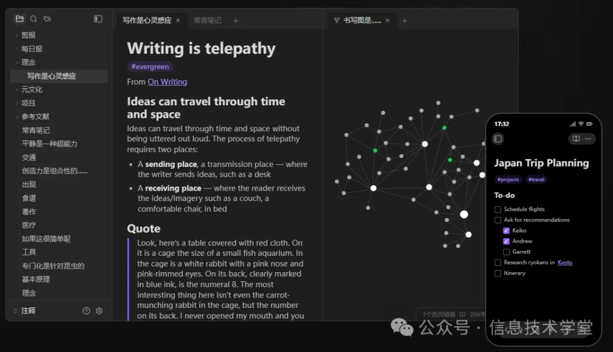

# 用 WorkBuddy搭建专属知识管理系统，打造个人第二大脑

## 资料在下面

---

### 为什么现在人人都该有自己的知识库

> [!NOTE]
> 
信息爆炸时代，我们每天接触的资料远远超过大脑处理能力。微信收藏的文章、浏览器书签、本地文档、会议记录——这些信息散落在各处，需要的时候往往找不到。

>
> 
理想的知识管理系统应该满足三个条件：<strong>资料集中存储、支持智能检索、随时随地可用。</strong>过去搭建这样的系统需要配置数据库、学习向量检索、部署服务，门槛很高。但 AI 编程助手的出现改变了这一切。

>
> 
WorkBuddy 作为腾讯推出的 AI 编程助手，它的特殊之处在于能直接操作你的电脑文件系统——读取文件、写入内容、执行脚本，而不只是给你建议。基于这个能力，知识库的搭建从&quot;需要配置的技术项目&quot;真正变成了&quot;说一句话就能搞定的事&quot;。

### 方案一：本地私有化路线 —— WorkBuddy + Obsidian

#### 一、为什么选这套组合

Obsidian 是一款基于本地 Markdown 文件的笔记软件，核心优势是<strong>知识图谱可视化</strong>和<strong>完全本地存储</strong>。配合 WorkBuddy 的自动化能力，你可以实现：资料自动整理、双向链接自动建立、每日笔记自动生成。

这套方案适合：

<ul><li>对数据隐私有严格要求（法律、医疗、金融从业者）</li><li>需要做知识图谱分析（研究人员、 writer、学生）</li><li>喜欢深度定制工作流的技术用户</li></ul>

#### 二、详细搭建步骤

##### 第一步：安装并配置 Obsidian

<ol><li>访问 obsidian.md 下载安装包，完成安装。</li><li>打开 Obsidian，选择「创建新仓库」（Vault）。</li><li>选择一个本地文件夹作为仓库位置，建议路径简洁，例如<code>D:\MyVault。</code></li><li>进入设置 → 核心插件，确保开启以下功能：
<ul><li>每日笔记（Daily Notes）</li><li>模板（Templates）</li><li>图谱视图（Graph View）</li><li>标签面板（Tag Pane）</li></ul></li><li>在设置 → 文件和链接中，将「新笔记的默认位置」设为「按文件夹组织」，建议创建<code>00_Inbox</code>（收件箱）、<code>01_Projects</code>（项目）、<code>02_Archive</code>（归档）三个基础文件夹。</li></ol>

##### 第二步：配置 WorkBuddy 的 Obsidian 技能

WorkBuddy 已经内置了 Obsidian 操作技能（通过<code>obsidian</code>skill），你需要让 WorkBuddy 知道你的仓库路径：

<ol><li>在 WorkBuddy 中加载<code>obsidian</code>skill</li><li>告诉 WorkBuddy 你的 Obsidian 仓库路径，例如：<code>D:\MyVault</code></li><li>验证连接：让 WorkBuddy 执行「列出我 Obsidian 仓库中的所有文件」，确认能正常读取</li></ol>

##### 第三步：建立自动化知识处理流程

这是整套方案的核心。你可以通过 WorkBuddy 实现以下自动化场景：

<strong>场景A：网页文章自动保存</strong>

<ul><li>你对 WorkBuddy 说：「帮我把这篇文章保存为 Obsidian 笔记，提取关键要点，加上今天日期和 #article 标签」</li><li>WorkBuddy 会自动：抓取网页内容 → 提取摘要 → 写入<code>00_Inbox</code>文件夹 → 按预设模板格式化</li></ul>

<strong>场景B：每日笔记自动生成</strong>

<ul><li>配置 WorkBuddy 定时任务（每天早上 9 点）：
<ul><li>创建当日笔记（<code>YYYY-MM-DD.md</code>）</li><li>插入预设模板（包含「今日计划」「备忘」「灵感」三个区块）</li><li>自动关联前一天的笔记（建立双向链接）</li></ul></li></ul>

<strong>场景C：周报/月报自动汇总</strong>

<ul><li>你对 WorkBuddy 说：「汇总本周所有笔记，生成周报」</li><li>WorkBuddy 会：扫描本周所有日记 → 提取关键事项 → 按类别整理 → 生成周报笔记并链接到相关页面</li></ul>

##### 第四步：优化知识图谱

Obsidian 的图谱视图是这套方案的杀手锏。要让图谱有价值，需要：

<ol><li><strong>建立标签体系</strong>：在设置 → 标签中规划 2-3 级标签，例如<code>#项目/工作</code>、<code>#学习/编程</code>、<code>#灵感</code></li><li><strong>使用模板</strong>：为不同类型笔记创建模板，确保每次新建笔记都包含必要的元数据（标签、创建时间、关联项目）</li><li><strong>定期整理收件箱</strong>：让 WorkBuddy 每周提醒你整理<code>00_Inbox</code>，将已处理的内容移动到对应文件夹</li></ol>

##### 第五步（可选）：进阶配置

<ul><li><strong>Git 版本管理</strong>：在 Obsidian 仓库初始化 Git 仓库，每次修改自动提交，实现版本追溯和多设备同步</li><li><strong>Dataview 插件</strong>：安装 Dataview 社区插件，用类似 SQL 的语法动态查询笔记，自动生成「本月读书清单」「进行中的项目」等聚合视图</li><li><strong>Templater 插件</strong>：比原生模板更强大，支持 JavaScript 脚本，可以实现根据当前时间动态生成文件名等高级功能</li></ul>

### 方案二：云端智能问答路线 —— WorkBuddy + IMA 知识库

#### 一、为什么选这套组合

IMA 是腾讯推出的智能知识库产品，最大亮点是<strong>内置 RAG（检索增强生成）引擎</strong>，上传文档后可以直接用自然语言提问，AI 会基于你的资料给出答案，并标注信息来源。

这套方案适合：

<ul><li>需要移动端访问（经常在手机上查资料）</li><li>希望开箱即用，不想折腾配置</li><li>资料量大但敏感程度不高（运营资料、项目文档、学习笔记）</li></ul>

#### 二、详细搭建步骤

##### 第一步：开通 IMA 知识库

<ol><li>访问 IMA 官网（通过腾讯文档或企业微信入口），使用微信或企业微信账号登录</li><li>创建你的第一个知识库，建议按使用场景命名，例如「项目管理知识库」「学习资料库」</li><li>在知识库设置中，配置权限（个人使用选「仅自己可见」）</li></ol>

##### 第二步：配置 WorkBuddy 的 IMA 技能

WorkBuddy 已经内置了 IMA 操作技能（通过<code>ima-skills</code>skill）：

<ol><li>在 WorkBuddy 中加载<code>ima-skills</code>skill</li><li>首次使用时，WorkBuddy 会引导你完成 IMA 的授权登录（OAuth 流程，无需手动配置 API Key）</li><li>验证连接：让 WorkBuddy 执行「列出我的所有知识库」，确认能正常访问</li></ol>

##### 第三步：批量上传资料到 IMA

这是最需要耐心的步骤，但 WorkBuddy 可以大幅简化：

<strong>手动上传（适合一次性导入）：</strong>

<ul><li>在 IMA 网页端，点击「上传文件」，支持 Word、PDF、Markdown、网页链接等格式</li><li>建议每次上传后等待处理完成（IMA 会对文档进行向量化，通常需要几秒到几分钟）</li></ul>

<strong>通过 WorkBuddy 自动上传（适合持续维护）：</strong>

<ul><li>• 你对 WorkBuddy 说：「把<code>D:\Documents\项目资料</code>文件夹里的所有 PDF 上传到 IMA 的『项目管理知识库』」</li><li>• WorkBuddy 会：遍历文件夹 → 逐一调用 IMA 上传接口 → 反馈上传结果</li></ul>

<strong>网页内容直接收藏：</strong>

<ul><li>安装 IMA 浏览器插件（Chrome/Edge 应用商店搜索「ima知识库批量下载助手」）</li><li>浏览网页时点击插件图标，一键保存当前页面到指定知识库</li><li>或者让 WorkBuddy 帮你：「把这个 URL 的内容保存到 IMA 知识库」</li></ul>

##### 第四步：测试智能问答效果

上传完成后，进入 IMA 的问答界面，用自然语言提问来测试效果：

<ul><li><strong>事实型问题</strong>：「我们项目的上线日期是什么时候？」（IMA 会从项目文档中提取答案）</li><li><strong>总结型问题</strong>：「总结一下竞品分析的主要结论」（IMA 会综合多篇文档给出概括）</li><li><strong>对比型问题</strong>：「方案 A 和方案 B 各有什么优缺点？」（IMA 会从对比文档中提取关键信息并结构化呈现）</li></ul>

如果回答不准确，可能的原因和解决方法：

<ul><li>文档没有成功向量化：在知识库管理页面检查文档状态，重新上传失败的文件</li><li>提问不够具体：尝试加上限定条件，例如「基于 2024 年 Q3 的调研报告回答」</li><li>文档格式问题：IMA 对扫描版 PDF 的识别效果较差，建议上传文字版 PDF 或 Word 文档</li></ul>

##### 第五步：在移动端使用

IMA 的优势之一是原生支持移动端：

<ol><li>在微信中搜索「IMA 知识库」小程序，或用企业微信扫码登录</li><li>移动端的问答体验和网页端一致，适合：通勤途中查资料、会议现场快速检索、外出时查阅项目文档</li><li>可以让 WorkBuddy 配置定时提醒：「每天晚上 8 点，提醒我回顾今天收藏到 IMA 的内容」</li></ol>

##### 第六步（可选）：高级功能

<ul><li><strong>知识库分享</strong>：IMA 支持将知识库分享给团队成员，适合团队协作场景</li><li><strong>问答记录导出</strong>：定期让 WorkBuddy 帮你导出问答历史，分析哪些资料最常被查阅，指导后续的知识库内容规划</li><li><strong>多知识库联动</strong>：可以为不同场景建立独立知识库（例如「个人学习」「工作项目」「兴趣爱好」），提问时指定知识库范围</li></ul>

### 两套方案的核心差异对比

<table><thead><tr><th>对比维度</th><th>Obsidian + WorkBuddy</th><th>IMA + WorkBuddy</th></tr></thead><tbody><tr><td>数据存储位置</td><td>本地硬盘</td><td>腾讯云端</td></tr><tr><td>知识图谱</td><td>✅ 原生支持，可视化强</td><td>❌ 不支持</td></tr><tr><td>智能问答</td><td>⚠️ 需自行配置（可用 Local RAG）</td><td>✅ 开箱即用，效果优秀</td></tr><tr><td>移动端访问</td><td>需配合 Sync 服务或 Git</td><td>✅ 原生支持小程序/App</td></tr><tr><td>数据隐私</td><td>最高（完全本地）</td><td>中等（腾讯云存储）</td></tr><tr><td>上手难度</td><td>中等（需配置文件夹结构）</td><td>低（注册即用）</td></tr><tr><td>适合资料类型</td><td>敏感资料、长期知识沉淀</td><td>项目文档、运营资料、学习笔记</td></tr><tr><td>费用</td><td>Obsidian 免费（同步需付费）</td><td>IMA 基础版免费</td></tr></tbody></table>

<strong>一句话总结</strong>：Obsidian 胜在知识图谱和隐私，IMA 胜在智能问答和移动端。WorkBuddy 则是连接你和这两套系统的「执行层」——你说需求，它帮你操作。

### 如何根据需求选择

#### 选 Obsidian + WorkBuddy，如果你：

<ul><li>是研究人员、律师、医生、学生等需要长期积累专业知识的职业</li><li>处理的数据高度敏感，不能上传云端</li><li>喜欢看到知识之间的关联（图谱视图真的会上瘾）</li><li>愿意花时间打造适合自己的工作流</li></ul>

<strong>典型使用场景</strong>：法律条文研究、医学文献管理、学术论文写作、编程知识库搭建

#### 选 IMA + WorkBuddy，如果你：

<ul><li>是产品经理、运营、销售等需要快速查阅项目资料的职业</li><li>经常在外出时用手机查资料</li><li>希望「上传文档 → 直接提问」的极简体验</li><li>不想花时间维护本地软件</li></ul>

<strong>典型使用场景</strong>：项目管理文档查询、竞品资料库、客户信息库、学习笔记速查

#### 两套都用的混合方案

事实上，很多深度用户（包括本文作者）会同时使用两套系统：

<ul><li><strong>Obsidian</strong>作为「主知识库」：存放核心资料、长期积累的内容、敏感信息</li><li><strong>IMA</strong>作为「移动查询端」：将非敏感的重要资料同步一份到 IMA，方便在外查阅</li></ul>

WorkBuddy 可以让这个同步过程自动化：「每天晚上，把 Obsidian 中今天新增的、标签包含 #可公开 的笔记，自动上传到 IMA 知识库」

