# 从0到1小白教程用 WorkBuddy + ima 搭个人知识库

## 资料在下面

---

#### 很多人一提到个人知识库，第一反应就是 Obsidian

> [!NOTE]
> <p>它当然很好：本地 Markdown、双链、插件、目录、模板、图谱，玩深了以后确实很强。</p>
>
> <p>但问题是，很多普通人根本不是卡在&quot;知识库不够高级&quot;。</p>
>
> <p>他们真正卡住的是：<strong>资料太散。</strong></p>
>
> > <p>微信收藏里一堆文章，腾讯文档里一堆资料，电脑文件夹里一堆 PDF，会议纪要到处都是，视频看完没有字幕，灵感写在备忘录里，最后谁也找不到。 这时候你让一个小白上来就学 Obsidian、Markdown、模板、双链、插件，其实很容易把人劝退。</p>
>
> <p>所以如果你的主要资料都在中文办公环境里，我反而建议先看一个更适合国内用户的组合：</p>
>
> <p><strong>WorkBuddy + ima</strong></p>
>
> <ul><li>ima：负责把资料放进知识库。</li><li>WorkBuddy：负责读取、整理、归类、摘要和生成 Review。</li><li>人负责最后判断：哪些内容值得留下，哪些只是临时素材。</li></ul>
>
> <p>这是我理解的个人知识库从 0 到 1搭建</p>
>
> <p>先不考虑直接构建一个复杂系统，先让你那些散落在微信、文档、PDF、会议和视频里的资料，终于有人帮你处理第一遍</p>

## 一、为什么不是一上来就用 Obsidian

<p>Obsidian 的优势很明显：它适合长期沉淀，适合自己搭结构，适合把知识一点点织成网络。</p>

<p>但它也有一个现实问题：<strong>它更像一个&quot;很强的仓库&quot;。</strong></p>

<p>但仓库本身不会帮你整理货架</p>

<p>很多人的 Obsidian 最后没有变成第二大脑，而是变成了<strong>第二垃圾桶</strong>。网页剪藏进去，PDF 丢进去，每日笔记写进去，会议纪要塞进去。刚开始很有成就感，过一段时间就不想打开了。</p>

<p>原因很简单：<strong>资料进来以后，没人做第二步处理。</strong></p>

<ul><li>一条临时想法该不该保留？</li><li>一篇文章跟哪个项目有关？</li><li>一个 PDF 哪几页有用？</li><li>一次会议到底沉淀了什么结论？</li><li>一段视频内容能不能变成选题？</li></ul>

<p>这些问题不解决，知识库越大，负担越重。</p>

<p>所以普通人搭个人知识库，第一步不要追求高级。</p>

<p>先追求一件事：<strong>让资料进来以后，有人帮你初步处理。</strong></p>

<p>这就是 WorkBuddy + ima 的价值</p>

## 二、这个组合到底怎么分工

<p>我把它拆成三个角色：</p>

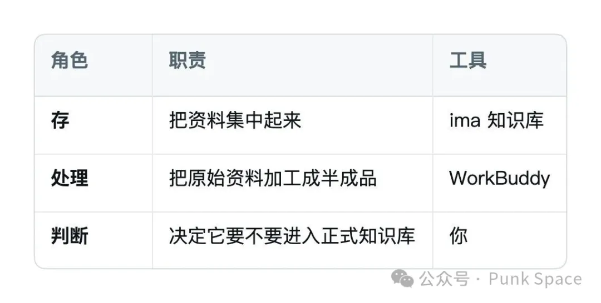

<p>这个分工很重要。因为很多人做知识库，一上来就想让 AI 接管全部流程——自动读取、自动分类、自动总结、自动归档、自动生成正式笔记。</p>

<p><strong>因为长期知识不是格式化文本，长期知识需要判断。</strong></p>

<ul><li>哪些资料值得留下？</li><li>哪些观点只是看起来正确？</li><li>哪些内容未来真的会用？</li><li>哪些资料只是当时觉得有用，后来根本不会再打开？</li></ul>

<p>这些不能完全交给 AI。</p>

<p>更稳的方式是：</p>

> <p>WorkBuddy 负责预处理，ima 负责沉淀，人负责确认。 这个顺序不要乱。一乱，知识库就会变成一堆 AI 生成的漂亮废话。</p>

## 三、从 0 开始：5 分钟完成连接

### 第一步：安装并登录 ima

<ol><li>电脑浏览器打开 <a href="../references/links.md#ref-ima-qq-com">ima 页面内容的本地说明</a></li><li>下载 Mac 或 Windows 客户端，用微信扫码登录</li><li>手机端：微信搜索「IMA 知识库」小程序，用同一个微信登录</li></ol>

> <p>重要提醒：ima 和 WorkBuddy 必须用同一个微信账号登录，否则知识库读不到。</p>

### 第二步：在 WorkBuddy 中连接 ima

<ol><li>打开 WorkBuddy 客户端</li><li>点击左侧边栏的 「资料库」，选择 「ima 知识库」</li><li>点击 「立即前往授权」</li><li>弹出微信扫码界面，用微信扫码登录 ima 知识库</li><li>点击 「确认授权」</li></ol>

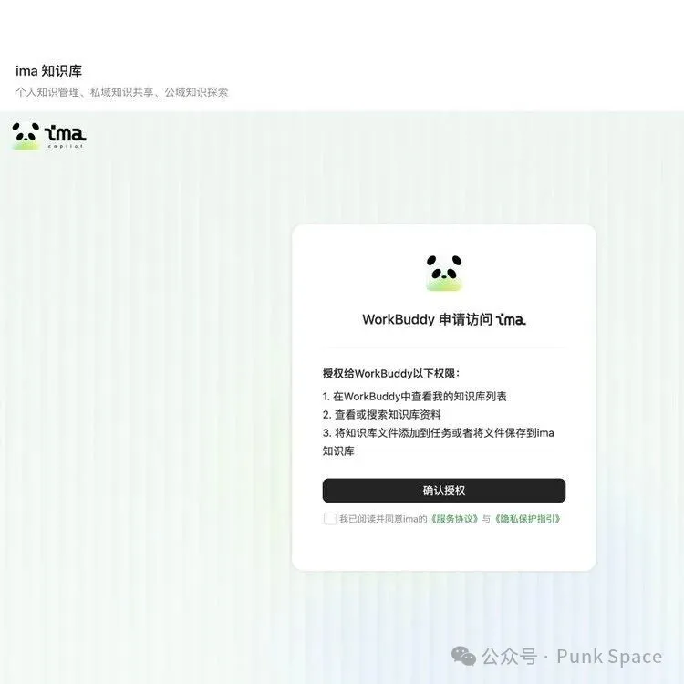

<p>授权完成后，WorkBuddy 将获得以下权限：</p>

<ul><li>在 WorkBuddy 中查看你的知识库列表</li><li>查看或搜索知识库资料</li><li>将知识库文件添加到任务，或将文件保存到 ima 知识库</li></ul>

> <p>验证连接是否成功： 在 WorkBuddy 对话框中输入「帮我列出 ima 知识库中所有的知识库名称」，如果返回了你的知识库列表，说明连接成功。</p>
>
> 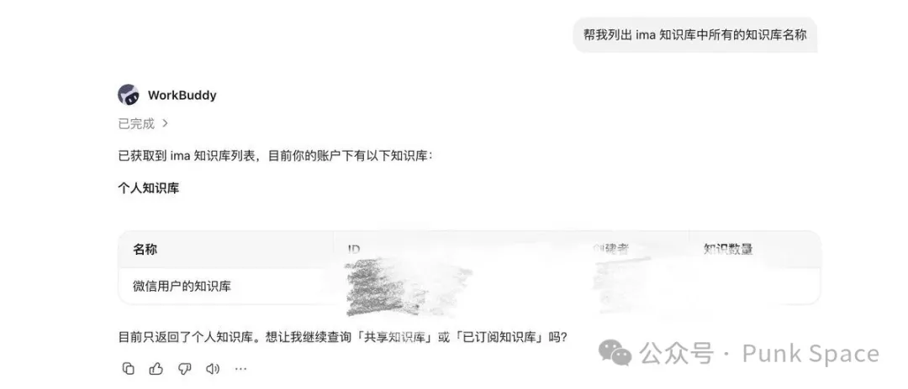

### 第三步：了解两种引用方式

<p>连接成功后，在任务中引用 ima 知识库内容有两种方式：</p>

<p><strong>方式 A</strong>从资料库添加：在「资料库 → ima 知识库」中选中对应文件，点击「添加到任务」。</p>


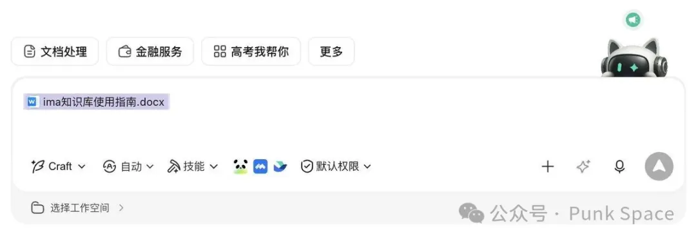

<p><strong>方式 B</strong>— 在对话框添加：在新建任务的输入框上方点击「上传文件」图标，打开 ima 知识库，支持勾选整个知识库或选择具体文件，点击「确定」添加到对话。</p>

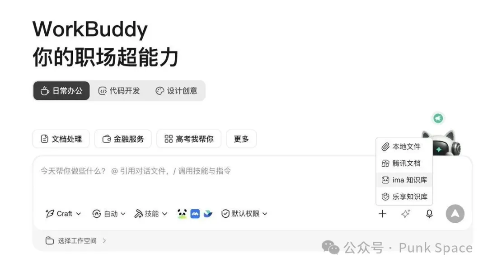

### 第四步：了解产物存回功能

<p>WorkBuddy 处理完资料后，产物可以存回 ima：</p>

<ol><li>在右侧产物区找到需要的文件</li><li>点击「上传到云端」</li><li>选择「ima 知识库」储存</li><li>支持按 个人 / 共享 / 订阅 三类知识库储存 这样就读取 → 处理 → 存回，形成完整闭环。</li></ol>

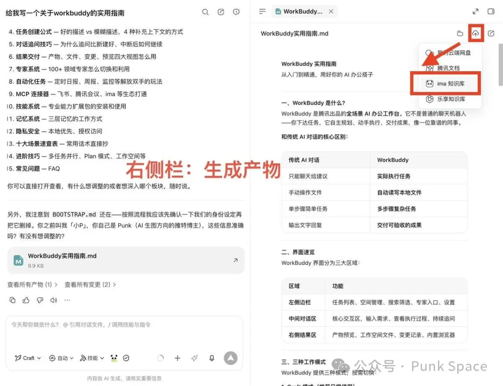

## 四、小白第一版，只建三个知识库

<p>很多知识库教程最大的问题，是一开始就设计得太复杂。资料库、项目库、领域库、卡片库、输出库、归档库、灵感库、阅读库、客户库、产品库、复盘库……</p>

<p>听起来很专业，但对小白来说，分类越多，越容易放弃。</p>

<p><strong>第一版，只建三个：</strong></p>

> [!NOTE]
> #### 01-资料库
>
> <p>用来放外部资料。</p>
>
> <p>文章、PDF、报告、网页、课程、视频字幕、访谈稿、会议录音转写。</p>

> [!NOTE]
> #### 02-项目库
>
> <p>用来放你正在推进的事情。</p>
>
> <p>一个公众号选题、一个客户项目、一个产品想法、一个课程计划、一个商业方案。</p>

> [!NOTE]
> #### 03-输出库
>
> <p>用来放你自己的成果。</p>
>
> <p>文章草稿、选题库、复盘、总结、观点卡片、方法论沉淀。</p>

<p><strong>为什么只建三个？</strong></p>

<p>因为小白第一阶段最重要的不是分类精细，而是先养成一个习惯：<strong>资料进来以后，不要到处乱放。</strong>先进入一个能被 AI 读取和处理的地方。</p>

<p>只要这一步跑通，你就已经超过了大多数人的&quot;收藏夹知识库&quot;。</p>

> <p>在 ima 中创建知识库的方法： 打开 ima 客户端 → 左侧「知识库」→ 点击「+」新建知识库 → 输入名称 → 创建完成。</p>
>
> 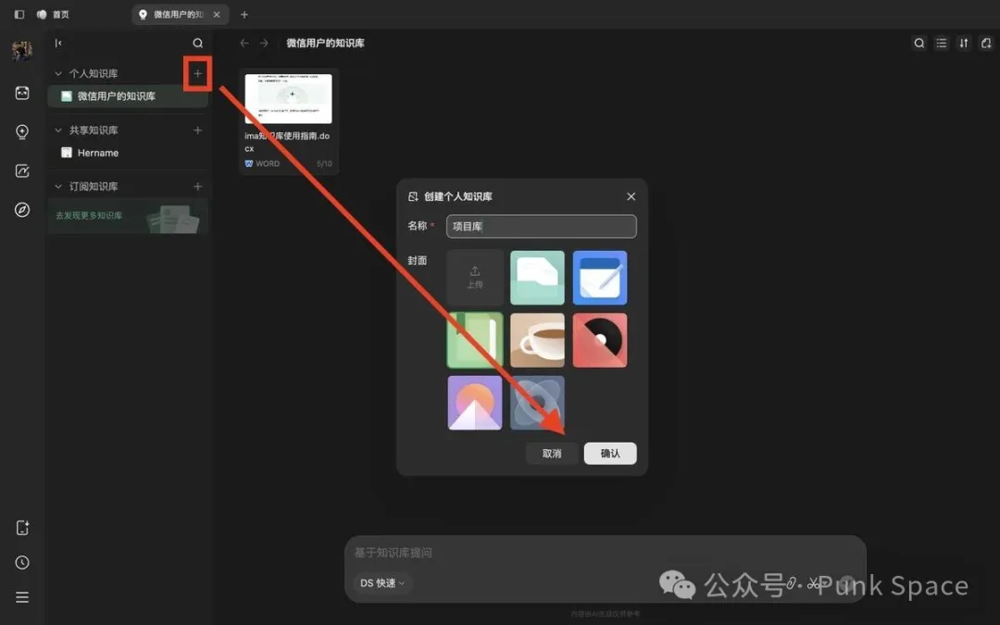

## 五、第一批资料不要太多

<p>很多人搭知识库，最容易犯的错误是：第一天就想把所有资料都倒进去。微信收藏几百条，浏览器收藏几百个网页，电脑文件夹几十个 PDF，历史笔记一大堆。全都导进去，看起来很壮观。</p>

<p>但这不是搭知识库，<strong>这是把垃圾堆搬进新房子。</strong></p>

<p><strong>第一批资料一定要少。我建议只放 20 条以内：</strong></p>

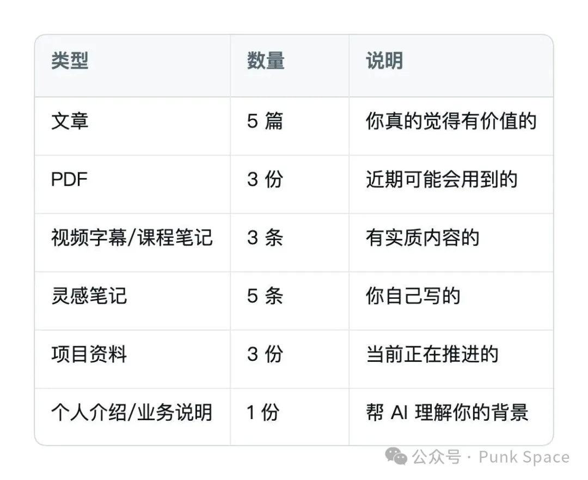

<p>为什么要这么少？因为第一阶段不是为了&quot;建成一个大知识库&quot;，而是为了验证三个问题：</p>

<ol><li>ima 能不能把这些资料存好</li><li>WorkBuddy 能不能把这些资料读出来、整理好</li><li>你看完 AI 生成的结果以后，是否愿意继续用 如果这三个问题没有跑通，资料越多，越混乱。先拿一小批真实资料试，跑通以后再扩。</li></ol>

### 往 ima 添加资料的方法：

<ul><li>公众号文章：复制文章链接 → 打开 ima 客户端/小程序 → 进入对应知识库 → 粘贴链接保存</li></ul>

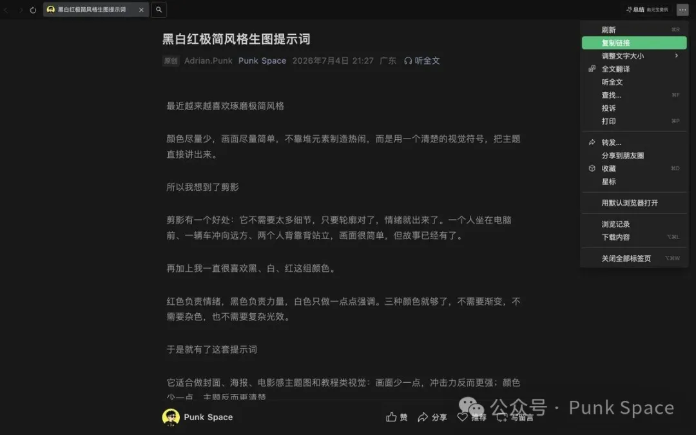

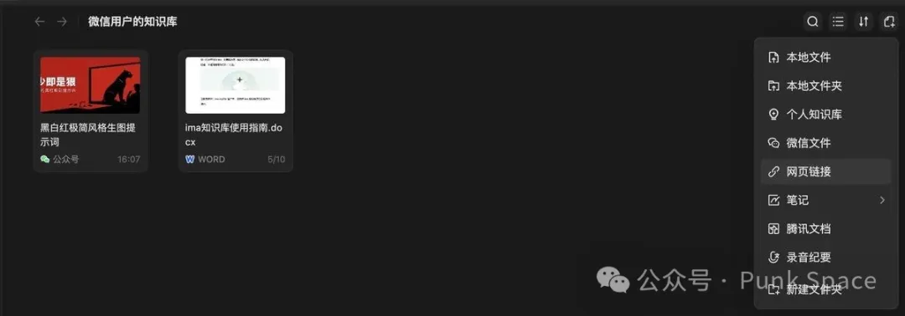

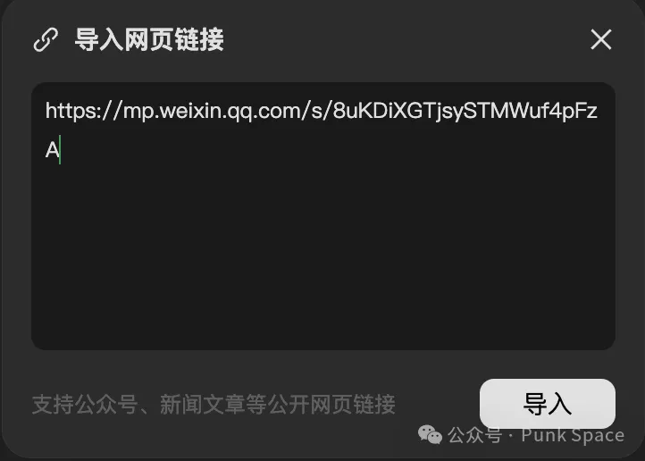

<ul><li>微信聊天文件：知识库上传「微信文件」 → 选择联系人 →选择文件→ 入库</li><li>本地文件：打开 ima 客户端 → 进入对应知识库 → 上传文件</li><li>拍照/截图：打开 IMA 小程序 →「+」→ 拍照 → 自动 OCR 入库 注意：在对话框直接发文件只是临时文件，一定要进「知识库」内部上传，才算真正存入。</li></ul>

## 六、连接打通后，先跑三个最小任务

<p>WorkBuddy 和 ima 打通以后，不要急着自动化。先跑三个最小任务。这三个任务跑通了，个人知识库的雏形就有了。</p>

### 任务一：整理资料库

<p>让 WorkBuddy 读取你的 01-资料库，你可以这样说：</p>

```
请读取 ima 知识库中的「01-资料库」。

帮我整理最近上传的资料。

按主题分组输出。

每条资料请包含：标题、一句话摘要、核心观点、适合归入的主题、是否值得精读。

不要生成最终文章。不要替我删除、移动或覆盖任何资料。
```

<p>这个任务的目的不是让 AI 给你结论，而是先把一堆资料变成你能快速扫读的清单。你看完以后，至少能知道：</p>

<ul><li>哪些值得精读</li><li>哪些只是临时参考</li><li>哪些可以以后再看</li><li>哪些根本不该进入知识库</li></ul>

<p><strong>这一步很关键。因为个人知识库的第一道关卡，不是收藏，是筛选。</strong></p>

### 任务二：生成项目资料包

<p>让 WorkBuddy 围绕一个项目整理资料：</p>

```
请读取 ima 知识库中的「02-项目库」。

围绕「我的当前项目」整理一份项目资料包。

请输出：项目背景、已有资料、关键问题、可用素材、缺失信息、下一步行动。

不要替我做最终决策。不要生成正式方案。
```

<p>这个任务非常实用。因为很多时候，我们不是没有资料，而是不知道资料之间有什么关系。一份客户需求在腾讯文档里，一条灵感在手机备忘录里，一篇行业文章在微信收藏里，一次会议纪要在文件夹里。</p>

<p>WorkBuddy 的作用，就是先帮你把它们拉到同一个视角里。你再判断：这个项目现在缺什么？下一步该补什么？哪些素材能马上用？哪些只是噪音？</p>

<p><strong>这比让 AI 直接写方案靠谱得多。</strong></p>

### 任务三：生成内容选题

<p>如果你写公众号、X、小红书、视频脚本，这个组合很适合做选题池：</p>

```
请读取 ima 知识库中的「01-资料库」和「03-输出库」。

帮我生成 10 个适合发公众号或 X 的选题。

每个选题包含：标题、核心观点、可引用资料、适合角度、风险点。不要直接写成完整文章。
```

<p>这个指令的重点是最后一句：<strong>不要直接写成完整文章。</strong></p>

<p>很多人用 AI 写内容，一上来就说&quot;帮我写一篇爆款文章&quot;，结果大概率是一堆套话。更稳的做法是让 AI 先生成选题候选、素材包、观点对照和风险点。内容最终怎么写，仍然由你决定。</p>

## 七、正确流程：资料不是直接变文章

<p>很多人会把 AI 知识库理解成一个自动写作机器：资料放进去 → AI 读一下 → 直接生成文章 → 复制发布。</p>

<p>这个流程很诱人，但很容易出问题。因为：</p>

<ul><li>资料 ≠ 观点</li><li>观点 ≠ 文章</li><li>文章 ≠ 可以发布的内容 更稳的流程应该是：</li></ul>

```
资料进入 ima
    ↓
WorkBuddy 生成 review
    ↓
人筛选有价值内容
    ↓
再生成选题
    ↓
再生成大纲
    ↓最后才写正文
```

<p>这个流程看起来多了几步，其实更省时间。因为它避免了一个更大的坑：<strong>你发出去的东西，看起来完整，但你自己并没有真正判断过。</strong></p>

<p>这也是我不建议让 WorkBuddy 直接生成最终知识的原因。它可以帮你读、整理、归类、找出关联、生成候选——但最后那一步，必须由你确认。</p>

<p>尤其是涉及观点判断、商业判断、法律医疗投资等高风险内容，更不能直接交给 AI 下结论。</p>

## 八、个人知识库最重要的不是&quot;存&quot;，是&quot;复用&quot;

<p>很多人以为个人知识库的核心是存资料。其实不是。存资料只是第一步，真正有价值的是复用。</p>

<p>比如你今天看到一篇关于 AI Agent 的文章，放进 01-资料库。下周你写 WorkBuddy 教程，它能变成参考资料。下个月你做 AI 工具分享，它能变成案例。三个月后你写个人方法论，它能变成支撑观点。</p>

<p><strong>这才叫知识库。如果资料只是存进去以后再也不看，那它只是收藏夹。</strong></p>

<p>我建议你每周做一次复盘：</p>

```
请读取 ima 知识库中本周新增资料。

帮我生成一份 weekly review。

包含：本周新增内容、重复主题、值得精读的资料、
可发展成文章的选题、需要补充的信息、下周行动建议。不要删除、移动或覆盖任何资料。
```

<p>这份 weekly review 才是个人知识库真正开始运转的标志。因为它会逼你每周处理一次资料——不是一直往里扔，而是定期筛、定期看、定期用。</p>

## 九、远程触发：不在电脑前，也能处理低风险任务

<p>WorkBuddy 相比普通知识库工具，还有一个很适合国内用户的点：<strong>它可以通过微信、企微、QQ、钉钉、飞书等入口远程触发任务。</strong></p>

<p>这个能力很适合处理低风险知识库任务。</p>

<p>比如你在外面突然想到一个问题：</p>

```
请在 ima 知识库中查找和「AI 工作流」相关的资料。

只读取，不修改。

请输出相关资料标题、一句话摘要、来源位置，以及最值得继续看的 5 条。
```

<p>再比如你开完会，想让电脑先整理会议记录：</p>

```
请读取今天新增的会议转写内容。

整理会议主题、讨论要点、明确结论、待办事项、
负责人、截止时间和待确认问题。结果保存为 review，不要生成正式文档。
```

<p><strong>远程任务必须克制。</strong></p>

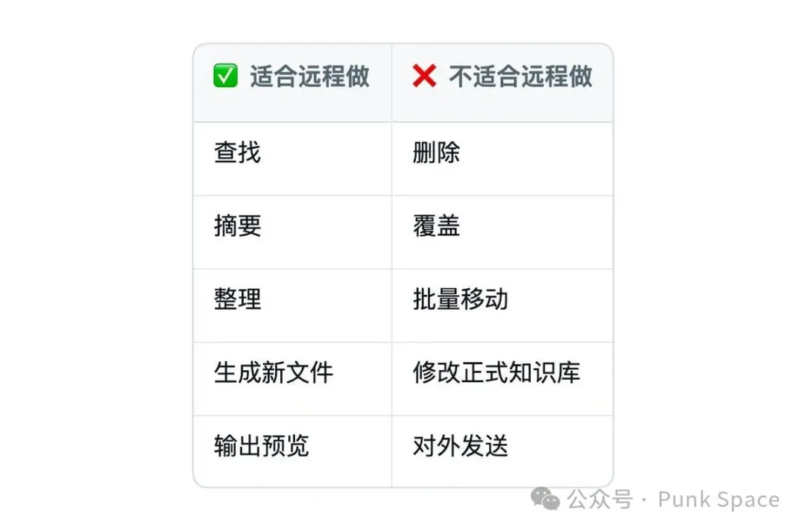

<p>原则：<strong>远程只做低风险处理，正式修改必须回到电脑前确认。</strong></p>

## 十、哪些资料适合放进 ima

#### 第一类：文章

<p>公众号文章、网页文章、行业分析、产品介绍、教程、案例。</p>

<p>适合放进 01-资料库。WorkBuddy 可以帮你提炼标题、摘要、核心观点、可引用内容和相关主题。</p>

#### 第二类：PDF

<p>行业报告、白皮书、课程讲义、产品文档、研究资料。</p>

<p>PDF 不要一上来全文精读。先让 WorkBuddy 提取目录、章节摘要、关键数据、页码和风险提示。尤其要注意：<strong>关键数据一定要保留来源，没有来源的数据不要直接拿去发布。</strong></p>

#### 第三类：会议纪要

<p>会议记录最容易散。今天一段录音，明天一个文档，后天一条微信消息。建议统一进入 02-项目库。</p>

<p>让 WorkBuddy 输出：会议主题、背景、讨论要点、明确结论、行动项、负责人、截止时间、待确认问题。</p>

<p>这样会议纪要才不是&quot;听完就忘&quot;。</p>

#### 第四类：视频字幕

<p>课程、访谈、发布会、播客、教程视频，都可以先转成文本再放进资料库。WorkBuddy 可以帮你整理章节、关键概念、行动建议、值得二刷的时间点和可延伸选题。</p>

#### 第五类：自己的灵感

<p>这类内容更重要。因为外部资料只是材料，你自己的判断才是知识库最有价值的部分。</p>

<p>可以先放进 03-输出库，后面再慢慢整理。第一版不用复杂，先让它进入系统。</p>

## 十一、哪些内容不要直接放进去

<p>不是所有内容都适合进知识库。尤其是下面几类，必须谨慎：</p>

<ul><li>未脱敏的客户资料</li><li>合同、报价、身份证、手机号、银行卡等敏感信息</li><li>公司内部机密</li><li>医疗、法律、投资类最终判断材料</li><li>未经核实的二手信息</li><li>你没有明确用途的大量网页收藏</li></ul>

<p><strong>AI 知识库不是保险柜。</strong>敏感资料一旦进入自动化流程，就要考虑模型调用、第三方服务、日志、同步目录、权限边界。</p>

<p>如果你不确定能不能放，那就先别放。如果必须处理，先脱敏：</p>

<ul><li>客户名改成「客户 A」</li><li>手机号删掉</li><li>合同金额模糊化</li><li>内部信息只保留结构，不保留原文</li></ul>

<p>对小白来说，最安全的原则是：<strong>能公开发出来的资料可以优先放，不能公开发出来的资料先不要放。</strong></p>

## 十二、文件和知识库命名要简单

<p>很多人知识库乱，不是因为工具差，是因为命名太随意。今天叫&quot;资料整理&quot;，明天叫&quot;AI总结&quot;，后天叫&quot;最终版&quot;，过一周你自己都不知道哪个是哪个。</p>

<p><strong>第一版命名不用高级，但要稳定：</strong></p>

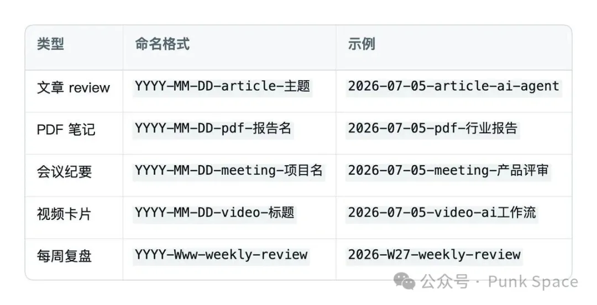

<p>命名的目的不是好看，是为了以后能找回来。个人知识库最怕的不是资料少，是资料明明在里面，你却找不到。</p>

## 十三、小白可以直接照抄的 5 条指令

#### 指令 1：整理资料库

```
请读取 ima 知识库中的「01-资料库」。

按主题整理最近新增资料。

每条资料输出：标题、一句话摘要、核心观点、
可引用内容、相关主题、是否值得精读。不要删除、移动、覆盖任何资料。
```

#### 指令 2：整理项目资料

```
请读取 ima 知识库中的「02-项目库」。

围绕「项目名称」整理一份项目资料包。

输出：项目背景、已有资料、关键问题、
可用素材、缺失信息、下一步行动。不要生成最终方案。
```

#### 指令 3：生成选题

```
请读取 ima 知识库中的「01-资料库」和「03-输出库」。

围绕「主题」生成 10 个内容选题。

每个选题包含：标题、核心观点、可引用资料、
适合角度、风险点。不要直接写完整文章。
```

#### 指令 4：整理会议

```
请读取最新会议记录。

整理会议主题、背景、讨论要点、明确结论、
待办事项、负责人、截止时间和待确认问题。

结果输出为 review。不要生成正式对外文件。
```

#### 指令 5：每周复盘

```
请读取 ima 知识库中本周新增资料。

生成一份 weekly review。

包含：本周新增内容、重复主题、值得精读的资料、
可发展成文章的选题、需要补充的信息、下周行动建议。不要删除、移动或覆盖任何资料。
```

<p><strong>这 5 条先跑熟，不要一开始就追求自动化。</strong></p>

## 十四、跑稳以后，再考虑自动化和 Skill

<p>如果你只是偶尔整理一次资料，直接发任务就够了。如果你每周都要整理，那就固定成模板。如果模板跑了很多次都稳定，再考虑自动化。如果自动化也稳定，最后再沉淀成 Skill。</p>

<p><strong>正确的进阶顺序：</strong></p>

```
一次性任务 → 固定指令 → 固定模板 → 每周复盘 → 自动化 → Skill
```

<p>不要跳步骤。很多人失败，就是因为第一天就想做一个&quot;全能个人知识库助手&quot;——既要读资料，又要分类，又要总结，又要写文章，又要做项目管理，又要自动归档。最后一定会变成灾难。</p>

<p><strong>第一个 Skill 不要全能，只解决一个明确问题：</strong></p>

<ul><li>ima 资料库整理 Skill</li><li>会议纪要 review Skill</li><li>PDF 阅读笔记 Skill</li><li>内容选题整理 Skill</li><li>项目资料包 Skill</li></ul>

<p>能稳定跑一个，再做第二个。知识库系统不是一次搭完的，它是从一个能复用的小流程开始，慢慢长出来的。</p>

> <p>自动化示例： 在 WorkBuddy 左侧「自动化」中新建任务，设置每周五 17:30 触发，提示词写复盘指令，WorkBuddy 就会每周自动读取 ima 知识库、生成周报、存回 ima。这才是真正长期运转的知识管理系统。</p>

## 十五、常见问题排查

#### 问题 1：授权后发现知识库读不到

<p><strong>原因：</strong>ima 账号有多个，授权的不是存有知识库的那个。</p>

<p><strong>解决：</strong>在 WorkBuddy 连接器设置中重新授权，确保选择了正确的 ima 账号。ima 和 WorkBuddy 必须用同一个微信登录。</p>

#### 问题 2：WorkBuddy 读取知识库时回答质量很差

<p><strong>原因：</strong>指令太模糊，AI 不知道要读什么内容、提炼什么维度。</p>

<p><strong>解决：</strong>指令要具体到「读取哪个知识库」「关注哪个维度」「输出什么格式」。</p>

<ul><li>❌ 差：帮我分析一下知识库里的内容</li><li>✅好：访问「产品需求」知识库，提炼其中关于「用户体验」的需求点，按优先级高中低排列，输出为列表</li></ul>

#### 问题 3：ima 知识库显示内容数为 0

<p>99% 是以下 4 个原因，按顺序排查：</p>

<ol><li>文件没进知识库，只在临时对话里 → 去 ima 客户端对应知识库确认有没有文件</li><li>文件还在解析中 → 上传后等 1～3 分钟，显示「解析完成」才能被搜到</li><li>绑错库或密钥错 → 发送「查看 ima 配置」核对信息</li><li>缓存没更新 → 发送「刷新 ima 知识库缓存」再查</li></ol>

#### 问题 4：产物存回 ima 失败

<p><strong>原因：</strong>ima 知识库的权限设置为「仅自己可写」，而连接器的授权权限不够。</p>

<p><strong>解决：</strong>在 ima 里确认知识库权限为「允许写入」，或重新授权时勾选「写入权限」。</p>

## 十六、先跑一条最小流程

<p>如果你看完只准备做一件事，我建议就做这个：</p>

<p><strong>第一步：</strong>在 ima 里建三个知识库——01-资料库、02-项目库、03-输出库。</p>

<p><strong>第二步：</strong>放入第一批资料——5 篇文章、3 份 PDF、3 条视频字幕、5 条灵感笔记、3 份项目资料。</p>

<p><strong>第三步：</strong>让 WorkBuddy 读取资料库，生成 review。</p>

<p><strong>第四步：</strong>人工检查——看来源是否保留、看摘要是否准确、看标签是否有用、看选题是否有支撑材料、看行动项是否清楚。</p>

<p><strong>第五步：</strong>只把有价值的内容沉淀下来。</p>

<p>不要追求一次性完美，也不要一开始就搬空所有收藏夹。先处理一小批真实资料，看看这个组合能不能减少你的整理负担。如果能，再扩。</p>

## 结语：第二大脑不是资料越多越好

<p>我现在越来越觉得，&quot;第二大脑&quot;这个词很容易误导人。</p>

<p>很多人以为第二大脑就是把资料都存进去——网页、PDF、截图、会议、视频、笔记，越多越好。</p>

<p>但真正的问题是：</p>

<ul><li>资料进去以后，谁来处理？</li><li>谁来筛选？</li><li>谁来复盘？</li><li>谁来判断它未来有没有用？</li></ul>

<p>如果没有这一步，再高级的知识库也只是仓库。</p>

<p>WorkBuddy + ima 的价值，不是让你拥有一个更花哨的收藏夹，而是把个人知识库拆成一个更适合小白的流程：</p>

> <p>ima 负责存，WorkBuddy 负责整理，人负责判断。 我不会让 WorkBuddy 接管整个知识库。我只让它先做三件事：读取资料、生成 review、保留来源。最后进不进入正式知识库，仍然由我决定。</p>

<p>这才是我理解的个人知识库从 0 到 1。</p>

<p>不是搭一个复杂系统，而是先让每一批进入系统的资料，都有人处理、有人筛选、有人决定是否值得沉淀。</p>
