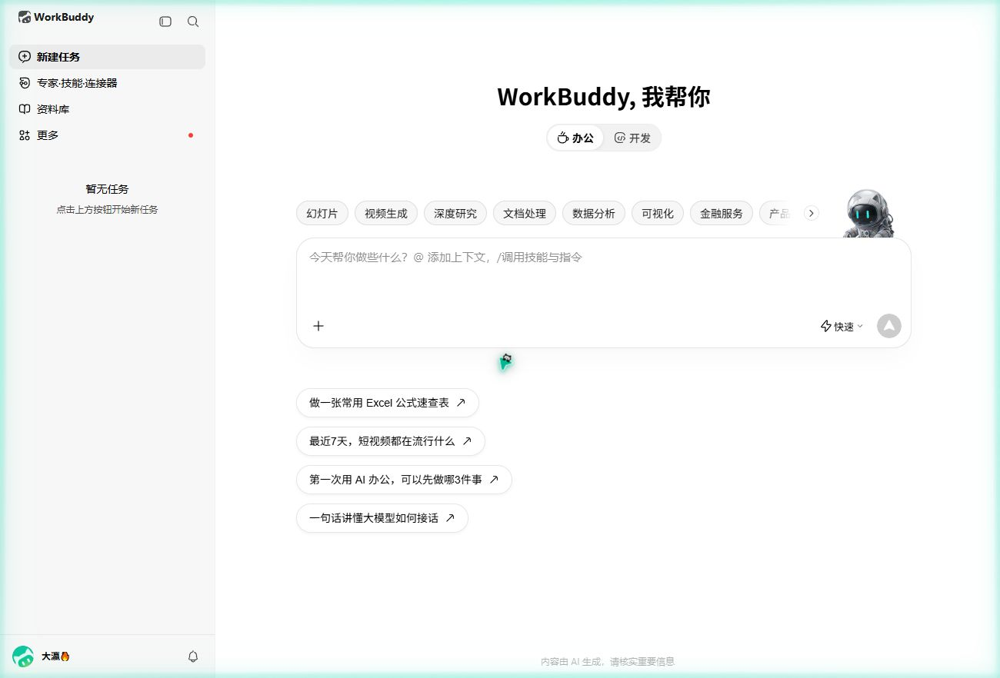
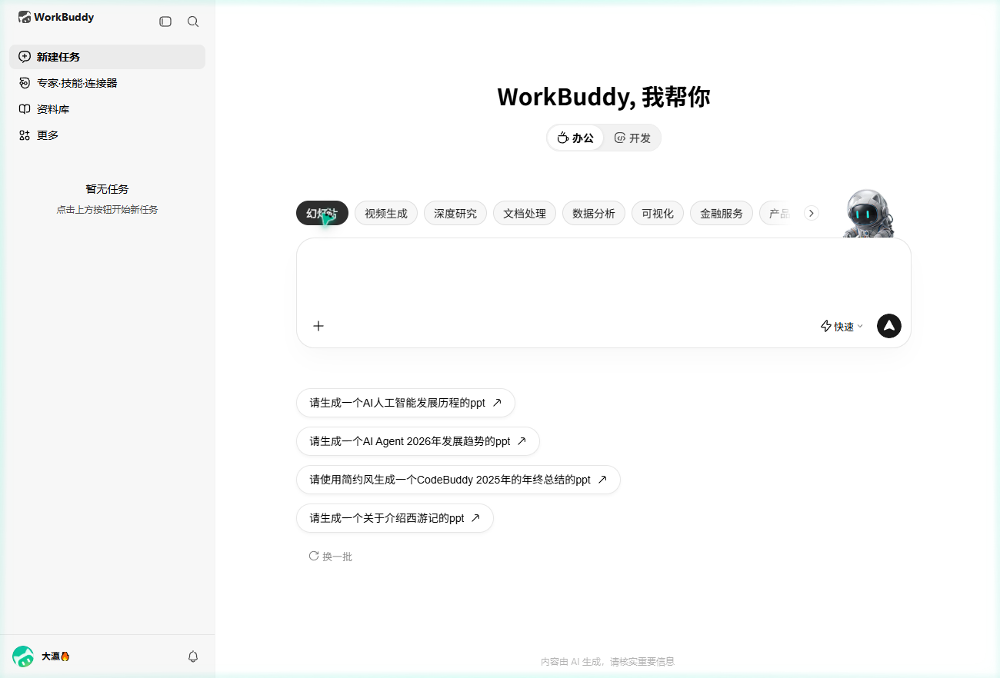
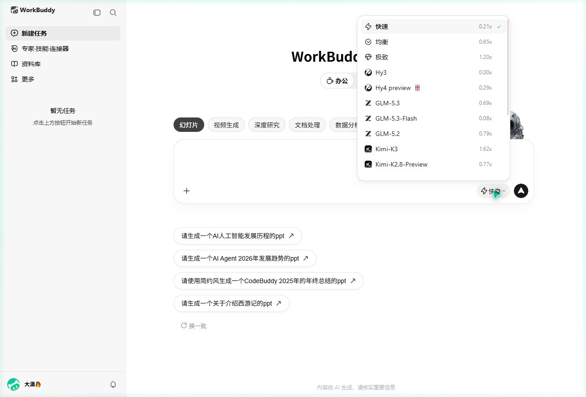
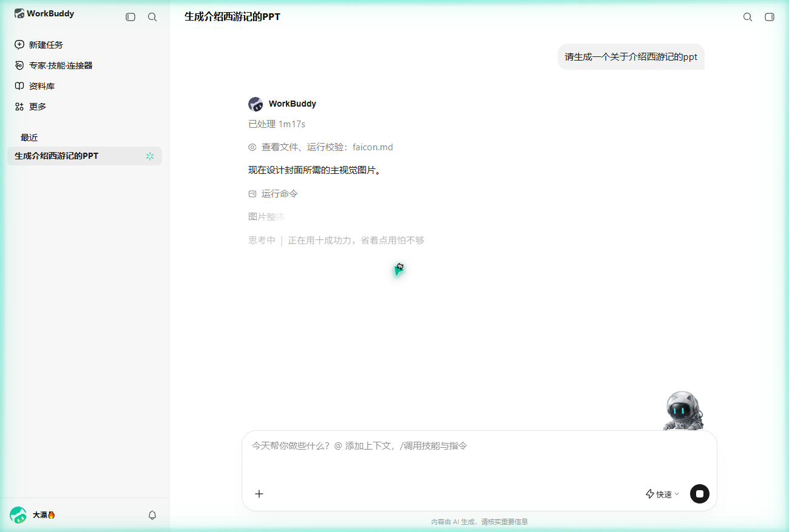
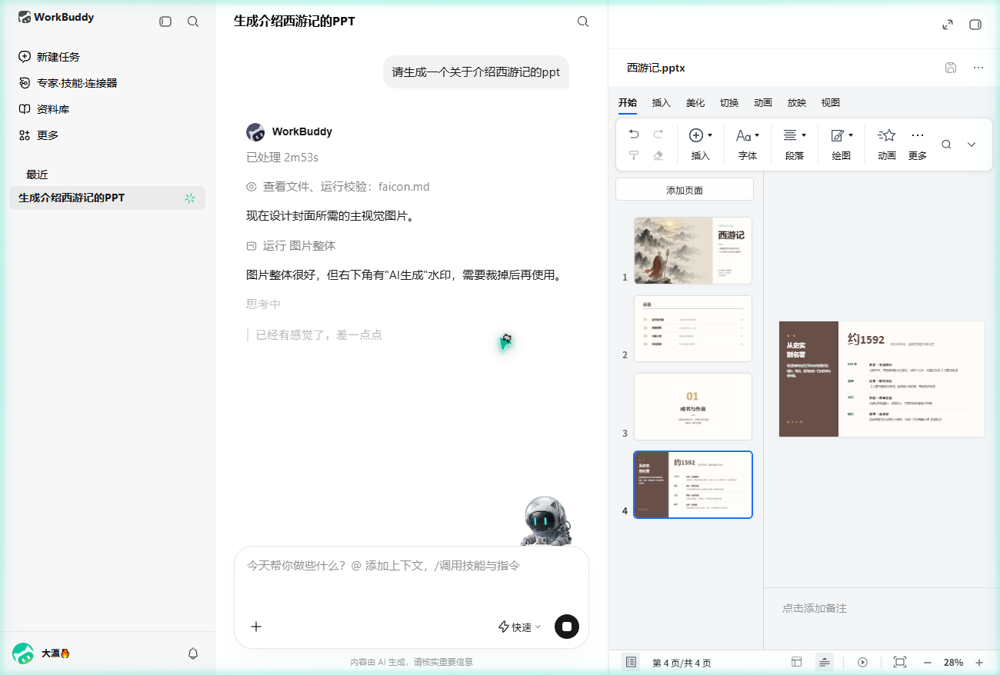
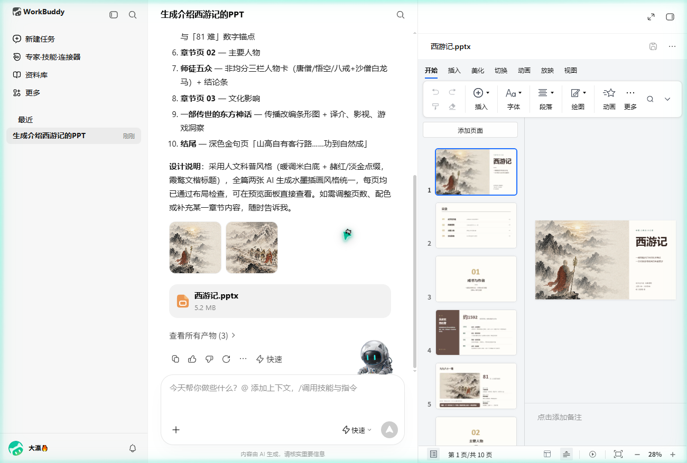
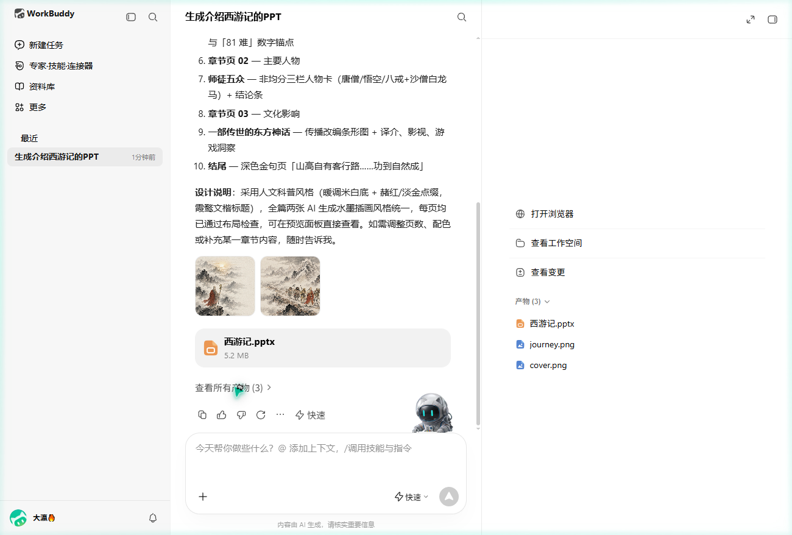
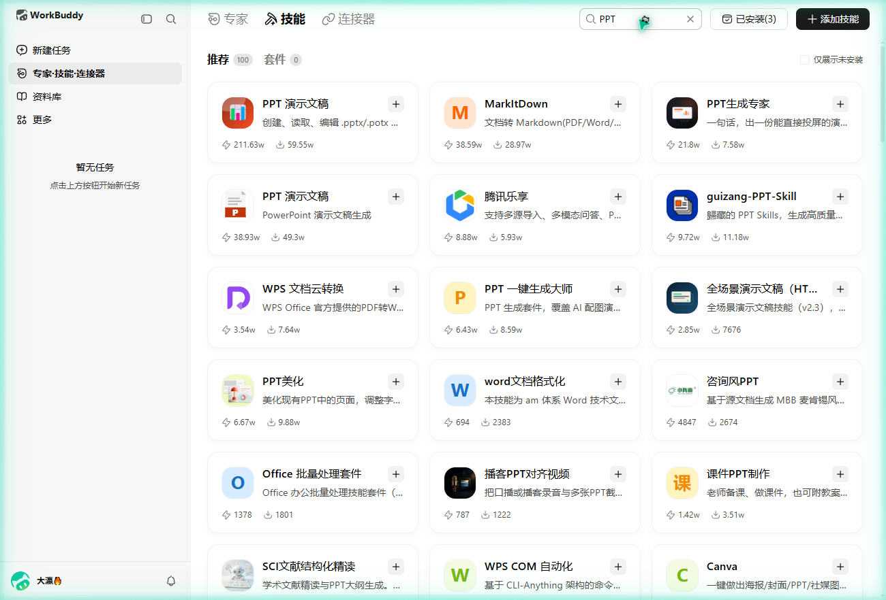

# 用 WorkBuddy 制作 PPT 的保姆级实操教程

## 资料在下面

---

<strong>写在前面：</strong>这篇教程不是&quot;它会自动帮你&quot;的空话，而是我亲手在 WorkBuddy 上一步步点出来的真实操作记录。每一步都告诉你<strong>打开哪个入口、点哪个按钮、输入什么、选什么模型</strong>，配了真实截图，你照着做就能跑通。

---

## 第 1 步：打开 WorkBuddy，找到做 PPT 的入口

打开 WorkBuddy 后，你会看到主界面。做 PPT 的入口在<strong>输入框上方的一排功能按钮</strong>里，找到「<strong>幻灯片</strong>」这个按钮。

整排按钮长这样：幻灯片、视频生成、深度研究、文档处理、数据分析、可视化、金融服务、产品管理、设计、邮件编辑……

> [!NOTE]
> 📌
> 
<strong>一句话记住：</strong>要做 PPT，就点「幻灯片」；要做视频就点「视频生成」；写文档就点「文档处理」。入口都在这一排。

---

## 第 2 步：点「幻灯片」，进入 PPT 制作

点一下「幻灯片」按钮，你会发现两件事：

<ol><li>输入框里自动出现了「<strong>幻灯片</strong>」这个词——它已经帮你把技能挂上了；</li><li>输入框下方弹出了<strong>几个现成的 PPT 示例指令</strong>，比如&quot;请生成一个 AI 人工智能发展历程的 ppt&quot;、&quot;请生成一个关于介绍西游记的 ppt&quot;，旁边还有个「换一批」按钮。</li></ol>

这些示例是给你参考的，你可以直接点一个试试，也可以自己在输入框里写。

---

## 第 3 步：选好模型（可选，新手可跳过）

输入框右下角有个<strong>「快速」下拉按钮</strong>，点开能选模型。它分成两类：

<ul><li><strong>速度档</strong>：快速、均衡、极致（越靠后越慢但越细致）；</li><li><strong>具体模型</strong>：Hy3、Hy4 preview、GLM-5.3、DeepSeek-V4-Pro、Kimi-K3、MiniMax-M3.1 等（每个后面跟着的数字是消耗积分的倍率）。</li></ul>

<strong>新手建议：</strong>第一次直接用默认的「快速」就行，不用纠结。等熟练了再按需换模型。

---

## 第 4 步：输入你的要求，点发送

在输入框里写下你要的 PPT。写清楚<strong>主题 + 页数 + 用途</strong>就够了，比如：

> 
&quot;请生成一个关于介绍西游记的 ppt&quot;

或者更具体的：

> 
&quot;帮我做一份《中国新茶饮国风品牌趋势》PPT，用于品牌策略提案，12 页左右。&quot;

写完点右下角的<strong>发送按钮（圆形箭头）</strong>，任务就开始了。

> [!TIP]
> 💡
> 
<strong>写要求的诀窍：</strong>三个信息给足——<strong>做什么（主题）、几页（页数）、给谁看（用途）</strong>。信息越清楚，出来的 PPT 越符合你预期。

---

## 第 5 步：等它生成，看它一步步在干什么

发送后，界面会切换到执行状态，对话区会<strong>实时显示它在做什么</strong>，比如：

<ul><li>&quot;查看文件、运行校验&quot;</li><li>&quot;现在设计封面所需的主视觉图片&quot;</li><li>&quot;图片整体很好，但右下角有 AI 生成水印，需要裁掉后再使用&quot;</li></ul>

你能看到它<strong>不是一锤子买卖，而是在自己检查、自己修正</strong>。这个阶段你不用管，等它跑就行（一个 PPT 通常要 1~5 分钟）。

---

## 第 6 步：查看生成结果

生成完成后，<strong>右侧会自动打开一个 PPT 编辑器</strong>，你能直接看到做好的每一页。编辑器顶部有一排工具栏：<strong>开始、插入、美化、切换、动画、放映、视图</strong>——这就是一个能在线编辑的 PPT。

左侧是<strong>所有页面的缩略图</strong>，点哪页看哪页；底部显示&quot;第 X 页 / 共 X 页&quot;。

生成到一半时右侧就已经能看到预览了，最终完成后会是完整的成品。下面这张是<strong>完整生成好的 10 页 PPT</strong>：

---

## 第 7 步：不满意就改，点哪改哪

如果某一页不满意，有两种改法：

<ol><li><strong>直接对话改</strong>：在下面输入框说&quot;把第三页的标题改成 XX&quot;&quot;再加一页总结&quot;，它会接着改；</li><li><strong>手动改</strong>：直接在右侧编辑器里点选文字、图片，用顶部工具栏（插入、字体、美化、动画等）自己调。</li></ol>

---

## 第 8 步：导出、下载成品

做完后，看右侧的<strong>「产物」面板</strong>，里面列着你这次生成的所有文件，比如：

<ul><li><strong>西游记.pptx</strong>（这就是最终的 PPT 文件）</li><li>cover.png、journey.png（它顺手生成的两张配图）</li></ul>

在产物面板里，你可以<strong>下载 .pptx 文件</strong>，也可以点「打开浏览器」「查看工作空间」找到文件位置。下载下来的 .pptx 能用 PowerPoint 或 WPS 打开，继续本地微调。

> [!NOTE]
> ✅
> 
<strong>到这里，一份 PPT 就做完了。</strong>从&quot;打开 WorkBuddy&quot;到&quot;拿到 .pptx 文件&quot;，全程就是：点幻灯片 → 输入要求 → 发送 → 等它生成 → 下载。

---

## 附：如果你想要更专业的 PPT，可以装技能

除了默认的「幻灯片」，WorkBuddy 里还有一批专门的 PPT 技能。点左侧「<strong>专家·技能·连接器</strong>」→ 切到「<strong>技能</strong>」标签 → 在搜索框输入「<strong>PPT</strong>」，就能看到：

<ul><li><strong>PPT 演示文稿</strong>（官方，创建/读取/编辑 .pptx）</li><li><strong>PPT 生成专家</strong>（一句话出一份能投屏的 PPT）</li><li><strong>PPT 一键生成大师</strong>（带 AI 配图）</li><li><strong>PPT 美化</strong>（给现有 PPT 改排版、调字体）</li><li><strong>课件 PPT 制作</strong>（老师备课专用）</li></ul>

每个技能卡片右上角有个「<strong>+</strong>」号，点它就是安装。装好后，你在输入框里<strong>/</strong>就能直接调用这些技能。

---

## 结尾：一句口诀记住它

用 WorkBuddy 做 PPT，记住这句口诀：

> 
<strong>点「幻灯片」→ 说清楚「做啥、几页、给谁看」→ 发送 → 等它生成 → 下载。</strong>

从原来的&quot;一页页排版一下午&quot;，变成&quot;几分钟拿到成品&quot;。现在就打开 WorkBuddy，从点一下「幻灯片」开始。

## 附：口播稿（人味版 · 一整段 · 约 6.5 分钟）

> [!TIP]
> 💡
> 
口播正文 1571 字，240 字/分钟约 6.5 分钟。整段连读，无小标题。配屏幕录制：点「幻灯片」→ 说要求 → 执行过程 → 编辑器 → 产物面板。

先说件丢人的事。上个月给客户提案，我一份十八页的 PPT，从下午两点捯饬到晚上七点，改到第七版的时候，我已经不知道自己在改什么了，就来回挪那几个字。第二天我同事拿 WorkBuddy 重做了一版，六分钟，还比我好看。他跟我说的时候我压根不信，我说你把电脑给我，我盯着你弄。然后我就看着他打了三行字，点了一下发送，起来去倒水了。他回来的时候，十八页躺在那儿，封面的配色是我调了一下午都没调出来的那种。那天我没说话，回工位自己下了个 WorkBuddy。今天我把那三行字是什么、他点的哪个按钮、后面几步怎么弄，全给你走一遍。

你照着点，第一次就能出来一版能交的。打开之后先别急着打字，抬头。输入框上面横着那一排，幻灯片、视频生成、深度研究、文档处理、数据分析、可视化……说白了就是它把工具都摆桌上了。做 PPT 就点「幻灯片」。你可能想问别的干啥用——做视频点视频生成，写文档点文档处理，就这么个逻辑，不用你去猜。点下去之后有两件事会同时发生。输入框里自己冒出来「幻灯片」三个字，意思是这项技能已经给你挂上了，你不用解释。下面还会弹出一串现成的例子，什么&quot;请生成一个关于介绍西游记的 PPT&quot;，旁边还有个「换一批」。

我第一次看见这几个例子的时候挺不屑，心想这玩意儿还用教？后来发现最省事的用法就是抄一个、改俩字。它给你的不是模板，是话该怎么说。再往下有个坑我替你踩过了。输入框右下角那个「快速」，点开能挑模型：快速、均衡、极致，还有 Hy3、GLM、DeepSeek 这些，名字后面跟的数字是耗多少积分。我头一回在这上面纠结了十几分钟，现在想想纯属浪费——你连它哪儿做得不好都还没看见，换什么模型啊。用默认的，先把东西跑出来。真正决定成败的在这一句。

我第一次用它，就打了四个字：做个 PPT。它真做了，封面标题写着&quot;公司简介&quot;，八页，段落一看就是复制粘贴的。我打开就想笑，笑完有点来气，气完发现自己没资格生气——你对着一个刚来的新人说&quot;把这个弄一下&quot;，他能给你弄出什么好东西来？所以我现在派活之前，先在心里过三个问题：做什么，几页，给谁看。那天我说的是十八页、内部评审用、国风但别太老气。就多了这二十来个字，后面省了我半小时返工。发出去之后，一到五分钟。这段时间别干等着，看对话区它在说什么，一行一行往外冒：「查看文件、运行校验」「现在设计封面所需的主视觉图片」。

有一次它还自己写了句「图片右下角有 AI 生成水印，需要裁掉后再使用」。我看到那行字的时候是真愣了一下——这活以前是我干的，而且我十次里有三次忘。它自己查、自己改，你就去接杯水。中途还能插话，我最常干的是跑到一半跟它说&quot;第九页换成两栏对比&quot;，下一版它就改了，不用等它全跑完再推倒重来。出来之后，右边会自己开一个编辑器，左边一排缩略图，点哪页看哪页。顶上开始、插入、美化、切换、动画、放映、视图，这就是个能在线改的 PPT，不用下载了再打开——这点我当初挺意外的。不满意怎么改？小的直接在下面说，把第三页标题改成什么什么、后面再加一页总结，它接着改，不用重开一轮。

想自己动手就点选文字图片，用工具栏调，跟平时用 PPT 一个路数。我的习惯是先对话改三轮，方向对了再抠字号；反过来干，就是给自己加班。现在我拿它干的活挺杂的，月度汇报、客户提案、我侄子学校的家长会材料，全是这一个路子。上礼拜那份月度汇报，我扔给它一句&quot;把这三张表的数字做成两页对比图，给领导看，别太花&quot;，它给我合成了两页，柱状图还带了同比箭头。那两页我自己弄，得折腾四十分钟。最后拿文件。看右边「产物」面板，这次生成的所有东西都列在里头，那个 pptx，还有它顺手做的一两张配图。点下载。

我第一次找文件找了半天，因为它不在&quot;下载&quot;文件夹里，得在产物面板里点出来，你留意一下这个地方。文件落地之后，PowerPoint 能开，WPS 也能开，接着改。要是觉得默认出来的不够专业，还有一招：左边「专家·技能·连接器」，切到技能，搜 PPT，会冒出一串——PPT 演示文稿是官方的，负责创建编辑 pptx；PPT 生成专家，一句话出一份能投屏的；还有个一键生成大师，带 AI 配图；PPT 美化，专门给现成的改排版；课件 PPT 制作，老师备课用的。卡片右上角一个加号，点了就是安装，装完在输入框打斜杠就能叫出来。口诀就一句：点「幻灯片」，说清做啥、几页、给谁看，发送，等，下载。以前是一页页排版一下午，现在几分钟拿到成品。但你也别指望它一次给你个能直接投的东西——它就是个手特别快、但需要你把话说明白的实习生。你给它一个清楚的活儿，它出第一版，你在它那版上改，怎么都比对着白纸强。

对了，那个六分钟的同事，现在自己做 PPT 都不动手了，他就在群里发一句&quot;谁要模板，我这儿有&quot;。

