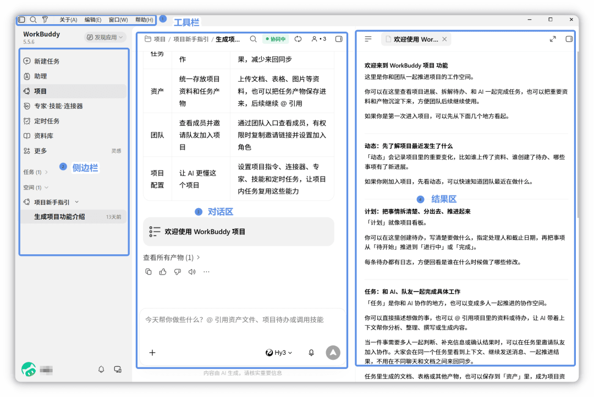

# WorkBuddy 资料教程大合集

## 这份合集是什么

<strong>一句话：把 WorkBuddy 从&quot;装不上、不会用&quot;到&quot;能拿它干活&quot;要走的路，一次铺齐。</strong>

这里收着 20 份资料，按&quot;先跑起来 → 再学透 → 最后落到自己的岗位&quot;三个阶段排布。有装机包，有几百页的系统手册，有按行业分的手册（HR、律师、教师、大学生、审计师），有视频课，有可以直接套用的 UI 工作台模板，也有自动化流程和知识库联动的实战教程。

你不需要全看。看完全部 3000 多页，人的记忆也留不下多少，正确用法是：<strong>先按自己的身份挑一条线，走通一件事，再回头补理论。</strong>下面给了六条按身份分的路径，照着挑一条就行。

## 20 份资料，逐份说清楚

下面这张表是&quot;看目录&quot;；表后面的段落是&quot;怎么挑&quot;。表格按图上的编号排，你对照着看就行。

<table><thead><tr><th>
编号
</th><th>
资料
</th><th>
里面是什么
</th><th>
适合谁
</th></tr></thead><tbody><tr><td>
01
</td><td>
<strong>WorkBuddy 安装包（Windows+Mac）</strong>
</td><td>
双平台客户端安装文件。官网也能下，但存一份在本地，遇到官网更新、下载慢、或者要发给同事时不用等。
</td><td>
所有人，第一步
</td></tr><tr><td>
02
</td><td>
<strong>196 页｜从入门到精通</strong>
</td><td>
最系统的一本。从&quot;它是什么、和聊天 AI 有啥区别&quot;，到界面、指令、文件处理、多轮任务，一层层往上走。属于地基型资料。
</td><td>
完全新手、想打牢基础
</td></tr><tr><td>
03
</td><td>
<strong>267 页｜使用手册与实战指南</strong>
</td><td>
比 02 更偏&quot;手册&quot;：功能逐条拆解 + 配套实操例子。适合当工具书，遇到具体功能不会用时按目录查。
</td><td>
用了一阵、开始查细节
</td></tr><tr><td>
04
</td><td>
<strong>480 页｜进阶教程指南</strong>
</td><td>
最厚的一本。涵盖智能体、技能封装、工作流、跨工具协作这些进阶主题，内容密度高，不适合从头读到尾，适合按需跳读。
</td><td>
已经能上手、想往上走
</td></tr><tr><td>
05
</td><td>
<strong>103 页｜职场高效应用实战</strong>
</td><td>
纯办公场景：写周报、做会议纪要、整理表格、写方案、做汇报。每个场景给一套可直接改的指令。
</td><td>
办公室打工人
</td></tr><tr><td>
06
</td><td>
<strong>122 页｜HR 六大模块实战场景 AI 手册</strong>
</td><td>
人力资源专属：规划、招聘、培训、绩效、薪酬、员工关系六个模块各自的场景与指令。与本库《HR 六大模块入门实战手册》配套看效果最好。
</td><td>
HR、行政兼人事
</td></tr><tr><td>
07
</td><td>
<strong>579 页｜律师实战手册</strong>
</td><td>
全合集里最厚的一本。合同审查、法规检索、案例梳理、文书起草、证据整理，按律师的日常作业流程排的。
</td><td>
律师、法务、合规
</td></tr><tr><td>
08
</td><td>
<strong>237 页｜教师手册</strong>
</td><td>
备课、课件、习题、评语、家长沟通、班级管理，都给了现成的做法和指令模板。
</td><td>
中小学教师、培训讲师
</td></tr><tr><td>
09
</td><td>
<strong>311 页｜大学生手册</strong>
</td><td>
论文选题与降重、文献整理、课程作业、简历、实习求职、考公考研资料整理。
</td><td>
在校生、应届生
</td></tr><tr><td>
10
</td><td>
<strong>60 页｜Harness 技术与实战蓝皮书</strong>
</td><td>
偏技术向，讲 WorkBuddy 的调度与执行框架（Harness）怎么理解、怎么利用它设计更复杂的任务。页数少但含金量高。
</td><td>
技术、爱折腾的人
</td></tr><tr><td>
11
</td><td>
<strong>30 页｜自动化工作流 SOP 手册</strong>
</td><td>
把重复性工作变成&quot;定时自动跑&quot;的流程：怎么拆步骤、怎么配定时任务、怎么验收。薄，但最能改变工作方式的一本。
</td><td>
天天干重复活的人
</td></tr><tr><td>
12
</td><td>
<strong>31 页｜使用说明书·审计师专属版</strong>
</td><td>
审计场景定制：底稿整理、抽凭核对、异常筛查、报告措辞。行业垂直度最高的一本。
</td><td>
审计、内控、财务核查
</td></tr><tr><td>
13
</td><td>
<strong>写标书全套实操教程</strong>
</td><td>
从读招标文件、拆评分点到写技术标、商务标、做偏离表、最后排版装订，一条链路走完。投标党的救命资料。
</td><td>
投标、销售支持、商务
</td></tr><tr><td>
14
</td><td>
<strong>38 节视频｜小白从零上手 + 多场景实战</strong>
</td><td>
视频课，配 Demo 和课件。适合不爱看文档、跟着做一遍就会的人。第一遍建议 1.25 倍速过，第二遍挑着练。
</td><td>
零基础、看视频学得快
</td></tr><tr><td>
15
</td><td>
<strong>50 节视频｜全套 AI 提效实战课</strong>
</td><td>
比 14 更偏&quot;提效&quot;：办公、写作、数据、汇报各场景的实操课。适合已经把基础跑通、想提速的人。
</td><td>
有基础、想提效
</td></tr><tr><td>
16
</td><td>
<strong>36 节视频｜零基础掌握智能体应用</strong>
</td><td>
专讲智能体（Agent）：怎么理解、怎么拆任务、怎么封装成技能反复用。看完你对&quot;专家 / 技能 / 连接器&quot;这三个词就不会再混。
</td><td>
想自己搭智能体
</td></tr><tr><td>
17
</td><td>
<strong>2026 最新｜办公自动化入门案例实战</strong>
</td><td>
以案例为单位：一个案例一个可复现的流程，跟着做就能跑出来。版本最新，界面和现在的产品对得上。
</td><td>
要&quot;照着做一遍&quot;的人
</td></tr><tr><td>
18
</td><td>
<strong>24 套 UI 工作台模板</strong>
</td><td>
现成的工作台布局模板：日报台、选题台、客户跟进台、数据看板等。开箱改字就能用，不用自己从空白画起。
</td><td>
想搭个人工作台
</td></tr><tr><td>
19
</td><td>
<strong>WorkBuddy × ima 知识库全套实战</strong>
</td><td>
把 ima 知识库和 WorkBuddy 打通：资料怎么进库、怎么让它带着你的资料回答、怎么自动更新知识库。
</td><td>
要做个人/团队知识库
</td></tr><tr><td>
20
</td><td>
<strong>其他零散教程合集</strong>
</td><td>
前面 19 项装不下的碎片：单点技巧、更新说明、短篇实操、群友问答整理。属于&quot;翻到有用的就存下来&quot;的类型。
</td><td>
所有人，当补充
</td></tr></tbody></table>

## 按身份挑路线，别全都看

20 份资料，3000 多页，全看是不可能的。下面六条路线，找一条你的：

### 路线一｜纯新手，先跑通一件事（3 天）

<strong>01 安装包 → 14 视频课（前 10 节）→ 02 入门到精通（前 60 页）→ 05 职场实战（挑一个你自己的场景练）</strong>。三天之内你会有一个能交出去的成品，这比看完全部理论都管用。

### 路线二｜HR / 行政兼人事（1 周）

<strong>01 → 06 HR 六大模块手册 → 本库《WorkBuddy HR 六大模块入门实战手册》→ 11 自动化 SOP</strong>。先把手上的招聘、绩效两件事做出成品，再把重复的部分配成定时任务。

### 路线三｜教师 / 培训（1 周）

<strong>01 → 08 教师手册 → 15 提效实战课（课件与讲稿相关章节）→ 18 UI 模板（做课程管理台）</strong>。

### 路线四｜律师 / 法务（1-2 周）

<strong>01 → 07 律师实战手册 → 03 使用手册（查功能）→ 19 ima 知识库（把案卷和法规做成自己的库）</strong>。律师这条线，知识库的价值比什么都大。

### 路线五｜大学生 / 应届（3-5 天）

<strong>01 → 09 大学生手册 → 14 视频课 → 05 职场实战（提前熟悉办公场景）</strong>。

### 路线六｜想搭智能体、做自动化（2-4 周）

<strong>01 → 16 智能体视频课 → 10 Harness 蓝皮书 → 04 进阶指南（跳读）→ 11 自动化 SOP → 18 UI 模板</strong>。这条线走完，你能给自己搭一套天天自动跑的活。

> [!TIP]
> 
💡 <strong>一句实话：</strong>收藏了不等于学会了。20 份资料里，真正能改变你工作方式的其实只有两三份——挑了、练了、用起来了，剩下的才有意义。别做&quot;资料囤积症&quot;。

## 四大核心亮点

### 一、系统全面：从入门到精通，覆盖所有核心知识点

这 20 份资料不是东拼西凑的网盘合集。它有一条主线：装 → 会用 → 用好 → 自动化 → 落到岗位。你按 01 到 20 的编号走，等于把 WorkBuddy 的整条学习曲线走了一遍，中间不会出现&quot;这一块没人讲&quot;的断点。

### 二、实战导向：大量实战案例，学完即可上手应用

看资料最怕的是&quot;看懂了但干不了活&quot;。这套资料里，光视频课就有 124 节，PDF 手册里每个功能后面都跟着场景例子——不是告诉你&quot;这个按钮能干什么&quot;，而是给你一句可以直接复制、改两个字就能用的指令。学一段，当天就有一件事能交出去。

### 三、持续更新：紧跟官方更新，内容持续迭代

AI 工具一个月一小改、三个月一大改，去年的教程今年就废一半。这套资料是跟着产品版本走的，第 17 项就是 2026 最新版，界面和现在的产品对得上。你手上的旧教程跑不通时，先来这里看有没有更新的版本。

### 四、精品资源：精心整理筛选，高质量学习资料

不追求数量堆砌。20 份，每一份都有明确的用途和对应人群，没有那种&quot;下载完永远打不开第二次&quot;的填充物。24 套 UI 模板、写标书教程、审计师专属版这类，属于市面上不太容易一次凑齐的东西。

## 怎么拿到这些文件

<strong>这份文档是导览，文件本体不在文档里。</strong>需要哪一份，按下面来：

<ol><li>只想先试试水的，先要 01 安装包 + 14 视频课前 10 节，够你判断值不值得继续。</li></ol>

## 三条使用提醒

> [!TIP]
> 
💡 <strong>一、按身份挑，别贪全。</strong>3000 多页看完是不可能的，也没必要。上面六条路线挑一条，走通一件事，比收藏二十份强。

>
> 
<strong>二、先动手，再看理论。</strong>装上、跑一个自己的活、卡住了再翻书。顺序反过来，你会看得很爽，然后什么都不会。

>
> 
<strong>三、以当前官方界面为准。</strong>AI 产品迭代快，教程里的按钮位置可能变了，找不到就按功能名去搜，别死磕截图。

## 附录：WorkBuddy 界面速览

不管看哪份资料，先认准界面这四个区，后面所有教程都建立在这个基础上：

