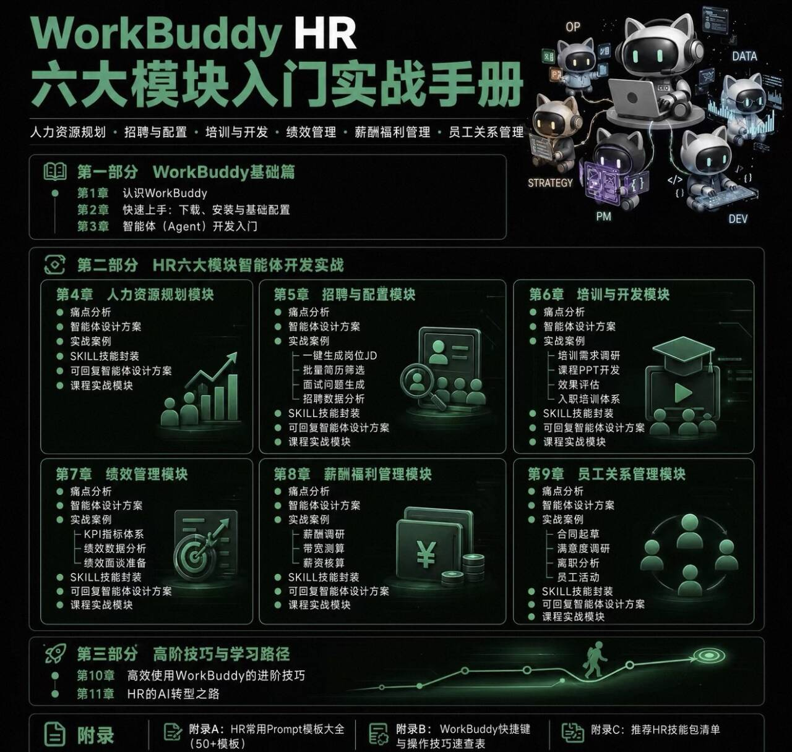

# WorkBuddy HR 六大模块入门实战手册

## 这本手册解决什么问题

<strong>一句话：让不懂技术的 HR，也能给自己造出六个&quot;不用发工资的助手&quot;。</strong>

HR 的活有个共同点——碎、重复、还都要跟人打交道。筛简历要一份份看，培训需求要一遍遍问，绩效数据要一张张表核，薪酬带宽要拿计算器敲。这些活不难，但吃时间，而且做多了会麻木。

这本手册不讲&quot;AI 有多强&quot;，只讲一件事：把上面这些活，一件件改成&quot;你说一句话，它出结果&quot;。六个模块，就是 HR 的六大块日常工作，每块都按同一套方法拆开——先看清楚痛在哪，再设计智能体怎么干，再上手做，再封成能反复用的技能，最后配一个能直接对话问答的助手。

> [!NOTE]
> 
🎯 <strong>谁适合看：</strong>HR 专员/主管、行政兼人事、中小企业老板（自己管人事的）、想转 HR 的其他岗位。不需要会写代码，需要你愿意动手试。

## 目录结构：三部分、11 章、3 个附录

<table><thead><tr><th>
部分
</th><th>
章
</th><th>
你要拿到的东西
</th></tr></thead><tbody><tr><td>
<strong>第一部分</strong>WorkBuddy 基础篇
</td><td>
第 1 章 认识 WorkBuddy 第 2 章 快速上手：下载、安装与基础配置第 3 章 智能体（Agent）开发入门
</td><td>
装好、看懂界面、明白&quot;智能体&quot;到底是个啥，能自己发出第一条像样的指令
</td></tr><tr><td>
<strong>第二部分</strong>HR 六大模块智能体开发实战
</td><td>
第 4 章 人力资源规划 第 5 章 招聘与配置 第 6 章 培训与开发 第 7 章 绩效管理 第 8 章 薪酬福利管理第 9 章 员工关系管理
</td><td>
六个模块各出一个能用的智能体：能筛简历、能出培训方案、能核绩效、能算薪酬、能起草合同
</td></tr><tr><td>
<strong>第三部分</strong>高阶技巧与学习路径
</td><td>
第 10 章 高效使用 WorkBuddy 的进阶技巧第 11 章 HR 的 AI 转型之路
</td><td>
从&quot;会用&quot;到&quot;用得快&quot;，再想清楚自己接下来该怎么走
</td></tr><tr><td>
<strong>附录</strong>
</td><td>
附录 A HR 常用 Prompt 模板大全（50+ 模板） 附录 B WorkBuddy 快捷键与操作技巧速查表附录 C 推荐 HR 技能包清单
</td><td>
不用现写指令，抄了就能用；按键不用记，查表就行
</td></tr></tbody></table>

## 第二部分的关键：每章都是同一个六件套

这是整本手册最值得注意的地方。第 4 到第 9 章，每一章都按完全相同的六个步骤写——你学会一个模块，剩下五个就是照着套：

<table><thead><tr><th>
环节
</th><th>
干什么
</th></tr></thead><tbody><tr><td>
<strong>① 痛点分析</strong>
</td><td>
先把这块工作里最费时间、最容易出错、最不被人看见的环节挑出来。不想清楚痛点，做出来的智能体就是玩具。
</td></tr><tr><td>
<strong>② 智能体设计方案</strong>
</td><td>
定角色（它是谁）、定输入（你要给它什么）、定输出（它交什么格式）、定边界（哪些它不能碰）。
</td></tr><tr><td>
<strong>③ 实战案例</strong>
</td><td>
一个真实场景走一遍：从一句话指令到最终成品，中间怎么改、怎么追问，全给出来。
</td></tr><tr><td>
<strong>④ SKILL 技能封装</strong>
</td><td>
把跑通的流程固化成技能，下次一句话就能调起来，不用重新交代背景。
</td></tr><tr><td>
<strong>⑤ 可回复智能体设计方案</strong>
</td><td>
做成能对话的助手：同事问它&quot;年假怎么算&quot;，它照着你的制度答；答不了的怎么兜底。
</td></tr><tr><td>
<strong>⑥ 课程实战模块</strong>
</td><td>
给你一个练习任务和验收标准，做完才算过这一章。
</td></tr></tbody></table>

## 怎么学：三种节奏，挑一个

### 节奏一｜三天速通（先能用）

第 1-3 章通读（约 40 分钟）→ 挑你手上最烦的那一个模块（多数人选招聘）→ 只看那一章的六件套 → 做一遍课程实战模块。三天后你至少有一个活不用自己干了。

### 节奏二｜两周打全（推荐）

第一天把第一部分的 3 章走完；然后每天一个模块，第 4 章到第 9 章正好六天；剩下几天做第 10 章进阶技巧 + 把六个模块的技能装起来；最后一天看第 11 章，给自己排一个 90 天落地计划。

### 节奏三｜一个月落地（带团队）

第一周自己学完并做出两个模块；第二周挑一个同事带一遍，看他卡在哪；第三周把六个模块的智能体在部门里试运行，收集反馈；第四周按第 11 章的转型路径，写成部门的 AI 使用规范。

## 分册入口

为避免单篇太长（手机上翻不动），本手册按三个部分拆成了三份子文档，点下面直接进：

📘<a href="075.md">第一部分：WorkBuddy 基础篇（第 1-3 章）</a>

📗<a href="076.md">第二部分：HR 六大模块智能体开发实战（第 4-9 章）</a>

📙<a href="077.md">第三部分：高阶技巧、学习路径与附录（第 10-11 章 + 附录 A/B/C）</a>

> [!NOTE]
> 
📌 <strong>说明：</strong>本手册为按图示目录整理的完整教学内容，界面截图取自 WorkBuddy 官方文档；涉及 HR 真实业务数据的示例均为脱敏示范，你替换成自己公司的口径即可。产品界面会随版本更新，位置找不到时按功能名搜索。

