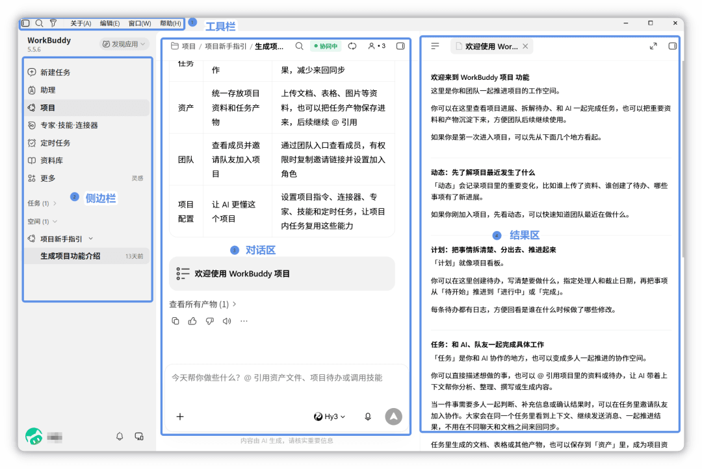

# 第一部分：WorkBuddy 基础篇

这一部分只有三章，但必须走完。HR 学 AI 最容易犯的错，是跳过基础直接找&quot;招聘话术模板&quot;——结果拿到一堆指令，用起来还是不对味，因为不知道它到底怎么工作。

## 第 1 章 认识 WorkBuddy

### 1.1 它到底是什么

WorkBuddy 是腾讯出的一款 AI 办公工具。但&quot;AI 办公工具&quot;这个词太泛，容易和聊天机器人混在一起。它们的区别，用一句话说清：

> [!TIP]
> 💡
> 
<strong>聊天 AI 给你答案，WorkBuddy 给你成品。</strong>

<table><thead><tr><th>
场景
</th><th>
聊天 AI 的反应
</th><th>
WorkBuddy 的反应
</th></tr></thead><tbody><tr><td>
你说&quot;把这 80 份简历整理成一张表&quot;
</td><td>
给你一段话，告诉你应该按什么维度整理
</td><td>
自己读文件、识别字段、合并成表、检查一遍，把 xlsx 交给你
</td></tr><tr><td>
你说&quot;汇总这个月的绩效数据&quot;
</td><td>
给你一个 Excel 公式示例
</td><td>
打开你的表、算完、标出异常值、生成汇总页
</td></tr><tr><td>
你说&quot;按这个制度算一下他的年假&quot;
</td><td>
给你一段解释
</td><td>
读你给的制度文件，算出天数，把依据和算式一起列出来
</td></tr></tbody></table>

### 1.2 它凭什么能干活

三件事：

<strong>一、会规划。</strong>任务越复杂，它拆得越细——先干什么、再干什么、哪一步要检查，它自己列出来。你不用当项目经理。

<strong>二、会用工具。</strong>读写 Word、做 Excel、做 PPT、搜网页、读 PDF、连飞书，都是它自己调，不用你一个个切软件。

<strong>三、全程留痕。</strong>每一步做了什么都写在对话区里，你能看见、能打断、能纠正。这一条对 HR 特别重要——招聘、薪酬这类活，你得知道结论是怎么来的。

### 1.3 界面就四个区

第一次打开别慌。整个界面四块：顶上一条工具栏（日常基本不点）、左边侧边栏（新建任务、助理、项目、专家技能连接器、定时任务、资料库）、中间对话区（你说话、它汇报）、右边结果区（它交的活，以及&quot;存进资产&quot;这个动作）。

### 1.4 HR 拿到手，最先能干的三个活

别一上来就搞&quot;六大模块智能体&quot;，先用三件小事建立手感：

<ol><li><strong>把一份杂乱的简历 PDF 转成结构化表格</strong>（练&quot;读文件 + 提字段&quot;）；</li><li><strong>把一段会议录音整理成待办清单，按负责人分组</strong>（练&quot;多步任务 + 指定输出格式&quot;）；</li><li><strong>把公司现行考勤制度喂给它，问十个员工最常问的问题</strong>（练&quot;带着资料回答&quot;）。</li></ol>

这三件事跑顺了，你就算过了&quot;工具关&quot;。

## 第 2 章 快速上手：下载、安装与基础配置

### 2.1 下载与安装

打开官网 workbuddy.cn，点下载。电脑端 Windows 和 Mac 都有，手机端也有客户端和小程序。一条经验：<strong>电脑端是主力，手机端当遥控器</strong>——出门派个活、看进度用手机，真干活还是电脑。

### 2.2 登录后先看这一列

装完登录，先确认左边这一列能看到&quot;新建任务、助理、项目、专家技能连接器、定时任务、资料库&quot;这几个入口。能看到，就说明装好了，其他都不用管。

### 2.3 模型怎么选

输入框右下角有个模型选择（默认显示&quot;快速&quot;）。通常分两档：速度档（快速 / 均衡 / 极致，越往后越慢越细）和具体模型（不同厂商的模型，名字后面的数字是消耗积分倍率）。

<strong>HR 的实际建议：</strong>日常的写通知、改措辞、整理表格，用默认的快速足够；涉及制度解读、薪酬测算、合同条款这类&quot;错一个字要出事&quot;的活，切到更细的档位，多花点积分值得。新手前两周别折腾模型，先把活干出来。

### 2.4 资产：这是它越用越顺手的关键

活干完，结果在右边。这时候做一件关键动作——<strong>存进资产</strong>。存进去的东西，下次派类似的活可以直接引用，不用把背景重新讲一遍。

对 HR 来说，值得存的东西很固定：公司组织架构、岗位说明书库、薪酬带宽表、员工手册、常用制度文件、面试题库。这些存一次，后面所有智能体都能调。

### 2.5 第一个正式任务，四步走

<ol><li><strong>新建任务</strong>，用大白话把你要的结果说出来，别自己拆步骤；</li><li><strong>看它给的计划</strong>——三十秒，扫一眼方向对不对，不对当场改；</li><li><strong>让它跑</strong>，中间每一步都能点开看，随时插话；</li><li><strong>把结果存进资产</strong>，下次直接引用。</li></ol>

> [!TIP]
> 💡
> 
<strong>新手最常踩的坑：</strong>跳过第 2 步。有回我偷懒不看计划，它跑了十几分钟我才发现方向理解岔了，前面全白干。三十秒的事，赔进去十几分钟。

## 第 3 章 智能体（Agent）开发入门

### 3.1 智能体和&quot;聊天&quot;差在哪

聊天是&quot;一次问答&quot;，智能体是&quot;一套能反复执行的角色化流程&quot;。差别在于三件事：<strong>有固定角色</strong>（它知道自己是招聘专员还是薪酬专员）、<strong>有固定输入输出</strong>（你给什么、它交什么格式，每次都一样）、<strong>能沉淀成技能</strong>（一句话叫起来，不用重新交代）。

### 3.2 三个词必须分清

<table><thead><tr><th>
概念
</th><th>
是什么
</th><th>
HR 场景举例
</th></tr></thead><tbody><tr><td>
<strong>专家</strong>
</td><td>
角色包：给它一个身份和一套专业口径
</td><td>
&quot;资深招聘官&quot;专家，说话按招聘官的口径来
</td></tr><tr><td>
<strong>技能</strong>
</td><td>
能力包：把一套固定流程封装起来，一句话调用
</td><td>
&quot;一键生成岗位 JD&quot;技能，输入岗位名+要求，直接出 JD
</td></tr><tr><td>
<strong>连接器</strong>
</td><td>
打通外部服务的接口
</td><td>
连飞书，让它直接读你的多维表格候选人库
</td></tr></tbody></table>

这三个词分不清的人，会一直在界面里瞎点。记住：<strong>专家决定&quot;谁来说&quot;，技能决定&quot;干什么&quot;，连接器决定&quot;从哪拿数据&quot;。</strong>

### 3.3 造第一个智能体，五步

<ol><li><strong>定角色</strong>：一句话写清它是谁——&quot;你是一家 300 人制造企业的招聘专员，熟悉制造业岗位画像&quot;；</li><li><strong>定任务</strong>：它要完成什么——&quot;根据我给的岗位名称和三条要求，产出一份可直接发布的 JD&quot;；</li><li><strong>定要求</strong>：格式、字数、风格、禁忌——&quot;分岗位职责、任职要求、加分项三块，不要出现性别和年龄要求&quot;；</li><li><strong>定交付</strong>：输出成什么——&quot;输出为可直接粘贴的纯文本，不要加解释&quot;；</li><li><strong>跑三遍再封</strong>：换三个不同岗位测，稳定了再封成技能。</li></ol>

### 3.4 封成技能：这是效率真正翻倍的地方

流程跑顺之后，把它存成技能（你可以在&quot;专家·技能·连接器&quot;里管理）。之后你在输入框里打斜杠就能叫出来，输入参数、直接出结果，不用每次重讲背景。

判断一个活值不值得封成技能，看两条：<strong>这件事一个月要做三次以上</strong>，且<strong>每次的输入格式基本一样</strong>。招聘 JD、面试问题、培训通知、绩效面谈提纲，全都符合。

### 3.5 本章练习

任务：造一个&quot;招聘 JD 生成器&quot;，用三个不同岗位（一个技术岗、一个职能岗、一个一线操作岗）各跑一遍，把三份 JD 存进资产。

验收标准：三份 JD 都不需要你改结构，最多改两三个词；换第四個岗位时，一句话就能出稿。

> [!NOTE]
> ✅
> 
<strong>第一部分走完，你应该有的东西：</strong>一个装好的 WorkBuddy、一个存了公司基础资料的资产库、一个能用的 JD 生成技能。带着这三样去看第二部分，效率完全不一样。

