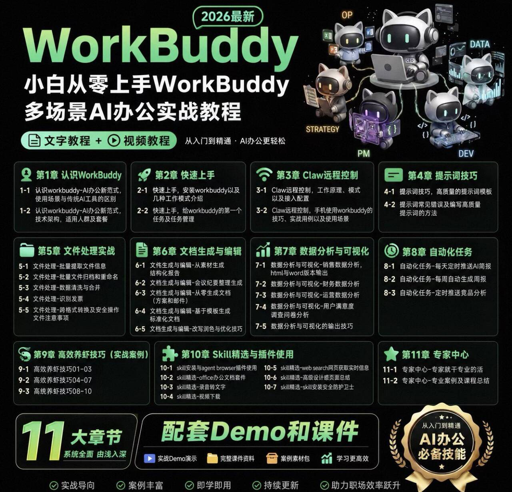

# WorkBuddy 全套资料工具箱

## 这套教程是什么

<strong>一句话：从&quot;打开就懵&quot;到&quot;能自己做出一套自动跑的办公流程&quot;，11 章走完。</strong>

市面上讲 WorkBuddy 的内容，多数停在&quot;它能干什么&quot;这一层——给你看几个惊艳的例子，看完你还是不会用。这套教程的不同在于：每一章都有明确的操作对象（一个文件夹、一份会议录音、一张销售表），每一节都有可复制的指令，每章末尾有配套 Demo 演示。你跟着做，手里是会多出东西的。

它一共 11 章、44 个小节，覆盖四块能力：<strong>认识与上手</strong>（第 1-4 章）、<strong>办公实战三件套</strong>（第 5-7 章：文件、文档、数据）、<strong>自动化与长期运营</strong>（第 8-9 章）、<strong>技能与专家</strong>（第 10-11 章）。

## 11 章全景：一张表看完

<table><thead><tr><th>
章
</th><th>
小节
</th><th>
你会拿到什么
</th><th>
适合谁先看
</th></tr></thead><tbody><tr><td>
<strong>第 1 章</strong>认识 WorkBuddy
</td><td>
1-1 AI 办公新范式、与传统 AI 工具的区别1-2 技术架构、适用人群与套餐
</td><td>
搞清楚它和聊天 AI 的本质差别在哪，知道自己的岗位该从哪块入手，以及要不要付费
</td><td>
完全没接触过的人
</td></tr><tr><td>
<strong>第 2 章</strong>快速上手
</td><td>
2-1 安装与几种工作模式2-2 第一个任务与任务管理
</td><td>
装好、登录、看懂几种工作模式的用法，独立跑通第一个任务并会管理历史任务
</td><td>
刚装上的人
</td></tr><tr><td>
<strong>第 3 章</strong>Claw 远程控制
</td><td>
3-1 工作原理、模式与接入配置3-2 手机端使用技巧与实战场景
</td><td>
人不在电脑前也能派活：手机上发一句，家里/公司的电脑自己跑起来
</td><td>
经常外出、通勤时间长的人
</td></tr><tr><td>
<strong>第 4 章</strong>提示词技巧
</td><td>
4-1 高质量提示词模板4-2 常见错误与编写方法
</td><td>
一套能直接套用的指令结构，和十几种&quot;说了等于没说&quot;的错误示范对照
</td><td>
所有人都该看，性价比最高的一章
</td></tr><tr><td>
<strong>第 5 章</strong>文件处理实战
</td><td>
5-1 批量提取文件信息 5-2 批量归档与重命名 5-3 数据清洗与合并 5-4 识别发票5-5 跨格式转换与安全注意事项
</td><td>
把最枯燥的那类活交出去：几百个文件改名、几十张表合并、一堆发票提金额
</td><td>
行政、财务、运营
</td></tr><tr><td>
<strong>第 6 章</strong>文档生成与编辑
</td><td>
6-1 从素材生成结构化报告 6-2 会议纪要整理 6-3 从零生成方案与邮件 6-4 基于模板生成标准化文档6-5 改写润色与优化
</td><td>
材料进、成品出：录音变纪要、散料变报告、模板变标准件
</td><td>
所有要写东西的人
</td></tr><tr><td>
<strong>第 7 章</strong>数据分析与可视化
</td><td>
7-1 销售数据分析（HTML / Word 双版本） 7-2 财务数据分析 7-3 运营数据分析 7-4 用户满意度问卷分析7-5 输出技巧
</td><td>
给一张表，出来一份带图带结论的分析报告，而不是一堆图表
</td><td>
运营、销售、财务、管理者
</td></tr><tr><td>
<strong>第 8 章</strong>自动化任务
</td><td>
8-1 每天定时推送 AI 简报 8-2 每周自动生成周报8-3 定时推送竞品分析
</td><td>
配一次、长期跑的能力。这是从&quot;用工具&quot;到&quot;有系统&quot;的分水岭
</td><td>
已经会用基础功能的人
</td></tr><tr><td>
<strong>第 9 章</strong>高效养虾技巧（实战案例）
</td><td>
9-1 技巧 01-03 9-2 技巧 04-079-3 技巧 08-10
</td><td>
10 条长期运营技巧：怎么让一个智能体越用越顺手，而不是用两次就废
</td><td>
已经跑起来、想提效率的人
</td></tr><tr><td>
<strong>第 10 章</strong>Skill 精选与插件
</td><td>
10-1 技能安装 + Agent Browser 插件 10-2 办公 Office 文档套件 10-3 录音转文字 10-4 视频下载 10-5 Web Search 实时信息 10-6 高级设计感页面总结10-7 安装安全防护卫士
</td><td>
七个最该先装的技能，装完能力立刻上一层；还有装技能前怎么防坑
</td><td>
想扩展能力的人
</td></tr><tr><td>
<strong>第 11 章</strong>专家中心
</td><td>
11-1 专家就干专业的话11-2 专业案例与课程总结
</td><td>
不会写指令时的另一条路：直接找现成的专家，让它按行业口径干活
</td><td>
懒得学提示词的人
</td></tr></tbody></table>

## 四个分册，点着走

11 章按能力块拆成了四个子文档，手机上从下面链接直接进，不用来回翻：

### 第一部分：入门与基础（第 1-4 章）

👉<strong>点这里进入：</strong><strong><a href="079.md">第一部分：入门与基础</a></strong>

认识它 → 装上 → 远程控制 → 学会说话。这四章是所有后续内容的地基，尤其第 4 章的提示词技巧，后面每一章的指令质量都建立在它上面。看这一册的目标只有一个：<strong>能独立、清楚地把一个活派出去</strong>。

### 第二部分：办公实战三件套（第 5-7 章）

👉<strong>点这里进入：</strong><strong><a href="080.md">第二部分：办公实战三件套</a></strong>

文件、文档、数据——上班最耗时间的三类活。每一节都是一个完整实战：从把材料丢进去，到拿到能交的成品，中间怎么问、怎么改都写了。看这一册的目标：<strong>你手上至少三类重复劳动能被替代掉</strong>。

### 第三部分：自动化与实战案例（第 8-9 章）

👉<strong>点这里进入：</strong><strong><a href="081.md">第三部分：自动化与实战案例</a></strong>

第 8 章教你把活变成定时任务（每天/每周自己跑），第 9 章是 10 条长期运营技巧。看这一册的目标：<strong>让系统替你跑，而不是你天天手动点</strong>。很多人卡在这一步——会用，但永远在手动用。

### 第四部分：技能插件与专家中心（第 10-11 章）

👉<strong>点这里进入：</strong><strong><a href="082.md">第四部分：技能插件与专家中心</a></strong>

七个必装技能 + 专家中心用法。看这一册的目标：<strong>把别人的成果直接借过来用</strong>，不用什么都自己从零搭。第 10-7 那节（安装安全防护）建议所有人都看一遍，装第三方技能前先学会判断风险。

## 怎么学：三条路线，按你的时间挑

### 路线一｜三天上手（每天 40 分钟）

第一天：第 1-2 章，装上、跑通第一个任务。第二天：第 4 章提示词技巧，把你手上最烦的那件活重新派一遍。第三天：第 5 章挑一节（多数人先做批量重命名或发票识别），做完你就回不去了。

### 路线二｜七天办公提效（推荐）

第 1 天第 1-2 章打底；第 2 天第 4 章 + 第 3 章（顺手把手机远程配上）；第 3-5 天分别啃第 5、6、7 章，每章至少做一节的实战；第 6 天第 8 章，给自己配一个定时任务；第 7 天第 10 章，装三到五个技能。七天之后，你手上会有一套自己的流程，不是零散的技巧。

### 路线三｜深度玩家（21 天）

前七天按路线二走完；第 8-14 天做第 9 章的 10 条养虾技巧，边做边调自己的智能体；第 15-21 天吃第 11 章专家中心 + 第 10 章全部技能，把自己那套流程封装成技能，变成可复用的资产。

## 配套 Demo 和课件

<table><thead><tr><th>
配套
</th><th>
怎么用
</th></tr></thead><tbody><tr><td>
<strong>实战 Demo 演示</strong>
</td><td>
每章对应一段操作演示。建议先看 Demo 再动手——先知道成品长什么样，做的时候不容易跑偏。
</td></tr><tr><td>
<strong>完整课件资料</strong>
</td><td>
章节结构、要点提纲。适合复习时快速过一遍，不用重看全文。
</td></tr><tr><td>
<strong>案例素材包</strong>
</td><td>
教程里用到的原始文件（表格、录音、文档）。跟着练时用同一份素材，结果才能对上。
</td></tr><tr><td>
<strong>实战导向 · 案例丰富 · 即学即用 · 持续更新</strong>
</td><td>
这套教程的定位：不做概念科普，每一节都能当天用在自己工位上。
</td></tr></tbody></table>

## 四个提醒，看完能少踩坑

<strong>一、别跳第 4 章。</strong>很多人急着上手实战，结果每一节都在&quot;它怎么又理解错了&quot;里打转。提示词那一章花你四十分钟，能省后面几十次返工。

<strong>二、实战章挑一节做完，比通读十节有用。</strong>第 5-7 章的每一节都是独立闭环，读完不做等于没学。挑你明天就要干的那个活开始。

<strong>三、第 8 章是分水岭。</strong>前面七章再熟，你也只是&quot;手动用得比较溜&quot;。真正拉开差距的是定时任务和长期运营（第 8-9 章）——那时候它才算替你干活。

<strong>四、装技能前先看第 10-7。</strong>第三方技能是别人写的指令包，装之前至少要知道它要什么权限、动了什么数据。这一节讲的就是怎么判断。

## 这套教程和你手上其他资料怎么配合

<table><thead><tr><th>
资料
</th><th>
讲什么
</th><th>
什么时候看
</th></tr></thead><tbody><tr><td>
<strong>本工具箱（11 章）</strong>
</td><td>
系统课程：从认识到自动化，主张&quot;跟着做一遍&quot;
</td><td>
想系统学、想有人带着走一遍
</td></tr><tr><td>
<strong>WorkBuddy 全流程提效</strong>
</td><td>
三大方向（自媒体工作台 / 个人办公提效 / 电商实操）的落地方案
</td><td>
学完基础，想找一个方向深扎
</td></tr><tr><td>
<strong>HR 六大模块手册</strong>
</td><td>
HR 岗位的六模块智能体开发，六件套框架
</td><td>
你是 HR，或者想学&quot;一个岗位怎么被 AI 重构&quot;
</td></tr><tr><td>
<strong>WorkBuddy 全套实战资料包</strong>
</td><td>
500 个应用场景、200 条指令、30 个案例、20 份专题
</td><td>
当字典用：遇到具体问题查场景和指令
</td></tr></tbody></table>

> [!TIP]
> 
💡 <strong>建议的用法：</strong>这套工具箱当教材（从头到尾学一遍），资料包当字典（遇到问题查），HR 手册和全流程提效当方向书（选定一条路深扎）。三样不冲突，是分工。

