# 离线参考内容

本页收录正文所引用网页的本地文字与配图。目录链接均指向仓库内文件。

## ref-cloud-tencent-com-developer

**腾讯云开发者社区-腾讯云**

腾讯云开发者社区

文档建议反馈控制台

首页

学习

活动

专区

圈层

工具

MCP广场

文章/答案/技术大牛

发布

- WorkBuddy 开发者沙龙全国城市巡回中 快来看看有没有你的城市，一起来探索 AI 新玩法
- 盟友圈 | 全国顶尖架构师，都在关注什么？ 学进阶架构师知识&与架构师聊一线开发都在这

为你推荐

OpenClaw专区NEW

腾讯专区

订阅及关注

云计算

人工智能

前端

后端

编程语言

数据库

大数据

音视频

安全

物联网

硬件

运维

测试

网络与通信

架构设计

开发工具

操作系统

职业发展

算法

管理

腾讯混元 Hy4 flash 深度测评：224B 参数仅激活 12B，把 Agent 单任务成本打到 3 毛钱以下？

2026 年 11 月 4 日，腾讯混元正式发布新一代旗舰大语言模型 Hy4，凭借强劲的综合智能跻身开源模型第一梯队：Artificial Analysis 智能指数位列中国模型第二，AgentArena 榜单居开源模型第一。

Neolnfra

2026-11-16

790

标签:

腾讯元宝

大模型部署

压测AI Agent 治理与评测调优实践

压测智能分析Agent接入真实业务后，分析结果跑偏可能是证据采集、工具调用、规则校验或模型推理中任意一环出了问题。只看最终结论，很难定位根因，也没法验证改动是否有效。

得物技术

2026-11-13

1300

标签:

第四期热点征文-C#

卓越架构师最佳实践征文#场景解决方案

SPIFFE/SPIRE 单信任域框架梳理

单信任域下的 SPIFFE 与 SPIRE 相关的文章都收在这里，按从整体结构到具体环节的顺序排列：

CipherHUB.Cloud

2026-11-16

470

标签:

ssm

密钥管理系统

MCP

其实你都见过：换个角度去看 Harness，你可能就通透了

一个跑了 40 分钟的长任务 agent，最后交出来一份格式漂亮、结论全错的分析报告。复盘时翻日志，三件事是连在一起的：第 12 分钟工具调用抛了异常，被一句 except 吞掉了；agent 没拿到结果，却把上一轮的旧数据当成成功继续往下写；全程没有第三方评审，产物直接进了交付目录。监控一片绿，没有一条告警，也没有一次报错。

无叶生花

2026-11-17

320

标签:

系统架构

agent

北京同盟

详细拆解 Anthropic Claude的 7\*24 在线Agent 架构设计

“7×24 在线 Agent”不是一个一直运行、一直思考的模型，而是一套事件驱动、状态持久化、按需唤醒、运行后休眠的系统。模型负责理解与决策，外围架构负责可靠地触发它、延续它的上下文、限制它的权限，并把结果交付给用户。Anthropic 文章的核心贡献，是将这类 Agent 的架构拆解为五个原语：事件收件箱、定时器、记忆、权限、发件箱。它提供的是一种系统设计思路，而不是一份可以原样照搬的生产部署蓝图。要真正落地，还必须补上幂等、并发控制、可观测性、成本治理、记忆审计和故障恢复等工程机制。

技术方舟

2026-11-16

1172

标签:

合肥同盟

腾讯云架构师技术同盟

单 Agent 还是多 Agent：从任务结构到工程取舍

用“决策单元”而不是“模型调用次数”来数 Agent：单 Agent 也能并行调工具，多模型、多角色名都不等于多 Agent。

宋振华

2026-11-17

250

标签:

Agent 集群服务

腾讯云开发者社区

腾讯云架构师技术同盟

深圳同盟

AI时代的架构师

ES 的 ILM 进了只读也标 indexing\_complete，别只拿它判断还写不写

9.2 起 ILM 执行 ReadOnly 动作时会把 indexing\_complete 设为 true。这是一个内部标记的自动化——以前要单独配，现在 ReadOnly 一并做了。如果你不知道 indexing\_complete 是什么，这篇正好把它讲清楚。

岳涛

2026-11-10

2110

标签:

大数据

搜索引擎

Elasticsearch Service

elk

lucene

【企业应用】CVE-2026-45659：Microsoft SharePoint远程代码执行漏洞深度解析与修复指南

摘要: 2026年5月,Microsoft披露了SharePoint Server高危漏洞CVE-2026-45659,CVSS评分8.8。该反序列化漏洞允许已认证攻击者在SharePoint服务器上远程执行代码,无需管理员权限。我把漏洞原理、攻击场景、影响范围、修复方案和临时缓解措施整理出来,方便大家快速应对。

行者全栈架构师

2026-11-16

690

标签:

sharepoint

member

viewstate

microsoft

Magpie 实战：把 WorkBuddy、Qoder 的订阅模型接进一个本地池子

电脑上的 AI 工具越装越多，Codex、ZCode、WorkBuddy、Qoder、MiniMax Code……为了领免费的赛博鸡蛋，装着装着就这么多了。做一个项目，经常需要来回切换工具，还要记得当前使用哪个工具，改到了哪一步。

对你无可奈何

2026-11-13

3400

标签:

人工智能

格局！刚刚 DeepSeek 正式开放全家桶 API，咱都能复刻 DeepSeek App 了？

简单来说，DeepSeek 把自家 App 里的联网搜索、深度思考搜索、阅读链接、上传文件、语音输入和朗读，全部开放成了 API。

程序员鱼皮

2026-11-14

1.6K0

标签:

AIGC

腾讯云AI编程达人秀

DeepSeek

程序员

编程

为你推荐

OpenClaw专区NEW

腾讯专区

订阅及关注

云计算

人工智能

前端

后端

编程语言

数据库

大数据

音视频

安全

物联网

硬件

运维

测试

网络与通信

架构设计

开发工具

操作系统

职业发展

算法

腾讯混元 Hy4 flash 深度测评：224B 参数仅激活 12B，把 Agent 单任务成本打到 3 毛钱以下？

2026 年 11 月 4 日，腾讯混元正式发布新一代旗舰大语言模型 Hy4，凭借强劲的综合智能跻身开源模型第一梯队：Artificial Analysis 智能指数位列中国模型第二，AgentArena 榜单居开源模型第一。

Neolnfra

2026-11-16

790

标签:

腾讯元宝

大模型部署

压测AI Agent 治理与评测调优实践

压测智能分析Agent接入真实业务后，分析结果跑偏可能是证据采集、工具调用、规则校验或模型推理中任意一环出了问题。只看最终结论，很难定位根因，也没法验证改动是否有效。

得物技术

2026-11-13

1300

标签:

第四期热点征文-C#

卓越架构师最佳实践征文#场景解决方案

SPIFFE/SPIRE 单信任域框架梳理

单信任域下的 SPIFFE 与 SPIRE 相关的文章都收在这里，按从整体结构到具体环节的顺序排列：

CipherHUB.Cloud

2026-11-16

470

标签:

ssm

密钥管理系统

MCP

其实你都见过：换个角度去看 Harness，你可能就通透了

一个跑了 40 分钟的长任务 agent，最后交出来一份格式漂亮、结论全错的分析报告。复盘时翻日志，三件事是连在一起的：第 12 分钟工具调用抛了异常，被一句 except 吞掉了；agent 没拿到结果，却把上一轮的旧数据当成成功继续往下写；全程没有第三方评审，产物直接进了交付目录。监控一片绿，没有一条告警，也没有一次报错。

无叶生花

2026-11-17

320

标签:

系统架构

agent

北京同盟

详细拆解 Anthropic Claude的 7\*24 在线Agent 架构设计

“7×24 在线 Agent”不是一个一直运行、一直思考的模型，而是一套事件驱动、状态持久化、按需唤醒、运行后休眠的系统。模型负责理解与决策，外围架构负责可靠地触发它、延续它的上下文、限制它的权限，并把结果交付给用户。Anthropic 文章的核心贡献，是将这类 Agent 的架构拆解为五个原语：事件收件箱、定时器、记忆、权限、发件箱。它提供的是一种系统设计思路，而不是一份可以原样照搬的生产部署蓝图。要真正落地，还必须补上幂等、并发控制、可观测性、成本治理、记忆审计和故障恢复等工程机制。

技术方舟

2026-11-16

1172

标签:

合肥同盟

腾讯云架构师技术同盟

单 Agent 还是多 Agent：从任务结构到工程取舍

用“决策单元”而不是“模型调用次数”来数 Agent：单 Agent 也能并行调工具，多模型、多角色名都不等于多 Agent。

宋振华

2026-11-17

250

标签:

Agent 集群服务

腾讯云开发者社区

腾讯云架构师技术同盟

深圳同盟

AI时代的架构师

ES 的 ILM 进了只读也标 indexing\_complete，别只拿它判断还写不写

9.2 起 ILM 执行 ReadOnly 动作时会把 indexing\_complete 设为 true。这是一个内部标记的自动化——以前要单独配，现在 ReadOnly 一并做了。如果你不知道 indexing\_complete 是什么，这篇正好把它讲清楚。

岳涛

2026-11-10

2110

标签:

大数据

搜索引擎

Elasticsearch Service

elk

lucene

【企业应用】CVE-2026-45659：Microsoft SharePoint远程代码执行漏洞深度解析与修复指南

摘要: 2026年5月,Microsoft披露了SharePoint Server高危漏洞CVE-2026-45659,CVSS评分8.8。该反序列化漏洞允许已认证攻击者在SharePoint服务器上远程执行代码,无需管理员权限。我把漏洞原理、攻击场景、影响范围、修复方案和临时缓解措施整理出来,方便大家快速应对。

行者全栈架构师

2026-11-16

690

标签:

sharepoint

member

viewstate

microsoft

Magpie 实战：把 WorkBuddy、Qoder 的订阅模型接进一个本地池子

电脑上的 AI 工具越装越多，Codex、ZCode、WorkBuddy、Qoder、MiniMax Code……为了领免费的赛博鸡蛋，装着装着就这么多了。做一个项目，经常需要来回切换工具，还要记得当前使用哪个工具，改到了哪一步。

对你无可奈何

2026-11-13

3400

标签:

人工智能

格局！刚刚 DeepSeek 正式开放全家桶 API，咱都能复刻 DeepSeek App 了？

简单来说，DeepSeek 把自家 App 里的联网搜索、深度思考搜索、阅读链接、上传文件、语音输入和朗读，全部开放成了 API。

程序员鱼皮

2026-11-14

1.6K0

标签:

AIGC

腾讯云AI编程达人秀

DeepSeek

程序员

编程

**下午好！**

欢迎来到腾讯云开发者社区

沙龙日历

全部 >

加入讨论

的问答专区 >

最具价值作者榜

更多 >

- ### 社区

  - 技术文章
  - 技术问答
  - 技术沙龙
  - 技术视频
  - 学习中心
  - 技术百科
  - 技术专区
- ### 活动

  - 自媒体同步曝光计划
  - 邀请作者入驻
  - 自荐上首页
  - 技术竞赛
- ### 圈层

  - 腾讯云最具价值专家
  - 腾讯云架构师技术同盟
  - 腾讯云创作之星
  - 腾讯云TDP
- ### 关于

  - 社区规范
  - 免责声明
  - 联系我们
  - 友情链接
  - MCP广场开源版权声明

### 腾讯云开发者


扫码关注腾讯云开发者

领取腾讯云代金券

### 热门产品

- 域名注册
- 云服务器
- 区块链服务
- 消息队列
- 网络加速
- 云数据库
- 域名解析
- 云存储
- 视频直播

### 热门推荐

- 人脸识别
- 腾讯会议
- 企业云
- CDN加速
- 视频通话
- 图像分析
- MySQL 数据库
- SSL 证书
- 语音识别

### 更多推荐

- 数据安全
- 负载均衡
- 短信
- 文字识别
- 云点播
- 大数据
- 小程序开发
- 网站监控
- 数据迁移

Copyright © 2013 - 2026 Tencent Cloud. All Rights Reserved. 腾讯云 版权所有

深圳市腾讯计算机系统有限公司 ICP备案/许可证号：粤B2-20090059粤公网安备44030502008569号

腾讯云计算（北京）有限责任公司 京ICP证150476号 |  京ICP备11018762号

问题归档专栏文章快讯文章归档关键词归档开发者手册归档开发者手册 Section 归档

领券

## ref-ima-qq-com

**ima - 腾讯AI知识管家**

ima是以知识库为基础的AI知识管家，提供“搜-读-写”一站式体验

> 公开页面仅返回应用外壳或登录入口，没有可读取的正文。

## ref-ima-qq-com-agent-interface

**ima claw配置**

页面标题：ima claw配置

> 公开页面仅返回应用外壳或登录入口，没有可读取的正文。

## ref-ima-qq-com-extension-info

**ima插件安装指南**


「ima知识库插件」介绍及安装指南

什么是「ima知识库插件」？

安装ima知识库插件，一键将浏览内容保存到您的ima知识库，从而更有效地积累信息，提升工作和学习效率。ima知识库插件适用于以下浏览器：

如何在浏览器中安装「ima知识库插件」？

第一步：进入浏览器的扩展程序页面。Chrome地址为：chrome://extensions/

第二步： 开启扩展程序页面右上角的「开发者模式」开关。

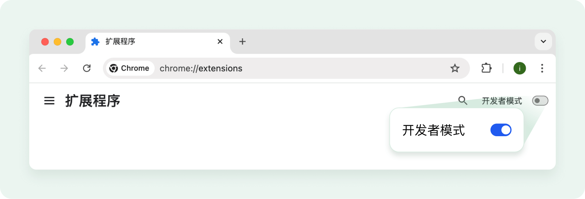

第三步：解压下载好的ima知识库插件.zip文件，找到其中的ima知识库插件.crx文件，将其拖动到扩展程序页面以完成安装。

下载

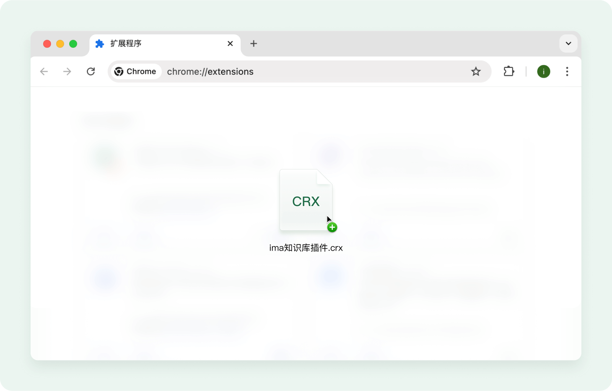

如何使用「ima知识库插件」？

## ref-mp-weixin-qq-com

**微信公众平台**

微信公众平台，给个人、企业和组织提供业务服务与用户管理能力的全新服务平台。

> 公开页面仅返回应用外壳或登录入口，没有可读取的正文。

## ref-obsidian-md-download

**Download - Obsidian**

- Download
- Account
- Sync
- Publish
- Pricing
- Plugins
- Enterprise
- Web Clipper

Learn more

- Help
- About
- Blog
- Discord
- Changelog
- Community
- Roadmap
- Security
- Merch store
- Privacy

Download for Windows

Last updated

## App

iOS

App Store

Android

Google Play
APK

Windows

Universal

Mac

Universal

Linux

AppImage
Snap
Deb
AppImage (AArch64, ARM64)
Flatpak Community maintained

## Web Clipper

Chrome
Safari
Firefox
Edge

Brave
Arc
Orion
Vivaldi

## ref-openclaw-org

**OpenClaw Foundation | Bringing people closer to AI.**


# Bringing people closer to AI.

AI is changing the world faster than any technology in history. The closer you are to it, the less scary it feels. The OpenClaw Foundation exists to close that distance and make AI personal, fun, and empowering for everyone.

Get started →

### Open

Built by thousands of contributors around the world. OpenClaw is free, open source, and belongs to everyone. The Foundation exists to keep it that way: independent, community-driven, and open forever.

### Neutral

No single company controls OpenClaw. The Foundation exists so that's true today, tomorrow, and permanently. Every model, every platform, every device. No gates, no gatekeepers.

### Personal

AI that runs on your hardware, knows your context, and works for you. Not a product you rent from a platform. A tool you own, and a foundation that protects your right to own it.

From the blogAll posts →

Nov 13, 2026 OpenClaw is coming to Shenzhen Join us in Shenzhen on December 4–6, 2026 for Claw Hack, the OpenClaw hackathon, and ClawCon, our flagship conference. Open hardware, open source and open-weight models, built together.Nov 6, 2026 Use new models in OpenClaw without an update OpenClaw now learns about new models from a hosted catalog, your provider account, and your installed Codex, so a model launch no longer waits for an OpenClaw release.Nov 5, 2026 Shattering Silos with OpenClaw Multiplayer OpenClaw Multiplayer solves the biggest problem with agentic work today. See how Multiplayer breaks down silos and helps more work happen.

## ref-skillhub-cn-install-skillhub-md

**SkillHub 安装说明**

# SkillHub 安装与优先源配置

## 概述

SkillHub 是国内优先的 Skill 商店，提供加速、合规的技能搜索与安装能力。优先策略已内联，Agent 读取本文档即感知。

## 适用场景（先判断，避免打扰用户）

- **仅搜索/安装某个技能**（CLI 已存在）→ 直接跳到第三节执行命令，**不要询问是否设为优先源**。
- **首次安装 / 用户明确要求配置优先源** → 走第一、二节（含询问），询问**只在此场景做一次**。

## 一、检查并安装 CLI

```bash
command -v skillhub && skillhub --version
```

- 已安装 → 直接进行技能操作（第三节），不再询问。
- 未安装 → 执行安装：

```bash
# 完整安装（CLI + 默认 Skill，推荐）
curl -fsSL https://skillhub-1388575217.cos.ap-guangzhou.myqcloud.com/install/install.sh | bash

# 仅安装 CLI
curl -fsSL https://skillhub-1388575217.cos.ap-guangzhou.myqcloud.com/install/install.sh | bash -s -- --cli-only
```

> 沙箱限网时需以允许联网的权限执行。

## 二、询问是否设为优先安装源（仅首次安装时）

**仅当本次是首次安装 CLI，或用户明确要求配置优先源时**，用 `AskQuestion`（不支持时直接询问）确认：「是否将 SkillHub 设为优先技能安装源？」

- **是** → 采纳「优先策略」：涉及技能发现/安装/升级时优先 `skillhub` 做 search/install/update（CN 更快更合规），不可用/无匹配则回退 `clawhub` 并说明；安装前汇总来源、版本、风险再交用户确认。本会话即刻生效，无需重启。
- **否** → 仅保留 CLI，按 Agent 默认行为，不改变技能源优先级。

后续纯技能操作不再重复询问。

## 三、技能操作

⚠️ 安装技能时**必须**用 `--dir` 指向当前 Agent 的 skills 目录，否则默认装到 `./skills/` 不会被识别（仍需重启）。各 Agent 的 skills 目录不同，按当前环境自行确定。

```bash
skillhub search abc                      # 搜索
skillhub install abc --dir <skills 目录>  # 装到当前 Agent 的 skills 目录
```

## 四、安装目录

- workbuddy: `~/.workbuddy/skills/`
- CodeBuddy: `~/.codebuddy/skills/` 或项目下的 `.codebuddy/skills/`
- OpenClaw 安装到你的 skills 目录。
- Hermes 安装到你的 skills 目录 或 `~/.hermes/skills/`。
- Claude Code: `~/.claude/skills/`
- Cursor: `~/.cursor/skills/`
- Windsurf: `~/.codeium/windsurf/skills/` 或项目下的 `.windsurf/skills/`
- Codex: `~/.codex/skills/` 或项目下的 `.agents/skills/`
- Google Antigravity: `~/.gemini/antigravity/skills/`
- Gemini CLI: `~/.gemini/skills/`
- QoderWork: `~/.qoderwork/skills/`

## ref-wechat-ai-team

**一人公司最大的坑，是什么都想自己干 - 数英**

原文中的链接文字：一人公司≠一个人死磕！我用141个AI员工，搭了一支24小时不打烊的顶配团队

公众号原页面需要访问验证，无法读取或核对正文，因此没有用主题相似的文章代替。此处仅保留本地来源说明。

## ref-wechat-ima-skills

**ima上线skills，“龙虾”可以帮你干活了-AI Express**

原文中的链接文字：ima上线skills，“龙虾”可以帮你干活了

> 微信分享页因访问验证未能读取原始正文。以下为可访问的同题公开转载版本，已删除网页账号信息与外链。

上周，我们发了腾讯“龙虾特攻队”周记

有用户在问，ima的skill什么时候推出、和Workbuddy结合？

![图片[1]-ima上线skills，“龙虾”可以帮你干活了-AI Express](web-assets/c2b91125165564c5.png)

现在，真的可以了

**ima上线ima skills**

**支持龙虾操作ima笔记、知识库等功能**

已全面适配OpenClaw、WorkBuddy、QClaw等多个Claw类产品。首期上线笔记skill，支持“龙虾”在笔记模块的内容查询、读、写，知识库skill也将在近期上线。

![图片[2]-ima上线skills，“龙虾”可以帮你干活了-AI Express](web-assets/98b80602a84eee2a.jpg)

**如何配置？**

在ima内的“Claw配置”进入，简单配置就能调用👇

**进入ima中心- Claw配置**

![图片[3]-ima上线skills，“龙虾”可以帮你干活了-AI Express](web-assets/ca2e350c1322e147.png)

**1️⃣ 复制提示词发给“龙虾”**

**2️⃣ 获取API Key发至“龙虾”**

![图片[4]-ima上线skills，“龙虾”可以帮你干活了-AI Express](web-assets/94cfc40106b2570d.png)

![图片[5]-ima上线skills，“龙虾”可以帮你干活了-AI Express](web-assets/2b93357e4af60e0c.gif)

**三大功能，帮你查、读、写👇**

**·查笔记**

![图片[6]-ima上线skills，“龙虾”可以帮你干活了-AI Express](web-assets/f673a4d411c8c724.jpg)

![图片[7]-ima上线skills，“龙虾”可以帮你干活了-AI Express](web-assets/9b74e79ae5834b7e.gif)

![图片[8]-ima上线skills，“龙虾”可以帮你干活了-AI Express](web-assets/62daf47891b894fa.png)

**·记笔记**

![图片[9]-ima上线skills，“龙虾”可以帮你干活了-AI Express](web-assets/f0e1cd86281ffcc3.png)

![图片[10]-ima上线skills，“龙虾”可以帮你干活了-AI Express](web-assets/359015b3cbd16acb.gif)

![图片[11]-ima上线skills，“龙虾”可以帮你干活了-AI Express](web-assets/1286d866ebe4ec75.png)

**·查目录**

![图片[12]-ima上线skills，“龙虾”可以帮你干活了-AI Express](web-assets/47e61e5aabd1e027.png)

![图片[13]-ima上线skills，“龙虾”可以帮你干活了-AI Express](web-assets/72c72a7a9ce28130.gif)

![图片[14]-ima上线skills，“龙虾”可以帮你干活了-AI Express](web-assets/c5308032dc58af3d.png)

**如果你的龙虾接了im（如微信、QQ）👇**

就可以直接在手机发起需求，装了ima skills的“龙虾”就会自动帮你干活！

![图片[15]-ima上线skills，“龙虾”可以帮你干活了-AI Express](web-assets/f69fe5f6972e0110.gif)

![图片[16]-ima上线skills，“龙虾”可以帮你干活了-AI Express](web-assets/26b92725f23a33f4.gif)

![图片[17]-ima上线skills，“龙虾”可以帮你干活了-AI Express](web-assets/d83708b1de1d1c74.gif)

快去试试吧！

知识库skill也将在近期上线，敬请期待![图片[18]-ima上线skills，“龙虾”可以帮你干活了-AI Express](web-assets/82206a12a467e7d0.png)

![图片[19]-ima上线skills，“龙虾”可以帮你干活了-AI Express](web-assets/440345b1e02cd6bc.png)

如果想第一时间看到 ima 最新内容

点「···」把 ima「设为星标」

![图片[20]-ima上线skills，“龙虾”可以帮你干活了-AI Express](web-assets/b577d54764beee96.gif)

**推荐阅读**

这一周，腾讯“龙虾特攻队”做了这15件事

今天有点不一样

意见反馈🙋

欢迎点击下方 阅读原文 告诉我们

![图片[21]-ima上线skills，“龙虾”可以帮你干活了-AI Express](web-assets/102523db725dcdb3.png)

![图片[22]-ima上线skills，“龙虾”可以帮你干活了-AI Express](web-assets/bc1b303de7f83013.png)

![图片[23]-ima上线skills，“龙虾”可以帮你干活了-AI Express](web-assets/aca295c65f8c1ff9.png)

<原文链接：（外部链接内容已转入本地资料）

© 版权声明

除特别注明外，本站文章转载自微信公众号等公开渠道，版权归原作者所有，文中已标注原文出处；如需二次转载请联系原作者，如有侵权请联系我们删除。

THE END

AI 资讯国产 AI

## ref-www-codebuddy-cn-docs-workbuddy-from-beginner-to-expert-guide-fqa

**腾讯云代码助手 CodeBuddy – AI 代码编辑器**

腾讯云 CodeBuddy 是新一代 AI 代码编辑器。提供代码补全、错误诊断、技术问答、性能优化等服务，支持主流编程语言，提升编码效率90%，降低代码错误率35%，适用于企业级应用开发和教学实践。

> 公开页面仅返回应用外壳或登录入口，没有可读取的正文。

## ref-www-codebuddy-cn-docs-workbuddy-from-beginner-to-expert-guide-functi-063fce0df3

**求职展示攻略：用 ima × WorkBuddy 搭建个人介绍网站 | WorkBuddy - AI Agent 办公新范式**

# 求职展示攻略：用 ima × WorkBuddy 搭建个人介绍网站 ​

> 本章为进阶教程，如需了解操作方式，请前往 WorkBuddy × ima 功能指引 和 如何用 WorkBuddy 把 ima 知识库越用越厚。

很多同学在求职、申请项目或展示个人作品时，会准备简历、作品集、项目介绍和个人介绍文案。

这些资料通常分散在不同文件里：简历是一份，作品链接是一份，项目经历散在文档或网盘里。

真正要做个人网站时，还需要重新整理经历、筛选作品、组织页面结构和撰写介绍文案。

这时，可以先把简历、作品、项目经历和个人介绍资料保存到 ima，再让 WorkBuddy 基于这些资料生成个人网站。

这样网站内容不需要从零编写，也能减少经历遗漏和表达不一致的问题。

> 本教程中使用的案例人物，其所有信息由 AI 生成。

## 一、准备个人资料库 ​

在 ima 中新建一个知识库，放入相关资料。

后续 WorkBuddy 生成网站时，可以直接读取这些资料，整理成适合网页展示的内容。

| 资料类型 | 示例 | 用途 |
| --- | --- | --- |
| 基础信息 | 个人简介、教育经历、联系方式 | 用于生成首页和 About 页面 |
| 简历文件 | 中文简历、英文简历、不同岗位版本简历 | 提取经历、技能和项目亮点 |
| 项目作品 | 项目介绍、作品链接、截图、成果数据 | 用于生成作品集页面 |
| 个人表达 | 自我介绍、求职动机、过往面试稿 | 用于统一网站语气 |
| 视觉参考 | 喜欢的网站风格、配色、排版示例 | 帮助 WorkBuddy 判断设计方向 |

## 二、生成个人网站 Brief ​

在生成网站前，先明确网站用途、目标读者、展示重点和页面结构，避免网站内容变成简单的简历搬运。

可以在 WorkBuddy 中选择 ima 个人资料库，并勾选简历、项目作品和个人介绍资料，添加至任务，并让 WorkBuddy 生成个人网站 Brief。

> 请基于 ima 中的个人简历、项目作品和个人介绍资料，帮我生成一份个人介绍网站 Brief。

> **请输出：**
>
> - 网站应该突出哪些个人优势；
> - 首页需要展示哪些核心信息；
> - 适合放入哪些项目作品；
> - 每个项目应该突出哪些亮点；
> - 建议网站包含哪些页面或模块；
> - 网站整体语气和视觉风格建议；
> - 哪些信息需要我人工核对或补充。

> **注意：** 这一步先不要生成完整网站，只生成网站 Brief。

你可以根据 Brief 结果，和 WorkBuddy 对话修改，直到获得满意的版本。

## 三、生成网站结构和页面文案 ​

确定网站方向后，可以让 WorkBuddy 生成具体页面结构和文案。

这一步重点是把简历内容改写成更适合网页浏览的表达。

> 请基于刚才的个人网站 Brief，帮我生成个人介绍网站的页面结构和完整文案。

> **请输出：**
>
> - 网站首页结构；
> - 首页主标题和副标题；
> - About Me 模块文案；
> - 项目作品模块结构；
> - 每个项目的标题、简介、亮点和成果；
> - 技能或能力模块文案；
> - 联系方式模块文案；
> - 适合放在网站中的按钮文案；
> - 需要人工核对的信息。

## 四、生成个人网站 ​

最后让 WorkBuddy 根据确认后的页面结构和文案，生成可预览的个人介绍网站。

> 注：如果有偏好的视觉风格，记得提前放在 ima 中，并标注为"参考案例"。

> 请基于刚才确认的个人网站结构和页面文案，帮我生成一个个人介绍网站。

> **要求：**
>
> - 网站包含首页、关于我、项目作品、技能能力和联系方式模块；
> - 页面风格简洁、专业，适合求职和作品展示；
> - 项目作品需要以卡片形式展示；
> - 每个项目卡片包含项目名称、简介、我的职责、关键成果和作品链接位置；
> - 页面需要适配电脑和手机浏览；
> - 请生成可直接预览的网页文件。

**生成示例：**

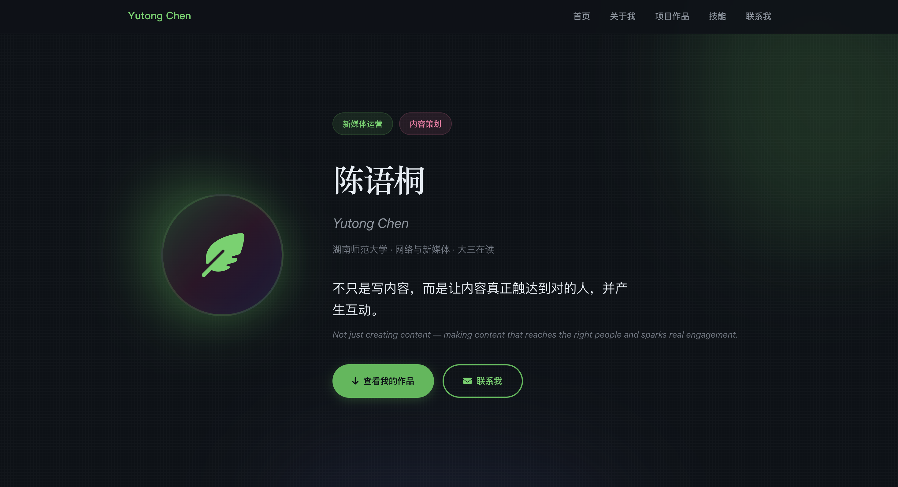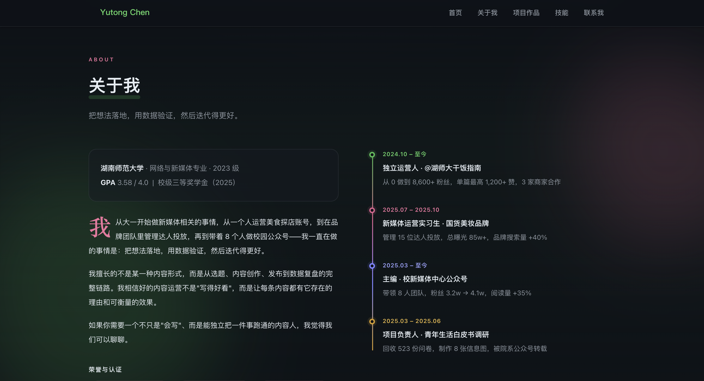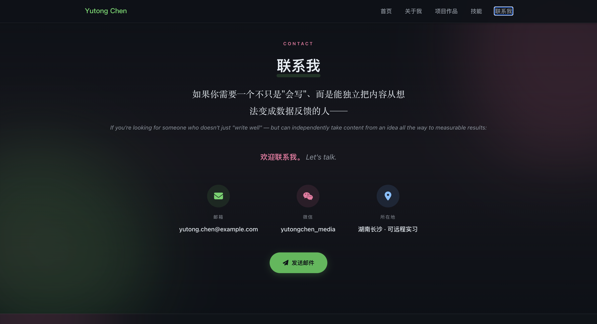

## 五、部署个人网站上线 ​

网站生成后，它还只是在你本地可见，而无法让其他人查看。

这时，你可以让 WorkBuddy 直接完成部署。

部署完成后，你会得到一个可以直接访问的个人网站链接，可以放进简历、作品集、社交主页或求职材料中。

> 请帮我部署刚才生成的个人介绍网站。部署完成后，请提供可访问的网站链接。

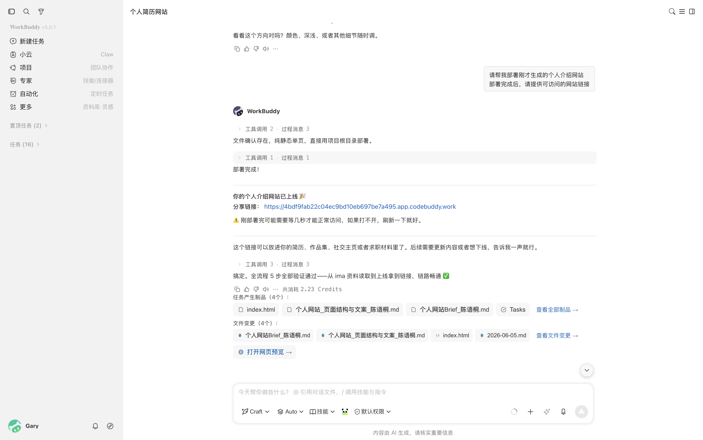

后续如果找不到网站链接、网站有更新或者想删除网站，你可以在 WorkBuddy 的**应用管理**中，对网站进行管理。

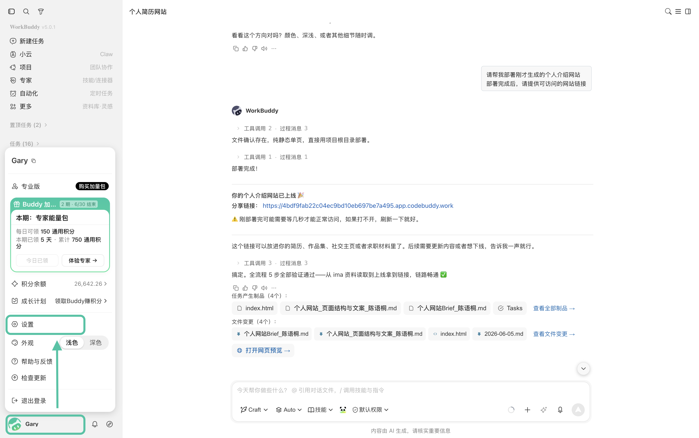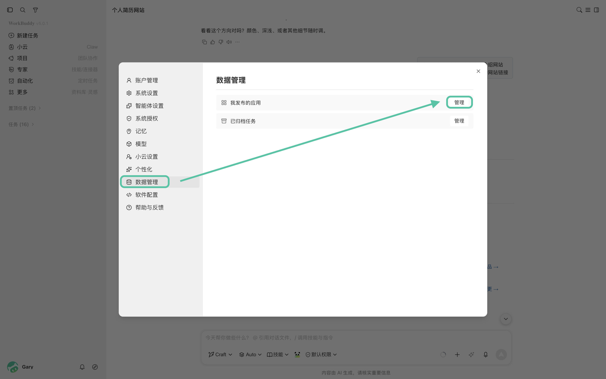

## ref-www-codebuddy-cn-docs-workbuddy-from-beginner-to-expert-guide-functi-093b8ccbe9

**学业助手攻略：期末忙不过来？你的 24 小时学伴已上线 | WorkBuddy - AI Agent 办公新范式**

# 学业助手攻略：期末忙不过来？你的 24 小时学伴已上线 ​

> 本章为进阶教程，如需了解操作方式，请前往 WorkBuddy × ima 功能指引 和 如何用 WorkBuddy 把 ima 知识库越用越厚。

大学学习中，你可能遇到过这些困境：

- 课程资料越来越多，却始终没有形成清晰的知识框架；
- 不同课程要求提交论文、PPT、表格或网页，每次都要重新寻找工具；
- 小组资料散落在微信聊天中，收集和分享很麻烦。

本篇将从上述三类常见学习难题出发，看看如何用 WorkBuddy × ima，把课程资料变成理解、成果和协作基础。

> 你可以根据自己的专业、课程要求和学校关于 AI 使用的规范，选择适合的部分参考。

## 一、资料看过很多，却还是理不清、学不会 ​

学的时候，抽象概念看不懂——好不容易啃下一块，看新内容又把旧的丢了，知识散落一地，串不起来。

让 AI 帮忙，又得反复上传资料、解释课程背景和自己的学习进度；得到大段文字的回复后，依然没有耐心读完。

这时，可以先将课程资料保存到 ima 知识库。

在学习时，让 WorkBuddy 调用其中的内容，根据知识特点选择合适的可视化方式进行讲解，并将学习的内容整理为笔记，回存至 ima。

### 用更直观的方式讲解可靠的知识 ​

在 ima 中建立知识库，将课程资料导入知识库中。

在 WorkBuddy 中要求调用对应 ima 知识库进行讲解，WorkBuddy 会自行根据知识特点选择合适的讲解形式。

> 请结合 ima 中"消费者行为学"知识库的内容，讲解"经典条件反射"和"操作性条件反射"。我理解两者的定义，但放进案例后容易混淆。请根据知识特点选择合适的方式讲解，并结合课程案例说明区别。

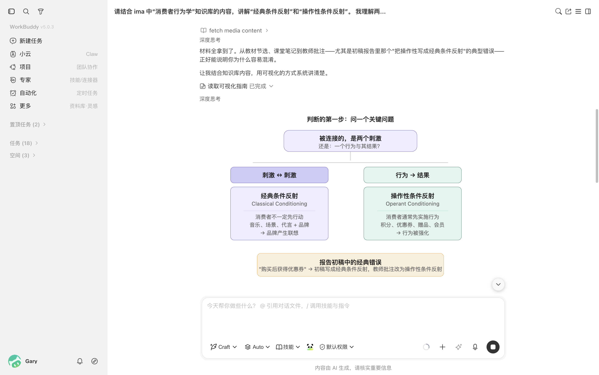

### 梳理知识之间的联系 ​

记住单个定义，不代表形成了知识体系。

WorkBuddy 可以结合课程大纲和学习资料，梳理知识之间的层级、并列、先后和因果关系，帮助你理解不同知识如何共同解释一个问题。

例如，可以让它围绕"消费者决策过程"，连接个人、社会、文化和情境因素，形成完整的知识架构。

> 请结合 ima 中"消费者行为学"知识库里的课程大纲、教材、课件和课堂笔记，围绕"消费者决策过程"梳理知识架构。重点呈现知识之间的层级、并列、先后和因果关系。请根据内容选择合适的可视化方式，不要只做逐章摘要。

### 生成笔记并保存回 ima ​

完成讲解后，可以让 WorkBuddy 生成笔记，并一键保存回 ima，方便后续复习。

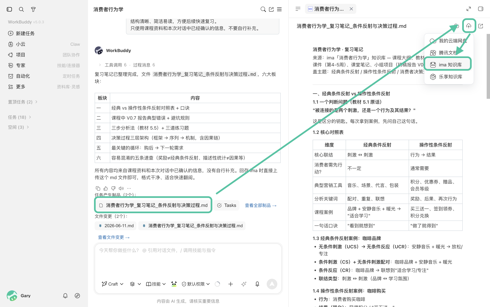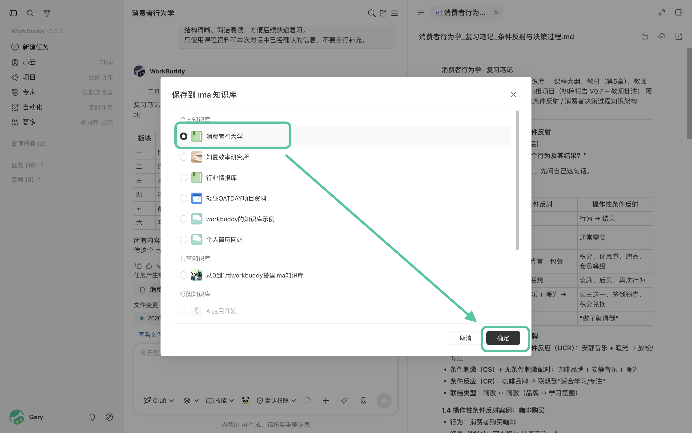

## 二、作业形式多样，不知道怎样开始 ​

大学作业除了论文，还包括 PPT、调研报告、数据表格、信息图等多种形式。

面对复杂作业，可以先让 WorkBuddy 阅读作业要求和评分标准，梳理核心问题、交付内容、评分重点与格式要求，并生成清晰的执行计划。

方向确认后，WorkBuddy 可以直接制作可继续编辑的初版成果，让你不必再对着空白页面从零开始。

如果一项作业需要同时提交多种成果，还可以开启多个任务并行推进，提高整体制作效率。

> 请将任务拆分给多个 Agent 并行推进，利用 skills 同时完成以下成果：
>
> 1. **数据分析 Agent：** 清洗问卷数据，生成包含关键指标和图表的 Excel 文件；
> 2. **报告撰写 Agent：** 结合调研方案与分析结果，制作结构完整的调研报告；
> 3. **演示制作 Agent：** 提炼核心发现，制作一份适合 8 分钟课堂展示的 PPT。
>
> 请在各任务完成后统一汇总并交叉检查，确保 Excel、调研报告和 PPT 的数据口径、核心发现与结论保持一致。无法从现有资料中确认的信息，请明确标注，不要自行补充。

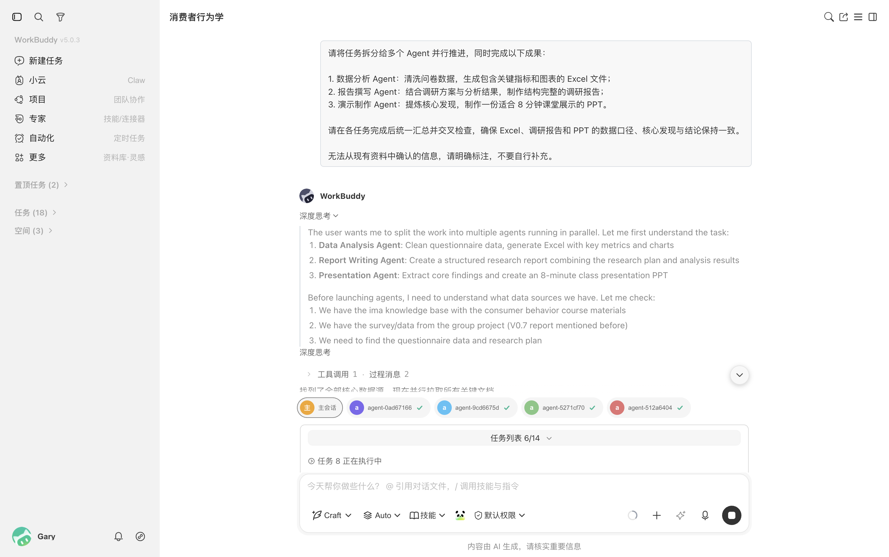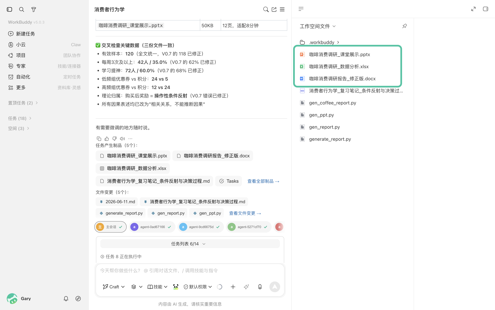

## 三、小组文件怎样方便地收集和分享 ​

小组作业的资料和阶段成果经常通过微信传递。借助 WorkBuddy × ima，可以更方便地在微信中收集资料、分享成果。

### 从微信获取文件 ​

微信聊天中的作业要求、参考资料、文档、表格和图片，可以直接上传到 ima，集中保存并供 WorkBuddy 调用。

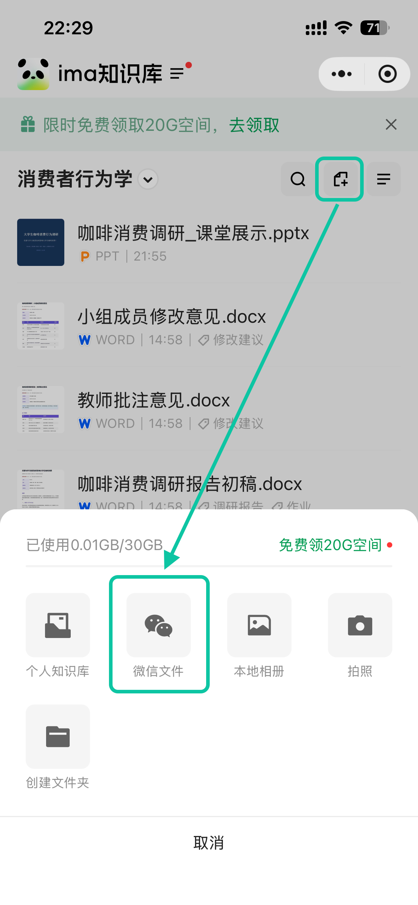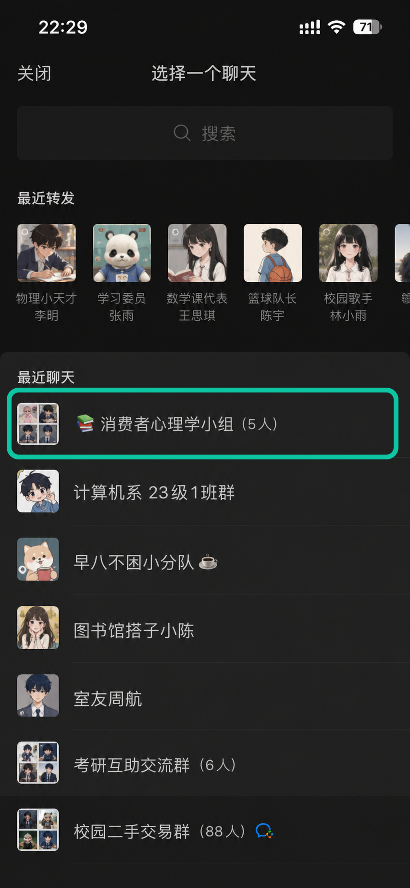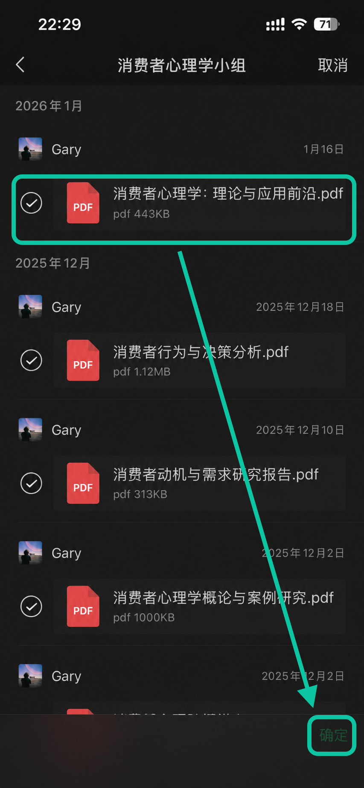

### 将成果发送到微信 ​

WorkBuddy 完成报告、PPT、表格或其他产物后，可以直接分享到微信，方便组员查看和讨论。

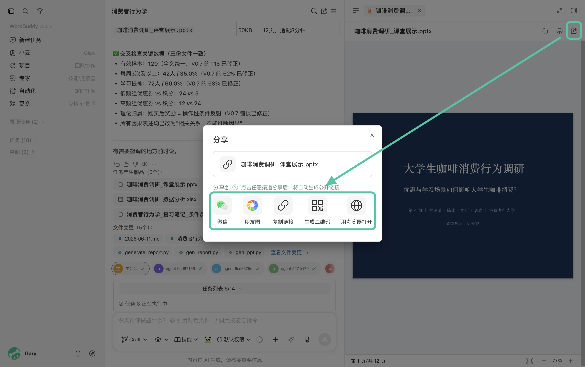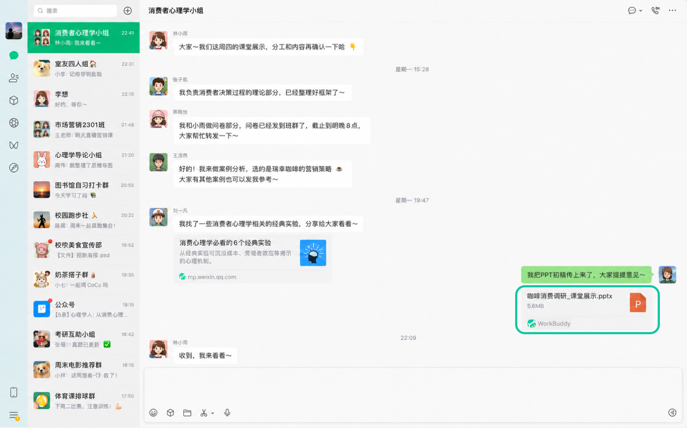

## 四、让 AI 参与学习，而不是代替学习 ​

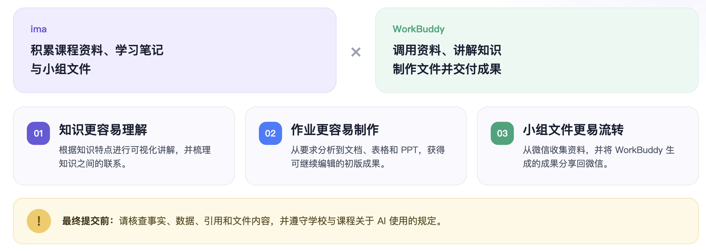

在这套方式中，ima 负责积累课程资料和学习成果，WorkBuddy 负责调用资料、讲解知识、制作文件并交付产物。

它的价值不是替学生完成思考，而是让知识更容易理解、作业更容易制作、小组文件更容易流转。

最终提交前，仍需核查事实、数据、引用和文件内容，并遵守学校和课程关于 AI 使用的规定。

## ref-www-codebuddy-cn-docs-workbuddy-from-beginner-to-expert-guide-functi-81ed6080c3

**创作者攻略：从&quot;通用 AI 写手&quot;到&quot;专属编辑助理&quot; | WorkBuddy - AI Agent 办公新范式**

# 创作者攻略：从"通用 AI 写手"到"专属编辑助理" ​

> 本章为进阶教程，如需了解基础操作方式，请前往 WorkBuddy × ima 功能指引 和 如何用 WorkBuddy 把 ima 知识库越用越厚。

很多人在用 AI 写文章时，常遇到一个问题：内容结构完整，句子也通顺，但读起来不像自己的表达。

更烦的是：选题全靠灵感、热点总是慢半拍、配图得另外找。

这篇文章将帮助你，用 WorkBuddy × ima 一次性解决这些问题：

- 定时任务每天帮你抓热点、出简报，不用手动刷资讯
- ima 让 WorkBuddy 从"通用写手"变成"读过你所有资料的专属编辑"
- 专家团让创作不再痛苦，配图、视频、排版一站式搞定
- 每次创作沉淀回 ima，越用越懂你

## 一、选题和方向，比动笔更重要 ​

创作者每天都会接触大量行业新闻、热门话题和优秀内容。

如果只是随手收藏，这些资料很快就会散落在不同平台；真正准备创作时，依然不知道该写什么。

### 用 ima 建立作品与素材库 ​

先在 ima 建一个知识库，保存与创作相关的资料，如：

| 资料类型 | 示例 | 用途 |
| --- | --- | --- |
| 选题相关资料 | 行业报告、官方信息、新闻动态、数据案例 | 了解选题背景，为文章提供事实依据 |
| 优质参考作品 | 好文章、优秀视频链接、标题或结构案例 | 参考选题角度、内容结构和表达方式 |
| 个人作品与素材 | 已发布作品、历史草稿、采访记录、个人案例 | 避免重复选题，提炼个人风格并复用已有内容 |

这些内容将成为后续 WorkBuddy 了解你的账号内容的重要资料。

### 让选题每天主动找上门 ​

除了手动积累，还可以在 WorkBuddy 中创建定时任务，每天定时搜索行业动态，并生成选题简报。

早上打开 WorkBuddy 时，就可以观看今天最新的动态与选题，让灵感源源不断。

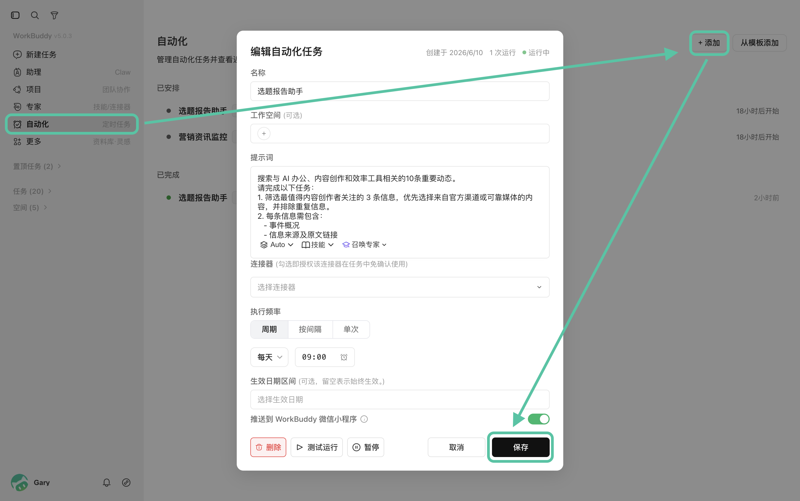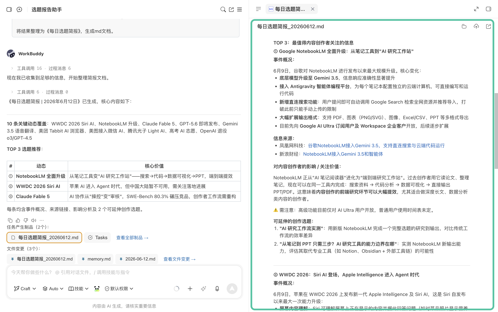

打开下方推送至 WorkBuddy 微信小程序，还可以在手机上查看推送内容。

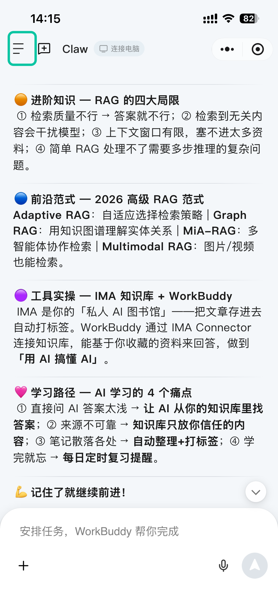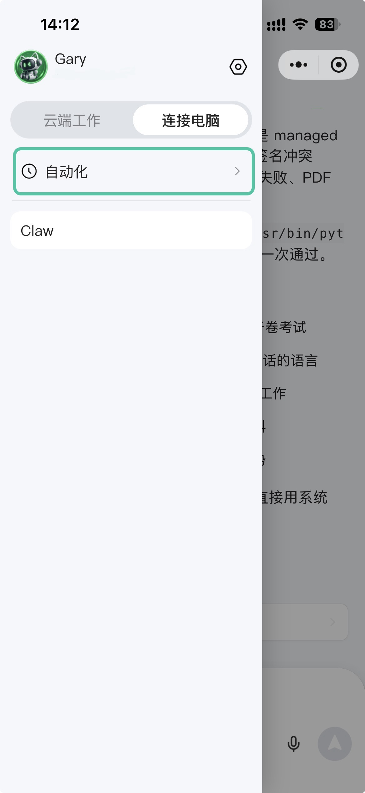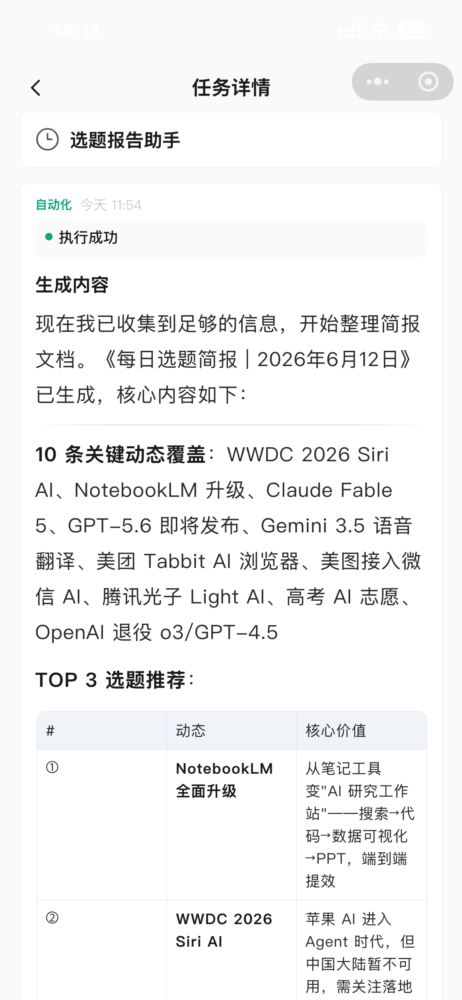

## 二、用 WorkBuddy × ima 提炼创作风格画像 ​

有了选题和素材，还需要解决：怎样让 AI 写得更像自己？

仅仅给出一两个作品并要求"模仿我的文风"，通常只能得到一些表面相似的表达。每次生成时都让 WorkBuddy 读一遍 ima 中的过往作品，又太消耗积分。

更稳定的方式，是先让 WorkBuddy 基于 ima 中的过往作品，提炼一份可重复调用的创作风格画像。

在 WorkBuddy 中进入 ima 知识库，选择对应文章添加到任务，并参考下方提示词进行操作：

> 请基于我选择的 ima 过往公众号文章，帮我整理一份创作风格画像，产出一份"创作风格画像"，产物格式应适合保存回 ima。重点总结选题角度、标题与开头、文章结构、论证方式、句式节奏和常用表达。不要只使用"专业、自然"等笼统形容词，请整理成一份能够直接指导后续写作的创作风格画像。

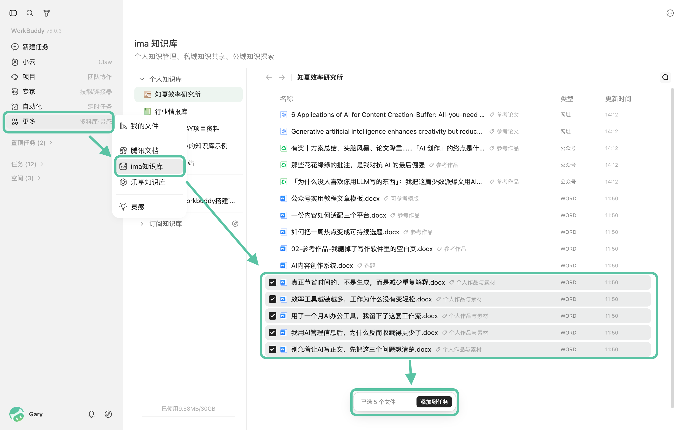

WorkBuddy 将产出一份创作风格画像，可以将其保存回 ima，作为后续生成的参考。

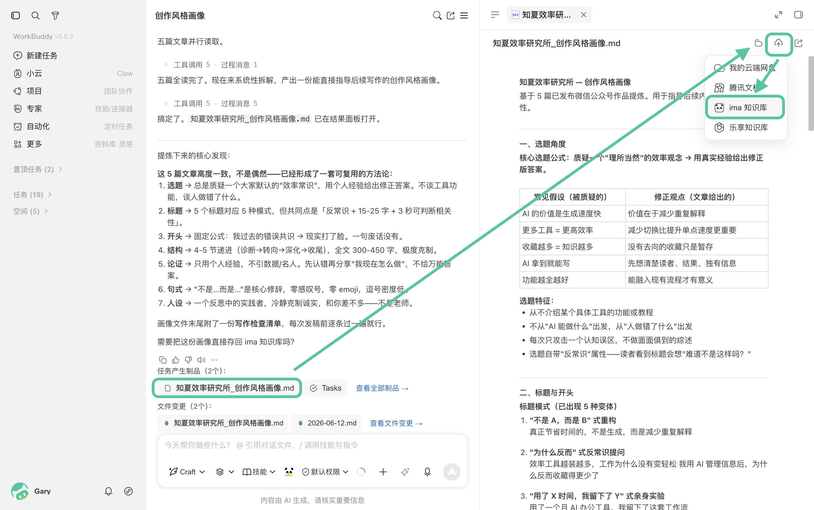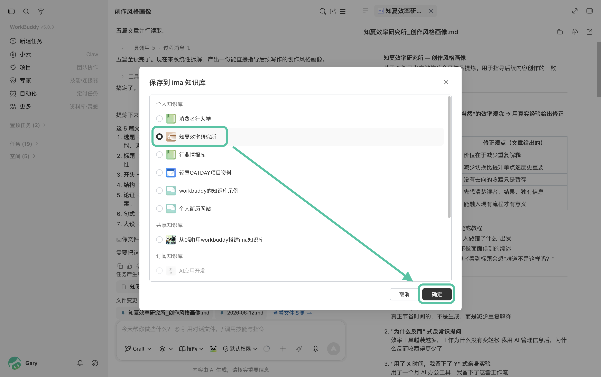

## 三、专家团一站式完成内容创作 ​

对创作者来说，真正消耗精力的往往不只是写正文，而是内容生产被分散在多个平台：

先查找资料，再切换不同工具生成文案、制作配图和视频，并将文案改编成适配不同平台的版本。

每进入一个新环节，都要重新复制素材、补充背景并说明创作要求。

WorkBuddy × ima 可以把原本分散的环节串联起来，完成包括图片、视频、排版等在内的多类型产出。

- 开始任务时，只需在提示词中明确需要读取的知识库名称，需要参考哪些资料、最终产出类型，以及你关于本次创作的其他想法。
- 专家团便会基于选题资料理解内容背景，参考个人作品和创作风格画像确定表达方式，再根据最终产物要求安排成员协作。

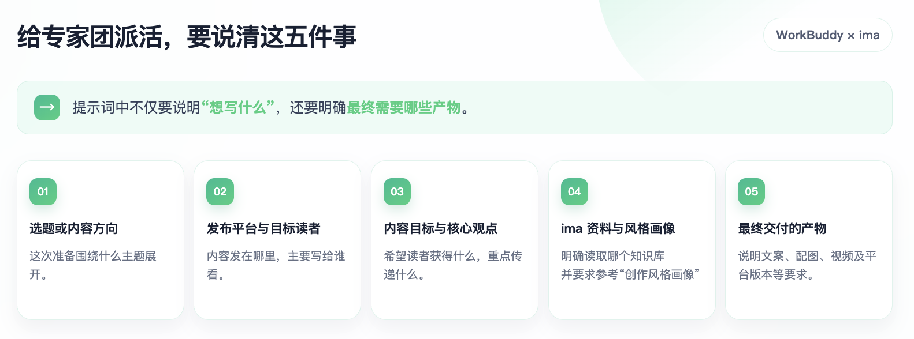
> 请结合 ima 中"知夏效率研究所"的选题资料和创作风格画像，完成一期关于"如何利用 WorkBuddy × ima 建立长期内容创作系统"的内容策划与制作。

> **目标读者：** 已经使用 AI 写作，但输出风格不稳定、资料比较分散的内容创作者。

> **内容目标：** 帮助读者理解，AI 不应只参与单次写作，还可以参与素材积累、选题、创作和内容沉淀。请参考创作风格画像，但不要机械模仿，也不要补充没有可靠来源的数据。

> **请交付以下产物：**
>
> - 3 个公众号标题方案
> - 1 篇完整的公众号文章
> - 3 张文章配图
> - 1 份小红书图文版本
> - 1 份 60 秒短视频口播脚本

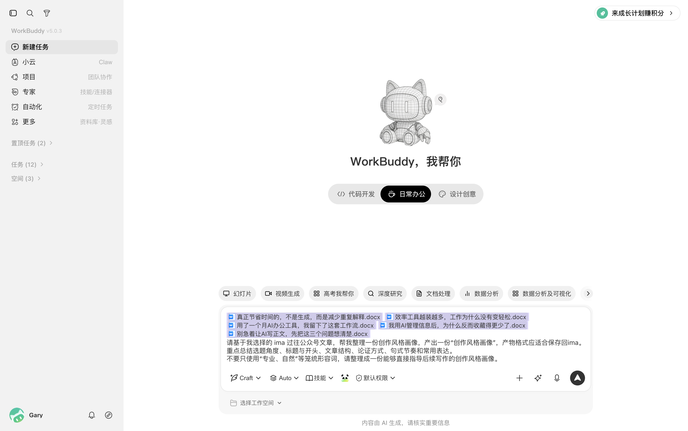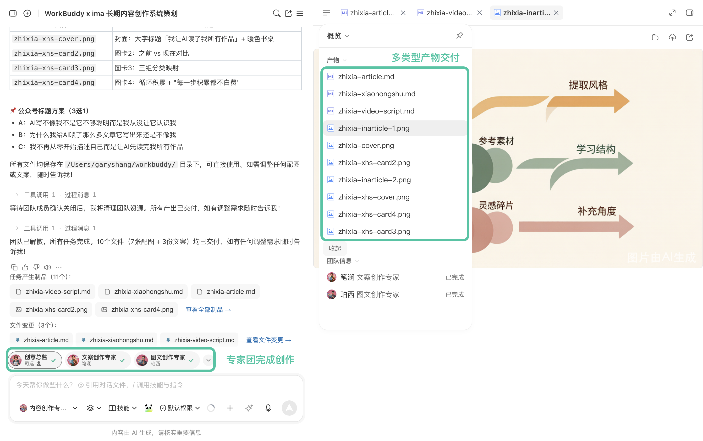

最终产出确认后，可以再将其一键回存至 ima。

WorkBuddy 下一次策划选题时，就能根据知识库判断哪些主题已经写过、哪些观点可以继续延伸，也能参考最新作品调整创作风格。

对于已完成认证的微信公众号创作者，还可以通过技能将内容直接推送至后台草稿箱中（首次使用需配置 WeChat API 凭证，按 WorkBuddy 反馈进行配置即可）。

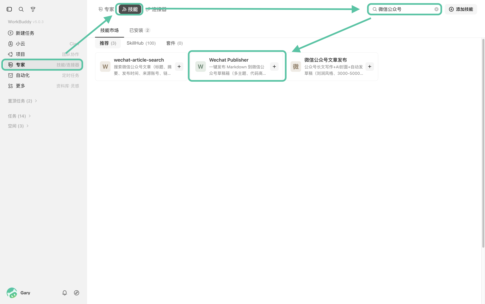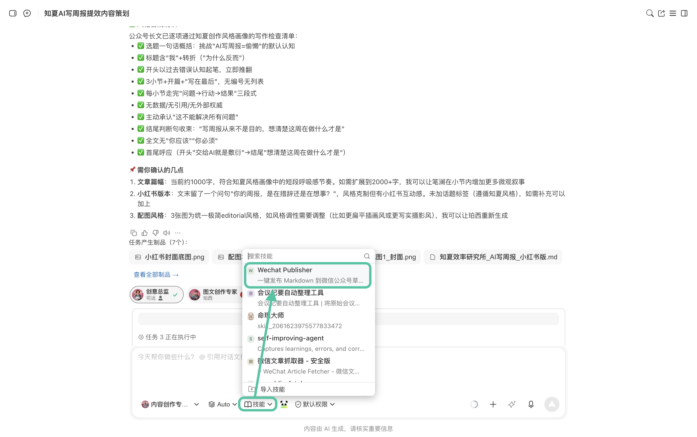

## 四、从一次生成，到长期创作 ​

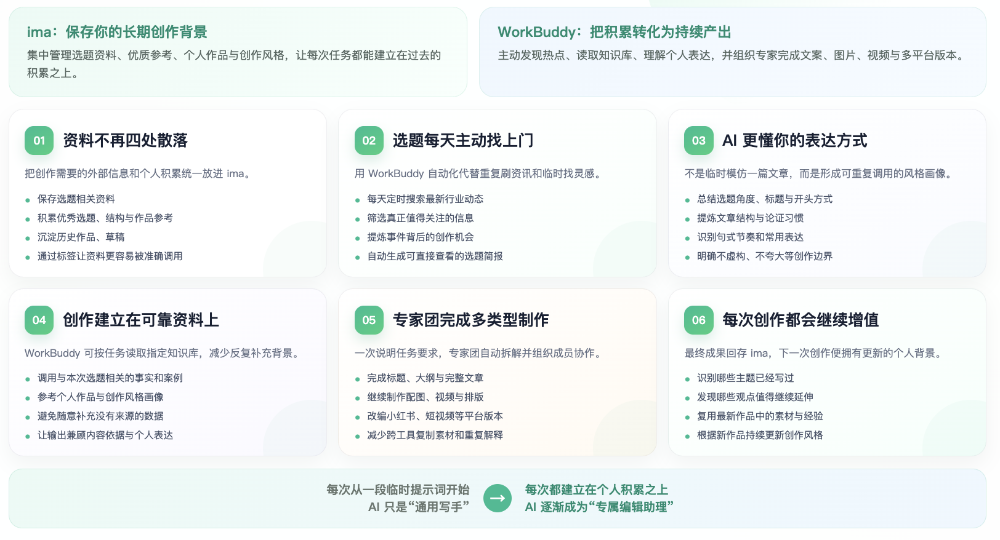

WorkBuddy × ima 的价值，不只是更快地生成一篇文章，而是让每次创作都能延续过去的积累。

当选题、素材、作品和创作经验不断沉淀回 ima，WorkBuddy 面对的便不再是一段孤立的提示词，而是一套可以持续调用和更新的个人创作背景。

它也会从每次都要重新认识你的"通用 AI 写手"，逐渐成为更了解你表达习惯与创作方式的专属编辑搭档。

## ref-www-codebuddy-cn-docs-workbuddy-from-beginner-to-expert-guide-functi-93acd0b210

**WorkBuddy × ima 功能指引 | WorkBuddy - AI Agent 办公新范式**

# WorkBuddy × ima 功能指引 ​

WorkBuddy 是腾讯推出的全场景职场 AI 智能体桌面工作台，面向各类职能角色设计。您只需用一句话描述需求，WorkBuddy 便能像同事一样自主规划和执行任务，并交付可验收的结果。

ima 知识库是"搜、读、写"一体的 AI 知识工作台，以个人知识库为核心，提供智能问答与内容生成能力。

WorkBuddy 接入后可直接检索并引用 ima 中的个人 / 共享 / 订阅知识库。

本篇教程将带你学习 WorkBuddy × ima 的基础操作。

## 一、连接 ​

根据账号所在环境不同，WorkBuddy 提供的 ima 知识库连接器也不同：

| 使用环境 | 提供的连接器 |
| --- | --- |
| 企业账号 | **ima 知识库企业版** + **ima 知识库个人版** 双连接器 |
| 其他企业旗舰版 | **ima 知识库个人版** 连接器 |

- **企业版连接器**：通过企业统一身份完成授权，无需单独扫码；由企业统一管理，不支持解绑。
- **个人版连接器**：使用个人微信扫码授权，支持随时解绑。
- 两个连接器的授权状态**相互独立**、互不影响；在连接器面板点击**连接**即可进入对应授权页，授权完成后连接状态即时刷新。

个人版连接器的连接步骤如下：

1. 在左侧边栏点击**资料库**，选择 **ima 知识库**。

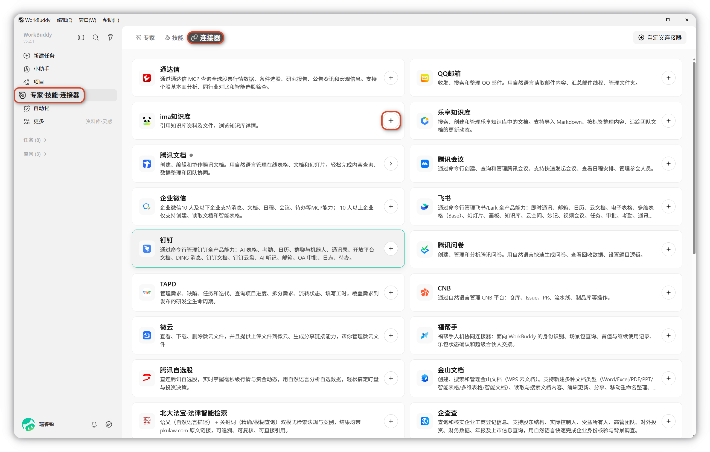

2. 点击**立即前往授权**后使用微信扫码登录 ima 知识库，再次**确认授权**后 WorkBuddy 将获得以下权限：

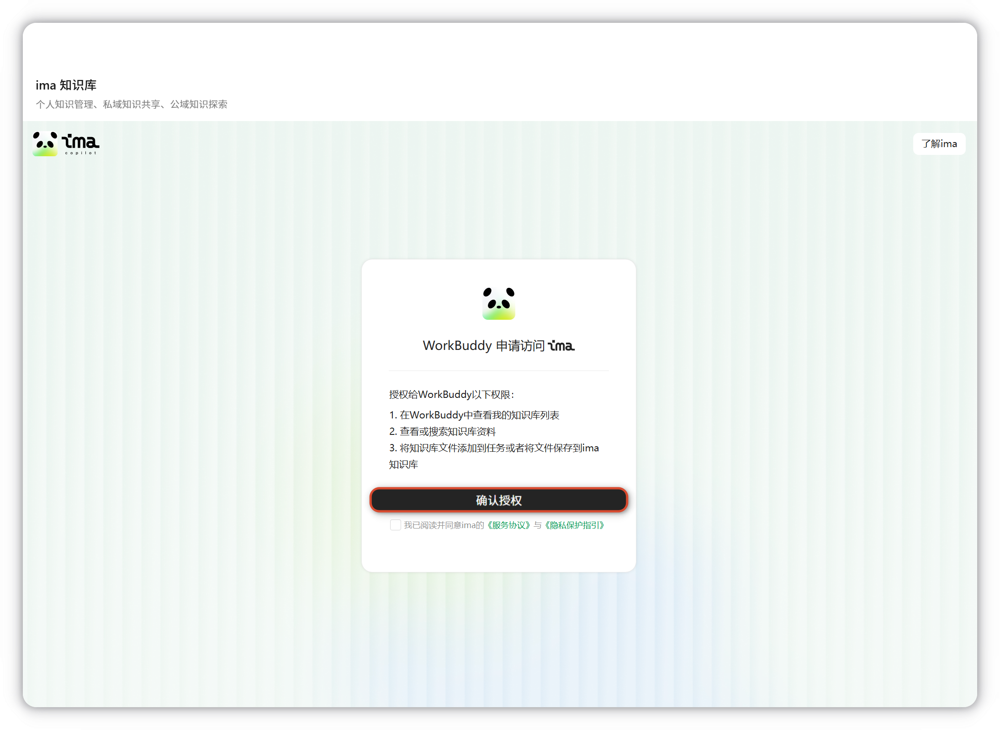

- 在 WorkBuddy 中查看我的知识库列表。
- 查看或搜索知识库资料。
- 将知识库文件添加到任务或者将文件保存到 ima 知识库。

TIP

WorkBuddy 连接资料库的 ima 知识库后将获得**登录用户**的 ima 知识库的权限，详细授权信息见上方内容。

## 二、使用 ​

### 任务引用知识库文件 ​

在任务中引用 ima 知识库内容的方式有两种：

**a. 从资料库添加：** 在资料库 - ima 知识库中选中对应文件，点击**添加到任务**。

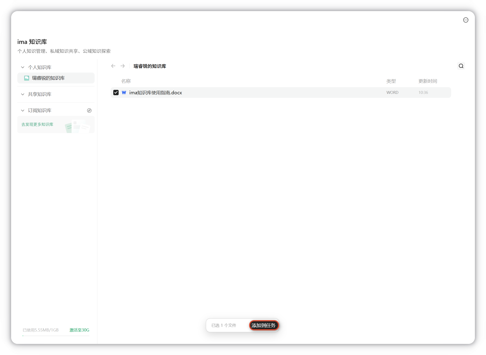

**b. 在对话框添加：** 在新建任务的输入框上方**上传文件**图标处打开 ima 知识库，支持勾选整个知识库或选择文件，点击**确定**添加到对话。

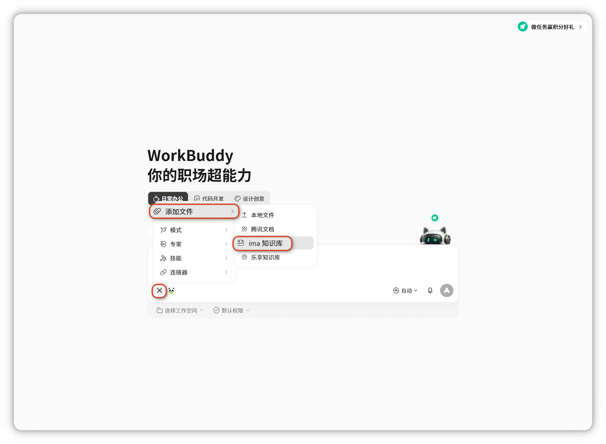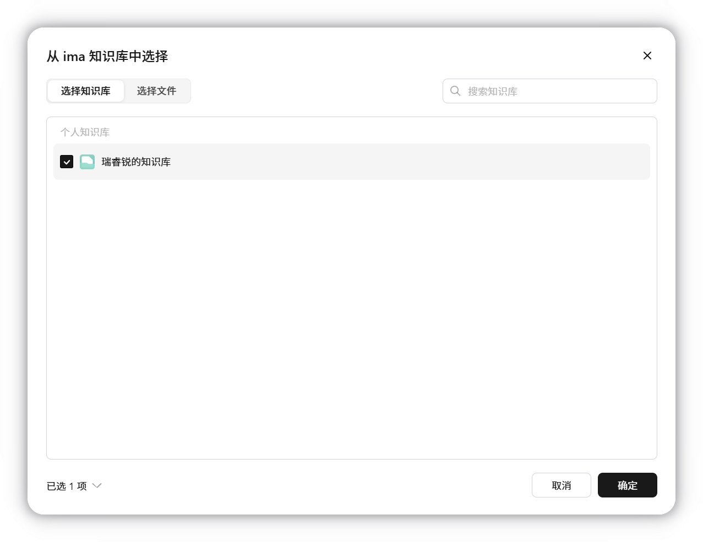

### 产物存回 ima 知识库 ​

在右侧产物中找到需要的文件，点击上传到云端，选择 **ima 知识库**储存。保存到 ima 知识库支持按 **个人 / 共享 / 订阅** 三类知识库储存。

[图片：配图（未能本地收录）]

## 三、解除绑定 ​

如果需要换绑账号或关闭连接，可以点击 **ima 知识库**，在右上角点击**更多（⋯）→ 解除绑定**。

说明

仅 **ima 知识库个人版**连接器支持解除绑定；**企业版**连接器由企业统一管理，不支持在端内解绑。

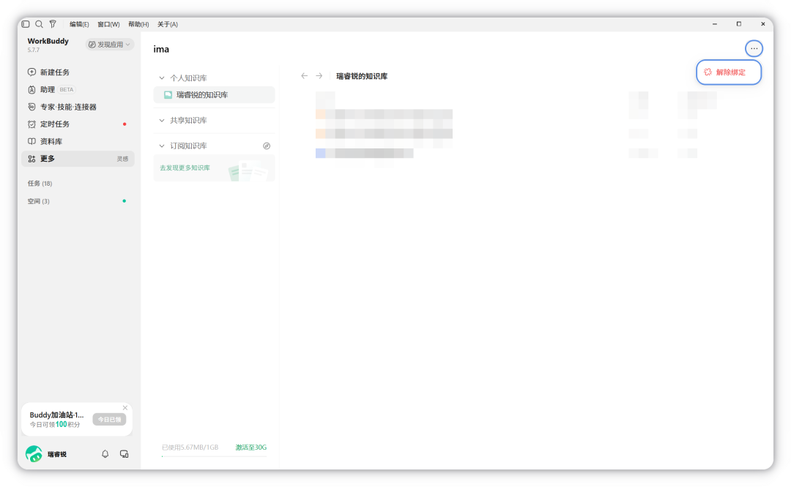

## ref-www-codebuddy-cn-docs-workbuddy-from-beginner-to-expert-guide-functi-afeca4eb27

**如何用 WorkBuddy 把 ima 知识库越用越厚 | WorkBuddy - AI Agent 办公新范式**

# 如何用 WorkBuddy 把 ima 知识库越用越厚 ​

## 本篇目标 ​

- 尝试搭建第一个知识库
- 把有价值的产出回传 ima，形成知识复利

## 一、按任务目标建立主题知识库 ​

新手不要一开始建立一个"大而全"的知识库，比如"我的资料库"或"AI 资料库"。

这种知识库短期方便，长期很容易变乱。

更推荐按照任务目标建立主题知识库。也就是说，先想清楚这个知识库未来要服务什么任务。

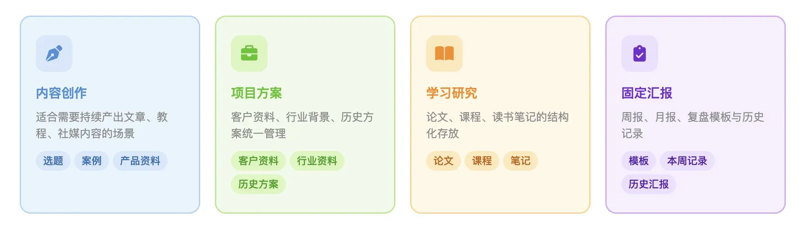

建议先从一个近期明确要完成的任务开始。例如，本周需要制作 AI 工具教程，就可以先准备一个"AI 工具教程素材库"。

另外还有两种知识库类型可以根据需要选择：

- 如果需要和其他人共用知识库，可以建立**共享知识库**。
- 也可以在发现中，寻找合适的知识库，直接**订阅**。

### 创建个人知识库 ​

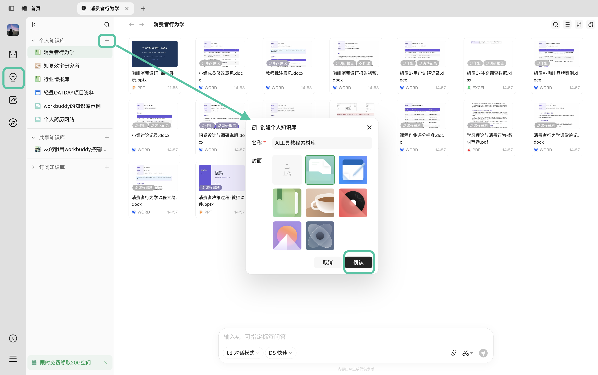

### 创建共享知识库 ​

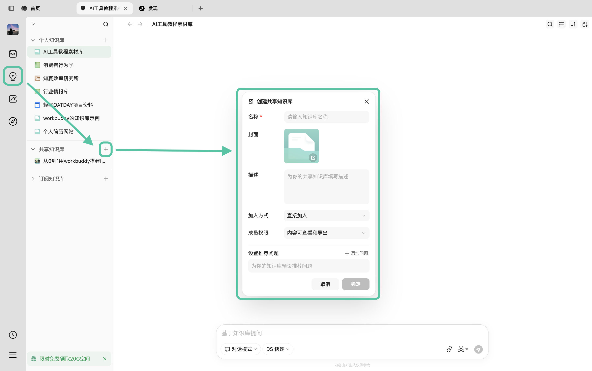

### 订阅知识库 ​

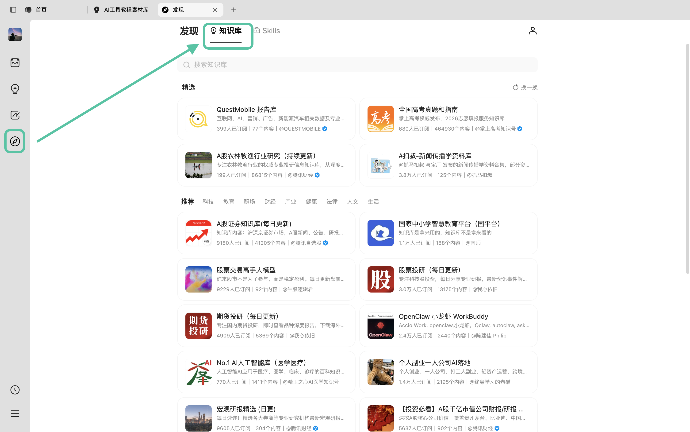

## 二、准备第一批资料 ​

第一批资料不需要多，建议控制在 10-20 条以内。

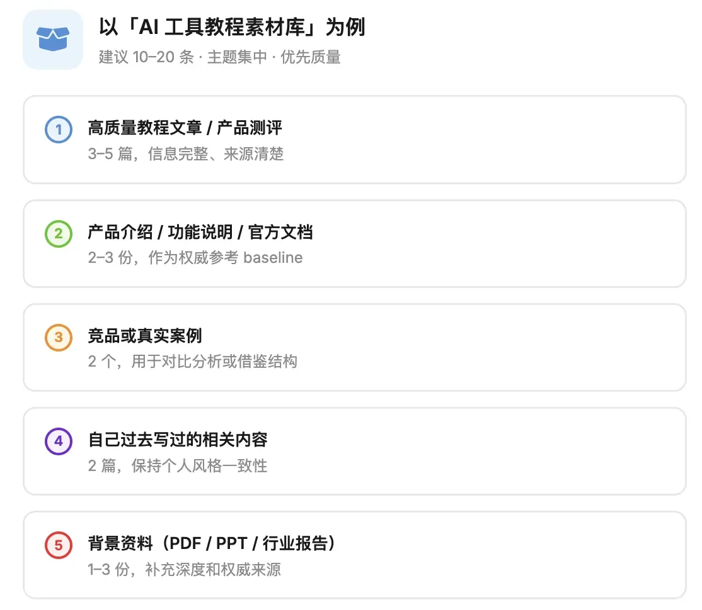

选择资料时，优先保留信息完整、来源清楚、近期仍然有效的内容。避免将多个无关主题混在同一个知识库中。

如果自己搜寻资料找到的内容有限，也可以直接在知识库广场订阅知识库、让 WorkBuddy 来搜索合适的资料内容，你再根据个人的偏好，选择内容放入 ima 中。

## 三、让知识库持续增值 ​

除了最初准备的原始资料，WorkBuddy 生成的正式内容也应该保存回 ima，成为新的知识资产。

例如：基于当前知识库生成的小红书笔记、公众号大纲、FAQ、报告摘要、PPT 大纲——只要这些内容后续还有复用价值，就可以回传到 ima，方便后续继续调用。

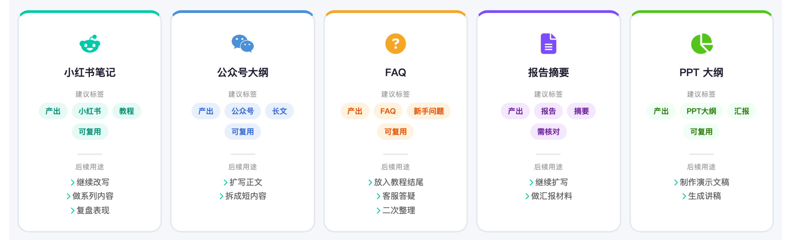
> 请基于当前生成内容，帮我整理一份回传 ima 的保存建议。请输出：建议标题、建议保存到哪个知识库、后续可复用场景、是否需要人工核对。

### 回传 ima 操作步骤 ​

1. 在 WorkBuddy 中打开生成内容，点击产物区域的**上传到云端**。
2. 选择 **ima 知识库**。

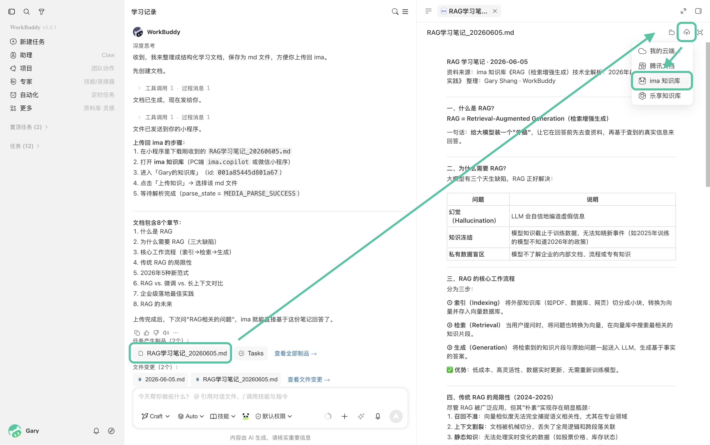

3. 保存到对应主题知识库。

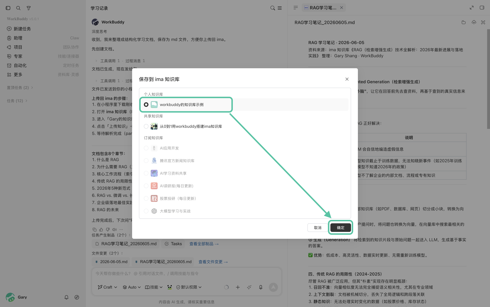

## ref-www-codebuddy-cn-docs-workbuddy-from-beginner-to-expert-guide-functi-c1c0a064e3

**OPC 的一天：如何用 WorkBuddy × ima 形成专属团队 | WorkBuddy - AI Agent 办公新范式**

# OPC 的一天：如何用 WorkBuddy × ima 形成专属团队 ​

> 本章为进阶教程，如需了解基础操作方式，请前往 WorkBuddy × ima 功能指引 和 如何用 WorkBuddy 把 ima 知识库越用越厚。

一个人经营一家公司，经常不是工作不会做，而是事情太多：

- 既要关注行业变化，又要服务客户；
- 既要判断方案方向，又要亲自制作文件。

本篇以一位为中小企业提供品牌与内容增长服务的独立咨询顾问为例，看看他如何在一天的工作中，通过 WorkBuddy × ima 提升效率。

这套流程并非所有 OPC 的固定模板。你可以根据自己的业务，更换其中的行业、专家角色等，探索属于自己的工作流。

> 本教程中使用的案例信息，已经过 AI 二次处理。

## 一、早上：行业变化和客户消息一起涌来 ​

一天还没正式开始，新的行业动态、竞品消息和客户邮件已经堆了起来。

与其花一上午逐条搜索和阅读，不如先让 WorkBuddy 完成第一轮整理。

### 让行业情报定时找上门 ​

在 WorkBuddy 中创建定时任务，搜索最近的行业变化和重点竞品动态，并整理成带有来源链接的简报。

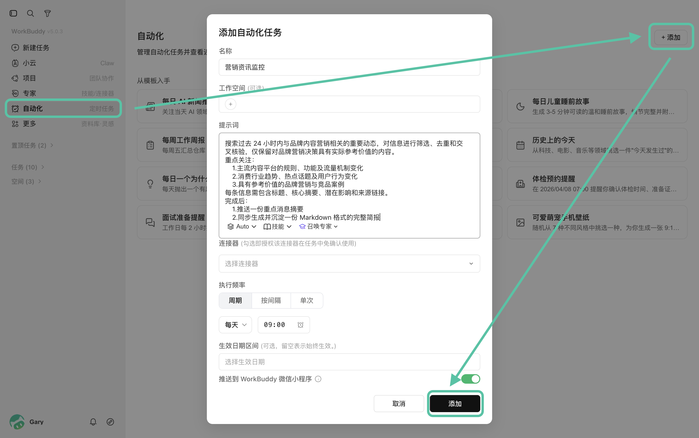

早上打开 WorkBuddy 时，你可以直接阅读已经生成的简报。

生成的内容，可以在 WorkBuddy 中一键保存回 ima，逐渐形成自己的行业情报库。

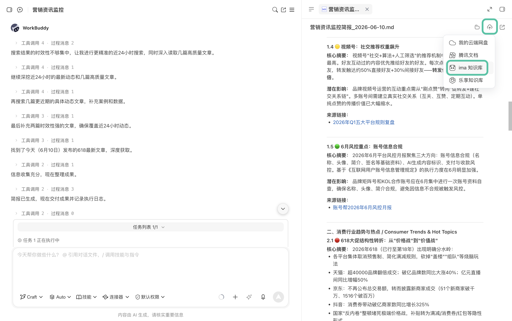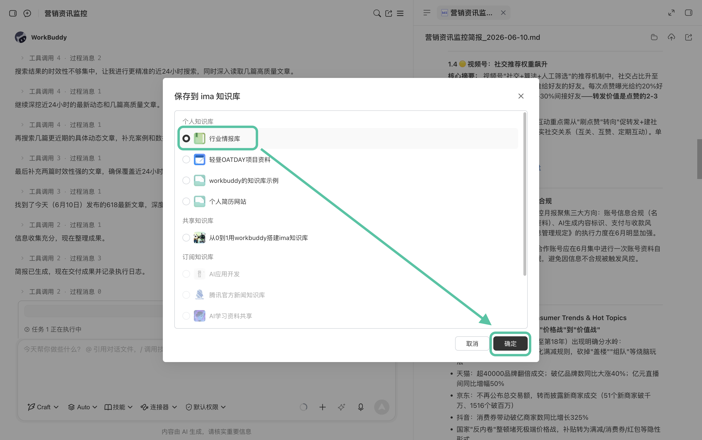

### 汇总客户消息 ​

看完简报后，再通过连接器读取 QQ 中的客户邮件、飞书中的沟通信息。让 WorkBuddy 汇总新消息，找出需要立即处理的事项，并生成今天的工作优先级。

> 请读取昨日至现在，QQ 邮箱中的新增邮件、飞书中的消息。重点标出需要立即回复、可能影响项目进度的内容，并按优先级生成今日待办。


这样，早上得到的不再是一堆待读信息，而是一份可以直接执行的工作安排。

## 二、上午：客户提出新需求，先把变化说清楚 ​

上午的会议中，客户临时调整了项目方向：不仅要修改内容策略，还增加了新的交付要求。

对于 OPC 来说，最危险的不是需求变化，而是还没弄清变化，就直接开始修改方案。

因此，对会议细节的梳理和记录就显得尤为重要。

这时，可以通过腾讯会议连接器，将会议记录导入 WorkBuddy。

WorkBuddy 会把散落在会议中的讨论整理成结构清晰的需求记录。

> 请根据腾讯会议中"新昼 OATDAY 需求修改"这一会议的记录，整理客户的新需求、已确认事项、待确认问题和后续行动。只使用会议中明确提到的信息，不要自行补充。


确认无误后，可以将其保存回对应的 ima 知识库，作为后续工作的最新依据。

## 三、下午：召集专属团队，重新制作并交付 ​

客户确认新方向后，需要在有限时间内重新评估方案、修改报价并完成交付。

这部分可以用一句话概括：ima 提供历史知识，WorkBuddy 负责专业分析并生成交付文件。

### 先从 ima 找回项目资料 ​

修改方案前，先让 WorkBuddy 调用 ima 中的客户背景、历史报价、原始方案和上午保存的会议记录，对比新旧需求。


过去需要在文件夹、聊天记录和文档中反复查找的信息，现在可以被集中调用。

能让你快速判断，哪些是原有范围内的修改，哪些属于新增需求。

### 让专家团共同分析 ​

明确需求变化后，在专家市场中选择适合的预置专家团。

对于品牌与内容增长项目，可以召唤"营销战役团队"，向团长说明客户背景、最新需求和预期成果。

不需要自己挑选团员或拆分任务，团长会自动拆解任务，安排负责内容、活动、SEO 和品牌分析的成员协作，最后汇总交付完整方案。


### 审核与分享产物 ​

专家团完成任务后，可以先检查产物。如需修改，直接通过对话补充要求并调整。

如需分享给他人，可以直接在 WorkBuddy 中进行产物分享。


## 四、晚上：做一次真正有用的复盘 ​

交付完成不代表工作真正结束。

如果不及时整理，今天积累的判断、模板和经验很快就会散落在文件和聊天记录中。下一次遇到类似项目，依然要从头摸索。

晚上，可以让 WorkBuddy 根据当天的会议纪要、方案调整和最终交付文件完成复盘：

> 请复盘今天的项目过程，重点总结有效做法、出现的问题、可以复用的方案模块，以及下次处理类似需求时应该提前确认的事项。内容整理为复盘报告，形成 docx 形式的文档。

最终把复盘报告保存回 ima。这样，今天的工作成果就会成为下一个项目的参考。

## 五、一个人经营，也可以形成团队工作方式 ​

回顾这一天，完整流程是：


WorkBuddy × ima 的价值，并不是替 OPC 做所有决定，而是帮助其减少重复搜索、重复解释和机械制作文件的时间。

你仍然负责客户关系、创意和关键判断，但不必再独自承担每一项具体工作。

## 六、补充：客户隐私怎么处理？ ​

WorkBuddy 非常重视用户个人信息的保护，将按照法律法规规定，保护您的个人信息安全，详请可参见下方链接：

- WorkBuddy 隐私保护指引：腾讯隐私保护平台
- ima.copilot（PC 端）隐私保护指引：腾讯隐私保护平台

必要时先进行脱敏处理，例如删除姓名、手机号、合同金额、内部账号、未公开经营数据等信息，再进行整理和调用。

## ref-www-codebuddy-cn-work

**WorkBuddy - AI Agent 办公新范式**

WorkBuddy 是腾讯云代码助手推出的 AI Agent 办公工具，自主规划并交付多模态复杂任务结果，支持多 Agents 并行工作，极致提效。

> 公开页面仅返回应用外壳或登录入口，没有可读取的正文。

## ref-www-workbuddy-cn

**WorkBuddy - AI Agent 办公新范式**

WorkBuddy 是腾讯云代码助手推出的 AI Agent 办公工具，自主规划并交付多模态复杂任务结果，支持多 Agents 并行工作，极致提效。

> 公开页面仅返回应用外壳或登录入口，没有可读取的正文。
